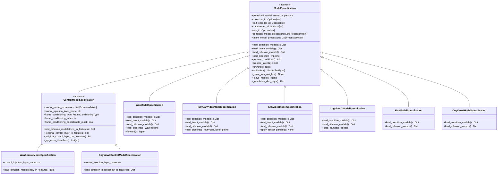
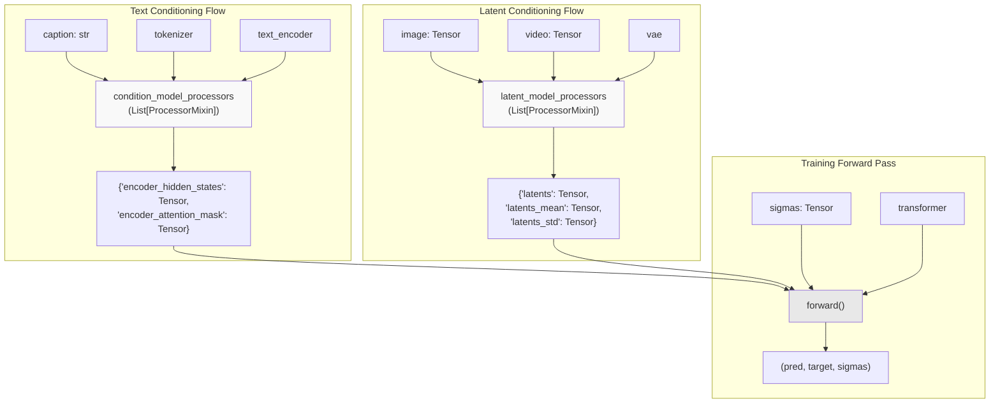
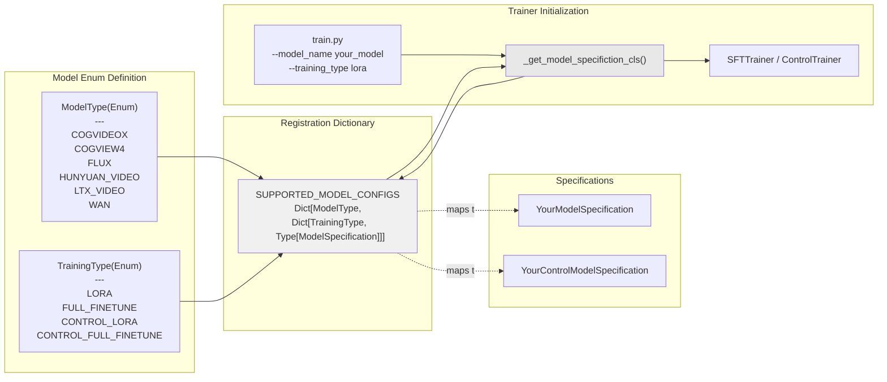
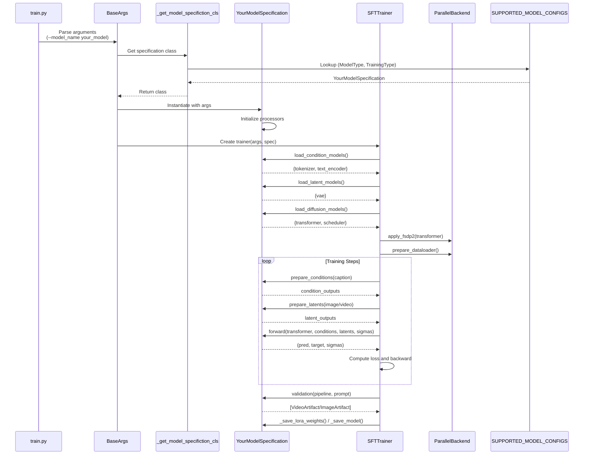

<!-- source: DeepWiki mcp.deepwiki.com · repo huggingface/finetrainers · page 9.1 Adding a New Model · fetched 2026-10-26 -->

# Adding a New Model

<details>
<summary>Relevant source files</summary>

The following files were used as context for generating this wiki page:

- [docs/models/README.md](docs/models/README.md)
- [finetrainers/config.py](finetrainers/config.py)
- [finetrainers/models/cogvideox/base_specification.py](finetrainers/models/cogvideox/base_specification.py)
- [finetrainers/models/cogview4/base_specification.py](finetrainers/models/cogview4/base_specification.py)
- [finetrainers/models/flux/base_specification.py](finetrainers/models/flux/base_specification.py)
- [finetrainers/models/hunyuan_video/base_specification.py](finetrainers/models/hunyuan_video/base_specification.py)
- [finetrainers/models/ltx_video/base_specification.py](finetrainers/models/ltx_video/base_specification.py)
- [finetrainers/models/wan/base_specification.py](finetrainers/models/wan/base_specification.py)
- [finetrainers/models/wan/control_specification.py](finetrainers/models/wan/control_specification.py)
- [finetrainers/parallel/accelerate.py](finetrainers/parallel/accelerate.py)
- [finetrainers/parallel/base.py](finetrainers/parallel/base.py)
- [finetrainers/parallel/ptd.py](finetrainers/parallel/ptd.py)
- [tests/README.md](tests/README.md)
- [tests/models/flux/base_specification.py](tests/models/flux/base_specification.py)

</details>


This document provides a comprehensive guide for implementing support for new diffusion models in finetrainers. It covers the `ModelSpecification` abstraction, required components, processor system, registration process, and advanced features like control training and tensor parallelism.

For information about training existing models, see [Supported Models](#6). For details on the processor system, see [Processors and Data Transforms](#8.3). For architectural context, see [Model Specifications](#3.2).

---

## Overview

Adding a new model to finetrainers requires implementing a `ModelSpecification` subclass that defines how to:
- Load model components (tokenizers, text encoders, VAE, transformer, scheduler)
- Prepare text and image/video conditions for training
- Execute the training forward pass
- Run validation inference
- Save trained weights (LoRA or full model)

All model implementations follow a consistent interface, enabling the training infrastructure to work with any supported architecture without modification.

**When to add a new model:**
- Supporting a new diffusion architecture from Hugging Face Diffusers
- Enabling training for variants of existing models with different components
- Implementing custom architectures that follow the diffusion paradigm

Sources: [finetrainers/models/modeling_utils.py](), [finetrainers/config.py:1-76]()

---

## ModelSpecification Class Hierarchy



**Figure 1: ModelSpecification Class Hierarchy**

The base `ModelSpecification` class defines the interface for standard supervised fine-tuning, while `ControlModelSpecification` extends it for control-conditioned training. Each concrete implementation provides model-specific logic for component loading, conditioning, and training.

Sources: [finetrainers/models/modeling_utils.py](), [finetrainers/models/wan/base_specification.py:210-578](), [finetrainers/models/hunyuan_video/base_specification.py:75-392](), [finetrainers/models/ltx_video/base_specification.py:93-460]()

---

## Step-by-Step Implementation Guide

### Step 1: Create Model Specification File

Create a new file in `finetrainers/models/<model_name>/base_specification.py`. Start with the basic class structure:

```python
from typing import Dict, List, Optional, Any, Tuple
import torch
from diffusers import YourPipeline, YourTransformer, YourVAE, YourScheduler
from transformers import YourTokenizer, YourTextEncoder

from finetrainers.models.modeling_utils import ModelSpecification
from finetrainers.processors import ProcessorMixin

class YourModelSpecification(ModelSpecification):
    def __init__(
        self,
        pretrained_model_name_or_path: str = "org/model-name",
        tokenizer_id: Optional[str] = None,
        text_encoder_id: Optional[str] = None,
        transformer_id: Optional[str] = None,
        vae_id: Optional[str] = None,
        text_encoder_dtype: torch.dtype = torch.bfloat16,
        transformer_dtype: torch.dtype = torch.bfloat16,
        vae_dtype: torch.dtype = torch.bfloat16,
        revision: Optional[str] = None,
        cache_dir: Optional[str] = None,
        condition_model_processors: List[ProcessorMixin] = None,
        latent_model_processors: List[ProcessorMixin] = None,
        **kwargs,
    ) -> None:
        super().__init__(
            pretrained_model_name_or_path=pretrained_model_name_or_path,
            tokenizer_id=tokenizer_id,
            text_encoder_id=text_encoder_id,
            transformer_id=transformer_id,
            vae_id=vae_id,
            text_encoder_dtype=text_encoder_dtype,
            transformer_dtype=transformer_dtype,
            vae_dtype=vae_dtype,
            revision=revision,
            cache_dir=cache_dir,
        )
        
        # Define processors (see Step 2)
        if condition_model_processors is None:
            condition_model_processors = [...]  # Define text processors
        if latent_model_processors is None:
            latent_model_processors = [...]  # Define latent processors
            
        self.condition_model_processors = condition_model_processors
        self.latent_model_processors = latent_model_processors
```

Sources: [finetrainers/models/wan/base_specification.py:210-260](), [finetrainers/models/hunyuan_video/base_specification.py:75-121](), [finetrainers/models/ltx_video/base_specification.py:93-131]()

### Step 2: Implement Component Loading Methods

#### load_condition_models()

Returns a dictionary containing tokenizers and text encoders. Supports overriding individual components via CLI arguments.

```python
def load_condition_models(self) -> Dict[str, torch.nn.Module]:
    common_kwargs = {"revision": self.revision, "cache_dir": self.cache_dir}
    
    # Load tokenizer
    if self.tokenizer_id is not None:
        tokenizer = AutoTokenizer.from_pretrained(self.tokenizer_id, **common_kwargs)
    else:
        tokenizer = YourTokenizer.from_pretrained(
            self.pretrained_model_name_or_path, 
            subfolder="tokenizer", 
            **common_kwargs
        )
    
    # Load text encoder
    if self.text_encoder_id is not None:
        text_encoder = YourTextEncoder.from_pretrained(
            self.text_encoder_id, 
            torch_dtype=self.text_encoder_dtype, 
            **common_kwargs
        )
    else:
        text_encoder = YourTextEncoder.from_pretrained(
            self.pretrained_model_name_or_path,
            subfolder="text_encoder",
            torch_dtype=self.text_encoder_dtype,
            **common_kwargs,
        )
    
    return {"tokenizer": tokenizer, "text_encoder": text_encoder}
```

**Multiple text encoders:** For models with multiple text encoders (e.g., CLIP + T5), return all components with appropriate keys (`tokenizer_2`, `text_encoder_2`, etc.).

Sources: [finetrainers/models/wan/base_specification.py:265-287](), [finetrainers/models/hunyuan_video/base_specification.py:127-173](), [finetrainers/models/flux/base_specification.py:123-169]()

#### load_latent_models()

Returns a dictionary containing the VAE (and optionally other latent-related models like CLIP image encoder).

```python
def load_latent_models(self) -> Dict[str, torch.nn.Module]:
    common_kwargs = {"revision": self.revision, "cache_dir": self.cache_dir}
    
    if self.vae_id is not None:
        vae = YourVAE.from_pretrained(
            self.vae_id, 
            torch_dtype=self.vae_dtype, 
            **common_kwargs
        )
    else:
        vae = YourVAE.from_pretrained(
            self.pretrained_model_name_or_path, 
            subfolder="vae", 
            torch_dtype=self.vae_dtype, 
            **common_kwargs
        )
    
    return {"vae": vae}
```

Sources: [finetrainers/models/wan/base_specification.py:289-311](), [finetrainers/models/hunyuan_video/base_specification.py:175-185](), [finetrainers/models/ltx_video/base_specification.py:161-171]()

#### load_diffusion_models()

Returns a dictionary containing the transformer/UNet and scheduler.

```python
def load_diffusion_models(self) -> Dict[str, torch.nn.Module]:
    common_kwargs = {"revision": self.revision, "cache_dir": self.cache_dir}
    
    if self.transformer_id is not None:
        transformer = YourTransformer.from_pretrained(
            self.transformer_id, 
            torch_dtype=self.transformer_dtype, 
            **common_kwargs
        )
    else:
        transformer = YourTransformer.from_pretrained(
            self.pretrained_model_name_or_path,
            subfolder="transformer",
            torch_dtype=self.transformer_dtype,
            **common_kwargs,
        )
    
    scheduler = YourScheduler()
    
    return {"transformer": transformer, "scheduler": scheduler}
```

Sources: [finetrainers/models/wan/base_specification.py:313-330](), [finetrainers/models/hunyuan_video/base_specification.py:187-204](), [finetrainers/models/ltx_video/base_specification.py:173-190]()

#### load_pipeline()

Creates a Diffusers pipeline for validation inference. Should support VAE memory optimizations and model offloading.

```python
def load_pipeline(
    self,
    tokenizer: Optional[YourTokenizer] = None,
    text_encoder: Optional[YourTextEncoder] = None,
    transformer: Optional[YourTransformer] = None,
    vae: Optional[YourVAE] = None,
    scheduler: Optional[YourScheduler] = None,
    enable_slicing: bool = False,
    enable_tiling: bool = False,
    enable_model_cpu_offload: bool = False,
    training: bool = False,
    **kwargs,
) -> YourPipeline:
    from finetrainers.utils import get_non_null_items, _enable_vae_memory_optimizations
    
    components = {
        "tokenizer": tokenizer,
        "text_encoder": text_encoder,
        "transformer": transformer,
        "vae": vae,
        "scheduler": scheduler,
    }
    components = get_non_null_items(components)
    
    pipe = YourPipeline.from_pretrained(
        self.pretrained_model_name_or_path, 
        **components, 
        revision=self.revision, 
        cache_dir=self.cache_dir
    )
    pipe.text_encoder.to(self.text_encoder_dtype)
    pipe.vae.to(self.vae_dtype)
    
    _enable_vae_memory_optimizations(pipe.vae, enable_slicing, enable_tiling)
    if not training:
        pipe.transformer.to(self.transformer_dtype)
    if enable_model_cpu_offload:
        pipe.enable_model_cpu_offload()
    
    return pipe
```

Sources: [finetrainers/models/wan/base_specification.py:332-380](), [finetrainers/models/hunyuan_video/base_specification.py:206-244](), [finetrainers/models/ltx_video/base_specification.py:192-225]()

### Step 3: Implement Processor-Based Conditioning

#### Define _resolution_dim_keys Property

This property tells the training system which dimensions of your latent tensors correspond to spatial/temporal resolution for bucketing purposes.

```python
@property
def _resolution_dim_keys(self):
    # For video models with [B, C, F, H, W] latents
    return {"latents": (2, 3, 4)}  # Frame, Height, Width dimensions
    
    # For image models with [B, C, H, W] latents
    # return {"latents": (2, 3)}  # Height, Width dimensions
```

Sources: [finetrainers/models/wan/base_specification.py:261-263](), [finetrainers/models/hunyuan_video/base_specification.py:123-125](), [finetrainers/models/cogview4/base_specification.py:135-137]()

#### Create Custom Latent Encoder Processor

Define a `ProcessorMixin` subclass to encode images/videos to latents:

```python
from finetrainers.processors import ProcessorMixin

class YourLatentEncodeProcessor(ProcessorMixin):
    def __init__(self, output_names: List[str]):
        super().__init__()
        self.output_names = output_names
        # output_names typically: ["latents", "latents_mean", "latents_std", ...]
    
    def forward(
        self,
        vae: YourVAE,
        image: Optional[torch.Tensor] = None,
        video: Optional[torch.Tensor] = None,
        generator: Optional[torch.Generator] = None,
        compute_posterior: bool = True,
    ) -> Dict[str, torch.Tensor]:
        device = vae.device
        dtype = vae.dtype
        
        # Convert image to video if needed
        if image is not None:
            video = image.unsqueeze(1)  # Add frame dimension
        
        # Encode to latents
        video = video.to(device=device, dtype=dtype)
        video = video.permute(0, 2, 1, 3, 4).contiguous()  # [B, F, C, H, W] -> [B, C, F, H, W]
        
        if compute_posterior:
            latents = vae.encode(video).latent_dist.sample(generator=generator)
            latents = latents.to(dtype=dtype)
        else:
            # For precomputation, encode to moments without sampling
            moments = vae._encode(video)
            latents = moments.to(dtype=dtype)
        
        # Return outputs matching output_names
        return {
            self.output_names[0]: latents,
            # Additional outputs as needed
        }
```

Sources: [finetrainers/models/wan/base_specification.py:30-81](), [finetrainers/models/hunyuan_video/base_specification.py:28-72](), [finetrainers/models/ltx_video/base_specification.py:32-90]()

#### Implement prepare_conditions() and prepare_latents()

These methods orchestrate the processor pipeline:

```python
@torch.no_grad()
def prepare_conditions(
    self,
    tokenizer: YourTokenizer,
    text_encoder: YourTextEncoder,
    caption: str,
    max_sequence_length: int = 512,
    **kwargs,
) -> Dict[str, Any]:
    conditions = {
        "tokenizer": tokenizer,
        "text_encoder": text_encoder,
        "caption": caption,
        "max_sequence_length": max_sequence_length,
        **kwargs,
    }
    input_keys = set(conditions.keys())
    # Call parent to run condition_model_processors
    conditions = super().prepare_conditions(**conditions)
    # Filter out input keys to return only outputs
    conditions = {k: v for k, v in conditions.items() if k not in input_keys}
    return conditions

@torch.no_grad()
def prepare_latents(
    self,
    vae: YourVAE,
    image: Optional[torch.Tensor] = None,
    video: Optional[torch.Tensor] = None,
    generator: Optional[torch.Generator] = None,
    compute_posterior: bool = True,
    **kwargs,
) -> Dict[str, torch.Tensor]:
    conditions = {
        "vae": vae,
        "image": image,
        "video": video,
        "generator": generator,
        "compute_posterior": compute_posterior,
        **kwargs,
    }
    input_keys = set(conditions.keys())
    # Call parent to run latent_model_processors
    conditions = super().prepare_latents(**conditions)
    # Filter out input keys to return only outputs
    conditions = {k: v for k, v in conditions.items() if k not in input_keys}
    return conditions
```

Sources: [finetrainers/models/wan/base_specification.py:382-431](), [finetrainers/models/hunyuan_video/base_specification.py:246-292](), [finetrainers/models/ltx_video/base_specification.py:227-269]()

### Step 4: Implement Training Forward Pass

The `forward()` method executes one training step. It must:
1. Extract latents from conditions
2. Handle posterior sampling if needed
3. Add noise according to the diffusion schedule
4. Run the transformer forward pass
5. Compute the target for loss calculation

```python
def forward(
    self,
    transformer: YourTransformer,
    condition_model_conditions: Dict[str, torch.Tensor],
    latent_model_conditions: Dict[str, torch.Tensor],
    sigmas: torch.Tensor,
    generator: Optional[torch.Generator] = None,
    compute_posterior: bool = True,
    **kwargs,
) -> Tuple[torch.Tensor, ...]:
    import finetrainers.functional as FF
    
    # Extract latents
    if compute_posterior:
        latents = latent_model_conditions.pop("latents")
    else:
        # Sample from moments for precomputed latents
        from diffusers.models.autoencoders.vae import DiagonalGaussianDistribution
        posterior = DiagonalGaussianDistribution(latent_model_conditions.pop("latents"))
        latents = posterior.sample(generator=generator)
        del posterior
    
    # Apply scaling (model-specific)
    latents = latents * self.vae_config.scaling_factor
    
    # Add noise
    noise = torch.zeros_like(latents).normal_(generator=generator)
    noisy_latents = FF.flow_match_xt(latents, noise, sigmas)
    # OR for DDIM/epsilon prediction:
    # timesteps = (sigmas.flatten() * 1000.0).long()
    # noisy_latents = scheduler.add_noise(latents, noise, timesteps)
    
    # Prepare inputs
    timesteps = (sigmas.flatten() * 1000.0).long()
    latent_model_conditions["hidden_states"] = noisy_latents.to(latents)
    
    # Forward pass
    pred = transformer(
        **latent_model_conditions,
        **condition_model_conditions,
        timestep=timesteps,
        return_dict=False,
    )[0]
    
    # Compute target
    target = FF.flow_match_target(noise, latents)
    # OR for epsilon prediction:
    # target = noise
    
    return pred, target, sigmas
```

**Key considerations:**
- **Flow matching vs epsilon prediction:** Use `FF.flow_match_xt()` and `FF.flow_match_target()` for flow-based models, or `scheduler.add_noise()` for DDIM-style models
- **Packing/unpacking:** Some models (LTX, Flux) require packing latents into patches before forward pass
- **Additional embeddings:** Some models need guidance embeddings, rotary positional embeddings, or image IDs

Sources: [finetrainers/models/wan/base_specification.py:433-493](), [finetrainers/models/hunyuan_video/base_specification.py:294-330](), [finetrainers/models/ltx_video/base_specification.py:271-345](), [finetrainers/models/cogvideox/base_specification.py:258-333]()

### Step 5: Implement Validation

The `validation()` method generates samples during training for monitoring:

```python
def validation(
    self,
    pipeline: YourPipeline,
    prompt: str,
    height: Optional[int] = None,
    width: Optional[int] = None,
    num_frames: Optional[int] = None,
    num_inference_steps: int = 50,
    generator: Optional[torch.Generator] = None,
    **kwargs,
) -> List[ArtifactType]:
    from finetrainers.utils import get_non_null_items
    from finetrainers.data import VideoArtifact  # or ImageArtifact
    
    generation_kwargs = {
        "prompt": prompt,
        "height": height,
        "width": width,
        "num_frames": num_frames,
        "num_inference_steps": num_inference_steps,
        "generator": generator,
        "return_dict": True,
        "output_type": "pil",
    }
    generation_kwargs = get_non_null_items(generation_kwargs)
    
    # Generate
    output = pipeline(**generation_kwargs)
    
    # Return as artifact
    return [VideoArtifact(value=output.frames[0])]
    # OR for images: [ImageArtifact(value=output.images[0])]
```

Sources: [finetrainers/models/wan/base_specification.py:495-529](), [finetrainers/models/hunyuan_video/base_specification.py:332-355](), [finetrainers/models/ltx_video/base_specification.py:347-377]()

### Step 6: Implement Weight Saving

#### _save_lora_weights()

Saves LoRA adapter weights after training:

```python
def _save_lora_weights(
    self,
    directory: str,
    transformer_state_dict: Optional[Dict[str, torch.Tensor]] = None,
    scheduler: Optional[SchedulerType] = None,
    metadata: Optional[Dict[str, str]] = None,
    *args,
    **kwargs,
) -> None:
    import functools
    import os
    from finetrainers.utils import safetensors_torch_save_function
    
    if transformer_state_dict is not None:
        YourPipeline.save_lora_weights(
            directory,
            transformer_state_dict,
            save_function=functools.partial(safetensors_torch_save_function, metadata=metadata),
            safe_serialization=True,
        )
    if scheduler is not None:
        scheduler.save_pretrained(os.path.join(directory, "scheduler"))
```

Sources: [finetrainers/models/wan/base_specification.py:531-553](), [finetrainers/models/hunyuan_video/base_specification.py:357-375]()

#### _save_model()

Saves full model weights after training:

```python
def _save_model(
    self,
    directory: str,
    transformer: YourTransformer,
    transformer_state_dict: Optional[Dict[str, torch.Tensor]] = None,
    scheduler: Optional[SchedulerType] = None,
) -> None:
    import os
    from accelerate import init_empty_weights
    
    if transformer_state_dict is not None:
        # Create empty model and load weights
        with init_empty_weights():
            transformer_copy = YourTransformer.from_config(transformer.config)
        transformer_copy.load_state_dict(transformer_state_dict, strict=True, assign=True)
        transformer_copy.save_pretrained(os.path.join(directory, "transformer"))
    if scheduler is not None:
        scheduler.save_pretrained(os.path.join(directory, "scheduler"))
```

Sources: [finetrainers/models/wan/base_specification.py:554-568](), [finetrainers/models/hunyuan_video/base_specification.py:377-391]()

---

## Required Methods and Properties

| Method/Property | Required | Purpose |
|----------------|----------|---------|
| `__init__()` | Yes | Initialize processors and configuration |
| `load_condition_models()` | Yes | Load tokenizers and text encoders |
| `load_latent_models()` | Yes | Load VAE and related models |
| `load_diffusion_models()` | Yes | Load transformer and scheduler |
| `load_pipeline()` | Yes | Create inference pipeline |
| `prepare_conditions()` | Yes | Process text conditions |
| `prepare_latents()` | Yes | Encode images/videos to latents |
| `forward()` | Yes | Execute training forward pass |
| `validation()` | Yes | Generate validation samples |
| `_save_lora_weights()` | Yes | Save LoRA weights |
| `_save_model()` | Yes | Save full model |
| `_resolution_dim_keys` | Yes | Define resolution dimensions |
| `apply_tensor_parallel()` | No | Custom tensor parallelism (optional) |
| Model-specific helpers | No | E.g., `_pack_latents()`, `_normalize_latents()` |

Sources: [finetrainers/models/modeling_utils.py](), [finetrainers/models/wan/base_specification.py](), [finetrainers/models/ltx_video/base_specification.py]()

---

## Processor System Integration



**Figure 2: Processor Pipeline Flow**

Processors are composable units that transform inputs to outputs. The `condition_model_processors` handle text encoding, while `latent_model_processors` handle image/video encoding. Both pipelines feed into the `forward()` method.

**Built-in processors:**
- `T5Processor` - Encodes text using T5 models
- `CLIPPooledProcessor` - Encodes text using CLIP with pooled output
- `LlamaProcessor` - Encodes text using Llama models
- `CogView4GLMProcessor` - Encodes text using GLM models

**Creating custom processors:**

```python
from finetrainers.processors import ProcessorMixin

class CustomProcessor(ProcessorMixin):
    def __init__(self, output_names: List[str], **kwargs):
        super().__init__()
        self.output_names = output_names
        # Store any configuration
        
    def forward(self, **inputs) -> Dict[str, torch.Tensor]:
        # Process inputs
        # Return dict with keys matching output_names
        return {self.output_names[0]: result}
```

**Processor output naming:**
- Regular names (e.g., `"latents"`) are included in outputs
- `"__drop__"` indicates the output should be discarded
- Outputs are accumulated across all processors

Sources: [finetrainers/processors/](), [finetrainers/models/wan/base_specification.py:30-81](), [finetrainers/models/wan/base_specification.py:242-259]()

---

## Model Registration



**Figure 3: Model Registration Flow**

### Step 1: Add Model to Enums

Edit [finetrainers/config.py:13-30]():

```python
class ModelType(str, Enum):
    COGVIDEOX = "cogvideox"
    COGVIEW4 = "cogview4"
    FLUX = "flux"
    HUNYUAN_VIDEO = "hunyuan_video"
    LTX_VIDEO = "ltx_video"
    WAN = "wan"
    YOUR_MODEL = "your_model"  # Add your model

class TrainingType(str, Enum):
    # SFT
    LORA = "lora"
    FULL_FINETUNE = "full-finetune"
    # Control
    CONTROL_LORA = "control-lora"
    CONTROL_FULL_FINETUNE = "control-full-finetune"
```

### Step 2: Register in SUPPORTED_MODEL_CONFIGS

Edit [finetrainers/config.py:32-63]():

```python
SUPPORTED_MODEL_CONFIGS = {
    # ... existing models ...
    ModelType.YOUR_MODEL: {
        TrainingType.LORA: YourModelSpecification,
        TrainingType.FULL_FINETUNE: YourModelSpecification,
        # If you support control training:
        # TrainingType.CONTROL_LORA: YourControlModelSpecification,
        # TrainingType.CONTROL_FULL_FINETUNE: YourControlModelSpecification,
    },
}
```

### Step 3: Import Your Specification

Add import at top of [finetrainers/config.py:1-11]():

```python
from .models.your_model import YourModelSpecification, YourControlModelSpecification
```

### Step 4: Update __init__.py

Ensure your models are exported from [finetrainers/models/__init__.py]():

```python
from .your_model import YourModelSpecification, YourControlModelSpecification
```

Sources: [finetrainers/config.py:1-76]()

---

## Training Flow with New Model



**Figure 4: Training Execution Sequence**

This sequence shows how the trainer orchestrates the model specification to execute training. The specification is responsible only for model-specific logic; the trainer handles distributed training, optimization, and checkpointing.

Sources: [finetrainers/trainer/sft_trainer/sft_trainer.py](), [finetrainers/config.py:66-76]()

---

## Control Training Support

To support control training (conditional generation with additional control signals), create a `ControlModelSpecification` subclass:

```python
from finetrainers.models.modeling_utils import ControlModelSpecification

class YourControlModelSpecification(ControlModelSpecification):
    def __init__(
        self,
        pretrained_model_name_or_path: str = "org/model-name",
        # ... same as base specification ...
        control_model_processors: List[ProcessorMixin] = None,
        **kwargs,
    ) -> None:
        super().__init__(
            pretrained_model_name_or_path=pretrained_model_name_or_path,
            # ... pass through other args ...
        )
        
        # Define control processors
        if control_model_processors is None:
            control_model_processors = [YourControlLatentProcessor(...)]
        
        self.condition_model_processors = condition_model_processors
        self.latent_model_processors = latent_model_processors
        self.control_model_processors = control_model_processors
    
    @property
    def control_injection_layer_name(self) -> str:
        # Name of the layer where control channels are concatenated
        return "patch_embedding"  # or "conv_in", etc.
    
    def load_diffusion_models(self, new_in_features: int) -> Dict[str, torch.nn.Module]:
        # Load base model
        transformer = # ... load transformer ...
        
        # Expand input layer to accept control channels
        from finetrainers.models.utils import _expand_conv3d_with_zeroed_weights
        transformer.patch_embedding = _expand_conv3d_with_zeroed_weights(
            transformer.patch_embedding, 
            new_in_channels=new_in_features
        )
        transformer.register_to_config(in_channels=new_in_features)
        
        scheduler = YourScheduler()
        return {"transformer": transformer, "scheduler": scheduler}
    
    def forward(
        self,
        transformer: YourTransformer,
        condition_model_conditions: Dict[str, torch.Tensor],
        latent_model_conditions: Dict[str, torch.Tensor],
        sigmas: torch.Tensor,
        **kwargs,
    ) -> Tuple[torch.Tensor, ...]:
        # Extract both regular and control latents
        latents = latent_model_conditions.pop("latents")
        control_latents = latent_model_conditions.pop("control_latents")
        
        # Process latents
        noise = torch.zeros_like(latents).normal_()
        noisy_latents = FF.flow_match_xt(latents, noise, sigmas)
        
        # Concatenate control latents
        noisy_latents = torch.cat([noisy_latents, control_latents], dim=1)
        
        # Forward pass with concatenated input
        latent_model_conditions["hidden_states"] = noisy_latents
        pred = transformer(**latent_model_conditions, **condition_model_conditions, ...)[0]
        target = FF.flow_match_target(noise, latents)
        
        return pred, target, sigmas
```

**Key control training methods:**

| Method | Purpose |
|--------|---------|
| `control_injection_layer_name` | Identifies which layer has expanded input channels |
| `load_diffusion_models(new_in_features)` | Loads model with expanded input layer |
| `control_model_processors` | Processors for encoding control signals |
| `_original_control_layer_in_features` | Original number of input channels |
| `_original_control_layer_out_features` | Output features of control layer |
| `_qk_norm_identifiers` | Names of norm layers to expand for LoRA |

Sources: [finetrainers/models/wan/control_specification.py:36-438](), [finetrainers/models/modeling_utils.py]()

---

## Advanced Features

### Tensor Parallelism

For large models, implement custom tensor parallelism by overriding `apply_tensor_parallel()`:

```python
def apply_tensor_parallel(
    self,
    backend: ParallelBackendEnum,
    device_mesh: torch.distributed.DeviceMesh,
    transformer: YourTransformer,
    **kwargs,
) -> None:
    if backend == ParallelBackendEnum.PTD:
        from torch.distributed.tensor.parallel import parallelize_module
        from torch.distributed.tensor.parallel.style import ColwiseParallel, RowwiseParallel
        
        # Define parallelization plan
        plan = {}
        for block in transformer.transformer_blocks:
            block_plan = {
                "ff.net.0.proj": ColwiseParallel(),
                "ff.net.2": RowwiseParallel(),
            }
            parallelize_module(block, device_mesh, block_plan)
        
        parallelize_module(transformer, device_mesh, plan)
    else:
        raise NotImplementedError(f"Backend {backend} not supported")
```

Sources: [finetrainers/models/ltx_video/base_specification.py:415-460]()

### Model-Specific Preprocessing

Some models require special preprocessing (e.g., packing, normalization):

```python
@staticmethod
def _normalize_latents(
    latents: torch.Tensor, 
    latents_mean: torch.Tensor, 
    latents_std: torch.Tensor
) -> torch.Tensor:
    latents_mean = latents_mean.view(1, -1, 1, 1, 1).to(device=latents.device)
    latents_std = latents_std.view(1, -1, 1, 1, 1).to(device=latents.device)
    latents = ((latents.float() - latents_mean) * latents_std).to(latents)
    return latents

@staticmethod
def _pack_latents(latents: torch.Tensor, patch_size: int, patch_size_t: int) -> torch.Tensor:
    # Reshape [B, C, F, H, W] to [B, num_patches, patch_dim]
    batch_size, num_channels, num_frames, height, width = latents.shape
    post_patch_num_frames = num_frames // patch_size_t
    post_patch_height = height // patch_size
    post_patch_width = width // patch_size
    
    latents = latents.reshape(
        batch_size, -1, post_patch_num_frames, patch_size_t,
        post_patch_height, patch_size, post_patch_width, patch_size,
    )
    latents = latents.permute(0, 2, 4, 6, 1, 3, 5, 7).flatten(4, 7).flatten(1, 3)
    return latents
```

Sources: [finetrainers/models/wan/base_specification.py:570-577](), [finetrainers/models/ltx_video/base_specification.py:427-459]()

---

## Testing Your Implementation

### Step 1: Create Test Specification

Create a test file using a small model from Hugging Face:

```python
# tests/models/your_model/base_specification.py
from finetrainers.models.your_model import YourModelSpecification

class DummyYourModelSpecification(YourModelSpecification):
    def __init__(self, **kwargs):
        super().__init__(
            pretrained_model_name_or_path="hf-internal-testing/tiny-your-model",
            **kwargs
        )
```

Sources: [tests/models/flux/base_specification.py:1-6]()

### Step 2: Add to Trainer Tests

Add your model to the parametrized tests in [tests/trainer/test_sft_trainer.py]().

### Step 3: Manual Testing

Test with a small training run:

```bash
# Accelerate backend (single GPU)
accelerate launch --config_file accelerate_configs/uncompiled_1.yaml train.py \
    --model_name your_model \
    --training_type lora \
    --pretrained_model_name_or_path "org/model-name" \
    --dataset_file "your_dataset.csv" \
    --output_dir "outputs" \
    --rank 8 \
    --num_train_steps 100

# PTD backend (multi-GPU)
torchrun --nnodes=1 --nproc_per_node 2 train.py \
    --model_name your_model \
    --training_type lora \
    --parallel_backend ptd \
    --dp_degree 2 \
    --dataset_file "your_dataset.csv" \
    --output_dir "outputs"
```

### Step 4: Validation Testing

Ensure validation works:

```bash
python train.py \
    --model_name your_model \
    --training_type lora \
    --dataset_file "train.csv" \
    --validation_dataset_file "val.csv" \
    --validation_steps 50 \
    --output_dir "outputs"
```

Sources: [tests/README.md:1-54](), [docs/models/README.md:1-64]()

---

## Complete Implementation Checklist

### Core Requirements
- [ ] Create `finetrainers/models/<model_name>/base_specification.py`
- [ ] Implement `YourModelSpecification` class inheriting from `ModelSpecification`
- [ ] Define `__init__()` with processor initialization
- [ ] Implement `load_condition_models()` returning tokenizers/text encoders
- [ ] Implement `load_latent_models()` returning VAE
- [ ] Implement `load_diffusion_models()` returning transformer/scheduler
- [ ] Implement `load_pipeline()` creating inference pipeline
- [ ] Define `_resolution_dim_keys` property
- [ ] Create custom latent encoder processor
- [ ] Implement `prepare_conditions()` method
- [ ] Implement `prepare_latents()` method
- [ ] Implement `forward()` training method
- [ ] Implement `validation()` generation method
- [ ] Implement `_save_lora_weights()` method
- [ ] Implement `_save_model()` method

### Registration
- [ ] Add model to `ModelType` enum in [finetrainers/config.py]()
- [ ] Add to `SUPPORTED_MODEL_CONFIGS` dictionary
- [ ] Import specification in [finetrainers/config.py]()
- [ ] Export from [finetrainers/models/__init__.py]()

### Control Training (Optional)
- [ ] Create `YourControlModelSpecification` inheriting from `ControlModelSpecification`
- [ ] Define `control_injection_layer_name` property
- [ ] Implement `load_diffusion_models(new_in_features)` with expanded input layer
- [ ] Define `control_model_processors`
- [ ] Override `forward()` to concatenate control latents
- [ ] Override `validation()` for control-conditioned inference

### Testing
- [ ] Create test specification with tiny model
- [ ] Add to trainer test suite
- [ ] Test single GPU training
- [ ] Test multi-GPU training (if applicable)
- [ ] Test validation generation
- [ ] Test checkpointing and resumption
- [ ] Test LoRA and full finetuning modes

### Documentation
- [ ] Add model documentation to [docs/models/]()
- [ ] Include training command examples
- [ ] Document memory requirements
- [ ] Add inference examples
- [ ] Update [docs/models/README.md]() support matrix

Sources: [finetrainers/models/](), [finetrainers/config.py](), [tests/](), [docs/models/]()

---

## Common Patterns and Best Practices

### 1. Dtype Consistency

Always ensure dtypes are consistent across components:

```python
pipe.text_encoder.to(self.text_encoder_dtype)
pipe.vae.to(self.vae_dtype)
if not training:
    pipe.transformer.to(self.transformer_dtype)
```

Sources: [finetrainers/models/wan/base_specification.py:366-371]()

### 2. Memory Optimizations

Enable VAE memory optimizations in `load_pipeline()`:

```python
from finetrainers.utils import _enable_vae_memory_optimizations

_enable_vae_memory_optimizations(pipe.vae, enable_slicing, enable_tiling)
if enable_model_cpu_offload:
    pipe.enable_model_cpu_offload()
```

Sources: [finetrainers/utils/](), [finetrainers/models/hunyuan_video/base_specification.py:239-243]()

### 3. Optional Component Override

Support overriding components via CLI arguments:

```python
if self.tokenizer_id is not None:
    tokenizer = AutoTokenizer.from_pretrained(self.tokenizer_id, **common_kwargs)
else:
    tokenizer = DefaultTokenizer.from_pretrained(
        self.pretrained_model_name_or_path, 
        subfolder="tokenizer", 
        **common_kwargs
    )
```

Sources: [finetrainers/models/wan/base_specification.py:268-273](), [docs/models/README.md:38-44]()

### 4. Processor Output Filtering

Filter input keys from processor outputs to avoid passing them to the model:

```python
input_keys = set(conditions.keys())
conditions = super().prepare_conditions(**conditions)
conditions = {k: v for k, v in conditions.items() if k not in input_keys}
return conditions
```

Sources: [finetrainers/models/wan/base_specification.py:398-401]()

### 5. Safe State Dict Loading

Use `assign=True` when loading state dicts to avoid memory copies:

```python
with init_empty_weights():
    transformer_copy = YourTransformer.from_config(transformer.config)
transformer_copy.load_state_dict(transformer_state_dict, strict=True, assign=True)
```

Sources: [finetrainers/models/wan/base_specification.py:563-565]()

---

This guide provides a complete reference for adding new models to finetrainers. For specific examples, refer to the existing model implementations in [finetrainers/models/](). For training configuration details, see [Configuration System](#3.3). For processor implementation details, see [Processors and Data Transforms](#8.3).

---

