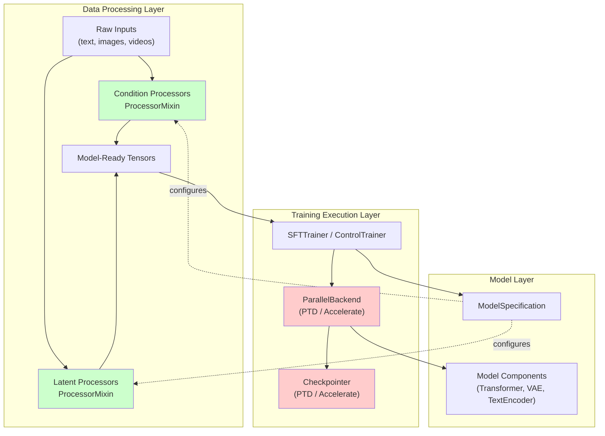
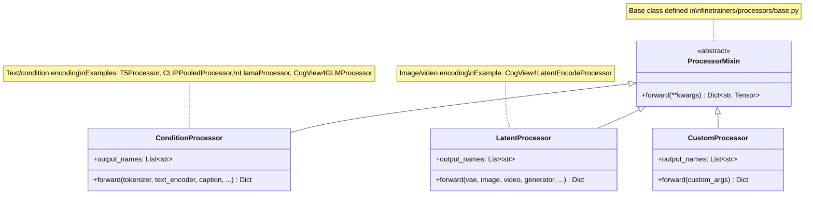
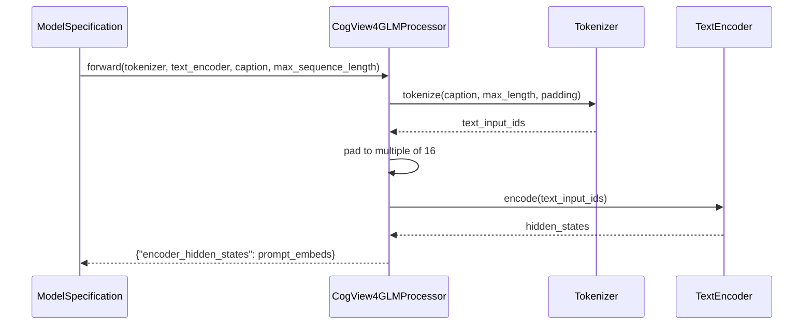
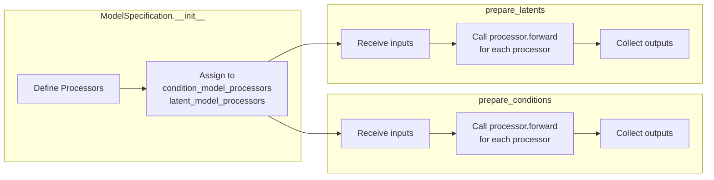
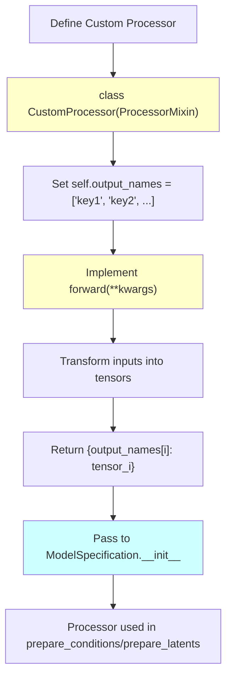
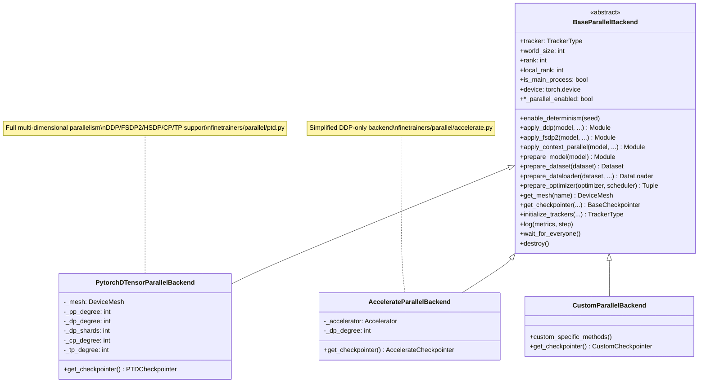
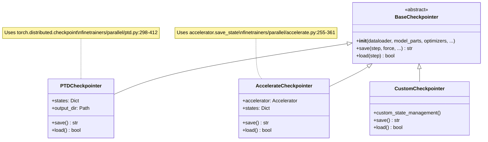
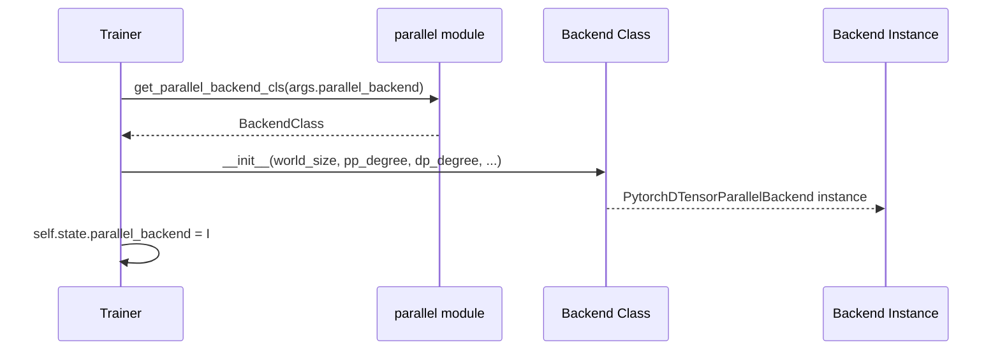
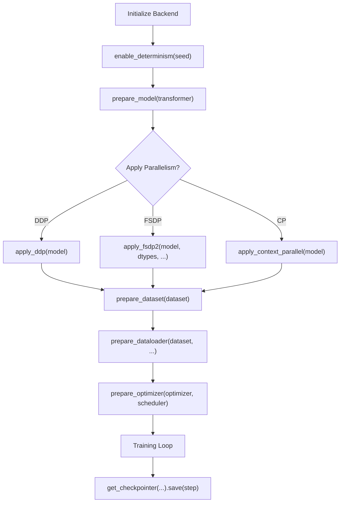
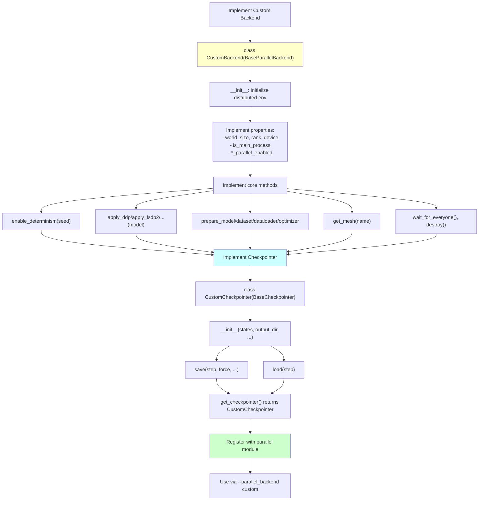

<!-- source: DeepWiki mcp.deepwiki.com · repo huggingface/finetrainers · page 9.2 Custom Processors and Backends · fetched 2026-10-26 -->

# Custom Processors and Backends

<details>
<summary>Relevant source files</summary>

The following files were used as context for generating this wiki page:

- [docs/environment.md](docs/environment.md)
- [docs/models/attention.md](docs/models/attention.md)
- [examples/training/sft/cogview4/raider_white_tarot/training.json](examples/training/sft/cogview4/raider_white_tarot/training.json)
- [examples/training/sft/cogview4/raider_white_tarot/validation.json](examples/training/sft/cogview4/raider_white_tarot/validation.json)
- [finetrainers/constants.py](finetrainers/constants.py)
- [finetrainers/functional/image.py](finetrainers/functional/image.py)
- [finetrainers/functional/video.py](finetrainers/functional/video.py)
- [finetrainers/models/__init__.py](finetrainers/models/__init__.py)
- [finetrainers/models/attention_dispatch.py](finetrainers/models/attention_dispatch.py)
- [finetrainers/models/cogview4/__init__.py](finetrainers/models/cogview4/__init__.py)
- [finetrainers/models/cogview4/base_specification.py](finetrainers/models/cogview4/base_specification.py)
- [finetrainers/parallel/accelerate.py](finetrainers/parallel/accelerate.py)
- [finetrainers/parallel/base.py](finetrainers/parallel/base.py)
- [finetrainers/parallel/ptd.py](finetrainers/parallel/ptd.py)
- [finetrainers/patches/__init__.py](finetrainers/patches/__init__.py)
- [finetrainers/processors/__init__.py](finetrainers/processors/__init__.py)
- [finetrainers/processors/glm.py](finetrainers/processors/glm.py)
- [finetrainers/trainer/base.py](finetrainers/trainer/base.py)
- [tests/README.md](tests/README.md)

</details>


This document explains how to extend finetrainers by implementing custom processors and parallel backends. Custom processors enable specialized data transformation logic for condition and latent encoding, while custom backends allow integration of new distributed training strategies.

For guidance on adding complete model support, see [Adding a New Model](#9.1). For general development practices, see [Development Workflow](#9.3).

---

## Overview

Finetrainers provides two primary extension points for customizing data processing and distributed training:

- **Processors**: Lightweight transformation modules that convert raw inputs (text, images, videos) into model-ready tensors. They implement the `ProcessorMixin` interface and are used in both condition and latent preparation pipelines.
- **Backends**: Distributed training abstractions that encapsulate parallelism strategies (DDP, FSDP2, CP, TP) and checkpointing logic. They implement the `BaseParallelBackend` interface.

**Architecture Context**



Sources: [finetrainers/processors/__init__.py](), [finetrainers/parallel/base.py](), [finetrainers/models/cogview4/base_specification.py]()

---

## Custom Processors

### ProcessorMixin Interface

All processors inherit from `ProcessorMixin` and implement a `forward` method that performs data transformations. Processors are stateless and device-agnostic—they receive model components and inputs, then return dictionaries of tensors.

**Core Interface**



Sources: [finetrainers/processors/__init__.py](), [finetrainers/processors/glm.py]()

### Implementation Pattern

**Step 1: Define Output Names**

Processors declare `output_names` to specify the keys in their return dictionary. This enables ModelSpecification to automatically map processor outputs to the correct model inputs.

```python
# Example from CogView4GLMProcessor
output_names = ["encoder_hidden_states"]
```

**Step 2: Implement Forward Method**

The `forward` method signature should match the inputs it needs. Common patterns:

| Processor Type | Typical Inputs | Return Keys |
|---|---|---|
| Text Encoder | `tokenizer`, `text_encoder`, `caption`, `max_sequence_length` | `encoder_hidden_states`, `attention_mask` |
| Latent Encoder | `vae`, `image`, `video`, `generator`, `compute_posterior` | `latents`, `original_size`, `target_size` |
| Control Signal | `image`, `control_type` (e.g., canny) | `control_image`, `controlnet_cond` |

**Example: Text Encoding Processor**



Sources: [finetrainers/processors/glm.py:1-75]()

### Implementation Examples

**Text Processor: CogView4GLMProcessor**

[finetrainers/processors/glm.py:9-75]() demonstrates a complete text encoding processor:

```python
class CogView4GLMProcessor(ProcessorMixin):
    def __init__(self, output_names: List[str]):
        super().__init__()
        self.output_names = output_names
        assert len(self.output_names) == 1
    
    def forward(
        self,
        tokenizer: AutoTokenizer,
        text_encoder: GlmModel,
        caption: Union[str, List[str]],
        max_sequence_length: int,
    ) -> Dict[str, torch.Tensor]:
        # Convert to list if needed
        if isinstance(caption, str):
            caption = [caption]
        
        # Tokenize
        text_inputs = tokenizer(
            caption,
            padding="longest",
            max_length=max_sequence_length,
            truncation=True,
            add_special_tokens=True,
            return_tensors="pt",
        )
        text_input_ids = text_inputs.input_ids.to(text_encoder.device)
        
        # Pad to multiple of 16 (model-specific requirement)
        current_length = text_input_ids.size(1)
        pad_length = 16 - current_length % 16
        if pad_length > 0:
            pad_ids = text_input_ids.new_full(
                (text_input_ids.shape[0], pad_length), 
                fill_value=tokenizer.pad_token_id
            )
            text_input_ids = torch.cat([pad_ids, text_input_ids], dim=1)
        
        # Encode
        prompt_embeds = text_encoder(
            text_input_ids, 
            output_hidden_states=True
        ).hidden_states[-2]
        
        return {self.output_names[0]: prompt_embeds}
```

**Latent Processor: CogView4LatentEncodeProcessor**

[finetrainers/models/cogview4/base_specification.py:28-93]() demonstrates a latent encoding processor:

```python
class CogView4LatentEncodeProcessor(ProcessorMixin):
    def __init__(self, output_names: List[str]):
        super().__init__()
        self.output_names = output_names
        assert len(self.output_names) == 4
    
    def forward(
        self,
        vae: AutoencoderKL,
        image: Optional[torch.Tensor] = None,
        video: Optional[torch.Tensor] = None,
        generator: Optional[torch.Generator] = None,
        compute_posterior: bool = True,
        _original_height: Optional[int] = None,
        _original_width: Optional[int] = None,
    ) -> Dict[str, torch.Tensor]:
        # Handle video input by extracting first frame
        if video is not None:
            image = video[:, 0]
        
        # Encode with VAE
        if compute_posterior:
            latents = vae.encode(image).latent_dist.sample(generator)
        else:
            moments = vae._encode(image)
            latents = moments
        
        # Prepare auxiliary data
        batch_size = latents.size(0)
        original_size = torch.tensor(
            [(_original_height, _original_width)], 
            device=vae.device
        ).repeat(batch_size, 1)
        target_size = torch.tensor(
            [(image.size(2), image.size(3))], 
            device=vae.device
        ).repeat(batch_size, 1)
        crop_coords = torch.zeros_like(target_size)
        
        return {
            self.output_names[0]: latents,
            self.output_names[1]: original_size,
            self.output_names[2]: target_size,
            self.output_names[3]: crop_coords,
        }
```

Sources: [finetrainers/models/cogview4/base_specification.py:28-93]()

### Integration with ModelSpecification

Processors are instantiated and used by ModelSpecification classes:



**Integration Code Example**

From [finetrainers/models/cogview4/base_specification.py:95-134]():

```python
class CogView4ModelSpecification(ModelSpecification):
    def __init__(
        self,
        condition_model_processors: List[ProcessorMixin] = None,
        latent_model_processors: List[ProcessorMixin] = None,
        **kwargs,
    ):
        super().__init__(**kwargs)
        
        # Set default processors if not provided
        if condition_model_processors is None:
            condition_model_processors = [
                CogView4GLMProcessor(["encoder_hidden_states"])
            ]
        if latent_model_processors is None:
            latent_model_processors = [
                CogView4LatentEncodeProcessor([
                    "latents", "original_size", "target_size", "crop_coords"
                ])
            ]
        
        self.condition_model_processors = condition_model_processors
        self.latent_model_processors = latent_model_processors
```

The ModelSpecification base class automatically invokes processors in `prepare_conditions` and `prepare_latents` methods, merging their outputs into dictionaries that are passed to the model's `forward` method.

Sources: [finetrainers/models/cogview4/base_specification.py:95-277]()

### Creating Custom Processors

**Workflow Diagram**



**Example: Custom Caption Preprocessor**

```python
from typing import List, Dict
import torch
from finetrainers.processors import ProcessorMixin

class CustomCaptionProcessor(ProcessorMixin):
    """Example processor that adds a prefix to captions."""
    
    def __init__(self, output_names: List[str], prefix: str = "[CUSTOM]"):
        super().__init__()
        self.output_names = output_names
        self.prefix = prefix
    
    def forward(
        self,
        tokenizer,
        text_encoder,
        caption: str,
        max_sequence_length: int,
    ) -> Dict[str, torch.Tensor]:
        # Preprocess caption
        if isinstance(caption, str):
            caption = [caption]
        caption = [f"{self.prefix} {c}" for c in caption]
        
        # Tokenize and encode
        inputs = tokenizer(
            caption,
            max_length=max_sequence_length,
            padding="max_length",
            truncation=True,
            return_tensors="pt",
        ).to(text_encoder.device)
        
        embeddings = text_encoder(**inputs).last_hidden_state
        
        return {self.output_names[0]: embeddings}
```

**Using the Custom Processor**

```python
from finetrainers.models import ModelSpecification

class CustomModelSpecification(ModelSpecification):
    def __init__(self, **kwargs):
        super().__init__(**kwargs)
        
        # Use custom processor
        self.condition_model_processors = [
            CustomCaptionProcessor(
                output_names=["encoder_hidden_states"],
                prefix="[CUSTOM_STYLE]"
            )
        ]
```

Sources: [finetrainers/processors/__init__.py:1-24](), [finetrainers/models/cogview4/base_specification.py:125-133]()

---

## Custom Backends

### BaseParallelBackend Interface

The `BaseParallelBackend` class defines the contract for distributed training backends. It abstracts parallelism strategies (DDP, FSDP, CP, TP), device management, checkpointing, and logging.

**Core Interface**

| Method/Property | Purpose | Implementations Required |
|---|---|---|
| `enable_determinism(seed)` | Set random seeds across all devices | ✓ |
| `apply_ddp(model, ...)` | Apply Data Distributed Parallelism | ✓ |
| `apply_fsdp2(model, ...)` | Apply Fully Sharded Data Parallelism | ✓ |
| `apply_context_parallel(model, ...)` | Apply Context/Sequence Parallelism | ✓ |
| `prepare_model(model)` | Finalize model preparation | ✓ |
| `prepare_dataset(dataset)` | Shard dataset across ranks | ✓ |
| `prepare_dataloader(dataset, ...)` | Create distributed dataloader | ✓ |
| `prepare_optimizer(optimizer, scheduler)` | Prepare optimizer for distributed training | ✓ |
| `get_mesh(name)` | Get DeviceMesh for specific parallelism | ✓ |
| `get_checkpointer(...)` | Instantiate checkpointer | ✓ |
| `initialize_trackers(...)` | Setup logging/tracking | Inherited |
| `log(metrics, step)` | Log metrics | Inherited |
| `wait_for_everyone()` | Synchronization barrier | ✓ |
| `destroy()` | Cleanup resources | ✓ |
| `world_size`, `rank`, `local_rank` | Distributed properties | ✓ |
| `is_main_process`, `is_local_main_process` | Process identification | ✓ |
| `device` | Current device | ✓ |
| Parallelism flags (`*_enabled`) | Query enabled strategies | ✓ |

Sources: [finetrainers/parallel/base.py:9-116]()

### Backend Architecture

**Backend Hierarchy**



Sources: [finetrainers/parallel/base.py:9-116](), [finetrainers/parallel/ptd.py:41-280](), [finetrainers/parallel/accelerate.py:37-253]()

### BaseCheckpointer Interface

Backends must provide a checkpointer implementation via `get_checkpointer()`. The checkpointer handles distributed state persistence.

**Checkpointer Interface**

| Method | Purpose | Required |
|---|---|---|
| `__init__(dataloader, model_parts, optimizers, schedulers, states, ...)` | Initialize with training state | ✓ |
| `save(step, force, *, _device, _is_main_process)` | Save checkpoint | ✓ |
| `load(step)` | Load checkpoint | ✓ |

**Checkpointer Hierarchy**



Sources: [finetrainers/parallel/base.py:118-146](), [finetrainers/parallel/ptd.py:298-412](), [finetrainers/parallel/accelerate.py:255-361]()

### Implementation Examples

**Backend: PytorchDTensorParallelBackend**

[finetrainers/parallel/ptd.py:41-280]() demonstrates a full-featured backend with multi-dimensional parallelism:

```python
class PytorchDTensorParallelBackend(BaseParallelBackend):
    def __init__(
        self,
        world_size: int,
        pp_degree: int = 1,
        dp_degree: int = 1,
        dp_shards: int = -1,
        cp_degree: int = 1,
        tp_degree: int = 1,
        backend: str = "nccl",
        timeout: int = 180,
        logging_dir: Optional[str] = None,
        output_dir: Optional[str] = None,
        gradient_accumulation_steps: Optional[int] = None,
    ):
        super().__init__()
        
        # Validate degrees
        if dp_shards * pp_degree * dp_degree * cp_degree * tp_degree != world_size:
            raise ValueError("Product of degrees must equal world_size")
        
        # Initialize process group
        torch.distributed.init_process_group(
            backend=backend,
            timeout=datetime.timedelta(seconds=timeout)
        )
        
        # Store configuration
        self._world_size = world_size
        self._pp_degree = pp_degree
        self._dp_degree = dp_degree
        # ... store other degrees
    
    def apply_fsdp2(
        self,
        model: torch.nn.Module,
        param_dtype: torch.dtype,
        reduce_dtype: torch.dtype,
        output_dtype: torch.dtype,
        pp_enabled: bool = False,
        cpu_offload: bool = False,
        device_mesh: Optional[torch.distributed.DeviceMesh] = None,
    ) -> torch.nn.Module:
        if device_mesh is None:
            device_mesh = self.get_mesh()
        apply_fsdp2(model, device_mesh, param_dtype, reduce_dtype, output_dtype, pp_enabled, cpu_offload)
        return model
    
    def get_mesh(self, name: Optional[str] = None) -> torch.distributed.DeviceMesh:
        if self._mesh is not None:
            return self._mesh if name is None else self._mesh[name]
        
        # Build multi-dimensional mesh
        mesh_list = [
            ("pp", self._pp_degree),
            ("dp_replicate", self._dp_degree),
            ("dp_shard", self._dp_shards),
            ("cp", self._cp_degree),
            ("tp", self._tp_degree),
        ]
        mesh_list = [(name, degree) for name, degree in mesh_list if degree > 1]
        names = [x[0] for x in mesh_list]
        degrees = [x[1] for x in mesh_list]
        
        mesh = torch.distributed.device_mesh.init_device_mesh(
            "cuda", 
            mesh_shape=degrees, 
            mesh_dim_names=names
        )
        
        # Create flattened views
        # ... mesh flattening logic
        
        self._mesh = mesh
        return self.get_mesh(name)
    
    def get_checkpointer(self, *args, **kwargs):
        return PTDCheckpointer(*args, **kwargs)
```

**Checkpointer: PTDCheckpointer**

[finetrainers/parallel/ptd.py:298-412]() shows distributed checkpointing:

```python
class PTDCheckpointer(BaseCheckpointer):
    def __init__(
        self,
        dataloader: torch.utils.data.DataLoader,
        model_parts: List[torch.nn.Module],
        optimizers: "optimizer.OptimizerWrapper",
        schedulers: "optimizer.SchedulerWrapper",
        states: Dict[str, Any],
        checkpointing_steps: int,
        checkpointing_limit: int,
        output_dir: str,
        enable: bool = True,
        _callback_fn: Callable = None,
        _prefix: str = "finetrainers_step",
    ):
        # Wrap models for stateful checkpointing
        self.states = states
        self.states.update({
            "model": ModelWrapper(model_parts),
            "optimizer": optimizers,
            "dataloader": dataloader,
        })
        self.states.update(schedulers.get_lr_scheduler_state())
        
        self.output_dir = pathlib.Path(output_dir)
        self.checkpointing_steps = checkpointing_steps
        self._callback_fn = _callback_fn
    
    def save(
        self, 
        step: int, 
        force: bool, 
        *, 
        _device: torch.device, 
        _is_main_process: bool
    ) -> str:
        if not self._should_checkpoint(step, force):
            return None
        
        checkpoint_dir = self._get_checkpoint_dir(step)
        
        # Distributed checkpoint save
        torch.distributed.checkpoint.save(
            self.states, 
            checkpoint_id=checkpoint_dir.as_posix()
        )
        
        # Gather full state dict on rank 0
        state_dicts = [
            gather_state_dict_on_cpu_rank0(model, _device, is_main_process=_is_main_process)
            for model in self.states["model"].model
        ]
        
        # Apply callback (e.g., for saving LoRA weights)
        if self._callback_fn is not None:
            list(map(self._callback_fn, state_dicts))
        
        self._purge_stale_checkpoints()
        return checkpoint_dir.as_posix()
    
    def load(self, step: int = -1) -> bool:
        if step == -1:
            latest_checkpoint_dir = self._find_latest_checkpoint_dir()
            if latest_checkpoint_dir is None:
                return False
            step = int(latest_checkpoint_dir.name.split("_")[-1])
        
        checkpoint_dir = self._get_checkpoint_dir(step)
        
        # Load distributed checkpoint
        torch.distributed.checkpoint.load(
            self.states, 
            checkpoint_id=checkpoint_dir.as_posix()
        )
        return True
```

Sources: [finetrainers/parallel/ptd.py:41-280](), [finetrainers/parallel/ptd.py:298-412]()

### Backend Registration and Usage

**Registration with Trainer**

Trainers instantiate backends via `parallel.get_parallel_backend_cls`:



**Usage in Training Loop**



Sources: [finetrainers/trainer/base.py:92-109]()

### Creating Custom Backends

**Implementation Checklist**



**Example: Minimal Custom Backend**

```python
from finetrainers.parallel import BaseParallelBackend, BaseCheckpointer
import torch.distributed as dist

class MinimalBackend(BaseParallelBackend):
    def __init__(self, world_size: int, **kwargs):
        super().__init__()
        self._world_size = world_size
        
        # Initialize your distributed environment
        dist.init_process_group(backend="nccl")
    
    def enable_determinism(self, seed: int):
        torch.manual_seed(seed)
        if torch.cuda.is_available():
            torch.cuda.manual_seed_all(seed)
    
    def apply_ddp(self, model, **kwargs):
        # Implement DDP wrapping
        return torch.nn.parallel.DistributedDataParallel(model)
    
    def apply_fsdp2(self, model, **kwargs):
        # Not supported in minimal example
        raise NotImplementedError("FSDP not supported")
    
    def apply_context_parallel(self, model, **kwargs):
        # Not supported in minimal example
        raise NotImplementedError("CP not supported")
    
    def prepare_model(self, model):
        return model.to(self.device)
    
    def prepare_dataset(self, dataset):
        # Shard dataset across ranks
        return dataset  # Implement actual sharding logic
    
    def prepare_dataloader(self, dataset, batch_size, num_workers, pin_memory):
        from torch.utils.data import DataLoader
        return DataLoader(
            dataset, 
            batch_size=batch_size,
            num_workers=num_workers,
            pin_memory=pin_memory
        )
    
    def prepare_optimizer(self, optimizer, scheduler):
        return optimizer, scheduler
    
    def get_mesh(self, name=None):
        # Return device mesh if applicable
        return None
    
    def get_checkpointer(self, *args, **kwargs):
        return MinimalCheckpointer(*args, **kwargs)
    
    def wait_for_everyone(self):
        dist.barrier()
    
    def destroy(self):
        if self.tracker is not None:
            self.tracker.finish()
        dist.destroy_process_group()
    
    @property
    def world_size(self):
        return self._world_size
    
    @property
    def rank(self):
        return dist.get_rank()
    
    @property
    def local_rank(self):
        return int(os.environ.get("LOCAL_RANK", 0))
    
    @property
    def is_main_process(self):
        return self.rank == 0
    
    @property
    def is_local_main_process(self):
        return self.local_rank == 0
    
    @property
    def device(self):
        return torch.device("cuda", self.local_rank)
    
    @property
    def pipeline_parallel_enabled(self):
        return False
    
    @property
    def data_parallel_enabled(self):
        return self._world_size > 1
    
    @property
    def data_replication_enabled(self):
        return self._world_size > 1
    
    @property
    def data_sharding_enabled(self):
        return False
    
    @property
    def context_parallel_enabled(self):
        return False
    
    @property
    def tensor_parallel_enabled(self):
        return False


class MinimalCheckpointer(BaseCheckpointer):
    def __init__(self, states, output_dir, checkpointing_steps, **kwargs):
        self.states = states
        self.output_dir = pathlib.Path(output_dir)
        self.checkpointing_steps = checkpointing_steps
    
    def save(self, step, force, *, _device, _is_main_process):
        if not force and step % self.checkpointing_steps != 0:
            return None
        
        checkpoint_path = self.output_dir / f"checkpoint_{step}.pt"
        if _is_main_process:
            torch.save(self.states, checkpoint_path)
        dist.barrier()
        return str(checkpoint_path)
    
    def load(self, step=-1):
        checkpoint_path = self.output_dir / f"checkpoint_{step}.pt"
        if checkpoint_path.exists():
            state = torch.load(checkpoint_path, map_location="cpu")
            # Load states into self.states
            return True
        return False
```

**Registering the Backend**

To make the backend available, register it in the parallel module:

```python
# In finetrainers/parallel/__init__.py
from .minimal import MinimalBackend

_BACKENDS = {
    "ptd": PytorchDTensorParallelBackend,
    "accelerate": AccelerateParallelBackend,
    "minimal": MinimalBackend,  # Add custom backend
}

def get_parallel_backend_cls(backend_name: str):
    if backend_name not in _BACKENDS:
        raise ValueError(f"Unknown backend: {backend_name}")
    return _BACKENDS[backend_name]
```

Sources: [finetrainers/parallel/base.py:9-146](), [finetrainers/parallel/ptd.py:41-280](), [finetrainers/parallel/accelerate.py:37-253]()

---

## Advanced Topics

### Processor Composition

Multiple processors can be chained to perform sequential transformations:

```python
class CogView4ModelSpecification(ModelSpecification):
    def __init__(self, **kwargs):
        super().__init__(**kwargs)
        
        self.condition_model_processors = [
            CaptionTextDropoutProcessor(["caption"], dropout_p=0.1),
            CogView4GLMProcessor(["encoder_hidden_states"]),
            CaptionEmbeddingDropoutProcessor(["encoder_hidden_states"], dropout_p=0.1),
        ]
```

Each processor's outputs become available for subsequent processors to consume.

Sources: [finetrainers/processors/__init__.py:9-10]()

### Backend-Specific Optimizations

Backends can implement custom optimizations:

- **PTD Backend**: Supports FSDP2 reshard policies, CPU offloading, mixed precision per-layer
- **Accelerate Backend**: Integrates gradient accumulation, DDP bucket configuration

```python
# PTD-specific: CPU offload for FSDP2
backend.apply_fsdp2(
    model, 
    param_dtype=torch.bfloat16,
    reduce_dtype=torch.float32,
    output_dtype=torch.bfloat16,
    cpu_offload=True  # Offload parameters to CPU
)
```

Sources: [finetrainers/parallel/ptd.py:466-500]()

### Integration with Patches

Custom backends may require model-specific patches. The patching system can conditionally apply modifications based on the active backend:

```python
# From finetrainers/patches/__init__.py
def perform_patches_for_training(args, parallel_backend):
    if parallel_backend.tensor_parallel_enabled:
        from .models.ltx_video import patch
        patch.patch_apply_rotary_emb_for_tp_compatibility()
```

Sources: [finetrainers/patches/__init__.py:13-43]()

---

## Testing Custom Implementations

### Processor Testing

Test processors in isolation:

```python
import torch
from your_module import CustomProcessor

def test_custom_processor():
    processor = CustomProcessor(output_names=["output1", "output2"])
    
    # Mock inputs
    mock_model = MockModel()
    mock_input = torch.randn(2, 3, 224, 224)
    
    # Test forward
    outputs = processor.forward(model=mock_model, input=mock_input)
    
    assert "output1" in outputs
    assert "output2" in outputs
    assert outputs["output1"].shape == (2, 512)
```

### Backend Testing

Test backends with various parallelism configurations:

```bash
# Single GPU
torchrun --nproc_per_node 1 test_custom_backend.py

# Multi-GPU DDP
torchrun --nproc_per_node 2 test_custom_backend.py --dp_degree 2

# Multi-dimensional parallelism
torchrun --nproc_per_node 4 test_custom_backend.py --dp_degree 2 --dp_shards 2
```

**Test Structure**

```python
def test_backend_initialization():
    backend = CustomBackend(world_size=2, dp_degree=2)
    assert backend.world_size == 2
    assert backend.data_parallel_enabled

def test_backend_model_preparation():
    backend = CustomBackend(world_size=1)
    model = nn.Linear(10, 10)
    prepared = backend.prepare_model(model)
    assert prepared.device == backend.device

def test_checkpointer():
    checkpointer = backend.get_checkpointer(
        states={"step": 0},
        output_dir="./checkpoints",
        checkpointing_steps=100,
    )
    checkpointer.save(step=100, force=False, _device=device, _is_main_process=True)
    assert checkpointer.load(step=100)
```

Sources: [tests/README.md:1-54]()

---

## Summary

**Custom Processors** enable specialized data transformations by:
- Implementing `ProcessorMixin.forward(**kwargs) -> Dict[str, torch.Tensor]`
- Declaring `output_names` to specify return dictionary keys
- Integrating via `ModelSpecification.__init__(condition_model_processors, latent_model_processors)`

**Custom Backends** enable new distributed training strategies by:
- Implementing `BaseParallelBackend` abstract interface (parallelism, device management, synchronization)
- Implementing `BaseCheckpointer` for state persistence
- Registering with the parallel module for CLI access

Both extension points maintain clean separation of concerns and enable composition with existing finetrainers infrastructure.

Sources: [finetrainers/processors/__init__.py](), [finetrainers/processors/glm.py](), [finetrainers/parallel/base.py](), [finetrainers/parallel/ptd.py](), [finetrainers/parallel/accelerate.py](), [finetrainers/models/cogview4/base_specification.py]()

---

