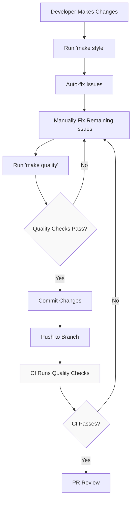
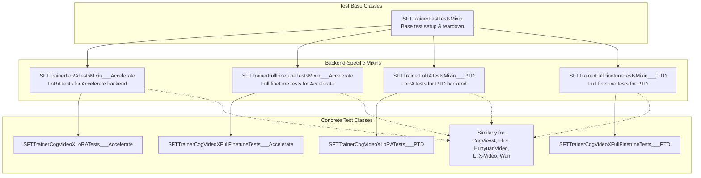
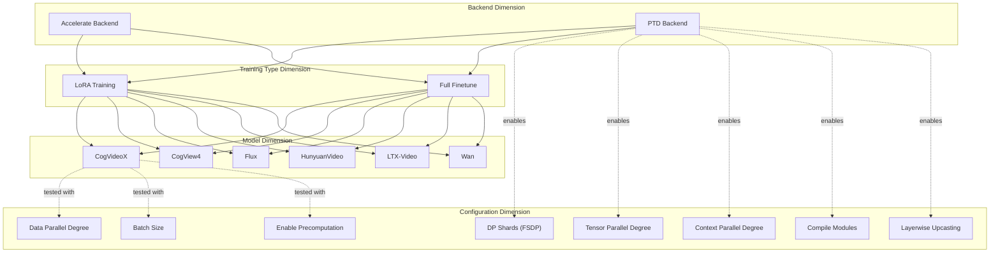
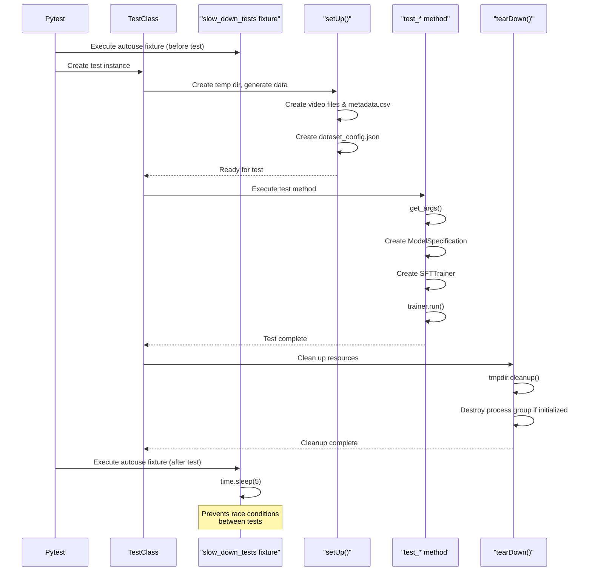
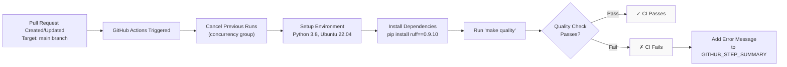

<!-- source: DeepWiki mcp.deepwiki.com · repo huggingface/finetrainers · page 9.3 Development Workflow · fetched 2026-10-26 -->

# Development Workflow

<details>
<summary>Relevant source files</summary>

The following files were used as context for generating this wiki page:

- [.github/workflows/pr_tests.yml](.github/workflows/pr_tests.yml)
- [Makefile](Makefile)
- [finetrainers/__init__.py](finetrainers/__init__.py)
- [finetrainers/utils/__init__.py](finetrainers/utils/__init__.py)
- [finetrainers/utils/torch.py](finetrainers/utils/torch.py)
- [requirements.txt](requirements.txt)
- [setup.py](setup.py)
- [tests/models/ltx_video/_test_tp.py](tests/models/ltx_video/_test_tp.py)
- [tests/trainer/test_sft_trainer.py](tests/trainer/test_sft_trainer.py)

</details>


This page documents the development workflow for contributors to the finetrainers project, including code quality tools, testing infrastructure, CI/CD pipelines, and contribution guidelines. For information about extending finetrainers with new models or components, see [Adding a New Model](#9.1) and [Custom Processors and Backends](#9.2).

---

## Development Environment Setup

### Installation for Development

To set up finetrainers for development, install the package with development dependencies:

```bash
git clone https://github.com/huggingface/finetrainers.git
cd finetrainers
pip install -e ".[dev]"
```

The `dev` extras include testing and linting tools as defined in [setup.py:23]():

| Tool | Version | Purpose |
|------|---------|---------|
| `pytest` | 8.3.2 | Unit testing framework |
| `ruff` | 0.9.10 | Fast Python linter and formatter |

### Core Dependencies

The project maintains dependencies in [requirements.txt:1-21]() with key packages:

| Category | Packages |
|----------|----------|
| **Deep Learning** | `torch>=2.5.1`, `torchvision>=0.20.1`, `torchdata>=0.10.1`, `torchao>=0.7.0` |
| **Diffusion Models** | `diffusers>=0.32.1`, `transformers>=4.45.2`, `peft>=0.13.0` |
| **Data Processing** | `datasets>=3.3.2`, `decord>=0.6.0`, `pandas`, `kornia>=0.7.3` |
| **Distributed Training** | `accelerate`, `bitsandbytes` |
| **Utilities** | `wandb`, `huggingface_hub`, `hf_transfer>=0.1.8` |
| **Code Quality** | `ruff==0.9.10` |

**Sources:** [requirements.txt:1-21](), [setup.py:23]()

---

## Code Quality Tools

### Ruff Configuration

The project uses `ruff` for both linting and code formatting. Ruff is a fast Python linter written in Rust that replaces multiple tools (flake8, isort, black, etc.).

**Makefile Targets:**

```make
quality:
    ruff check $(check_dirs) --exclude examples/_legacy
    ruff format --check $(check_dirs) --exclude examples/_legacy

style:
    ruff check $(check_dirs) --fix --exclude examples/_legacy
    ruff format $(check_dirs) --exclude examples/_legacy
```

The `check_dirs` variable includes: `finetrainers`, `tests`, `examples`, `train.py`, `setup.py`.

### Code Quality Workflow



### Running Code Quality Checks

| Command | Purpose | When to Use |
|---------|---------|-------------|
| `make style` | Auto-fix linting and formatting issues | Before committing changes |
| `make quality` | Check code quality without modifying files | To verify code is ready for commit |
| `ruff check <file>` | Check a specific file | During development |
| `ruff format <file>` | Format a specific file | During development |

**Sources:** [Makefile:1-12]()

---

## Testing Infrastructure

### Test Organization

The test suite is organized hierarchically using test mixins and concrete test classes:



**Test Class Naming Convention:** `SFTTrainer<ModelName><TrainingType>Tests___<Backend>`

Examples:
- `SFTTrainerCogVideoXLoRATests___Accelerate` [tests/trainer/test_sft_trainer.py:179-180]()
- `SFTTrainerWanFullFinetuneTests___PTD` [tests/trainer/test_sft_trainer.py:533-534]()

**Sources:** [tests/trainer/test_sft_trainer.py:42-537]()

### Test Base Class: SFTTrainerFastTestsMixin

The base test mixin [tests/trainer/test_sft_trainer.py:42-113]() provides common functionality:

| Component | Purpose | Implementation |
|-----------|---------|----------------|
| `model_specification_cls` | Dummy model class to test | Set by concrete test classes |
| `setUp()` | Creates temporary directory and test dataset | [tests/trainer/test_sft_trainer.py:49-80]() |
| `tearDown()` | Cleans up resources and destroys process groups | [tests/trainer/test_sft_trainer.py:82-88]() |
| `get_base_args()` | Returns default training arguments | [tests/trainer/test_sft_trainer.py:90-105]() |
| `_test_training()` | Executes training with given arguments | [tests/trainer/test_sft_trainer.py:110-113]() |

**Test Data Generation:**

Tests create synthetic video data using [tests/trainer/test_sft_trainer.py:51-64]():
- Generates `num_data_files` (default: 4) video files
- Each video has `num_frames` (default: 4) frames of size `height × width` (default: 64×64)
- Creates CSV metadata with captions

### Dummy Model Specifications

Each model has a dummy specification for testing, defined in `tests/models/<model_name>/base_specification.py`:

| Model | Dummy Specification Class | Import |
|-------|---------------------------|---------|
| CogVideoX | `DummyCogVideoXModelSpecification` | [tests/trainer/test_sft_trainer.py:22]() |
| CogView4 | `DummyCogView4ModelSpecification` | [tests/trainer/test_sft_trainer.py:23]() |
| Flux | `DummyFluxModelSpecification` | [tests/trainer/test_sft_trainer.py:24]() |
| HunyuanVideo | `DummyHunyuanVideoModelSpecification` | [tests/trainer/test_sft_trainer.py:25]() |
| LTX-Video | `DummyLTXVideoModelSpecification` | [tests/trainer/test_sft_trainer.py:26]() |
| Wan | `DummyWanModelSpecification` | [tests/trainer/test_sft_trainer.py:27]() |

These dummy models use small architectures to enable fast testing without requiring large GPU memory.

**Sources:** [tests/trainer/test_sft_trainer.py:22-27]()

### Test Matrix

The test suite covers multiple dimensions of configuration:



### Test Coverage by Backend

**Accelerate Backend Tests** [tests/trainer/test_sft_trainer.py:119-177]():

| Test | Parameters | Precomputation |
|------|-----------|----------------|
| `test___dp_degree_1___batch_size_1` | `dp_degree=1, batch_size=1` | `False`, `True` |
| `test___layerwise_upcasting___dp_degree_1___batch_size_1` | `dp_degree=1, batch_size=1, layerwise_upcasting_modules=["transformer"]` | `True` |
| `test___dp_degree_2___batch_size_1` | `dp_degree=2, batch_size=1` | `False`, `True` |

**PTD Backend Tests** [tests/trainer/test_sft_trainer.py:240-372]():

| Test | Parameters | Key Features Tested |
|------|-----------|---------------------|
| `test___dp_degree_1___batch_size_1` | `dp_degree=1, batch_size=1` | Basic training |
| `test___layerwise_upcasting___dp_degree_1___batch_size_1` | `layerwise_upcasting_modules=["transformer"]` | Memory optimization |
| `test___compile___dp_degree_1___batch_size_1` | `compile_modules=["transformer"]` | torch.compile integration |
| `test___dp_degree_1___batch_size_2` | `batch_size=2` | Larger batch size |
| `test___dp_degree_2___batch_size_1` | `dp_degree=2` | Data parallelism |
| `test___dp_shards_2___batch_size_1` | `dp_shards=2` | FSDP sharding |
| `test___dp_degree_2___dp_shards_2___batch_size_1` | `dp_degree=2, dp_shards=2` | HSDP (hybrid sharding) |
| `test___tp_degree_2___batch_size_2` | `tp_degree=2` | Tensor parallelism |
| `test___cp_degree_2___batch_size_1` | `cp_degree=2` | Context parallelism (skipped) |

**Note:** Context parallel tests are currently skipped [tests/trainer/test_sft_trainer.py:351-360]() because dummy models use small attention head dimensions that don't meet the requirement for certain attention backends.

**Sources:** [tests/trainer/test_sft_trainer.py:119-486]()

### Running Tests

**Run all tests:**
```bash
pytest tests/trainer/test_sft_trainer.py
```

**Run tests for a specific model:**
```bash
pytest tests/trainer/test_sft_trainer.py::SFTTrainerCogVideoXLoRATests___Accelerate
```

**Run a specific test:**
```bash
pytest tests/trainer/test_sft_trainer.py::SFTTrainerCogVideoXLoRATests___Accelerate::test___dp_degree_1___batch_size_1
```

**Run with distributed training (using torchrun):**
```bash
torchrun --nnodes=1 --nproc_per_node=2 -m pytest -s tests/trainer/test_sft_trainer.py
```

**Test Execution Flow:**



**Test Isolation:**

The `slow_down_tests` fixture [tests/trainer/test_sft_trainer.py:33-39]() adds a 5-second delay between tests to ensure proper cleanup of process groups and prevent random test failures.

**Sources:** [tests/trainer/test_sft_trainer.py:1-2](), [tests/trainer/test_sft_trainer.py:33-39](), [tests/trainer/test_sft_trainer.py:82-88]()

### Test Environment Configuration

Tests configure the environment to disable certain features [tests/trainer/test_sft_trainer.py:19-20]():

```python
os.environ["WANDB_MODE"] = "disabled"
os.environ["FINETRAINERS_LOG_LEVEL"] = "INFO"
```

This ensures tests run without external dependencies (W&B) and with appropriate logging verbosity.

**Sources:** [tests/trainer/test_sft_trainer.py:19-20]()

---

## CI/CD Pipeline

### Pull Request Workflow

The project uses GitHub Actions for continuous integration, defined in [.github/workflows/pr_tests.yml:1-31]():



### CI Configuration Details

| Setting | Value | Purpose |
|---------|-------|---------|
| **Trigger** | `pull_request` to `main` branch | Run on all PRs |
| **Concurrency** | `${{ github.workflow }}-${{ github.head_ref }}` | Cancel previous runs on new commits |
| **Runner** | `ubuntu-22.04` | Consistent environment |
| **Python Version** | `3.8` | Minimum supported version |
| **Job** | `check_code_quality` | Single job for quality checks |

**Failure Message:**

If quality checks fail, the workflow adds a helpful message to the GitHub step summary [.github/workflows/pr_tests.yml:29-30]():

```
Quality check failed. Please install ruff: `pip install ruff` and then run 
`make style && make quality` from the root of the repository.
```

**Sources:** [.github/workflows/pr_tests.yml:1-31]()

---

## Utility Functions for Development

### Memory Management Utilities

[finetrainers/utils/__init__.py:19]() exports memory management functions from [finetrainers/utils/torch.py]():

| Function | Purpose | Location |
|----------|---------|----------|
| `bytes_to_gigabytes` | Convert bytes to GB | Used in memory profiling |
| `free_memory` | Free GPU/CPU memory | Used in testing cleanup |
| `get_memory_statistics` | Get memory usage stats | Used in debugging |
| `make_contiguous` | Make tensors contiguous | Used in optimization |

### Torch Utilities

Commonly used utilities in development [finetrainers/utils/torch.py]():

| Function | Purpose | Usage in Tests |
|----------|---------|----------------|
| `enable_determinism` | Set random seeds for reproducibility | Ensures consistent test results |
| `apply_compile` | Apply torch.compile | Tested in compile-enabled tests |
| `clip_grad_norm_` | Gradient clipping with PP support | Tested in all training tests |
| `get_device_info` | Get device type and module | Used in device detection |
| `synchronize_device` | Synchronize CUDA/MPS | Used in timing benchmarks |

**Gradient Clipping with Multi-Dimensional Parallelism:**

The `clip_grad_norm_` function [finetrainers/utils/torch.py:100-161]() handles gradient clipping across all parallelism dimensions (DP, FSDP, TP, PP), which is tested extensively in the PTD backend tests.

**Sources:** [finetrainers/utils/__init__.py:1-52](), [finetrainers/utils/torch.py:1-396]()

---

## Contributing Guidelines

### Pre-Commit Checklist

Before submitting a pull request:

1. **Format and lint code:**
   ```bash
   make style
   make quality
   ```

2. **Run relevant tests:**
   ```bash
   pytest tests/trainer/test_sft_trainer.py -k <your_model_or_feature>
   ```

3. **Verify distributed tests (if applicable):**
   ```bash
   torchrun --nnodes=1 --nproc_per_node=2 -m pytest -s tests/trainer/test_sft_trainer.py -k <your_test>
   ```

4. **Check for uncommitted changes:**
   ```bash
   git status
   ```

### Code Style Requirements

The project enforces code quality using `ruff` [Makefile:6-7]():

- **Linting:** `ruff check` validates code against Python best practices
- **Formatting:** `ruff format` ensures consistent code style
- **Exclusions:** Legacy examples in `examples/_legacy` are excluded from checks

### Adding Tests for New Features

When adding new features:

1. **For new models:** Create a dummy specification in `tests/models/<model_name>/base_specification.py` and add test classes following the naming convention
2. **For new training types:** Add test mixins for both Accelerate and PTD backends
3. **For new parallelism strategies:** Add parameterized tests in PTD backend mixins
4. **For new utilities:** Add unit tests in appropriate test files

**Sources:** [tests/trainer/test_sft_trainer.py:42-537](), [Makefile:1-12]()

---

## Release Process

### Version Management

The project version is managed in [setup.py:12]() and [finetrainers/__init__.py:8]():

```python
version="0.2.0.dev0"
```

### Release Steps

Publishing instructions are documented in [setup.py:40-46]():

```python
# Steps to publish:
# 1. Update version in setup.py
# 2. python setup.py sdist bdist_wheel
# 3. Check if everything works with testpypi:
#    twine upload --repository testpypi dist/*
# 4. Upload to pypi:
#    twine upload dist/*
```

### Package Metadata

The package configuration in [setup.py:10-38]() includes:

| Field | Value |
|-------|-------|
| **Name** | `finetrainers` |
| **License** | Apache-2.0 |
| **Python** | `>=3.8.0` |
| **Repository** | https://github.com/a-r-r-o-w/finetrainers |
| **Status** | Development Status :: 1 - Planning |

**Sources:** [setup.py:1-47](), [finetrainers/__init__.py:8]()

---

## Development Best Practices

### Logging

Use the project's logger for consistent logging [finetrainers/__init__.py:3]():

```python
from finetrainers import get_logger

logger = get_logger()
logger.info("Your message here")
```

### Environment Variables

Key environment variables for development:

| Variable | Purpose | Example |
|----------|---------|---------|
| `FINETRAINERS_LOG_LEVEL` | Control logging verbosity | `DEBUG`, `INFO`, `WARNING` |
| `FINETRAINERS_ATTN_PROVIDER` | Select attention implementation | `flash`, `sage`, `native` |
| `WANDB_MODE` | Disable W&B in tests | `disabled` |
| `PYTHONHASHSEED` | Deterministic behavior | Set by `enable_determinism()` |

### Parameterized Testing

The project uses `@parameterized.expand` for testing multiple configurations [tests/trainer/test_sft_trainer.py:129-135]():

```python
@parameterized.expand([(False,), (True,)])
def test___dp_degree_1___batch_size_1(self, enable_precomputation: bool):
    args = self.get_args()
    args.enable_precomputation = enable_precomputation
    self._test_training(args)
```

This pattern enables testing the same functionality with different parameter combinations.

**Sources:** [tests/trainer/test_sft_trainer.py:10](), [tests/trainer/test_sft_trainer.py:129-176](), [finetrainers/utils/torch.py:164-217]()

---

