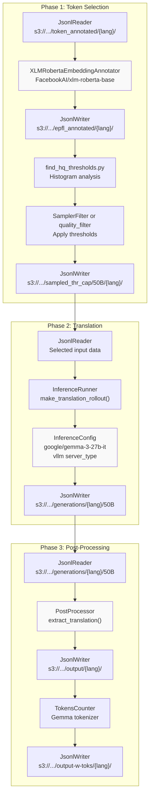
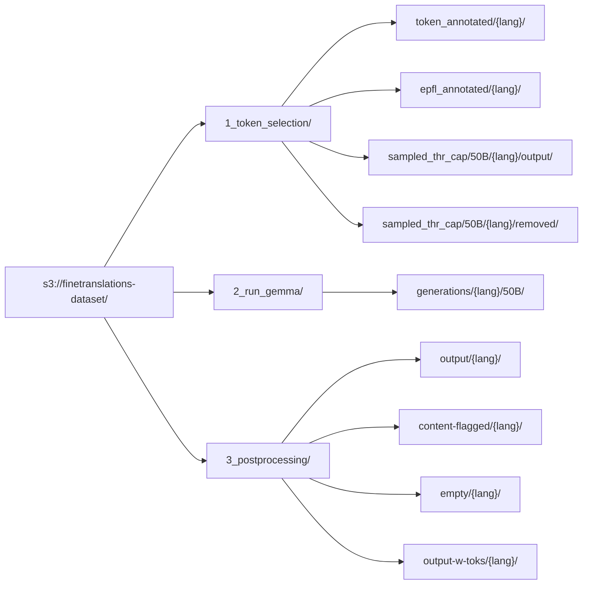

<!-- source: DeepWiki mcp.deepwiki.com · repo huggingface/finetranslations · page 1 Overview · fetched 2026-10-26 -->

# Overview

<details>
<summary>Relevant source files</summary>

The following files were used as context for generating this wiki page:

- [1_token_selection/annotate_with_hq_cla.py](1_token_selection/annotate_with_hq_cla.py)
- [2_run_gemma/run_pipeline.py](2_run_gemma/run_pipeline.py)
- [3_postprocessing/1_split_reformat.py](3_postprocessing/1_split_reformat.py)

</details>


## Purpose and Scope

This document provides a comprehensive introduction to the **finetranslations** pipeline, a three-phase distributed system designed to select, translate, and post-process high-quality multilingual web content into English. The pipeline processes up to 50 billion tokens per language across 19 supported languages, using quality-based filtering, neural machine translation, and automated content validation.

This overview covers the pipeline's architecture, data flow, supported languages, and key components. For detailed information about specific subsystems, see:
- Token selection mechanics: [Token Selection System (Phase 1)](#3)
- Translation inference details: [Translation System (Phase 2)](#4)
- Output processing: [Post-Processing System (Phase 3)](#5)
- Infrastructure configuration: [Infrastructure and Configuration](#6)

## System Purpose

The finetranslations pipeline addresses the need for large-scale, high-quality multilingual-to-English translation datasets. The system:

1. **Filters** raw token data using learned quality metrics to identify valuable content
2. **Translates** selected content using the Gemma language model with strict formatting preservation
3. **Validates** translation outputs and collects comprehensive statistics for dataset quality assurance

The pipeline enforces a token cap of 50 billion tokens per language (`TOKENS_CAP = 50e9`) to balance dataset size with processing constraints. Languages with fewer than 50B tokens use all available data; larger languages undergo quality-based sampling or threshold filtering.

**Sources:** [2_run_gemma/run_pipeline.py:2-3](), [3_postprocessing/1_split_reformat.py:142]()

## Pipeline Architecture

The system operates as a three-phase sequential pipeline, with each phase reading from and writing to Amazon S3 storage. All phases execute on a Slurm cluster with dynamic task allocation based on language-specific token volumes.

### End-to-End Pipeline Flow



**Diagram: Complete Pipeline Data Flow with Code Entities**

The pipeline uses the `SlurmPipelineExecutor` class to orchestrate execution across all phases, with language-specific configurations loaded from CSV assets (`lang_dist_token_counts.csv`, `fw2_thresholds_50B.csv`).

**Sources:** [1_token_selection/annotate_with_hq_cla.py:152-182](), [2_run_gemma/run_pipeline.py:286-407](), [3_postprocessing/1_split_reformat.py:131-166]()

## Supported Languages

The pipeline processes 19 languages, each identified by ISO 639-3 language codes combined with script identifiers (ISO 15924). Language selection and token count targets are configured in `lang_dist_token_counts.csv`.

| Language Family | Language Code | Script | Example Languages |
|----------------|---------------|---------|-------------------|
| Semitic | `arb_Arab` | Arabic | Arabic |
| Slavic | `ces_Latn` | Latin | Czech |
| Sino-Tibetan | `cmn_Hani` | Han | Mandarin Chinese |
| Slavic | `rus_Cyrl` | Cyrillic | Russian |
| - | *(15 additional languages)* | - | - |

Each language has a dedicated classifier model stored at `1_token_selection/epfl_classifiers/models/{lang_code}/model.pt` (~790KB per model). The `language_codes` list is populated from the CSV configuration at pipeline initialization.

**Note:** The specific 19 languages are loaded dynamically from the CSV at runtime. For the complete language catalog and classifier details, see [Language-Specific Models](#3.4.2).

**Sources:** [1_token_selection/annotate_with_hq_cla.py:4-7](), [1_token_selection/annotate_with_hq_cla.py:86]()

## Data Storage Architecture

All pipeline data resides in the `finetranslations-dataset` S3 bucket with a structured directory hierarchy organized by phase and language.

### S3 Path Structure



**Diagram: S3 Bucket Directory Structure**

Each phase operates independently through these paths:
- **Phase 1** reads from `token_annotated/`, writes quality scores to `epfl_annotated/`, and outputs filtered data to `sampled_thr_cap/50B/{lang}/output/`
- **Phase 2** conditionally reads from `token_annotated/`, `epfl_annotated/`, or `sampled_thr_cap/` based on token counts and threshold availability
- **Phase 3** reads from `generations/` and splits outputs into three categories: normal (`output/`), flagged (`content-flagged/`), and empty (`empty/`)

All data uses JSONL format (JSON Lines) with gzip compression (`.jsonl.gz`).

**Sources:** [1_token_selection/annotate_with_hq_cla.py:160-167](), [2_run_gemma/run_pipeline.py:308-333](), [3_postprocessing/1_split_reformat.py:153-155]()

## Key Pipeline Components

### Phase 1: Token Selection

| Component | Purpose | Key Code Entity |
|-----------|---------|-----------------|
| Quality Annotation | Assigns quality scores (0-1) using XLM-RoBERTa embeddings and language-specific classifiers | `XLMRobertaEmbeddingAnnotator` |
| Binary Classifier | Neural network (768→256→1) that scores token quality | `BinaryClassifier` [1_token_selection/annotate_with_hq_cla.py:61-83]() |
| Threshold Calculation | Determines optimal quality thresholds for target token counts | `find_hq_thresholds.py` |
| Sampling Filter | Applies thresholds or sampling rates to meet 50B cap | `quality_filter` [2_run_gemma/run_pipeline.py:320-323]() |

**Sources:** [1_token_selection/annotate_with_hq_cla.py:9-131]()

### Phase 2: Translation

| Component | Purpose | Key Code Entity |
|-----------|---------|-----------------|
| Document Chunking | Splits long documents into ~512-token chunks with line-aware segmentation | `chunk_document()` [2_run_gemma/run_pipeline.py:137-171]() |
| Prompt Construction | Builds prompts with system instructions and formatting rules | `SYSTEM_PROMPT` [2_run_gemma/run_pipeline.py:15-59]() |
| Translation Rollout | Orchestrates multi-chunk translation with context length error handling | `make_translation_rollout()` [2_run_gemma/run_pipeline.py:6-284]() |
| Inference Execution | Manages vLLM server for Gemma model inference | `InferenceRunner`, `InferenceConfig` [2_run_gemma/run_pipeline.py:342-363]() |

**Sources:** [2_run_gemma/run_pipeline.py:1-407]()

### Phase 3: Post-Processing

| Component | Purpose | Key Code Entity |
|-----------|---------|-----------------|
| Output Reformatting | Extracts translated text from XML-tagged model output | `PostProcessor` [3_postprocessing/1_split_reformat.py:3-129]() |
| Translation Extraction | Parses `<TRANSLATION>` tags and handles formatting violations | `extract_translation()` [3_postprocessing/1_split_reformat.py:51-63]() |
| Content Flagging | Identifies and routes content flagged by the model | Flagging logic [3_postprocessing/1_split_reformat.py:70]() |
| Token Counting | Counts tokens in final output using Gemma tokenizer | `TokensCounter` (referenced but not shown) |

**Sources:** [3_postprocessing/1_split_reformat.py:1-166]()

## Technology Stack

### Machine Learning Models

| Model | Purpose | Identifier |
|-------|---------|------------|
| XLM-RoBERTa Base | Universal multilingual embeddings (768-dim) | `FacebookAI/xlm-roberta-base` |
| EPFL Binary Classifiers | Language-specific quality scoring (19 models) | `models/{lang_code}/model.pt` |
| Gemma 3 27B Instruct | Translation inference | `google/gemma-3-27b-it` |

**Sources:** [1_token_selection/annotate_with_hq_cla.py:18](), [1_token_selection/annotate_with_hq_cla.py:86](), [2_run_gemma/run_pipeline.py:336]()

### Infrastructure Components

| Component | Usage | Configuration |
|-----------|-------|---------------|
| Amazon S3 | Data persistence across all phases | Bucket: `finetranslations-dataset` |
| Slurm Cluster | Distributed execution | Partitions: `hopper-cpu`, `hopper-prod` |
| vLLM Server | Gemma inference serving | `server_type="vllm"`, tensor parallelism=2 |
| PyTorch | Model loading and inference | Device: CUDA (GPU) or CPU fallback |
| Git LFS | Large model file storage | Pattern: `*.pt` (790KB each) |

**Sources:** [1_token_selection/annotate_with_hq_cla.py:45](), [1_token_selection/annotate_with_hq_cla.py:176](), [2_run_gemma/run_pipeline.py:343-347]()

### Datatrove Framework

The pipeline extensively uses the `datatrove` library for data processing:

- **Readers:** `JsonlReader` for S3 data ingestion
- **Writers:** `JsonlWriter` for JSONL output with gzip compression
- **Executors:** `SlurmPipelineExecutor` for cluster job orchestration
- **Pipeline Steps:** `PipelineStep` base class for custom processing logic
- **Inference:** `InferenceRunner`, `InferenceConfig` for LLM inference workflows

**Sources:** [1_token_selection/annotate_with_hq_cla.py:2](), [1_token_selection/annotate_with_hq_cla.py:150-152](), [2_run_gemma/run_pipeline.py:286-289]()

## Execution Model

The pipeline uses dynamic task allocation based on language-specific token volumes:

```python
# Phase 1: Annotation tasks
TOTAL_TASKS = round(max(1, min(500, int(500 * (lang_sizes[lang_code] / (100 * 1024**3))))))

# Phase 2: Translation tasks  
tasks = min(100, max(1, int(round(100 * min(total_tokens, TOKENS_CAP) / TOKENS_CAP))))

# Phase 3: Post-processing tasks
tasks = min(200, max(1, 2 * int(round(100 * min(total_tokens, TOKENS_CAP) / TOKENS_CAP))))
```

This formula ensures:
- Smaller languages run with fewer tasks (minimum 1)
- Larger languages leverage more parallelism (up to 500/100/200 tasks per phase)
- Task counts scale proportionally to token volume relative to the 50B cap

**Sources:** [1_token_selection/annotate_with_hq_cla.py:156](), [2_run_gemma/run_pipeline.py:365](), [3_postprocessing/1_split_reformat.py:146]()

## Configuration Assets

The pipeline behavior is controlled by CSV configuration files stored locally:

| File | Purpose | Usage |
|------|---------|-------|
| `lang_dist_token_counts.csv` | Language codes, names, and total token counts | Determines which languages to process and routing logic |
| `fw2_thresholds_50B.csv` | Quality score thresholds per language | Controls which documents pass filtering based on quality |

These files are loaded at pipeline initialization and drive conditional logic for data routing between different S3 paths.

**Sources:** [2_run_gemma/run_pipeline.py:296-300](), [2_run_gemma/run_pipeline.py:306-333]()

## Processing Statistics

Each phase collects execution metrics:

- **Phase 1:** `TokensQualityStats` generates quality score histograms per language
- **Phase 2:** Inference usage statistics (token counts, latency) via `InferenceRunner`
- **Phase 3:** `PostProcessor` tracks document counts, flagged content, formatting violations, and early stops

Statistics are written to local log directories and aggregated for dataset-level reporting.

**Sources:** [1_token_selection/annotate_with_hq_cla.py:134-148](), [3_postprocessing/1_split_reformat.py:67-128]()

---

