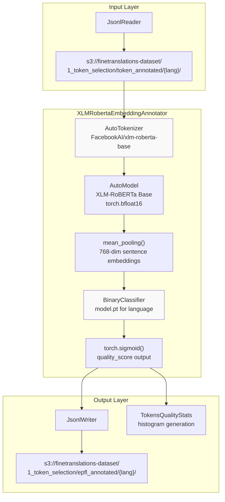
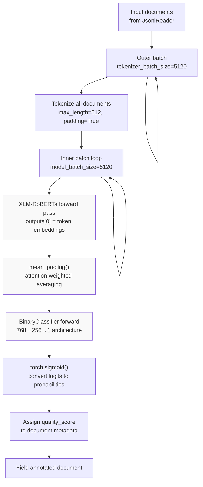
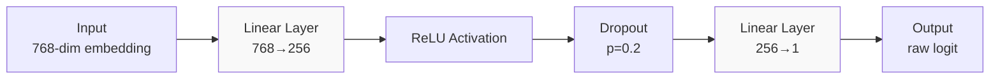
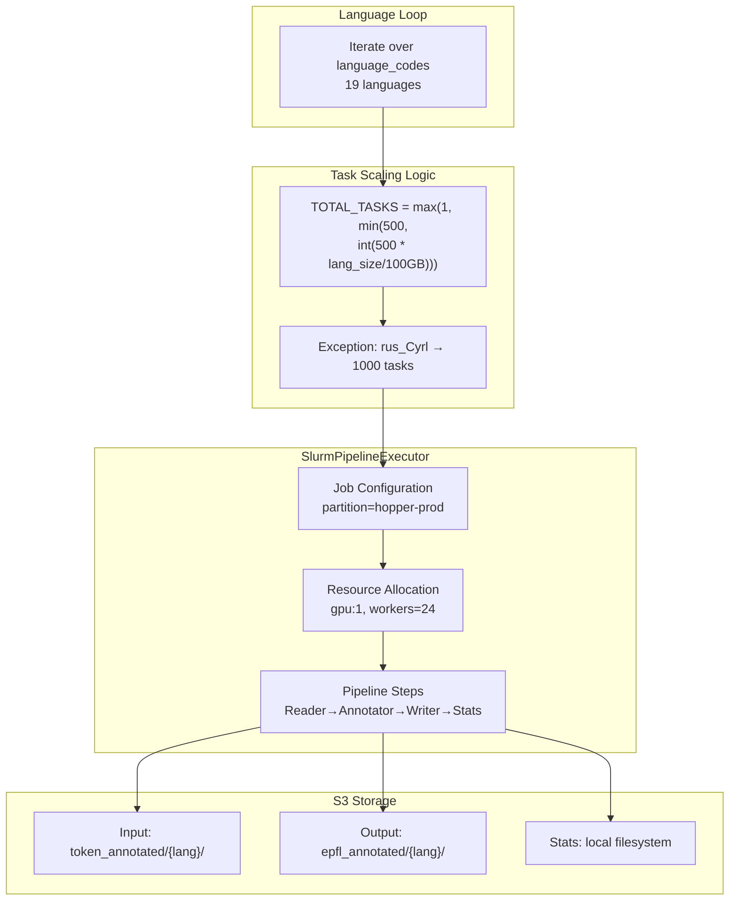
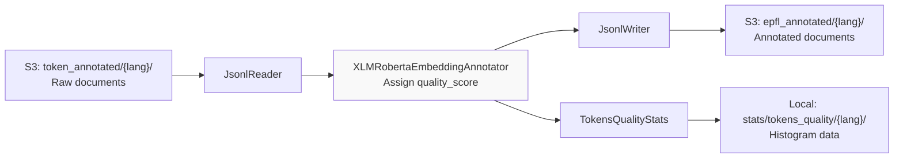

<!-- source: DeepWiki mcp.deepwiki.com · repo huggingface/finetranslations · page 3.1 Quality Score Annotation · fetched 2026-10-26 -->

# Quality Score Annotation

<details>
<summary>Relevant source files</summary>

The following files were used as context for generating this wiki page:

- [1_token_selection/annotate_with_hq_cla.py](1_token_selection/annotate_with_hq_cla.py)

</details>


## Purpose and Scope

This document describes the quality score annotation process, the first critical step in the Token Selection System. The `XLMRobertaEmbeddingAnnotator` pipeline step processes raw token data through XLM-RoBERTa embeddings and language-specific binary classifiers to assign quality scores (0-1 probability) to each document. This process enables downstream filtering and sampling based on content quality.

For information about how these quality scores are used to calculate thresholds, see [Quality Threshold Calculation](#3.2). For details on the binary classifier models themselves, see [EPFL Classifiers](#3.4).

---

## System Overview

The quality score annotation system combines three key components: a pre-trained XLM-RoBERTa base model for generating universal multilingual embeddings, language-specific binary classifiers trained on quality labels, and an efficient batched processing pipeline optimized for GPU execution.

### Architecture Diagram



**Sources:** [1_token_selection/annotate_with_hq_cla.py:1-182]()

---

## XLMRobertaEmbeddingAnnotator Class

The `XLMRobertaEmbeddingAnnotator` is a `PipelineStep` implementation that handles the entire annotation workflow. It processes documents in configurable batch sizes to optimize GPU memory utilization and throughput.

### Configuration Parameters

| Parameter | Default Value | Purpose |
|-----------|---------------|---------|
| `language` | Required | Language code for selecting the appropriate classifier model |
| `tokenizer_batch_size` | 10000 | Number of documents to process per outer batch |
| `model_batch_size` | 2048 | Number of documents to process simultaneously on GPU |
| `model` | `"FacebookAI/xlm-roberta-base"` | Pre-trained XLM-RoBERTa model identifier |

**Sources:** [1_token_selection/annotate_with_hq_cla.py:13-24]()

### Initialization and Model Loading

The `run()` method performs model initialization at execution time, not during class instantiation. This approach supports distributed execution where models are loaded on worker nodes:

1. **Tokenizer Loading**: Loads the XLM-RoBERTa tokenizer for text preprocessing
2. **Base Model Loading**: Loads the XLM-RoBERTa model with `torch.bfloat16` precision for memory efficiency
3. **Classifier Loading**: Loads the language-specific classifier from `model.pt` using the `BinaryClassifier.from_pt()` factory method
4. **Device Assignment**: Moves models to GPU if available, otherwise falls back to CPU

**Sources:** [1_token_selection/annotate_with_hq_cla.py:40-96]()

---

## Processing Pipeline

### Two-Level Batch Processing

The annotation pipeline uses a nested batching strategy to balance memory efficiency and throughput:



**Sources:** [1_token_selection/annotate_with_hq_cla.py:97-131]()

### Detailed Processing Steps

#### 1. Tokenization Phase

The outer batch collects documents and tokenizes them in bulk:

```python
batch_dict = tokenizer(
    texts,
    max_length=512,
    padding=True,
    truncation=True,
    return_overflowing_tokens=False,
    return_tensors="pt",
).to(device)
```

- Documents are truncated to 512 tokens (XLM-RoBERTa's maximum sequence length)
- Padding ensures uniform tensor dimensions within the batch
- Overflowing tokens are discarded (not split into multiple windows)

**Sources:** [1_token_selection/annotate_with_hq_cla.py:101-108]()

#### 2. Embedding Generation

The inner batch loop processes subsets through the XLM-RoBERTa model:

- **Input Slicing**: Extracts `input_ids` and `attention_mask` for the current sub-batch
- **Forward Pass**: Generates contextualized token embeddings for all tokens in each document
- **Mean Pooling**: Applies attention-weighted averaging to produce a single 768-dimensional embedding per document

**Sources:** [1_token_selection/annotate_with_hq_cla.py:113-123]()

#### 3. Mean Pooling Implementation

The `mean_pooling()` method implements sentence-level embedding extraction:

```python
def mean_pooling(self, model_output, attention_mask):
    import torch
    
    token_embeddings = model_output[0]  # Shape: [batch, seq_len, 768]
    input_mask_expanded = attention_mask.unsqueeze(-1).expand(
        token_embeddings.size()
    )  # Shape: [batch, seq_len, 768]
    return torch.sum(token_embeddings * input_mask_expanded, 1) / torch.clamp(
        input_mask_expanded.sum(1), min=1e-9
    )  # Shape: [batch, 768]
```

This approach:
- Masks padding tokens by multiplying with the attention mask
- Sums the masked embeddings across the sequence dimension
- Divides by the number of non-padding tokens (clamped to avoid division by zero)

**Sources:** [1_token_selection/annotate_with_hq_cla.py:26-38]()

#### 4. Quality Score Prediction

The pooled embeddings are passed through the `BinaryClassifier`:

1. **Type Casting**: Embeddings are cast to the classifier's dtype (typically `float32` or `bfloat16`)
2. **Forward Pass**: Processes embeddings through the 768→256→1 neural network
3. **Sigmoid Activation**: Converts raw logits to probabilities in the range [0, 1]
4. **Metadata Assignment**: Stores the quality score in `document.metadata["quality_score"]`

**Sources:** [1_token_selection/annotate_with_hq_cla.py:124-128]()

---

## BinaryClassifier Architecture

### Neural Network Structure

The `BinaryClassifier` is a simple feedforward neural network defined within the annotation script:



| Layer | Input Dimension | Output Dimension | Activation | Regularization |
|-------|----------------|------------------|------------|----------------|
| Linear 1 | 768 | 256 | ReLU | - |
| Dropout | 256 | 256 | - | p=0.2 |
| Linear 2 | 256 | 1 | - | - |

**Sources:** [1_token_selection/annotate_with_hq_cla.py:61-72]()

### Model Loading

The `BinaryClassifier.from_pt()` class method handles model deserialization:

```python
state_dict = torch.load(
    file_name, weights_only=True, map_location=torch.device("cpu")
)
classifier = BinaryClassifier(
    embedding_dim=embedding_dim, hidden_dim=hidden_dim
)
classifier.load_state_dict(state_dict)
classifier.eval()
```

- Loads the model weights from a `.pt` file in the language-specific directory
- Uses `weights_only=True` for security (prevents arbitrary code execution)
- Initializes on CPU first, then moves to target device
- Sets the model to evaluation mode (disables dropout)

**Sources:** [1_token_selection/annotate_with_hq_cla.py:74-83](), [1_token_selection/annotate_with_hq_cla.py:86-90]()

---

## Statistics Collection

### TokensQualityStats Class

The `TokensQualityStats` pipeline step runs in parallel with the `JsonlWriter` to collect quality score distributions:

```python
class TokensQualityStats(BaseStats):
    name = "🎼 Tokens quality stats"
    
    def __init__(self, output_folder) -> None:
        super().__init__(
            output_folder, 
            groups_to_compute=['histogram'], 
            histogram_round_digits=6
        )
    
    def extract_stats(self, doc):
        quality_score = doc.metadata.get("quality_score")
        return {"quality_score": quality_score}
```

This generates histogram data used by the threshold calculation script (see [Quality Threshold Calculation](#3.2)) to determine optimal filtering thresholds.

**Sources:** [1_token_selection/annotate_with_hq_cla.py:133-148]()

---

## Slurm Execution Configuration

### Pipeline Execution Flow



**Sources:** [1_token_selection/annotate_with_hq_cla.py:154-182]()

### Resource Allocation

The Slurm configuration is optimized for GPU-accelerated inference:

| Parameter | Value | Justification |
|-----------|-------|---------------|
| `partition` | `"hopper-prod"` | GPU partition for inference workloads |
| `gres` | `"gpu:1"` | Single GPU per task for model inference |
| `workers` | 24 | Parallel workers (8×3) for data loading and processing |
| `cpus_per_task` | 11 | CPU cores to support 24 workers |
| `mem-per-cpu` | `"1950M"` | ~2GB RAM per CPU for metadata processing |
| `time` | `"10:00:00"` | 10-hour time limit per job |
| `tasks` | Dynamic | Scaled based on language size |

**Sources:** [1_token_selection/annotate_with_hq_cla.py:170-181]()

### Dynamic Task Scaling

Task counts are calculated based on language-specific data sizes:

```python
TOTAL_TASKS = round(
    max(1, min(500, int(500 * (lang_sizes[lang_code] / (100 * 1024**3)))))
) if lang_code != 'rus_Cyrl' else 1000
```

- **Minimum**: 1 task (for very small languages)
- **Maximum**: 500 tasks (except Russian Cyrillic with 1000 tasks)
- **Scaling Factor**: 500 tasks per 100GB of raw data
- **Special Case**: Russian Cyrillic is assigned 1000 tasks due to its large volume

**Sources:** [1_token_selection/annotate_with_hq_cla.py:156]()

### Batch Size Configuration

The execution pipeline uses specific batch sizes optimized for GPU memory:

```python
XLMRobertaEmbeddingAnnotator(
    model="FacebookAI/xlm-roberta-base",
    tokenizer_batch_size=5120,
    model_batch_size=5120,
    language=lang_code,
)
```

Both `tokenizer_batch_size` and `model_batch_size` are set to 5120, which differs from the class defaults (10000 and 2048 respectively). This configuration balances:
- GPU memory utilization (avoiding OOM errors)
- Processing throughput (fewer kernel launches)
- Worker parallelism (24 workers can process batches concurrently)

**Sources:** [1_token_selection/annotate_with_hq_cla.py:161-166]()

---

## Data Flow Summary

### Complete Processing Pipeline



### Output Format

Each document in the output JSONL file contains the original content plus a `quality_score` field in the metadata:

```json
{
  "text": "Document content...",
  "id": "document_id",
  "metadata": {
    "quality_score": 0.8734521,
    "original_field": "original_value"
  }
}
```

The quality score is a float in the range [0, 1], representing the classifier's confidence that the document is high-quality.

**Sources:** [1_token_selection/annotate_with_hq_cla.py:128](), [1_token_selection/annotate_with_hq_cla.py:167]()

---

## Performance Characteristics

### Processing Speed

With the configured batch sizes and GPU acceleration:
- **Tokenization**: ~5120 documents per batch
- **Embedding Generation**: ~5120 documents per forward pass
- **Classification**: Sub-millisecond per document after batching
- **Total Throughput**: Varies by document length and GPU model

### Memory Requirements

- **GPU Memory**: XLM-RoBERTa base (~560MB) + classifier (~790KB) + batch data
- **CPU Memory**: ~1950MB per CPU (configured via Slurm)
- **Storage**: Input and output data stored on S3 (no local caching)

**Sources:** [1_token_selection/annotate_with_hq_cla.py:52](), [1_token_selection/annotate_with_hq_cla.py:179]()

---

