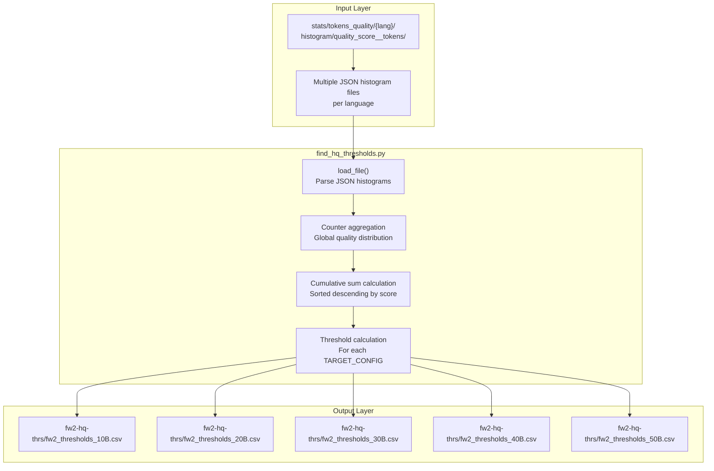
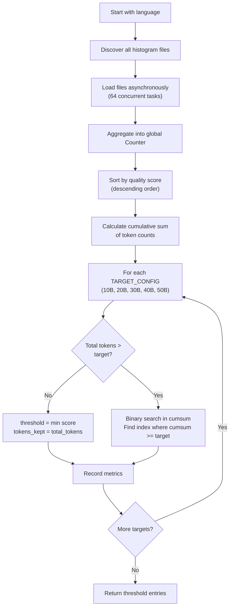
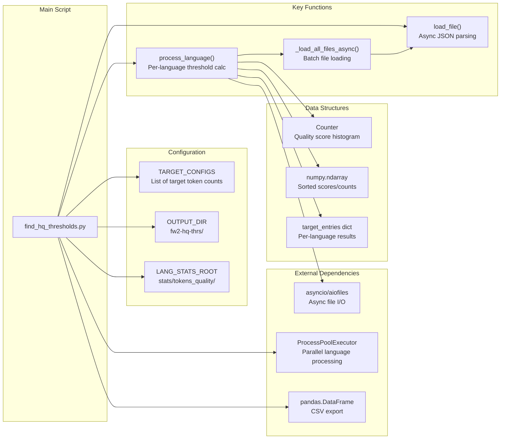

<!-- source: DeepWiki mcp.deepwiki.com · repo huggingface/finetranslations · page 3.2 Quality Threshold Calculation · fetched 2026-10-26 -->

# Quality Threshold Calculation

<details>
<summary>Relevant source files</summary>

The following files were used as context for generating this wiki page:

- [1_token_selection/find_hq_thresholds.py](1_token_selection/find_hq_thresholds.py)

</details>


## Purpose and Scope

This document describes the threshold calculation system that processes quality score histograms to determine optimal filtering thresholds for each language and target token count. The system calculates thresholds that enable the token selection pipeline to reduce datasets to specific target sizes (10B, 20B, 30B, 40B, 50B tokens).

For information about how quality scores are assigned to tokens, see [Quality Score Annotation](#3.1). For information about how these calculated thresholds are applied to filter and sample tokens, see [Token Sampling and Filtering](#3.3).

## Overview

The threshold calculation system takes quality score distributions from the annotation phase and computes the minimum quality score threshold needed to achieve each target token count per language. The core script `find_hq_thresholds.py` processes histogram data for all 19 languages in parallel and outputs threshold configuration files used by downstream sampling processes.

**Key Responsibilities:**
- Load and aggregate quality score histograms across all documents per language
- Calculate cumulative token counts sorted by quality score (descending)
- Determine threshold scores for predefined target token counts
- Generate threshold configuration CSVs for each target (10B through 100B)

## Data Flow Architecture



**Sources:** [1_token_selection/find_hq_thresholds.py:1-137]()

## Input Data Format

The script reads quality score histogram files located at:
```
stats/tokens_quality/{lang}/histogram/quality_score__tokens/*.json
```

Each histogram file is a JSON object mapping quality scores (as string keys) to token count statistics:

```json
{
  "0.95": {"total": 12500},
  "0.87": {"total": 8300},
  "0.72": {"total": 15600}
}
```

The `load_file()` function parses these JSON files and converts them to Python `Counter` objects with float keys representing quality scores and integer values representing token counts.

**Sources:** [1_token_selection/find_hq_thresholds.py:6-16]()

## Threshold Calculation Algorithm

### Algorithm Overview



**Sources:** [1_token_selection/find_hq_thresholds.py:31-119]()

### Detailed Algorithm Steps

The `process_language()` function implements the following algorithm for each language:

#### 1. File Loading and Aggregation

The script uses asynchronous I/O to load histogram files efficiently:

```python
async def _load_all_files_async(file_paths):
    semaphore = asyncio.Semaphore(64)
    # Loads up to 64 files concurrently
```

All individual histogram `Counter` objects are aggregated into a single global distribution per language.

**Sources:** [1_token_selection/find_hq_thresholds.py:47-65]()

#### 2. Sorting and Cumulative Sum

Quality scores and their token counts are sorted in descending order (highest quality first):

```python
sorted_items = sorted(global_counter.items(), key=lambda kv: kv[0], reverse=True)
scores = np.array([score for score, _ in sorted_items], dtype=float)
counts = np.array([cnt for _, cnt in sorted_items], dtype=np.int64)
cum_desc = np.cumsum(counts)
```

This creates a cumulative distribution where `cum_desc[i]` represents the total number of tokens with quality score >= `scores[i]`.

**Sources:** [1_token_selection/find_hq_thresholds.py:67-72]()

#### 3. Threshold Finding

For each target token count (10B, 20B, etc.), the algorithm finds the minimum quality score threshold:

| Condition | Action | Result |
|-----------|--------|--------|
| `scores` array is empty | Set `threshold_score = 0.0`, `tokens_kept = 0` | No tokens available |
| `target_tokens >= total_tokens` | Use minimum score (last index) | Keep all tokens |
| `target_tokens < total_tokens` | Find index where `cum_desc[idx] >= target_tokens` | Partial selection |

The algorithm uses an optimized linear search starting from the previous index to efficiently process multiple targets:

```python
while prev_idx < len(cum_desc) and cum_desc[prev_idx] < target_tokens:
    prev_idx += 1
```

**Sources:** [1_token_selection/find_hq_thresholds.py:79-96]()

#### 4. Overshoot Calculation

Since quality scores are discrete bins, the actual number of tokens kept may exceed the target:

- `tokens_above_threshold`: Tokens with quality score strictly above the threshold
- `at_threshold_bin`: Token count at the exact threshold score
- `needed_from_threshold_bin`: Tokens needed from the threshold bin to reach target
- `fraction_of_threshold_bin_needed`: Proportion of threshold bin needed (for potential random sampling)

**Sources:** [1_token_selection/find_hq_thresholds.py:98-106]()

## Output Format

### Threshold CSV Structure

The script generates one CSV file per target configuration, named `fw2_thresholds_{label}B.csv`, where `label` is 10, 20, 30, 40, or 50.

Each CSV contains one row per language with the following columns:

| Column | Type | Description |
|--------|------|-------------|
| `lang` | string | Language code (e.g., "arb_Arab", "ces_Latn") |
| `total_tokens` | integer | Total tokens available for this language |
| `threshold_score` | float | Minimum quality score to achieve target (range: 0.0-1.0) |
| `tokens_kept` | integer | Actual number of tokens at or above threshold |
| `overshoot` | integer | Excess tokens beyond target (`max(0, tokens_kept - target)`) |
| `share_kept` | float | Percentage of total tokens kept (`tokens_kept / total_tokens * 100`) |

**Example Output:**
```csv
lang,total_tokens,threshold_score,tokens_kept,overshoot,share_kept
arb_Arab,75000000000,0.8234,50000567000,567000,66.67
ces_Latn,25000000000,0.4512,25000000000,0,100.0
```

**Sources:** [1_token_selection/find_hq_thresholds.py:108-115](), [1_token_selection/find_hq_thresholds.py:130-137]()

### Output Directory Structure

```
fw2-hq-thrs/
├── fw2_thresholds_10B.csv
├── fw2_thresholds_20B.csv
├── fw2_thresholds_30B.csv
├── fw2_thresholds_40B.csv
├── fw2_thresholds_50B.csv
├── ...
└── fw2_thresholds_100B.csv
```

**Sources:** [1_token_selection/find_hq_thresholds.py:19-20]()

## Execution Configuration

### Target Token Counts

The script is configured to calculate thresholds for the following target sizes:

```python
TARGET_CONFIGS = [i for i in range(int(10e9), int(100e9) + 1, int(10e9))]
# Results in: [10B, 20B, 30B, 40B, 50B, 60B, 70B, 80B, 90B, 100B]
```

**Sources:** [1_token_selection/find_hq_thresholds.py:18]()

### Parallel Processing

The script uses `ProcessPoolExecutor` to process languages in parallel:

```python
with ProcessPoolExecutor() as executor:
    for per_target_entries in tqdm(
        executor.map(process_language, languages),
        total=len(languages),
    ):
        # Aggregate results
```

This parallelization enables processing all 19 languages concurrently, with each language running as an independent process.

**Sources:** [1_token_selection/find_hq_thresholds.py:122-128]()

### File I/O Optimization

Histogram files are loaded using asynchronous I/O with a semaphore limiting concurrent file operations to 64:

```python
semaphore = asyncio.Semaphore(64)
```

This balances I/O throughput with memory pressure from loading multiple large histogram files simultaneously.

**Sources:** [1_token_selection/find_hq_thresholds.py:48]()

## Code Entity Reference



**Sources:** [1_token_selection/find_hq_thresholds.py:1-137]()

## Usage in Pipeline

The threshold CSV files generated by this script are consumed by the token sampling and filtering stage (see [Token Sampling and Filtering](#3.3)). The pipeline reads the appropriate threshold file (typically `fw2_thresholds_50B.csv` for the 50B token target) and applies language-specific thresholds to filter documents based on their quality scores.

The `threshold_score` column from the output CSV directly determines which documents are retained:
- Documents with `quality_score >= threshold_score` are kept
- Documents with `quality_score < threshold_score` are excluded

**Sources:** [1_token_selection/find_hq_thresholds.py:135-137]()

---

