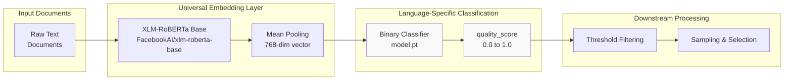
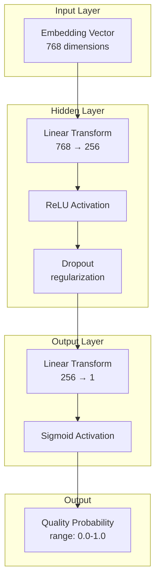
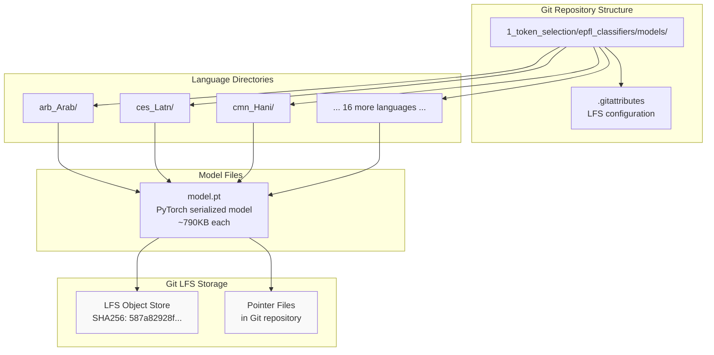
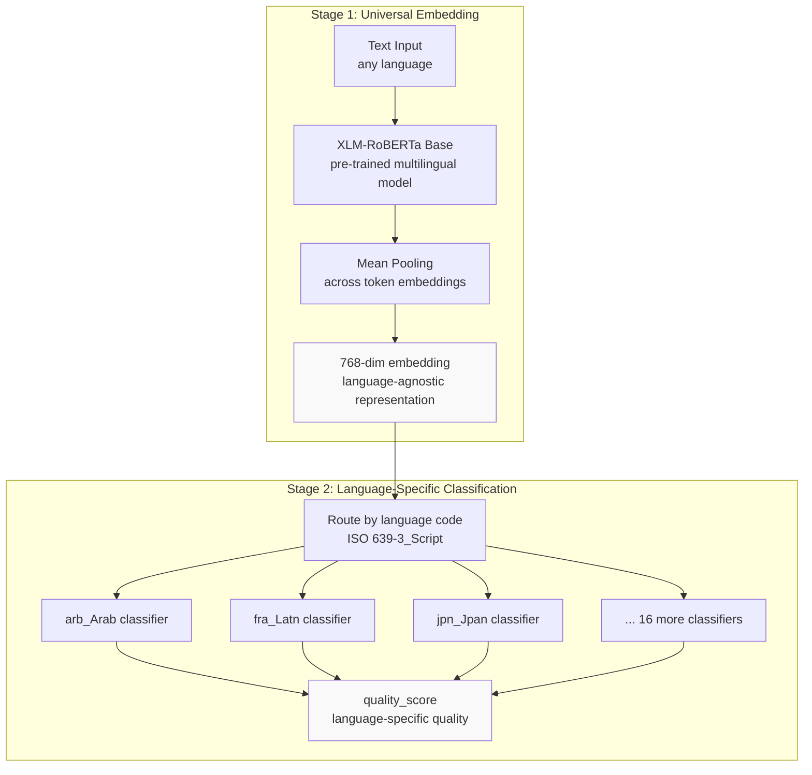

<!-- source: DeepWiki mcp.deepwiki.com · repo huggingface/finetranslations · page 3.4 EPFL Classifiers · fetched 2026-10-26 -->

# EPFL Classifiers

<details>
<summary>Relevant source files</summary>

The following files were used as context for generating this wiki page:

- [1_token_selection/epfl_classifiers/models/.gitattributes](1_token_selection/epfl_classifiers/models/.gitattributes)
- [1_token_selection/epfl_classifiers/models/arb_Arab/model.pt](1_token_selection/epfl_classifiers/models/arb_Arab/model.pt)
- [1_token_selection/epfl_classifiers/models/output.log](1_token_selection/epfl_classifiers/models/output.log)

</details>


## Purpose and Scope

This document provides an overview of the EPFL binary classifiers used in the finetranslations pipeline. These are language-specific machine learning models that assign quality scores to text documents during the token selection phase. Each classifier takes XLM-RoBERTa embeddings as input and outputs a probability score (0-1) indicating content quality.

For detailed information about the training process and evaluation metrics, see [Model Architecture and Training](#3.4.1). For a complete catalog of all language-specific models, see [Language-Specific Models](#3.4.2). For information about how these classifiers are used in the annotation pipeline, see [Quality Score Annotation](#3.1).

## Overview

The EPFL classifiers are a collection of 19 language-specific binary classification models that form a critical component of the token selection system. Each classifier is a lightweight neural network (~790KB per model) trained to distinguish high-quality text from low-quality text for a specific language.

Key characteristics:
- **Architecture**: Simple feed-forward network (768→256→1 dimensions)
- **Input**: 768-dimensional XLM-RoBERTa mean-pooled embeddings
- **Output**: Single probability score between 0 and 1
- **Size**: Approximately 790KB per model
- **Storage**: Managed via Git LFS for efficient version control
- **Languages**: 19 language-specific models covering major world languages

**Sources:** [1_token_selection/epfl_classifiers/models/.gitattributes:1-36](), [1_token_selection/epfl_classifiers/models/arb_Arab/model.pt:1-4](), [1_token_selection/epfl_classifiers/models/output.log:1-1361]()

## Role in Quality Scoring Pipeline

The EPFL classifiers operate as the final classification layer in a two-stage architecture where XLM-RoBERTa provides universal multilingual embeddings and language-specific classifiers make the final quality determination.



**Diagram: Quality Scoring Pipeline Data Flow**

The classifiers receive pre-computed embeddings from the XLM-RoBERTa model and output a `quality_score` field that is appended to each document. These scores are then used to calculate optimal thresholds and perform sampling to meet target token counts.

**Sources:** [1_token_selection/epfl_classifiers/models/output.log:1-68]()

## Model Architecture

Each EPFL classifier implements a compact binary classification architecture designed for efficient inference on large document collections.



**Diagram: EPFL Classifier Neural Network Architecture**

### Architecture Specifications

| Component | Specification |
|-----------|--------------|
| Input Dimension | 768 (XLM-RoBERTa embedding size) |
| Hidden Layer Size | 256 neurons |
| Activation Function | ReLU (hidden), Sigmoid (output) |
| Regularization | Dropout layer |
| Output Dimension | 1 (binary classification probability) |
| Parameter Count | ~197,632 parameters (768×256 + 256 + 256×1 + 1) |
| Model File Size | ~790KB serialized |

The architecture balances expressiveness with efficiency, allowing fast inference while maintaining high classification accuracy (>95% for most languages).

**Sources:** [1_token_selection/epfl_classifiers/models/output.log:10-11](), [1_token_selection/epfl_classifiers/models/output.log:62-68]()

## Training Characteristics

All EPFL classifiers follow a consistent training procedure:

| Training Parameter | Value |
|-------------------|-------|
| Training Set Size | 160,000 documents |
| Test Set Size | 20,000 documents |
| Number of Epochs | 6 |
| Batch Processing | Yes (batch size varies) |
| Evaluation Metrics | Accuracy, F1, Recall, Precision |

### Performance Summary

Trained models achieve high validation accuracy across all languages:

- **Best Performance**: Chinese (cmn_Hani) at 99.55% accuracy
- **Typical Performance**: Most languages achieve 97-99% accuracy
- **Lower Bound**: All languages exceed 95.6% accuracy

The models demonstrate strong precision (typically >97%) indicating low false positive rates, which is important for ensuring selected tokens are genuinely high-quality.

**Sources:** [1_token_selection/epfl_classifiers/models/output.log:1-2](), [1_token_selection/epfl_classifiers/models/output.log:60-68](), [1_token_selection/epfl_classifiers/models/output.log:146-147](), [1_token_selection/epfl_classifiers/models/output.log:1302-1303]()

## Storage and Version Control

The EPFL classifiers use Git LFS (Large File Storage) to efficiently manage binary model files while maintaining version control.



**Diagram: EPFL Classifier Storage Architecture**

### Git LFS Configuration

The `.gitattributes` file configures Git LFS to track all `.pt` (PyTorch) files:

```
*.pt filter=lfs diff=lfs merge=lfs -text
```

This configuration ensures that:
- Binary model files are stored efficiently in LFS
- The main repository remains lightweight
- Model versions are tracked via SHA256 hashes
- Developers can easily download specific model versions

### Model File Structure

Each language-specific directory contains:
- `model.pt` - The trained PyTorch model (stored in LFS)
- Files are stored with LFS metadata including SHA256 hash and size

Example from `arb_Arab/model.pt`:
```
version https://git-lfs.github.com/spec/v1
oid sha256:587a82928fa3681cdd3e12db7617aad566af6ecccf540bb8d945d784593b2ea5
size 790528
```

**Sources:** [1_token_selection/epfl_classifiers/models/.gitattributes:22-23](), [1_token_selection/epfl_classifiers/models/arb_Arab/model.pt:1-4]()

## Language Coverage

The EPFL classifiers cover 19 major world languages, each with a dedicated binary classification model:

| Language Code | Language Name | Script | Performance Range |
|--------------|---------------|--------|-------------------|
| arb_Arab | Arabic | Arabic | 97.9% accuracy |
| ces_Latn | Czech | Latin | 98.6% accuracy |
| cmn_Hani | Chinese | Han characters | 99.6% accuracy |
| dan_Latn | Danish | Latin | 98.8% accuracy |
| deu_Latn | German | Latin | 97.7% accuracy |
| ell_Grek | Greek | Greek | 98.6% accuracy |
| fas_Arab | Persian | Arabic | 98.3% accuracy |
| fra_Latn | French | Latin | 97.3% accuracy |
| hun_Latn | Hungarian | Latin | 99.1% accuracy |
| ind_Latn | Indonesian | Latin | 98.9% accuracy |
| ita_Latn | Italian | Latin | 98.6% accuracy |
| jpn_Jpan | Japanese | Japanese | 98.9% accuracy |
| nld_Latn | Dutch | Latin | 98.4% accuracy |
| pol_Latn | Polish | Latin | 98.7% accuracy |
| por_Latn | Portuguese | Latin | 97.6% accuracy |
| rus_Cyrl | Russian | Cyrillic | 98.3% accuracy |
| spa_Latn | Spanish | Latin | 97.0% accuracy |
| swe_Latn | Swedish | Latin | 99.0% accuracy |
| tur_Latn | Turkish | Latin | 98.6% accuracy |
| vie_Latn | Vietnamese | Latin | 96.7% accuracy |

Language codes follow ISO 639-3 (language) + ISO 15924 (script) naming convention.

**Sources:** [1_token_selection/epfl_classifiers/models/output.log:62-68](), [1_token_selection/epfl_classifiers/models/output.log:130-136](), [1_token_selection/epfl_classifiers/models/output.log:198-204](), [1_token_selection/epfl_classifiers/models/output.log:1355-1360]()

## Integration with XLM-RoBERTa

The EPFL classifiers are designed as lightweight downstream components that operate on frozen XLM-RoBERTa embeddings. This two-stage approach provides several advantages:



**Diagram: Two-Stage Classification Architecture**

### Design Rationale

**Shared Embedding Layer:**
- XLM-RoBERTa provides universal multilingual representations
- Single embedding model reduces computational overhead
- Embeddings can be pre-computed and cached
- 768-dimensional output is consistent across all languages

**Language-Specific Classifiers:**
- Each language has unique quality characteristics
- Small model size enables fast inference
- Independent training per language allows specialized tuning
- Easy to add new languages by training additional classifiers

This architecture enables the system to process 19 languages efficiently while maintaining high classification accuracy for each language's specific quality criteria.

**Sources:** [1_token_selection/epfl_classifiers/models/output.log:1-68]()

## Model Loading and Inference

At runtime, EPFL classifiers are loaded from their serialized `.pt` files using PyTorch's model loading mechanism. The typical workflow is:

1. Load language-specific model from `1_token_selection/epfl_classifiers/models/{lang_code}/model.pt`
2. Load model into `BinaryClassifier` PyTorch module
3. Set model to evaluation mode
4. Pass 768-dimensional embeddings through the network
5. Apply sigmoid activation to obtain quality probability

The models are loaded on-demand based on the language being processed and can be efficiently batched for inference on GPU hardware during the annotation phase.

For detailed information about the inference pipeline, see [Quality Score Annotation](#3.1).

**Sources:** [1_token_selection/epfl_classifiers/models/output.log:62-68](), [1_token_selection/epfl_classifiers/models/arb_Arab/model.pt:1-4]()

---

