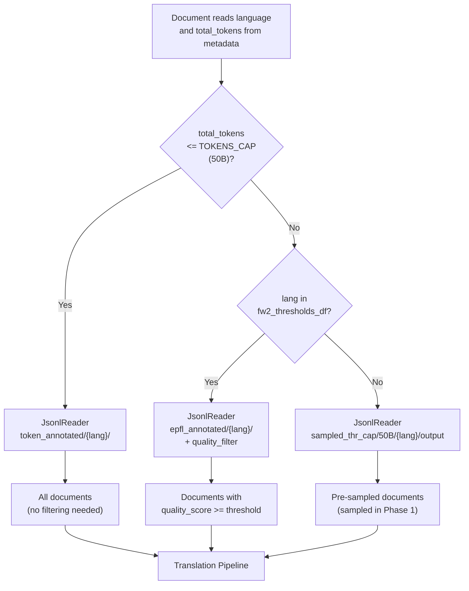
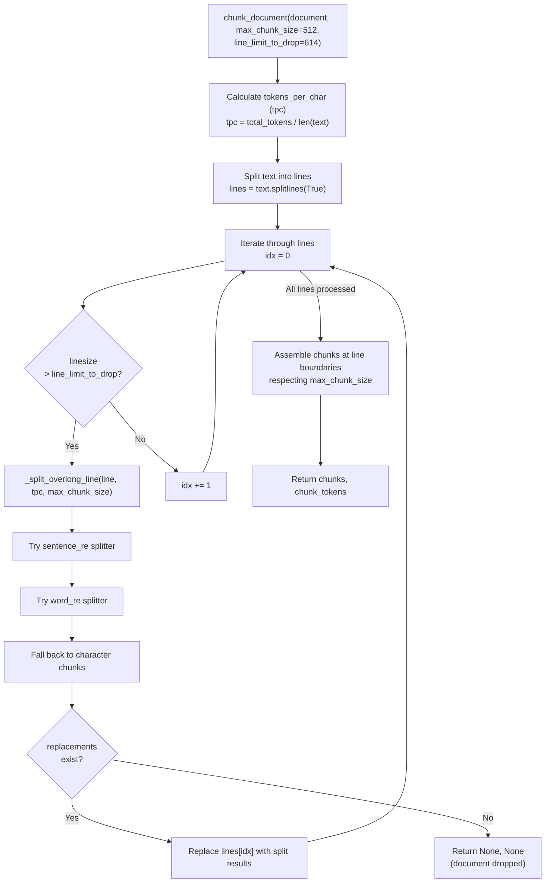
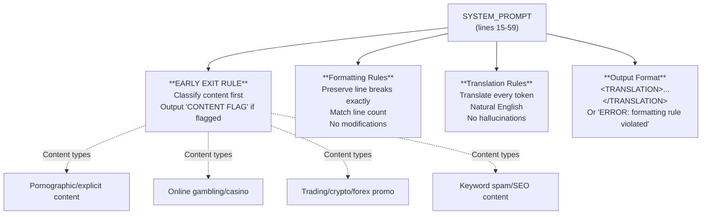
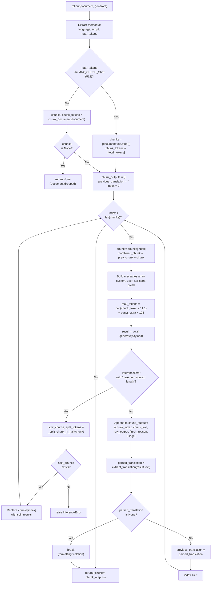
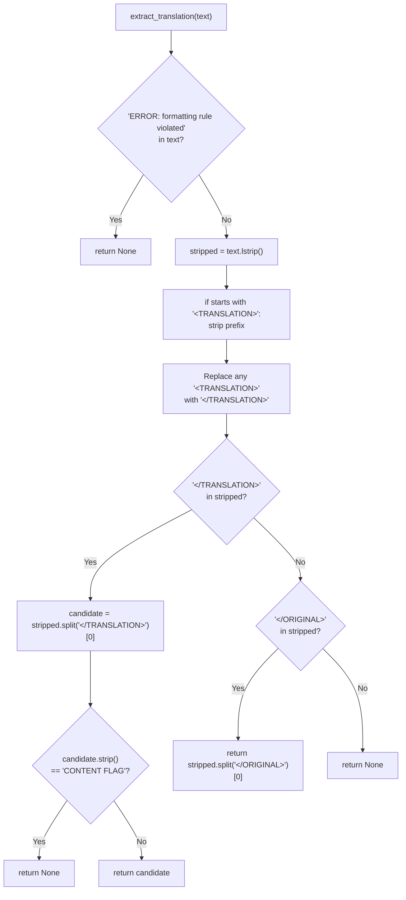
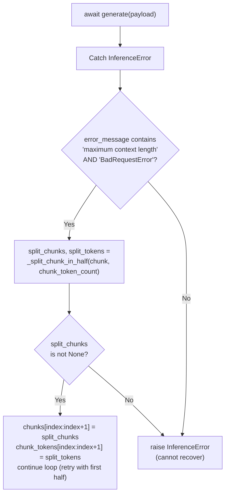

<!-- source: DeepWiki mcp.deepwiki.com · repo huggingface/finetranslations · page 4 Translation System (Phase 2) · fetched 2026-10-26 -->

# Translation System (Phase 2)

<details>
<summary>Relevant source files</summary>

The following files were used as context for generating this wiki page:

- [2_run_gemma/run_pipeline.py](2_run_gemma/run_pipeline.py)

</details>


## Purpose and Scope

The Translation System (Phase 2) translates selected multilingual documents to English using the Gemma-3-27B-IT model. This phase processes the filtered tokens from Phase 1, applies intelligent document chunking to handle context length constraints, constructs prompts with strict formatting requirements and content filtering rules, and executes translation inference using vLLM on GPU clusters. The system handles context length errors through dynamic chunk splitting and maintains translation continuity across chunks.

For information about token selection and quality scoring that precedes this phase, see [Token Selection System (Phase 1)](#3). For post-processing of translation outputs, see [Post-Processing System (Phase 3)](#5).

**Sources:** [2_run_gemma/run_pipeline.py:1-407]()

## Input Data Routing

The translation pipeline uses a three-tier routing strategy to select input data based on language-specific token counts and availability of quality annotations:

### Routing Decision Logic



**Route A: Direct Translation** (lines 315-317)  
Languages with `total_tokens <= 50B` bypass filtering entirely and read directly from `token_annotated/{lang}/`. This avoids unnecessary quality scoring overhead for smaller languages.

**Route B: Quality-Based Filtering** (lines 318-328)  
Languages with quality annotations (`lang in fw2_thresholds_df`) read from `epfl_annotated/{lang}/` and apply a `quality_filter` function that yields only documents meeting the threshold score from `fw2_thresholds_{THRESHOLD}B.csv`.

**Route C: Pre-Sampled Data** (lines 330-333)  
Languages without quality annotations read pre-sampled data from `sampled_thr_cap/{THRESHOLD}B/{lang}/output`, where sampling was performed during Phase 1.

**Sources:** [2_run_gemma/run_pipeline.py:306-333]()

### Input Path Configuration

| Routing Condition | S3 Input Path | Filter Applied |
|------------------|---------------|----------------|
| `total_tokens <= TOKENS_CAP` | `s3://finetranslations-dataset/1_token_selection/token_annotated/{lang}/` | None |
| `lang in fw2_thresholds_df` | `s3://finetranslations-dataset/1_token_selection/epfl_annotated/{lang}` | `quality_score >= threshold` |
| Default (sampled) | `s3://finetranslations-dataset/1_token_selection/sampled_thr_cap/50B/{lang}/output` | Pre-applied in Phase 1 |

The configuration reads from two CSV files: `lang_dist_token_counts.csv` (contains `subset`, `name`, `total_tokens` columns) and `fw2_thresholds_50B.csv` (contains `lang`, `threshold_score` columns).

**Sources:** [2_run_gemma/run_pipeline.py:296-333]()

## Document Chunking Strategy

The system processes documents that may exceed the model's context window through a sophisticated multi-level chunking strategy.

### Chunking Constants

```python
MAX_CHUNK_SIZE = 512        # Target tokens per chunk
LINE_LIMIT_TO_DROP = 614    # int(MAX_CHUNK_SIZE * 1.2)
```

Documents are evaluated based on their `token_count` metadata field. If `total_tokens <= 512`, the document is processed as a single chunk. Otherwise, `chunk_document()` splits it into multiple chunks.

**Sources:** [2_run_gemma/run_pipeline.py:12-13]()

### Chunk Document Function Flow



The chunking logic operates in two phases:

**Phase 1: Split Overlong Lines** (lines 145-154)  
Any line exceeding `line_limit_to_drop` (614 tokens) is split using `_split_overlong_line()`, which tries progressively coarser splitting strategies:
1. Split by sentences using `sentence_re` (matches full-stop marks and delimiters)
2. Split by words using `word_re` (matches `\S+\s*`)
3. Fall back to character-based chunks of `max_chars = int(max_tokens / tokens_per_char)`

If no valid split is found, the entire document is dropped (returns `None, None`).

**Phase 2: Assemble Chunks at Line Boundaries** (lines 156-171)  
After ensuring all lines fit within limits, the function iterates through lines and groups them into chunks, starting a new chunk whenever adding the next line would exceed `max_chunk_size`. This preserves line boundaries within chunks.

**Sources:** [2_run_gemma/run_pipeline.py:137-171](), [2_run_gemma/run_pipeline.py:124-136]()

### Sentence and Word Splitting

The system uses Unicode-aware regular expressions to identify split points:

**Full Stop Marks** (lines 61-89): Includes 24 Unicode code points representing period-like characters across multiple scripts (U+002E, U+0589, U+06D4, U+3002, etc.)

**Extra Delimiters** (line 90): `!?…。!؛،؟` (exclamation marks, question marks, Arabic punctuation)

**Sentence Regex** (lines 91-93): Matches text up to any full stop or delimiter using `re.UNICODE | re.DOTALL` flags

**Word Regex** (line 94): Matches any non-whitespace sequence followed by optional whitespace

**Sources:** [2_run_gemma/run_pipeline.py:61-94]()

## Prompt Construction

The translation pipeline constructs a multi-turn chat prompt with a system message, user message, and prefilled assistant response.

### System Prompt Architecture



The `SYSTEM_PROMPT` is a comprehensive instruction set spanning lines 15-59. It enforces:

**Early Exit Content Filter**: Before any translation, the model must classify the input. If it contains pornographic content, gambling, trading promotions, or SEO spam, it must output exactly `<TRANSLATION>CONTENT FLAG</TRANSLATION>` and stop.

**Strict Formatting Requirements**:
- Preserve exact line count (output must have same number of lines as input)
- No added/removed line breaks
- No blank lines for readability
- No paragraph reformatting
- Treat long multi-sentence lines as single lines
- One-to-one line correspondence

**Translation Requirements**:
- Translate every token (no skipping, summarizing, or omitting)
- Natural, fluent English
- No explanations or commentary
- No hallucinations

**Output Format**: Enclose translation in `<TRANSLATION>` tags only, or output `ERROR: formatting rule violated` if rules cannot be followed.

**Sources:** [2_run_gemma/run_pipeline.py:15-59]()

### Prompt Message Structure

The rollout function constructs a three-message chat array:

```python
messages = [
    {"role": "system", "content": SYSTEM_PROMPT},
    {"role": "user", "content": prompt},
    {"role": "assistant", "content": "<TRANSLATION>" + (previous_translation or "")},
]
```

**User Message Format** (lines 231-234):
```
**{display_language} ({subset_language}) Text to Translate (preserve all line breaks EXACTLY):**
<ORIGINAL>{combined_chunk}</ORIGINAL>

Now translate to English (eng_Latn).
```

Where `combined_chunk = (previous_chunk or "") + chunk` to provide context from the previous chunk.

**Assistant Prefill** (line 247): The assistant response is prefilled with `<TRANSLATION>` and the previous translation (if any). The `continue_final_message: True` parameter tells the model to continue generating from this prefill.

**Sources:** [2_run_gemma/run_pipeline.py:231-252]()

### Max Tokens Calculation

The system dynamically calculates `max_tokens` for each chunk based on content characteristics:

```python
extra_tokens = 0
if chunk:
    count = sum(1 for ch in chunk if ch in punct_chars)
    extra_tokens = int(count * 0.8)

max_tokens = ceil(chunk_token_count * 1.1) + extra_tokens + 128
```

- Base: `chunk_token_count * 1.1` (10% buffer for translation expansion)
- Extra: 80% of punctuation character count (punctuation often expands in translation)
- Fixed overhead: 128 tokens for tags and formatting

The `punct_chars` set includes: `=-_[]{}()/\|:;@#$%^&*+~«»<>"'`

**Sources:** [2_run_gemma/run_pipeline.py:236-241](), [2_run_gemma/run_pipeline.py:95]()

## Rollout Function Flow

The `rollout()` async function orchestrates the complete translation process for a single document.



**Key Behaviors:**

1. **Metadata Extraction** (lines 207-210): Retrieves `language`, `language_script`, and `token_count` from document metadata
2. **Chunking Decision** (lines 212-219): Single-chunk path for small documents, `chunk_document()` for large ones
3. **Chunk Loop** (lines 224-280): Processes chunks sequentially, maintaining context via `previous_translation`
4. **Context Provision** (lines 228-229): Includes previous chunk text in `combined_chunk` for continuity
5. **Error Recovery** (lines 257-264): Splits chunk in half if context length exceeded, then retries
6. **Output Storage** (lines 266-274): Stores chunk index, text, raw output, finish reason, and usage metrics
7. **Translation Extraction** (lines 275-279): Parses output; breaks loop if formatting violation detected
8. **Continuity** (line 279): Updates `previous_translation` for next chunk

**Sources:** [2_run_gemma/run_pipeline.py:206-283]()

### Translation Extraction Logic

The `extract_translation()` function parses model output to extract the translated text:



The function returns `None` in three cases:
1. Explicit formatting error message detected
2. Content flagged (translation is "CONTENT FLAG")
3. No valid closing tag found

This `None` return triggers the rollout loop to break, stopping processing of subsequent chunks (line 278).

**Sources:** [2_run_gemma/run_pipeline.py:191-204]()

## Inference Execution Configuration

The translation pipeline uses the datatrove `InferenceRunner` with vLLM backend for distributed inference.

### InferenceConfig Parameters

```python
config = InferenceConfig(
    server_type="vllm",
    model_name_or_path="google/gemma-3-27b-it",
    model_max_context=4096,
    use_chat=True,
    tp=2,  # Tensor parallelism
    default_generation_params={
        "temperature": 0.1,
        "repetition_penalty": 1.1
    },
    max_concurrent_generations=1000,
    max_concurrent_documents=1050,
)
```

| Parameter | Value | Purpose |
|-----------|-------|---------|
| `server_type` | `"vllm"` | Use vLLM inference engine |
| `model_name_or_path` | `"google/gemma-3-27b-it"` | Gemma 3 27B instruction-tuned model |
| `model_max_context` | `4096` | Maximum context window in tokens |
| `use_chat` | `True` | Use chat template formatting |
| `tp` | `2` | Tensor parallelism (split model across 2 GPUs) |
| `temperature` | `0.1` | Low randomness for consistent translations |
| `repetition_penalty` | `1.1` | Penalize repeated tokens |
| `max_concurrent_generations` | `1000` | Allow 1000 parallel generation requests |
| `max_concurrent_documents` | `1050` | Process 1050 documents concurrently |

**Sources:** [2_run_gemma/run_pipeline.py:342-351]()

### InferenceRunner Configuration

```python
pipeline.append(InferenceRunner(
    rollout_fn=make_translation_rollout(language_name),
    config=config,
    output_writer=writer,
    checkpoints_local_dir=f"/path/to/local/pipeline/3_launch_pipeline/checkpoints/{lang}/50B",
    records_per_chunk=5000,
))
```

The `InferenceRunner` wraps the rollout function and handles:
- Calling `rollout()` for each document with the `generate` function
- Writing outputs via `JsonlWriter` to S3
- Checkpointing progress locally every 5000 records
- Exception handling and retries

**Sources:** [2_run_gemma/run_pipeline.py:357-363]()

### Output Writer Configuration

```python
writer = JsonlWriter(
    OUTPUT_PATH,  # "s3://finetranslations-dataset/2_run_gemma/generations/{lang}/50B"
    output_filename="${rank}_chunk_${chunk_index}.jsonl.gz"
)
```

The writer creates compressed JSONL files with dynamic filenames based on:
- `${rank}`: Slurm task rank (0 to tasks-1)
- `${chunk_index}`: Checkpoint chunk index within the task

This sharding strategy distributes output across multiple files for parallel processing in Phase 3.

**Sources:** [2_run_gemma/run_pipeline.py:308](), [2_run_gemma/run_pipeline.py:354]()

## Context Length Error Handling

The system implements dynamic chunk splitting to recover from context length limit errors.

### Error Detection and Recovery



When vLLM raises an `InferenceError` with "maximum context length" and "BadRequestError" in the message (line 258), the system:

1. **Splits the chunk** using `_split_chunk_in_half()` at a line boundary near the midpoint
2. **Replaces in place**: Updates `chunks[index:index+1]` with the two halves
3. **Continues loop**: The `continue` statement (line 264) causes the loop to retry with `index` unchanged, processing the first half

If splitting fails (e.g., chunk has only one line that's too long), the original error is re-raised.

**Sources:** [2_run_gemma/run_pipeline.py:254-265]()

### Split Chunk in Half Function

```python
def _split_chunk_in_half(chunk: str, chunk_tokens: float):
    if not chunk or len(chunk) < 2:
        return None, None
    midpoint = len(chunk) // 2
    split_idx = chunk.rfind("\n", 0, midpoint)  # Search backward from midpoint
    if split_idx <= 0 or split_idx >= len(chunk):
        split_idx = chunk.find("\n", midpoint)  # Search forward from midpoint
    if split_idx <= 0 or split_idx >= len(chunk):
        split_idx = midpoint  # No line break found, split at midpoint
    first = chunk[:split_idx]
    second = chunk[split_idx:]
    if not first or not second:
        return None, None
    # Proportionally allocate tokens
    total_len = max(len(chunk), 1)
    first_tokens = max(1.0, chunk_tokens * len(first) / total_len)
    second_tokens = max(1.0, chunk_tokens * len(second) / total_len)
    return [first, second], [first_tokens, second_tokens]
```

The function prioritizes splitting at line boundaries:
1. Search backward from midpoint for `\n`
2. If not found, search forward from midpoint
3. If still not found, split at character midpoint

This ensures chunks remain syntactically coherent (preserving line structure) whenever possible.

**Sources:** [2_run_gemma/run_pipeline.py:173-190]()

## Slurm Execution Configuration

The translation pipeline executes on the `hopper-prod` partition with GPU acceleration and dynamic task scaling.

### SlurmPipelineExecutor Parameters

```python
executor = SlurmPipelineExecutor(
    pipeline=pipeline,
    tasks=tasks,  # Dynamic: min(100, max(1, int(round(100 * min(total_tokens, TOKENS_CAP) / TOKENS_CAP))))
    time="80:00:00",
    partition="hopper-prod",
    qos="high",
    job_name=f"ft_{lang}",
    logging_dir=f"/path/to/local/pipeline/3_launch_pipeline/logs/{lang}/50B",
    cpus_per_task=11 * tp,  # 22 CPUs (11 per GPU)
    sbatch_args={
        "gres": f"gpu:{tp}",  # 2 GPUs
        "mem-per-cpu": "22G",
    },
    env_command="module load cuda/12.4"
)
```

**Resource Allocation:**

| Resource | Value | Calculation |
|----------|-------|-------------|
| Partition | `hopper-prod` | GPU partition for inference workloads |
| GPUs | `2` | Matches `tp=2` tensor parallelism |
| CPUs | `22` | `11 * tp` (11 workers per GPU) |
| Memory | `484 GB` | `22 CPUs * 22G` per task |
| Time limit | `80:00:00` | 80 hours (extended for large languages) |
| QoS | `high` | High priority queue |

**Sources:** [2_run_gemma/run_pipeline.py:372-389]()

### Dynamic Task Scaling

```python
tasks = min(100, max(1, int(round(100 * min(total_tokens, TOKENS_CAP) / TOKENS_CAP))))
```

The number of parallel tasks scales linearly with token count:
- Minimum: 1 task (for smallest languages)
- Maximum: 100 tasks (for languages at or above 50B token cap)
- Scaling: Proportional to `min(total_tokens, TOKENS_CAP) / TOKENS_CAP`

Example calculations:
- 5B tokens: `100 * 5/50 = 10 tasks`
- 25B tokens: `100 * 25/50 = 50 tasks`
- 50B+ tokens: `100 * 50/50 = 100 tasks`

This ensures appropriate parallelism: small languages get few tasks (reducing scheduling overhead), while large languages fully utilize cluster capacity.

**Sources:** [2_run_gemma/run_pipeline.py:365]()

### Job Launch with Retry Logic

```python
delay = 2  # start with 2 seconds
while True:
    try:
        executor.run()
        break
    except Exception as e:
        print(f"Error launching job: {e}")
        time.sleep(delay)
        delay = min(delay * 2, 60 * 60)  # cap at 60 minutes
```

The launcher implements exponential backoff retry for job submission:
1. Initial delay: 2 seconds
2. Double delay on each failure
3. Cap at 60 minutes (3600 seconds)

This handles transient cluster issues (scheduler overload, quota limits) without manual intervention.

**Sources:** [2_run_gemma/run_pipeline.py:392-400]()

## Output Format and Storage

The translation pipeline writes outputs to S3 with a structured format that preserves chunk-level metadata.

### Output Data Structure

Each processed document generates a JSON object with the following structure:

```json
{
  "chunks": [
    {
      "chunk_index": 0,
      "chunk_text": "original chunk text...",
      "raw_output": "model's full response...",
      "finish_reason": "stop",
      "usage": {
        "prompt_tokens": 150,
        "completion_tokens": 120,
        "total_tokens": 270
      }
    },
    {
      "chunk_index": 1,
      ...
    }
  ]
}
```

The `chunk_outputs` array (lines 266-274) stores all chunks processed for the document. Each chunk object contains:
- `chunk_index`: Sequential position in the document (0-indexed)
- `chunk_text`: The original untranslated chunk text
- `raw_output`: The complete model response (including tags and any errors)
- `finish_reason`: Why generation stopped (`"stop"`, `"length"`, etc.)
- `usage`: Token counts from the inference API

**Sources:** [2_run_gemma/run_pipeline.py:266-274]()

### S3 Output Path Structure

```
s3://finetranslations-dataset/2_run_gemma/generations/{lang}/{THRESHOLD}B/
├── 0_chunk_0.jsonl.gz
├── 0_chunk_1.jsonl.gz
├── 1_chunk_0.jsonl.gz
├── 1_chunk_1.jsonl.gz
├── ...
└── 99_chunk_N.jsonl.gz
```

The output filename template `${rank}_chunk_${chunk_index}.jsonl.gz` creates:
- One file per checkpoint (5000 records)
- Files sharded by Slurm task rank (0 to tasks-1)
- Chunk index increments with each checkpoint
- Gzip compression to reduce storage costs

For a language with 50 tasks and 100 checkpoints per task, this produces ~5000 output files.

**Sources:** [2_run_gemma/run_pipeline.py:308](), [2_run_gemma/run_pipeline.py:354](), [2_run_gemma/run_pipeline.py:362]()

### Language Processing Order

```python
lang_dist_token_counts_df = lang_dist_token_counts_df.sort_values(by="total_tokens", ascending=True)
```

The main loop processes languages in ascending order by token count (line 302). This strategy:
- Completes small languages quickly, providing early feedback
- Allows debugging on small languages before launching large ones
- Reduces peak cluster resource usage (small jobs finish before large jobs start)

**Sources:** [2_run_gemma/run_pipeline.py:302]()

---

