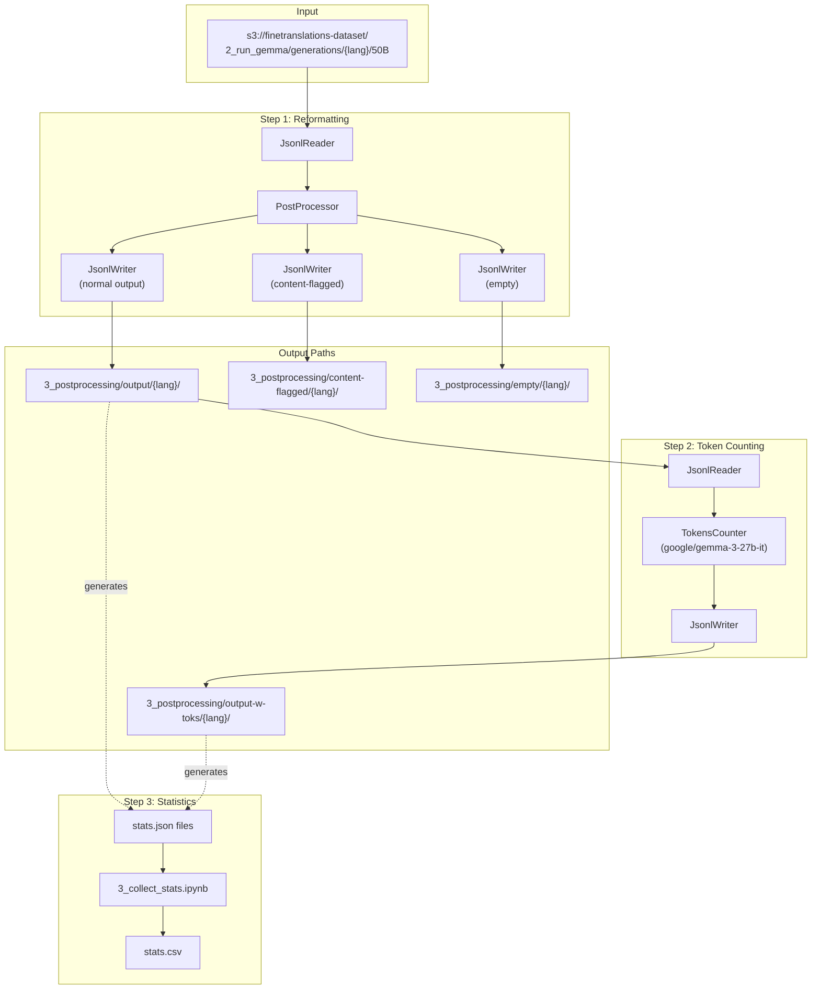
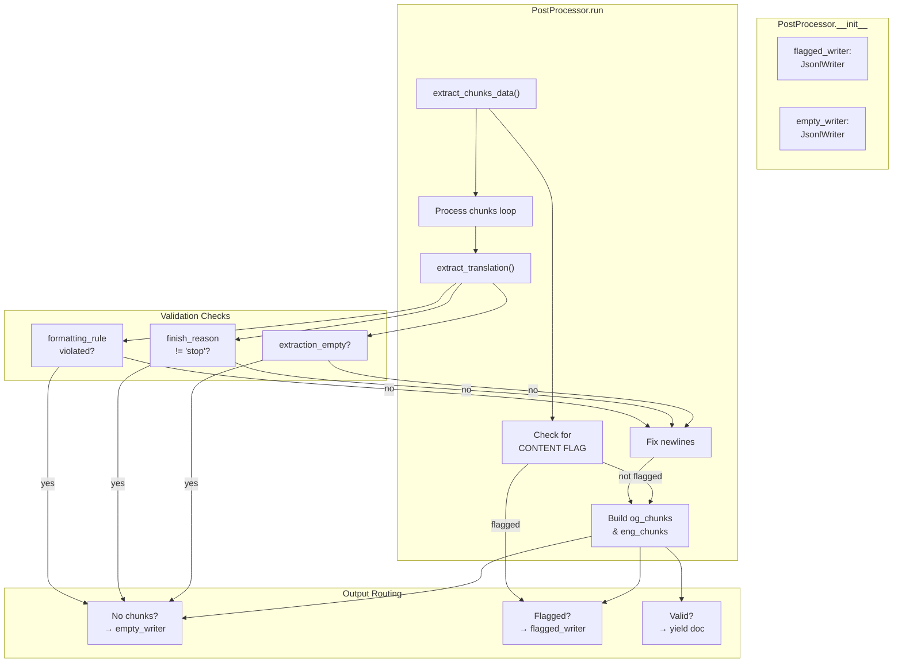
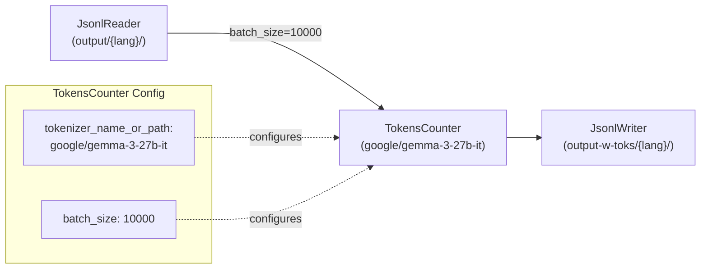
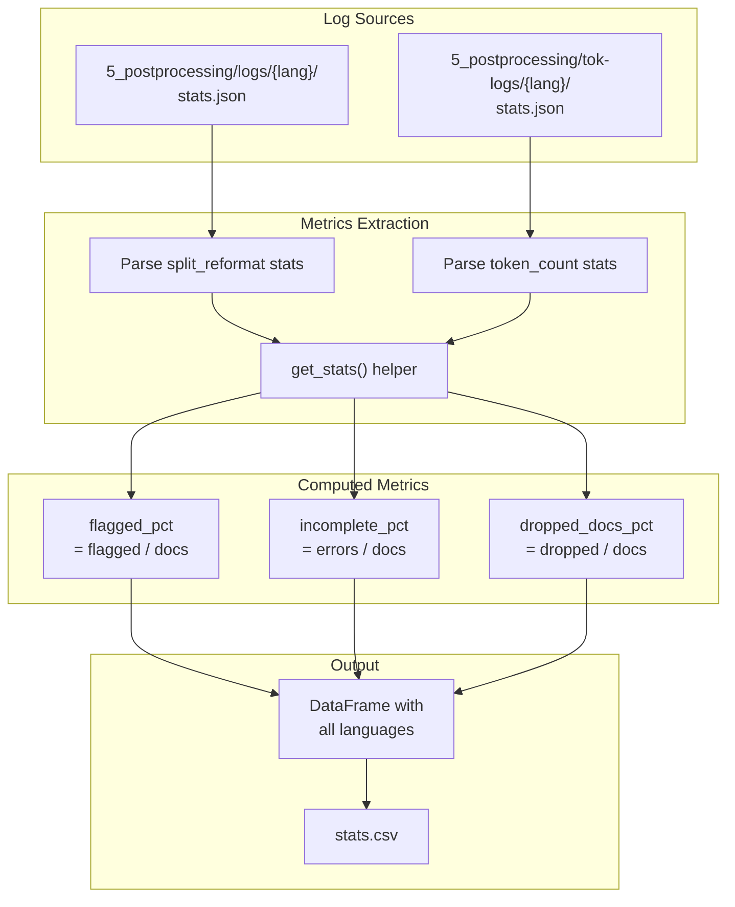

<!-- source: DeepWiki mcp.deepwiki.com · repo huggingface/finetranslations · page 5 Post-Processing System (Phase 3) · fetched 2026-10-26 -->

# Post-Processing System (Phase 3)

<details>
<summary>Relevant source files</summary>

The following files were used as context for generating this wiki page:

- [3_postprocessing/1_split_reformat.py](3_postprocessing/1_split_reformat.py)
- [3_postprocessing/2_count_toks.py](3_postprocessing/2_count_toks.py)
- [3_postprocessing/3_collect_stats.ipynb](3_postprocessing/3_collect_stats.ipynb)

</details>


## Purpose and Scope

The Post-Processing System is the final phase of the finetranslations pipeline that transforms raw Gemma translation outputs into structured, analyzed data ready for consumption. This phase performs three sequential operations: reformatting and validating translation outputs, counting tokens in the final English text, and aggregating comprehensive statistics across all languages.

This document covers the technical implementation of all three post-processing steps. For information about the translation system that produces the input to this phase, see [Translation System (Phase 2)](#4). For detailed documentation on individual steps, see:
- [Output Reformatting](#5.1) for the `PostProcessor` implementation
- [Token Counting](#5.2) for the `TokensCounter` pipeline step
- [Statistics Collection](#5.3) for metrics aggregation

## System Overview

Phase 3 consists of three sequential pipeline steps, each executing as separate Slurm jobs per language:

1. **Output Reformatting**: Extracts translation chunks, validates formatting, handles content flags, and routes documents to appropriate output directories
2. **Token Counting**: Applies the Gemma tokenizer to count tokens in the final English output
3. **Statistics Collection**: Aggregates metrics from processing logs to generate comprehensive statistics



**Diagram: Phase 3 Pipeline Architecture**

Sources: [3_postprocessing/1_split_reformat.py:151-156](), [3_postprocessing/2_count_toks.py:24-29](), [3_postprocessing/3_collect_stats.ipynb:36-66]()

## Data Flow Through S3

Phase 3 reads from and writes to multiple S3 directories under the `s3://finetranslations-dataset/` bucket:

| Step | Input Path | Output Path(s) | Purpose |
|------|-----------|----------------|---------|
| Reformatting | `2_run_gemma/generations/{lang}/50B` | `3_postprocessing/output/{lang}/` | Successfully processed documents |
| | | `3_postprocessing/content-flagged/{lang}/` | Documents with content flags |
| | | `3_postprocessing/empty/{lang}/` | Documents with no extractable chunks |
| Token Counting | `3_postprocessing/output/{lang}/` | `3_postprocessing/output-w-toks/{lang}/` | Documents with token counts added |

All data is stored in JSONL format with one document per line. The three-way split in the reformatting step allows downstream consumers to filter data based on content quality and completeness.

Sources: [3_postprocessing/1_split_reformat.py:153-155](), [3_postprocessing/2_count_toks.py:26-28]()

## Document Structure Transformation

The post-processing phase transforms documents from Gemma's inference output format to a structured format suitable for dataset release:

### Input Structure (from Gemma)

Documents contain either `rollout_results` or `inference_results` in metadata:

```
{
  "text": "original document text",
  "metadata": {
    "rollout_results": [...],  // Structure A
    "inference_results": [...], // Structure B
    "chunks": [...],
    "language": "arb",
    "language_script": "Arab",
    "quality_score": 0.85,
    ...
  }
}
```

### Output Structure (post-processing)

The `PostProcessor` restructures documents to separate original and translated content:

```
{
  "text": "concatenated English chunks",
  "id": "document_id",
  "metadata": {
    "eng_chunks": ["chunk1_en", "chunk2_en", ...],
    "og_chunks": ["chunk1_og", "chunk2_og", ...],
    "og_full_text": "original document text",
    "og_language": "arb_Arab",
    "og_language_score": 0.98,
    "og_token_count": 1024,
    "og_quality_score": 0.85,
    "early_stop": false,
    "url": "...",
    "file_path": "...",
    "minhash_cluster_size": 5
  }
}
```

Sources: [3_postprocessing/1_split_reformat.py:10-49](), [3_postprocessing/1_split_reformat.py:100-115]()

## PostProcessor Implementation

The `PostProcessor` class extends `datatrove.pipeline.base.PipelineStep` and implements the core reformatting logic. It requires two writer instances for handling rejected documents.



**Diagram: PostProcessor Logic Flow**

### Chunk Extraction Logic

The `extract_chunks_data()` function handles two output structures from the translation phase:

- **Structure A (rollout_results)**: Direct access to chunks array [3_postprocessing/1_split_reformat.py:14-24]()
- **Structure B (inference_results)**: Reconstructs chunks from separate metadata fields [3_postprocessing/1_split_reformat.py:26-48]()

Both structures are normalized to a consistent format:
```python
{"chunk_text": str, "raw_output": str, "finish_reason": str}
```

### Translation Extraction

The `extract_translation()` function parses Gemma's output to extract the English translation [3_postprocessing/1_split_reformat.py:51-63](). It handles multiple formatting patterns:

1. **Standard format**: `<TRANSLATION>text</TRANSLATION>`
2. **Malformed tags**: Splits on `</ORIGINAL>` and common typos (`</ORIGITAL>`, `</ORIGINATION>`, etc.)
3. **Returns `None`** if no valid translation found, triggering `extraction_empty` statistic

### Content Flagging Detection

Documents are flagged if any chunk's `raw_output` starts with `"CONTENT FLAG"` after stripping whitespace and the `<TRANSLATION>` prefix [3_postprocessing/1_split_reformat.py:70]():

```python
flagged = any(
    chunk['raw_output'].lstrip().removeprefix("<TRANSLATION>").startswith("CONTENT FLAG") 
    for chunk in chunks_data
)
```

### Cropping Conditions

The processor stops processing chunks and marks `early_stop=True` if any of these conditions occur:

| Condition | Statistic | Line Reference |
|-----------|-----------|----------------|
| `"ERROR: formatting rule violated"` in output | `formatting_rule` | [3_postprocessing/1_split_reformat.py:78-81]() |
| `finish_reason != "stop"` | `finish_length` | [3_postprocessing/1_split_reformat.py:82-85]() |
| `extract_translation()` returns `None` | `extraction_empty` | [3_postprocessing/1_split_reformat.py:86-90]() |

### Newline Preservation

The processor preserves leading and trailing newlines from the original chunk [3_postprocessing/1_split_reformat.py:92-95]():

```python
n_leading = len(chunk['chunk_text']) - len(chunk['chunk_text'].lstrip('\n'))
n_trailing = len(chunk['chunk_text']) - len(chunk['chunk_text'].rstrip('\n'))
extracted_english = "\n" * n_leading + extracted_english.strip("\n") + "\n" * n_trailing
```

This ensures the English text maintains the same paragraph structure as the original.

Sources: [3_postprocessing/1_split_reformat.py:3-129]()

## Token Counting Pipeline

The token counting step uses the `datatrove.pipeline.tokens.TokensCounter` class to count tokens in the final English output using the Gemma tokenizer.



**Diagram: Token Counting Pipeline Configuration**

The `TokensCounter` is configured with:
- `tokenizer_name_or_path="google/gemma-3-27b-it"` - Uses the same tokenizer as the translation model
- `batch_size=10000` - Processes 10,000 documents per batch for efficient tokenization

This step adds a `token_count` field to each document's metadata representing the number of tokens in the English text. The token count is essential for:
- Verifying the final dataset size
- Analyzing compression ratios between source and target languages
- Validating translation quality based on length preservation

Sources: [3_postprocessing/2_count_toks.py:27]()

## Statistics Collection

The statistics collection notebook aggregates metrics from Slurm job logs to produce a comprehensive overview of post-processing results per language.



**Diagram: Statistics Collection Workflow**

### Metrics Collected

The notebook collects the following metrics per language:

| Metric | Source | Calculation | Description |
|--------|--------|-------------|-------------|
| `lang` | Directory name | - | Language code |
| `starting_docs` | `stats[1]["stats"]["docs"]` | Direct | Number of input documents |
| `starting_tokens_ml` | `stats[0]["stats"]["doc_len_tokens"]` | Direct | Total tokens in original language |
| `flagged_docs` | `stats[1]["stats"]["flagged"]` | Direct | Documents with content flags |
| `flagged_pct` | Computed | `flagged / docs` | Percentage of flagged documents |
| `finish_length` | `stats[1]["stats"]["finish_length"]` | Direct | Documents stopped due to length |
| `extraction_empty` | `stats[1]["stats"]["extraction_empty"]` | Direct | Documents with empty extractions |
| `formatting_rule` | `stats[1]["stats"]["formatting_rule"]` | Direct | Documents with format violations |
| `incomplete_pct` | Computed | `(finish_length + extraction_empty + formatting_rule) / docs` | Percentage of incomplete translations |
| `no_chunks` | `stats[1]["stats"]["no_chunks"]` | Direct | Documents with zero chunks |
| `written_docs` | `stats[2]["stats"]["total"]` | Direct | Successfully processed documents |
| `written_toks_eng` | `tok_stats[1]["stats"]["tokens"]` | Direct | Total English tokens written |
| `dropped_docs_pct` | Computed | `(docs - written_docs) / docs` | Percentage of dropped documents |

### Stats JSON Structure

Each Slurm job writes a `stats.json` file containing statistics from each pipeline step. The structure is:

```
[
  {step_0_stats},
  {step_1_stats},
  {step_2_stats},
  ...
]
```

The `get_stats()` helper function extracts values, handling both scalar and dictionary formats [3_postprocessing/3_collect_stats.ipynb:44-48]():

```python
def get_stats(stat, key):
    val = stat["stats"].get(key, 0)
    if isinstance(val, dict):
        return val["total"]
    return val
```

### Output Format

The notebook exports a CSV file with one row per language containing all metrics. This enables easy analysis of:
- Translation success rates across languages
- Common failure modes (content flags vs. incomplete translations)
- Token count distributions in source and target languages
- Overall pipeline efficiency

Sources: [3_postprocessing/3_collect_stats.ipynb:29-66]()

## Slurm Execution Configuration

Both reformatting and token counting steps use `SlurmPipelineExecutor` with similar configuration patterns but different resource requirements.

### Reformatting Job Configuration

```python
SlurmPipelineExecutor(
    pipeline=[...],
    partition="hopper-cpu",
    cpus_per_task=1,
    time="2:00:00",
    tasks=min(200, max(1, 2 * int(round(100 * min(total_tokens, TOKENS_CAP) / TOKENS_CAP)))),
    job_name=f"proc_{lang}",
    logging_dir=f"/path/to/local/pipeline/5_postprocessing/logs/{lang}",
    sbatch_args={"mem-per-cpu": "1950M"}
)
```

Sources: [3_postprocessing/1_split_reformat.py:151-166]()

### Token Counting Job Configuration

```python
SlurmPipelineExecutor(
    pipeline=[...],
    partition="hopper-cpu",
    cpus_per_task=16,
    time="5:00:00",
    tasks=min(200, max(1, 2 * int(round(100 * min(total_tokens, TOKENS_CAP) / TOKENS_CAP)))),
    job_name=f"tok_count_{lang}",
    logging_dir=f"/path/to/local/pipeline/5_postprocessing/tok-logs/{lang}",
    sbatch_args={"mem-per-cpu": "1950M"}
)
```

Sources: [3_postprocessing/2_count_toks.py:24-39]()

### Resource Allocation Comparison

| Parameter | Reformatting | Token Counting | Rationale |
|-----------|--------------|----------------|-----------|
| `partition` | `hopper-cpu` | `hopper-cpu` | CPU-only operations |
| `cpus_per_task` | 1 | 16 | Token counting benefits from parallelization |
| `time` | 2:00:00 | 5:00:00 | Tokenization takes longer |
| `tasks` | Dynamic | Dynamic | Same formula based on token count |
| `mem-per-cpu` | 1950M | 1950M | Consistent memory allocation |

### Dynamic Task Scaling

Both steps use the same formula to calculate the number of parallel tasks [3_postprocessing/1_split_reformat.py:146](), [3_postprocessing/2_count_toks.py:19]():

```python
tasks = min(200, max(1, 2 * int(round(100 * min(total_tokens, TOKENS_CAP) / TOKENS_CAP))))
```

This formula:
- Scales from 1 to 200 tasks based on language token count
- Languages with token counts near `TOKENS_CAP` (50B) get maximum tasks (200)
- Languages with fewer tokens get proportionally fewer tasks
- Multiplies by 2 to increase parallelism
- Caps at 200 to avoid excessive job creation

For example:
- Language with 50B tokens: `min(200, max(1, 2 * 100)) = 200 tasks`
- Language with 25B tokens: `min(200, max(1, 2 * 50)) = 100 tasks`
- Language with 5B tokens: `min(200, max(1, 2 * 10)) = 20 tasks`

Sources: [3_postprocessing/1_split_reformat.py:142-146](), [3_postprocessing/2_count_toks.py:15-19]()

## Error Handling and Output Categories

The post-processing system routes documents to three distinct categories based on validation results:

### Category 1: Normal Output

Documents that pass all validation checks are written to `3_postprocessing/output/{lang}/` and contain:
- Successfully extracted English translations
- Complete chunk processing (no early stops)
- No content flags
- All chunks with `finish_reason="stop"`

These documents proceed to token counting and are included in the final dataset.

### Category 2: Content-Flagged

Documents written to `3_postprocessing/content-flagged/{lang}/` contain translations that triggered content safety mechanisms [3_postprocessing/1_split_reformat.py:122-125](). The flagging occurs when Gemma's output indicates potentially harmful content by starting with `"CONTENT FLAG"`.

These documents are excluded from the final dataset but retained for:
- Auditing content filtering effectiveness
- Analyzing false positive rates
- Understanding language-specific content patterns

### Category 3: Empty

Documents written to `3_postprocessing/empty/{lang}/` have zero extractable chunks [3_postprocessing/1_split_reformat.py:117-120](). This occurs when:
- All chunks fail validation (formatting errors, length limits, or extraction failures)
- The document contains no processable content after Gemma inference

Empty documents indicate translation failures and are used to:
- Identify systematic issues with specific document types
- Calculate failure rates per language
- Tune chunking or prompt strategies in future iterations

### Statistics Tracking

The `PostProcessor` tracks detailed statistics using `self.stat_update()` [3_postprocessing/1_split_reformat.py:67-128]():

| Statistic | Meaning |
|-----------|---------|
| `docs` | Total documents processed |
| `formatting_rule` | Documents with formatting violations |
| `finish_length` | Documents stopped due to length limits |
| `extraction_empty` | Documents where translation extraction failed |
| `no_chunks` | Documents with zero chunks |
| `flagged` | Documents with content flags |
| `chunks` | Total chunks successfully processed |

These statistics are written to `stats.json` files and aggregated by the statistics collection notebook.

Sources: [3_postprocessing/1_split_reformat.py:65-129]()

## Performance Considerations

### Memory Usage

Both reformatting and token counting jobs allocate 1950M per CPU, staying under the 2GB threshold to allow efficient packing on Slurm nodes. The reformatting step uses single-CPU tasks since chunk processing is I/O-bound, while token counting uses 16 CPUs to parallelize tokenization operations.

### Task Distribution

The dynamic task scaling ensures that:
- High-resource languages (near 50B tokens) get maximum parallelism (200 tasks)
- Low-resource languages use fewer tasks to avoid scheduler overhead
- All languages complete in similar wall-clock time due to proportional work distribution

### Batch Processing

Token counting uses `batch_size=10000` to amortize tokenizer initialization overhead across multiple documents. This significantly improves throughput compared to per-document tokenization.

Sources: [3_postprocessing/1_split_reformat.py:151-166](), [3_postprocessing/2_count_toks.py:24-39]()

---

