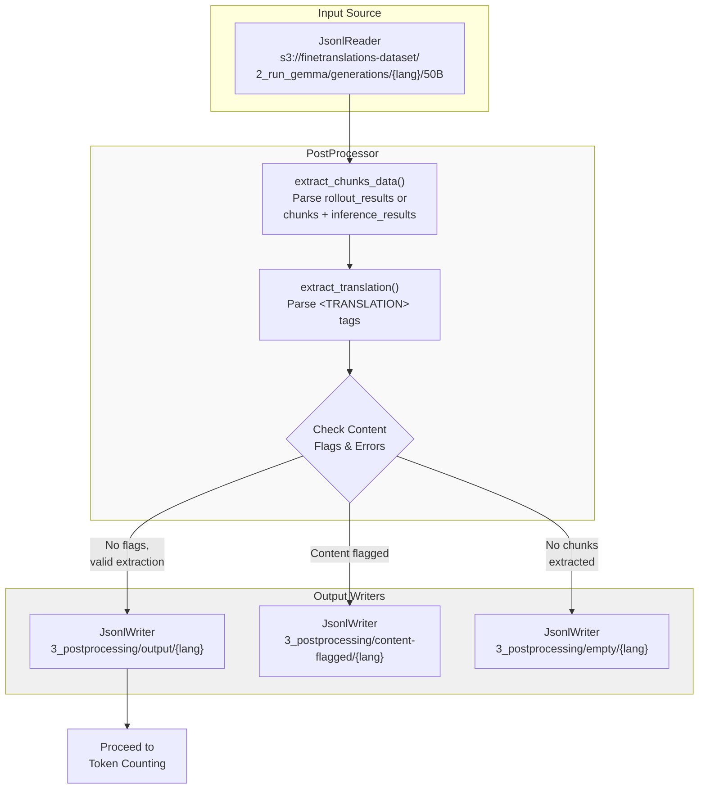
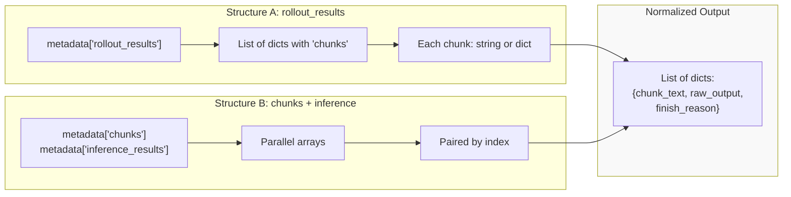
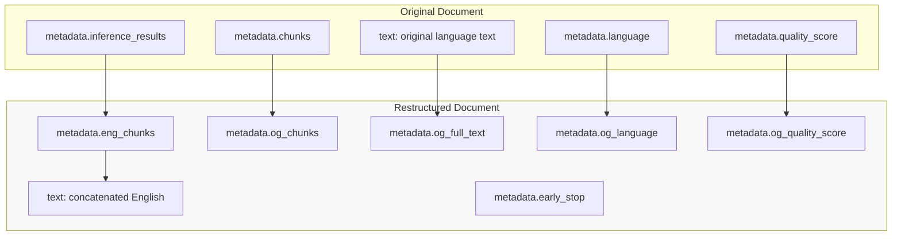
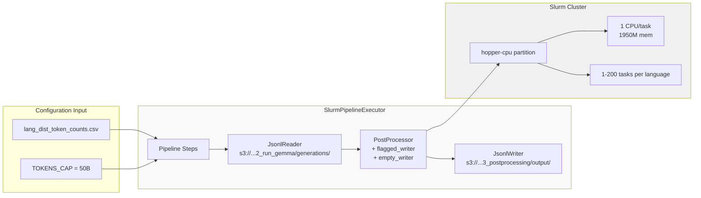

<!-- source: DeepWiki mcp.deepwiki.com · repo huggingface/finetranslations · page 5.1 Output Reformatting · fetched 2026-10-26 -->

# Output Reformatting

<details>
<summary>Relevant source files</summary>

The following files were used as context for generating this wiki page:

- [3_postprocessing/1_split_reformat.py](3_postprocessing/1_split_reformat.py)

</details>


## Purpose and Scope

The Output Reformatting subsystem processes the raw output from the Gemma translation model to extract clean, structured translations. This phase parses translation outputs, handles formatting violations and content flags, preserves chunk boundaries, and routes documents into three separate output categories based on processing outcomes. The reformatting logic is implemented in the `PostProcessor` pipeline step.

For information about the translation phase that produces these outputs, see [Translation System (Phase 2)](#4). For token counting that follows reformatting, see [Token Counting](#5.2).

## System Overview

The `PostProcessor` class [3_postprocessing/1_split_reformat.py:3-8]() is a `PipelineStep` that reads Gemma translation outputs from S3, extracts structured translation data, and writes results to three distinct output paths:

| Output Path | Purpose | Trigger Condition |
|------------|---------|------------------|
| `3_postprocessing/output/{lang}` | Successfully processed translations | No content flags, no formatting errors |
| `3_postprocessing/content-flagged/{lang}` | Documents flagged by Gemma | Raw output contains "CONTENT FLAG" |
| `3_postprocessing/empty/{lang}` | Documents with no extractable chunks | Empty extraction results |



**Diagram 1: PostProcessor data flow and output routing**

Sources: [3_postprocessing/1_split_reformat.py:3-129]()

## Input Format Handling

The `PostProcessor` handles two distinct input formats produced by different versions of the Gemma inference pipeline. The `extract_chunks_data` function [3_postprocessing/1_split_reformat.py:10-49]() normalizes both formats into a consistent internal representation.

### Structure A: rollout_results Format

Structure A stores translation results in `metadata["rollout_results"]` as a list of dictionaries, where each dictionary contains a `chunks` array [3_postprocessing/1_split_reformat.py:14-24](). Chunks can be either strings or dictionaries with `chunk_text` and `raw_output` fields.

### Structure B: chunks + inference_results Format

Structure B separates original chunks (`metadata["chunks"]`) from inference outputs (`metadata["inference_results"]`) [3_postprocessing/1_split_reformat.py:26-48](). The function pairs these arrays by index, falling back to using `doc.text` as a single chunk if the `chunks` field is missing [3_postprocessing/1_split_reformat.py:33-34]().



**Diagram 2: Input format normalization in extract_chunks_data()**

Sources: [3_postprocessing/1_split_reformat.py:10-49]()

## Translation Extraction Logic

The `extract_translation` function [3_postprocessing/1_split_reformat.py:51-63]() extracts English translations from Gemma's formatted output. The expected format uses XML-like tags: `<TRANSLATION>translated text</TRANSLATION>`.

### Extraction Algorithm

1. **Prefix normalization** [3_postprocessing/1_split_reformat.py:52-53](): Remove leading `<TRANSLATION>` tag
2. **Tag replacement** [3_postprocessing/1_split_reformat.py:54-55](): Replace any mid-text `<TRANSLATION>` with `</TRANSLATION>`
3. **Standard extraction** [3_postprocessing/1_split_reformat.py:56-58](): Split on `</TRANSLATION>` and take the first part
4. **Fallback extraction** [3_postprocessing/1_split_reformat.py:60-62](): If standard tags not found, try common misspellings of `</ORIGINAL>`: `</ORIGITAL>`, `</ORIGINATION>`, `</ORIGAL>`, `</ORIGINALS>`, `</ORIGINALE>`
5. **Failure case**: Return `None` if no valid tags found

This robust extraction handles common formatting errors produced by the Gemma model during generation.

Sources: [3_postprocessing/1_split_reformat.py:51-63]()

## Processing Pipeline and Error Handling

The main processing loop [3_postprocessing/1_split_reformat.py:66-129]() processes each document through multiple validation stages, collecting statistics and routing documents based on processing outcomes.

### Error Detection and Early Stopping

The processor checks for three types of issues that trigger early stopping (`cropped = True`):

| Error Type | Detection Logic | Statistics Key | Line Reference |
|------------|----------------|----------------|----------------|
| Formatting violation | `"ERROR: formatting rule violated"` in `raw_output` | `formatting_rule` | [3_postprocessing/1_split_reformat.py:78-81]() |
| Length limit exceeded | `finish_reason != "stop"` | `finish_length` | [3_postprocessing/1_split_reformat.py:82-85]() |
| Empty extraction | `extract_translation()` returns `None` | `extraction_empty` | [3_postprocessing/1_split_reformat.py:86-90]() |

When any error occurs, processing stops immediately for that document, and no further chunks are processed [3_postprocessing/1_split_reformat.py:77-90]().

### Newline Preservation

The processor preserves leading and trailing newlines from the original chunk to maintain document structure [3_postprocessing/1_split_reformat.py:92-95](). This ensures that paragraph boundaries and formatting from the source language are reflected in the English translation.

```python
n_leading = len(chunk['chunk_text']) - len(chunk['chunk_text'].lstrip('\n'))
n_trailing = len(chunk['chunk_text']) - len(chunk['chunk_text'].rstrip('\n'))
extracted_english = "\n" * n_leading + extracted_english.strip("\n") + "\n" * n_trailing
```

Sources: [3_postprocessing/1_split_reformat.py:66-99]()

## Content Flagging Detection

The processor detects content flags by checking if any chunk's `raw_output` starts with "CONTENT FLAG" after stripping leading whitespace and the `<TRANSLATION>` prefix [3_postprocessing/1_split_reformat.py:70](). This check occurs before chunk processing begins.

```python
flagged = any(chunk['raw_output'].lstrip().removeprefix("<TRANSLATION>").startswith("CONTENT FLAG") 
              for chunk in chunks_data)
```

Documents with flagged content are written to the `content-flagged` output path and excluded from the main output stream [3_postprocessing/1_split_reformat.py:122-125]().

Sources: [3_postprocessing/1_split_reformat.py:70](), [3_postprocessing/1_split_reformat.py:122-125]()

## Document Restructuring

Successfully processed documents are restructured into a new `Document` object [3_postprocessing/1_split_reformat.py:100-115]() with the following schema:

### Document Structure

| Field | Content | Purpose |
|-------|---------|---------|
| `text` | Concatenated `eng_chunks` | Full English translation |
| `id` | Original document ID | Preserved for traceability |
| `metadata.eng_chunks` | List of translated chunks | Per-chunk translations |
| `metadata.og_chunks` | List of original chunks | Per-chunk source text |
| `metadata.og_full_text` | Original `doc.text` | Complete source document |
| `metadata.og_language` | `{language}_{script}` | Source language code |
| `metadata.og_language_score` | Language detection score | From Phase 1 |
| `metadata.og_token_count` | Source token count | From Phase 1 |
| `metadata.og_quality_score` | EPFL classifier score | From Phase 1 (or -1 if not available) |
| `metadata.early_stop` | Boolean | Whether processing was truncated |
| `metadata.url` | Source URL | Preserved from original |
| `metadata.file_path` | Source file path | Preserved from original |
| `metadata.minhash_cluster_size` | Cluster size | Preserved from original |

This structure preserves complete provenance information, allowing downstream analysis to trace translations back to their source documents and quality scores.



**Diagram 3: Document restructuring from original to output format**

Sources: [3_postprocessing/1_split_reformat.py:100-115]()

## Statistics Collection

The `PostProcessor` tracks several statistics using `self.stat_update()` calls:

| Statistic | Description | Line Reference |
|-----------|-------------|----------------|
| `docs` | Total documents processed | [3_postprocessing/1_split_reformat.py:67]() |
| `formatting_rule` | Documents with formatting violations | [3_postprocessing/1_split_reformat.py:79]() |
| `finish_length` | Documents stopped due to length limits | [3_postprocessing/1_split_reformat.py:83]() |
| `extraction_empty` | Documents with empty extraction results | [3_postprocessing/1_split_reformat.py:88]() |
| `no_chunks` | Documents with zero extractable chunks | [3_postprocessing/1_split_reformat.py:118]() |
| `flagged` | Documents with content flags | [3_postprocessing/1_split_reformat.py:123]() |
| `chunks` | Total chunks successfully processed (per doc) | [3_postprocessing/1_split_reformat.py:128]() |

These statistics are aggregated across all tasks and used in downstream analysis (see [Statistics Collection](#5.3)).

Sources: [3_postprocessing/1_split_reformat.py:67-128]()

## Execution Configuration

The reformatting pipeline is executed using `SlurmPipelineExecutor` on the `hopper-cpu` partition [3_postprocessing/1_split_reformat.py:151-166](). The execution script iterates through all languages defined in `lang_dist_token_counts.csv` [3_postprocessing/1_split_reformat.py:137-145]().

### Resource Allocation

| Parameter | Value | Purpose |
|-----------|-------|---------|
| `partition` | `"hopper-cpu"` | CPU-only processing (no GPU needed) |
| `cpus_per_task` | `1` | Single-threaded processing |
| `time` | `"2:00:00"` | 2-hour time limit per task |
| `tasks` | `min(200, max(1, 2 * int(round(100 * min(total_tokens, TOKENS_CAP) / TOKENS_CAP))))` | Dynamic scaling based on token count |
| `mem-per-cpu` | `"1950M"` | ~2GB memory per CPU |

### Task Scaling Logic

The number of tasks is calculated dynamically based on the language's token count relative to the 50B cap [3_postprocessing/1_split_reformat.py:146]():

- Minimum: 1 task
- Maximum: 200 tasks
- Scaling: Approximately 2 tasks per 1B tokens (up to 50B cap)

This ensures larger languages receive more parallel processing resources while maintaining reasonable limits.



**Diagram 4: Execution pipeline and resource configuration**

Sources: [3_postprocessing/1_split_reformat.py:131-166]()

## Output Path Structure

The three output paths on S3 follow this structure:

```
s3://finetranslations-dataset/3_postprocessing/
├── output/{lang}/              # Successfully processed documents
├── content-flagged/{lang}/     # Documents with content flags
└── empty/{lang}/                # Documents with no extractable chunks
```

Each output writer is configured as a `JsonlWriter` that writes documents in JSONL format [3_postprocessing/1_split_reformat.py:154-155](). The main output path feeds into the token counting phase (see [Token Counting](#5.2)), while the flagged and empty paths are retained for analysis and potential manual review.

Sources: [3_postprocessing/1_split_reformat.py:151-166]()

---

