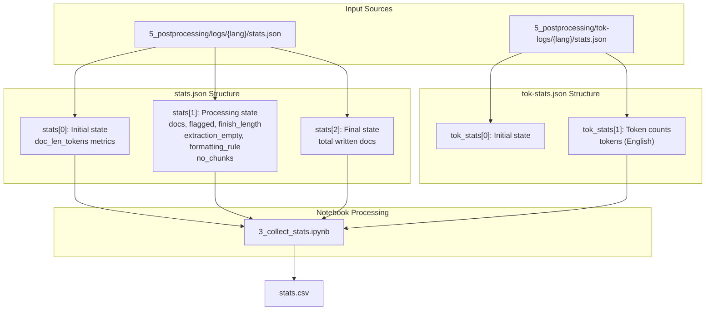
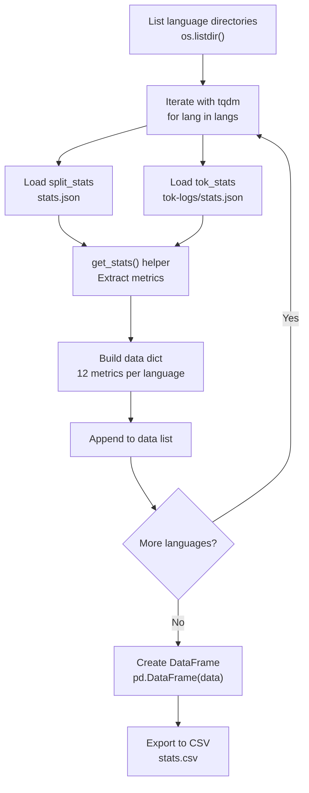
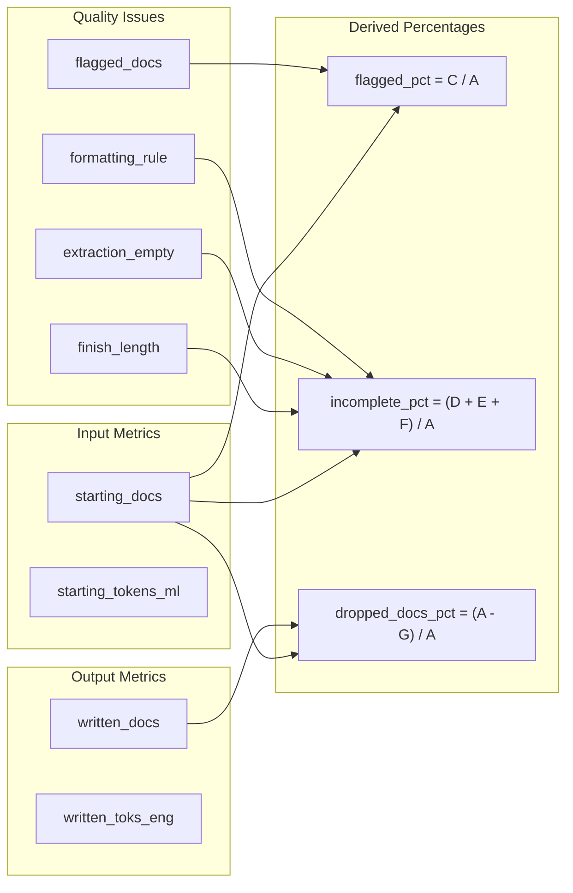
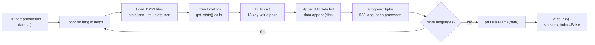

<!-- source: DeepWiki mcp.deepwiki.com · repo huggingface/finetranslations · page 5.3 Statistics Collection · fetched 2026-10-26 -->

# Statistics Collection

<details>
<summary>Relevant source files</summary>

The following files were used as context for generating this wiki page:

- [3_postprocessing/3_collect_stats.ipynb](3_postprocessing/3_collect_stats.ipynb)

</details>


## Purpose and Scope

This page documents the statistics collection process in the post-processing phase, which aggregates metrics from processing logs to provide a comprehensive view of the translation pipeline's outcomes across all languages. The notebook at [3_postprocessing/3_collect_stats.ipynb]() reads statistics files generated by earlier post-processing steps and compiles them into a single CSV file for analysis.

For information about the reformatting step that generates the split statistics, see [Output Reformatting](#5.1). For information about the token counting step that generates token statistics, see [Token Counting](#5.2).

---

## Overview

The statistics collection system is implemented as a Jupyter notebook that performs the following operations:

1. **Iterates through all language directories** in the post-processing logs
2. **Reads two types of statistics files** per language:
   - Split/reformatting statistics from the PostProcessor step
   - Token counting statistics from the TokensCounter step
3. **Extracts and computes metrics** including document counts, token counts, and quality indicators
4. **Calculates derived statistics** such as flagging rates, incompletion rates, and document drop rates
5. **Exports a consolidated CSV file** containing all metrics across languages

The notebook consolidates metrics that span the entire post-processing pipeline, enabling cross-language analysis and pipeline quality assessment.

**Sources:** [3_postprocessing/3_collect_stats.ipynb:1-99]()

---

## Input Sources

### Statistics File Structure

The notebook reads from two distinct statistics sources for each language:



### Split Statistics File

Located at `/path/to/local/pipeline/5_postprocessing/logs/{lang}/stats.json`, this file contains an array of three statistics objects tracking the progression through the reformatting step:

- **Index 0**: Initial document state with multilingual token counts
- **Index 1**: Processing state with error and quality metrics
- **Index 2**: Final state with successfully written document counts

**Sources:** [3_postprocessing/3_collect_stats.ipynb:36-38]()

### Token Counting Statistics File

Located at `/path/to/local/pipeline/5_postprocessing/tok-logs/{lang}/stats.json`, this file contains token counting results from the TokensCounter step:

- **Index 1**: Token counts for the English translations

**Sources:** [3_postprocessing/3_collect_stats.ipynb:40-42]()

---

## Statistics Collection Process

### Notebook Execution Flow



### Metric Extraction Helper

The notebook implements a helper function `get_stats()` at [3_postprocessing/3_collect_stats.ipynb:44-48]() that safely extracts values from the nested statistics structure:

```python
def get_stats(stat, key):
    val = stat["stats"].get(key, 0)
    if isinstance(val, dict):
        return val["total"]
    return val
```

This function handles two formats:
- **Simple values**: Direct numeric values (e.g., `{"docs": 1000}`)
- **Dict values**: Nested totals (e.g., `{"doc_len_tokens": {"total": 50000}}`)

**Sources:** [3_postprocessing/3_collect_stats.ipynb:44-48]()

---

## Collected Metrics

### Metrics Table

The notebook collects the following metrics for each language:

| Metric | Source | Description | Data Type |
|--------|--------|-------------|-----------|
| `lang` | Directory name | Language code | String |
| `starting_docs` | stats[1].docs | Total documents entering post-processing | Integer |
| `starting_tokens_ml` | stats[0].doc_len_tokens | Token count in source language | Integer |
| `flagged_docs` | stats[1].flagged | Documents flagged for content issues | Integer |
| `flagged_pct` | Derived | Percentage of documents flagged | Float (0-1) |
| `finish_length` | stats[1].finish_length | Documents with incomplete generation | Integer |
| `extraction_empty` | stats[1].extraction_empty | Documents with empty extraction | Integer |
| `formatting_rule` | stats[1].formatting_rule | Documents violating formatting rules | Integer |
| `incomplete_pct` | Derived | Percentage with processing issues | Float (0-1) |
| `no_chunks` | stats[1].no_chunks | Documents with no extractable chunks | Integer |
| `written_docs` | stats[2].total | Successfully written documents | Integer |
| `written_toks_eng` | tok_stats[1].tokens | Token count in English translation | Integer |
| `dropped_docs_pct` | Derived | Percentage of documents not written | Float (0-1) |

**Sources:** [3_postprocessing/3_collect_stats.ipynb:49-63]()

---

## Derived Statistics

### Percentage Calculations

The notebook computes three key percentage metrics to assess pipeline quality:

#### Flagged Percentage

```
flagged_pct = flagged_docs / starting_docs
```

This metric indicates the proportion of documents that triggered content flags during translation. A high flagging rate may indicate sensitive content or translation model issues.

**Source:** [3_postprocessing/3_collect_stats.ipynb:54]()

#### Incomplete Percentage

```
incomplete_pct = (finish_length + extraction_empty + formatting_rule) / starting_docs
```

This metric aggregates three types of processing failures:
- **finish_length**: Documents where generation was incomplete (context limit reached)
- **extraction_empty**: Documents where chunk extraction yielded no content
- **formatting_rule**: Documents that violated expected formatting patterns

**Source:** [3_postprocessing/3_collect_stats.ipynb:58]()

#### Dropped Documents Percentage

```
dropped_docs_pct = (starting_docs - written_docs) / starting_docs
```

This metric captures the overall attrition rate from input to final output, accounting for all types of failures (flagging, incompletion, extraction issues).

**Source:** [3_postprocessing/3_collect_stats.ipynb:62]()

### Metric Relationships



**Sources:** [3_postprocessing/3_collect_stats.ipynb:49-63]()

---

## Output Format

### CSV Export Structure

The notebook exports a CSV file named `stats.csv` containing one row per language with all 13 metrics. The export is performed using pandas:

```python
df = pd.DataFrame(data)
df.to_csv("stats.csv", index=False)
```

**CSV Schema:**

```
lang,starting_docs,starting_tokens_ml,flagged_docs,flagged_pct,finish_length,extraction_empty,formatting_rule,incomplete_pct,no_chunks,written_docs,written_toks_eng,dropped_docs_pct
arb_Arab,12500,45000000,125,0.01,50,10,5,0.0052,8,12400,43500000,0.008
ces_Latn,8900,32000000,89,0.01,35,8,3,0.0052,5,8850,31200000,0.0056
...
```

### Data Processing Pipeline



The notebook processes 532 language subdirectories as indicated by the progress bar output at [3_postprocessing/3_collect_stats.ipynb:24]().

**Sources:** [3_postprocessing/3_collect_stats.ipynb:29-66]()

---

## Implementation Details

### Language Directory Discovery

The notebook discovers languages by listing directories in the logs folder:

```python
langs = os.listdir("/path/to/local/pipeline/5_postprocessing/logs")
```

This approach automatically processes all available languages without requiring explicit configuration.

**Source:** [3_postprocessing/3_collect_stats.ipynb:11]()

### Progress Tracking

The notebook uses `tqdm` to provide visual feedback during processing:

```python
for lang in tqdm(langs):
    # Process each language
```

The progress bar shows real-time status (e.g., `100%|██████████| 532/532 [00:01<00:00, 477.94it/s]`), indicating 532 languages processed at approximately 478 languages per second.

**Source:** [3_postprocessing/3_collect_stats.ipynb:35]()

### Error Handling

The `get_stats()` helper function provides default values for missing keys:

```python
val = stat["stats"].get(key, 0)
```

This ensures the notebook continues processing even if some statistics are missing from the input files, defaulting to `0` for absent metrics.

**Sources:** [3_postprocessing/3_collect_stats.ipynb:44-48]()

---

