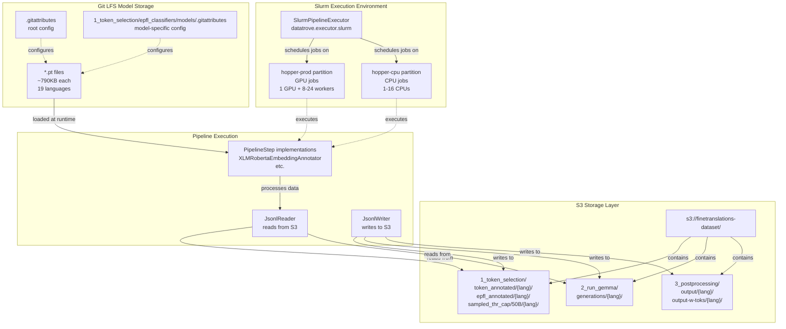
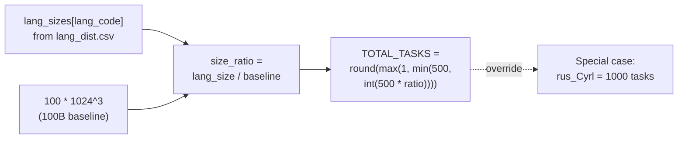
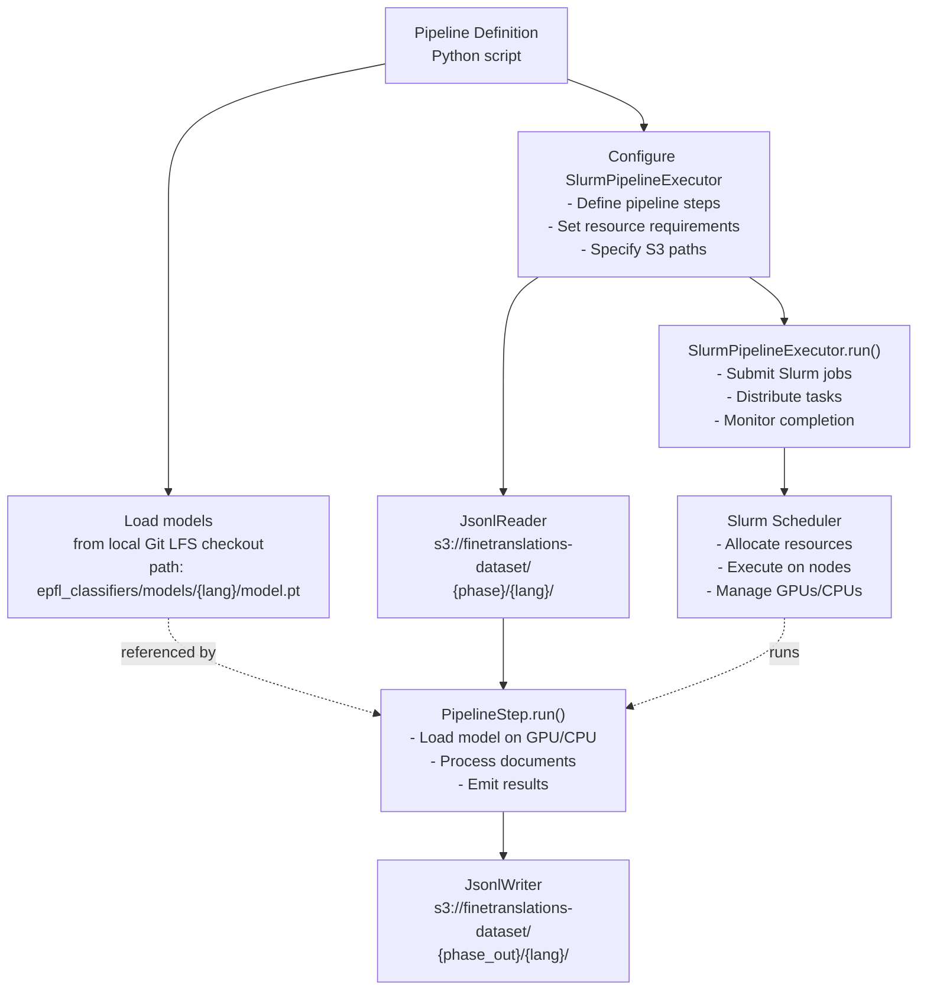

<!-- source: DeepWiki mcp.deepwiki.com · repo huggingface/finetranslations · page 6 Infrastructure and Configuration · fetched 2026-10-26 -->

# Infrastructure and Configuration

<details>
<summary>Relevant source files</summary>

The following files were used as context for generating this wiki page:

- [.gitattributes](.gitattributes)
- [.gitignore](.gitignore)
- [1_token_selection/annotate_with_hq_cla.py](1_token_selection/annotate_with_hq_cla.py)
- [1_token_selection/epfl_classifiers/models/.gitattributes](1_token_selection/epfl_classifiers/models/.gitattributes)

</details>


This document provides an overview of the infrastructure components that support the finetranslations pipeline. It covers the three foundational pillars: S3-based data storage, Slurm-based distributed execution, and Git LFS-based model management. Together, these components enable the processing of 19 languages across three pipeline phases with appropriate resource allocation and data persistence.

For detailed information on specific aspects:
- Data storage paths and organization patterns: see [Data Storage Architecture](#6.1)
- Slurm job configuration and resource allocation: see [Slurm Execution Environment](#6.2)
- Model artifact management with Git LFS: see [Model Management with Git LFS](#6.3)

## Infrastructure Overview

The finetranslations pipeline relies on three interconnected infrastructure components that work together to enable large-scale multilingual processing:

1. **S3 Storage Layer**: Provides durable data persistence across all pipeline phases using the `finetranslations-dataset` bucket
2. **Slurm Execution Layer**: Enables distributed processing across CPU and GPU resources via `SlurmPipelineExecutor`
3. **Git LFS Model Storage**: Manages versioned storage of language-specific binary classifier models

### Infrastructure Component Relationships



**Sources:** [.gitattributes:1-2](), [1_token_selection/epfl_classifiers/models/.gitattributes:22-25](), [1_token_selection/annotate_with_hq_cla.py:152-182]()

## Configuration Architecture

The infrastructure configuration is defined through three primary mechanisms:

### S3 Storage Configuration

All pipeline steps interact with S3 through the `datatrove` readers and writers. The bucket `finetranslations-dataset` serves as the central data repository with phase-specific path prefixes:

| Phase | Input Path Pattern | Output Path Pattern |
|-------|-------------------|---------------------|
| Phase 1 (Token Selection) | `1_token_selection/token_annotated/{lang}/` | `1_token_selection/epfl_annotated/{lang}/` |
| Phase 1 (Sampling) | `1_token_selection/epfl_annotated/{lang}/` | `1_token_selection/sampled_thr_cap/50B/{lang}/output/` |
| Phase 2 (Translation) | Various (direct or sampled) | `2_run_gemma/generations/{lang}/` |
| Phase 3 (Post-processing) | `2_run_gemma/generations/{lang}/` | `3_postprocessing/output/{lang}/` |

Storage configuration is embedded in pipeline definitions through `JsonlReader` and `JsonlWriter` instantiation with S3 paths:

```python
JsonlReader("s3://finetranslations-dataset/1_token_selection/token_annotated/{lang_code}/")
JsonlWriter("s3://finetranslations-dataset/1_token_selection/epfl_annotated/{lang_code}/")
```

**Sources:** [1_token_selection/annotate_with_hq_cla.py:160-167]()

### Slurm Execution Configuration

Pipeline execution is controlled through `SlurmPipelineExecutor` instances that define resource requirements and scheduling parameters. The executor configuration varies by computational intensity:

#### GPU-Intensive Jobs (Phase 1 Annotation, Phase 2 Translation)

Configuration for annotation jobs demonstrates GPU resource allocation:

```python
SlurmPipelineExecutor(
    pipeline=[...],
    workers=24,                    # 24 parallel workers
    cpus_per_task=11,             # 11 CPUs per task
    tasks=TOTAL_TASKS,            # Dynamic task count
    partition="hopper-prod",       # GPU partition
    sbatch_args={
        "mem-per-cpu": "1950M",
        "gres": "gpu:1"           # 1 GPU per task
    }
)
```

#### CPU-Only Jobs (Sampling, Reformatting, Token Counting)

CPU jobs use the `hopper-cpu` partition with simpler resource requirements:

```python
SlurmPipelineExecutor(
    pipeline=[...],
    workers=1,                     # Single worker per task
    cpus_per_task=1,              # 1 CPU per task
    tasks=1000,                   # Fixed or dynamic task count
    partition="hopper-cpu",        # CPU-only partition
    sbatch_args={
        "mem-per-cpu": "1950M"
    }
)
```

**Sources:** [1_token_selection/annotate_with_hq_cla.py:158-182]()

### Git LFS Configuration

Model artifact storage is configured through `.gitattributes` files that specify which file types should be tracked by Git LFS:

Root configuration tracks PyTorch and safetensors formats:
```
*.safetensors filter=lfs diff=lfs merge=lfs -text
*.pt filter=lfs diff=lfs merge=lfs -text
```

The models directory includes an extended configuration that covers additional binary formats such as `*.pkl`, `*.onnx`, `*.bin`, and archive formats like `*.zip`, `*.tar`.

**Sources:** [.gitattributes:1-2](), [1_token_selection/epfl_classifiers/models/.gitattributes:1-36]()

## Dynamic Resource Allocation

The pipeline implements dynamic task scaling based on language-specific token volumes. Task counts are calculated relative to a 100B baseline to balance processing time with cluster resource availability:

### Task Scaling Logic



This formula appears in annotation job configuration:

```python
TOTAL_TASKS = round(max(1, min(500, int(500 * (lang_sizes[lang_code] / (100 * 1024**3)))))) 
    if lang_code != 'rus_Cyrl' else 1000
```

The logic ensures:
- Minimum of 1 task for very small languages
- Maximum of 500 tasks to avoid cluster overload
- Proportional scaling between these bounds
- Special handling for `rus_Cyrl` which gets 1000 tasks

**Sources:** [1_token_selection/annotate_with_hq_cla.py:156]()

## Resource Allocation Patterns

Different pipeline phases have distinct resource requirements based on their computational characteristics:

| Phase | Partition | GPU | CPUs | Workers | Memory/CPU | Typical Duration |
|-------|-----------|-----|------|---------|------------|------------------|
| Token Annotation | `hopper-prod` | 1 | 11 | 24 | 1950M | 1-10 hours |
| Token Sampling | `hopper-cpu` | 0 | 1 | 1 | 1950M | < 1 hour |
| Translation (Gemma) | `hopper-prod` | 1 | 11 | 8 | 1950M | 1-4 hours |
| Reformatting | `hopper-cpu` | 0 | 1 | 1 | 1950M | < 1 hour |
| Token Counting | `hopper-cpu` | 0 | 16 | 1 | 1950M | < 1 hour |

The annotation phase demonstrates the most intensive resource usage with 24 workers per GPU task, enabling high throughput for embedding generation and classification.

**Sources:** [1_token_selection/annotate_with_hq_cla.py:170-181]()

## Infrastructure Integration Pattern

The three infrastructure components integrate through a standard pattern repeated across all pipeline phases:



**Sources:** [1_token_selection/annotate_with_hq_cla.py:40-131](), [1_token_selection/annotate_with_hq_cla.py:152-182]()

## Configuration Files and Paths

The infrastructure relies on several configuration files and standardized path conventions:

### Local Configuration Paths

Configuration files referenced in pipeline scripts typically reside in local filesystem paths:

- **Language metadata**: `/path/to/local/pipeline/assets/lang_dist.csv` - Contains language codes and token counts
- **Classifier models**: `/path/to/local/classifier/models/{lang}/model.pt` - Language-specific binary classifiers
- **Statistics output**: `/path/to/local/pipeline/{phase}/stats/` - Per-phase statistics collection
- **Logging directories**: `/path/to/local/pipeline/{phase}/logs/` - Slurm job logs

These paths are configured per-execution environment and are not committed to the repository (excluded via `.gitignore`).

**Sources:** [1_token_selection/annotate_with_hq_cla.py:4](), [1_token_selection/annotate_with_hq_cla.py:86](), [1_token_selection/annotate_with_hq_cla.py:168](), [1_token_selection/annotate_with_hq_cla.py:175](), [.gitignore:1-4]()

### Repository Structure

The Git repository uses a phase-organized structure:

```
finetranslations/
├── .gitattributes                    # LFS config for *.pt, *.safetensors
├── .gitignore                        # Excludes temporary fix scripts
├── 1_token_selection/
│   ├── annotate_with_hq_cla.py      # Phase 1 execution script
│   └── epfl_classifiers/
│       └── models/
│           ├── .gitattributes        # Extended LFS config
│           └── {lang}/
│               └── model.pt          # LFS-tracked binary
├── 2_run_gemma/                      # Phase 2 scripts
└── 3_postprocessing/                 # Phase 3 scripts
```

The `.gitignore` file excludes temporary fix scripts (`fix_lfs*.sh`, `fix_lfs*.py`, `nuke_and_reinit.sh`) that are used for repository maintenance but should not be version controlled.

**Sources:** [.gitattributes:1-2](), [.gitignore:1-4](), [1_token_selection/epfl_classifiers/models/.gitattributes:1-36]()

## Data Persistence and Recovery

The S3-based storage architecture provides natural checkpoint and recovery capabilities:

1. **Phase Isolation**: Each phase reads from specific S3 paths and writes to different paths, preventing data corruption
2. **Task Independence**: Individual Slurm tasks read disjoint data shards, enabling idempotent re-execution
3. **Incremental Progress**: Completed tasks write output immediately to S3, preserving progress even if subsequent tasks fail
4. **Audit Trail**: The path structure maintains a complete history of data transformations across phases

The `SlurmPipelineExecutor` handles task-level failures through the Slurm scheduler's retry mechanisms, while the S3 storage ensures completed work is never lost.

**Sources:** [1_token_selection/annotate_with_hq_cla.py:158-182]()

---

