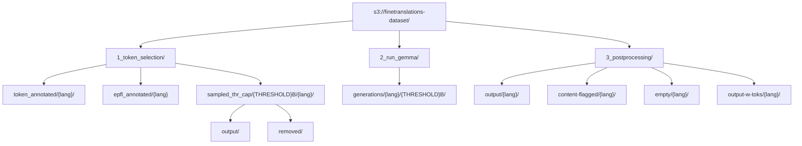
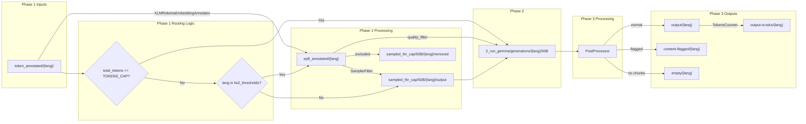
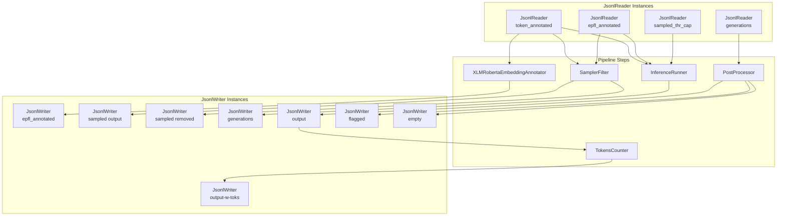

<!-- source: DeepWiki mcp.deepwiki.com · repo huggingface/finetranslations · page 6.1 Data Storage Architecture · fetched 2026-10-26 -->

# Data Storage Architecture

<details>
<summary>Relevant source files</summary>

The following files were used as context for generating this wiki page:

- [1_token_selection/4_sample_thr_cap.py](1_token_selection/4_sample_thr_cap.py)
- [2_run_gemma/run_pipeline.py](2_run_gemma/run_pipeline.py)
- [3_postprocessing/1_split_reformat.py](3_postprocessing/1_split_reformat.py)

</details>


## Purpose and Scope

This document describes the data storage architecture for the finetranslations pipeline, focusing on the S3 bucket organization, directory structures for each processing phase, data flow patterns between storage locations, and JSONL format conventions used throughout the system.

For information about how pipeline jobs execute and interact with this storage layer, see [Slurm Execution Environment](#6.2). For details about model artifact storage, see [Model Management with Git LFS](#6.3). For processing logic specific to each phase, see [Token Selection System](#3), [Translation System](#4), and [Post-Processing System](#5).

## S3 Bucket Organization

All pipeline data is stored in the S3 bucket `finetranslations-dataset`. The bucket is organized into three top-level directories corresponding to the three pipeline phases, with language-specific subdirectories under each phase.

### Bucket Structure Overview



**Sources:** [1_token_selection/4_sample_thr_cap.py:23-25](), [2_run_gemma/run_pipeline.py:308-332](), [3_postprocessing/1_split_reformat.py:153-155]()

## Phase-Specific Directory Structures

### Phase 1: Token Selection Storage

Phase 1 operates with multiple storage locations to support quality annotation, threshold-based filtering, and sampling operations.

| Directory Path | Purpose | Reader/Writer | Data Format |
|---------------|---------|---------------|-------------|
| `1_token_selection/token_annotated/{lang}/` | Raw input tokens with basic metadata | `JsonlReader` | JSONL with `token_count`, `language`, `language_script` |
| `1_token_selection/epfl_annotated/{lang}` | Tokens annotated with quality scores | `JsonlReader`/`JsonlWriter` | JSONL with added `quality_score` field |
| `1_token_selection/sampled_thr_cap/{THRESHOLD}B/{lang}/output` | Tokens passing sampling filter | `JsonlWriter` | JSONL subset of token_annotated |
| `1_token_selection/sampled_thr_cap/{THRESHOLD}B/{lang}/removed` | Tokens excluded by sampling filter | `JsonlWriter` (exclusion) | JSONL subset of token_annotated |

The `{THRESHOLD}B` placeholder represents the target token cap (e.g., `50B` for 50 billion tokens). The `{lang}` placeholder represents language-specific subdirectories using ISO 639-3 language codes with script suffixes (e.g., `arb_Arab`, `cmn_Hani`).

**Sources:** [1_token_selection/4_sample_thr_cap.py:23-25](), [2_run_gemma/run_pipeline.py:316-332]()

### Phase 2: Translation Storage

Phase 2 consolidates translation outputs into a single directory structure per language.

| Directory Path | Purpose | Reader/Writer | Data Format |
|---------------|---------|---------------|-------------|
| `2_run_gemma/generations/{lang}/{THRESHOLD}B` | Translation results from Gemma model | `JsonlWriter` | JSONL with `rollout_results` or `inference_results` metadata |

Output files use a sharded naming pattern: `${rank}_chunk_${chunk_index}.jsonl.gz`, where `${rank}` identifies the Slurm task and `${chunk_index}` identifies the checkpoint chunk within that task.

**Sources:** [2_run_gemma/run_pipeline.py:308-354]()

### Phase 3: Post-Processing Storage

Phase 3 splits output into multiple directories based on processing outcomes.

| Directory Path | Purpose | Reader/Writer | Data Format |
|---------------|---------|---------------|-------------|
| `3_postprocessing/output/{lang}` | Successfully processed translations | `JsonlWriter` | JSONL with restructured metadata |
| `3_postprocessing/content-flagged/{lang}` | Documents flagged for inappropriate content | `JsonlWriter` | JSONL with original translation data |
| `3_postprocessing/empty/{lang}` | Documents with no extractable chunks | `JsonlWriter` | JSONL with original document |
| `3_postprocessing/output-w-toks/{lang}` | Final output with token counts | `JsonlWriter` | JSONL with added token count metadata |

**Sources:** [3_postprocessing/1_split_reformat.py:153-155]()

## Data Flow Patterns

### Complete Pipeline Data Flow



**Sources:** [1_token_selection/4_sample_thr_cap.py:17-26](), [2_run_gemma/run_pipeline.py:313-333](), [3_postprocessing/1_split_reformat.py:152-155]()

### Routing Decision Logic

The pipeline implements conditional routing based on language-specific token counts:

1. **Direct Path** (`total_tokens <= TOKENS_CAP`): Languages with token counts below the cap read directly from `token_annotated/{lang}/`
2. **Quality-Based Selection** (`lang in fw2_thresholds`): Languages with quality thresholds read from `epfl_annotated/{lang}` and apply threshold filtering
3. **Sampling Path** (otherwise): Languages requiring sampling read from `sampled_thr_cap/{THRESHOLD}B/{lang}/output`

This routing is implemented in [2_run_gemma/run_pipeline.py:313-333]().

### Storage Access Pattern by Pipeline Component



**Sources:** [1_token_selection/4_sample_thr_cap.py:23-25](), [2_run_gemma/run_pipeline.py:315-354](), [3_postprocessing/1_split_reformat.py:152-155]()

## JSONL Format Conventions

### Base Document Format

All documents throughout the pipeline follow the `datatrove.data.Document` structure with a `text` field and `metadata` dictionary.

### Phase 1: Token Selection Metadata

**Input (`token_annotated/`):**
```python
{
    "text": "<document text>",
    "id": "<unique identifier>",
    "metadata": {
        "token_count": int,
        "language": str,  # ISO 639-3 code
        "language_script": str,  # Script code (e.g., "Arab", "Latn")
        "language_score": float,
        "url": str,
        "file_path": str,
        "minhash_cluster_size": int
    }
}
```

**After EPFL Annotation (`epfl_annotated/`):**
```python
{
    "metadata": {
        # ... all previous fields ...
        "quality_score": float  # 0.0 to 1.0, from binary classifier
    }
}
```

**Sources:** [2_run_gemma/run_pipeline.py:139](), [3_postprocessing/1_split_reformat.py:106-114]()

### Phase 2: Translation Metadata

Translation outputs store results in one of two metadata structures:

**Structure A (`rollout_results`):**
```python
{
    "metadata": {
        # ... original metadata ...
        "rollout_results": [
            {
                "chunks": [
                    {
                        "chunk_index": int,
                        "chunk_text": str,
                        "raw_output": str,
                        "finish_reason": str,
                        "usage": dict
                    }
                ]
            }
        ]
    }
}
```

**Structure B (`inference_results` + `chunks`):**
```python
{
    "metadata": {
        # ... original metadata ...
        "chunks": [str],  # List of chunk texts
        "inference_results": [
            {
                "text": str,
                "finish_reason": str
            }
        ]
    }
}
```

The `PostProcessor` in Phase 3 handles both structures via the `extract_chunks_data()` method at [3_postprocessing/1_split_reformat.py:10-49]().

**Sources:** [3_postprocessing/1_split_reformat.py:10-49](), [2_run_gemma/run_pipeline.py:266-282]()

### Phase 3: Post-Processed Metadata

After post-processing, documents are restructured with the following metadata:

```python
{
    "text": str,  # Concatenated English chunks
    "id": str,
    "metadata": {
        "eng_chunks": [str],  # List of translated chunks
        "og_chunks": [str],  # List of original chunks
        "og_full_text": str,  # Complete original text
        "og_language": str,  # "{language}_{script}"
        "og_language_score": float,
        "og_token_count": int,
        "og_quality_score": float,  # -1 if not annotated
        "early_stop": bool,  # True if translation incomplete
        "url": str,
        "file_path": str,
        "minhash_cluster_size": int
    }
}
```

**Sources:** [3_postprocessing/1_split_reformat.py:100-115]()

## File Naming Conventions

### Standard JSONL Files

Most pipeline stages write files with default naming:
- Pattern: `{chunk_index}.jsonl.gz`
- Compression: gzip
- Format: One JSON object per line

### Translation Output Sharding

The translation phase uses custom output filenames to support parallel checkpoint recovery:
- Pattern: `${rank}_chunk_${chunk_index}.jsonl.gz`
- `${rank}`: Slurm task rank (0 to tasks-1)
- `${chunk_index}`: Checkpoint chunk within task (multiples of `records_per_chunk`)
- Example: `42_chunk_15000.jsonl.gz`

This pattern is configured at [2_run_gemma/run_pipeline.py:354]():
```python
writer = JsonlWriter(OUTPUT_PATH, output_filename="${rank}_chunk_${chunk_index}.jsonl.gz")
```

**Sources:** [2_run_gemma/run_pipeline.py:354]()

## Storage Size and Scaling Characteristics

### Token Cap and Directory Size

The pipeline processes languages to a target cap of 50 billion tokens, controlled by:
- `THRESHOLD = 50` (in billions)
- `TOKENS_CAP = THRESHOLD * 1e9 = 50000000000`

This cap appears in directory names (e.g., `sampled_thr_cap/50B/`) and controls the maximum data volume per language processed through translation and post-processing phases.

### Language-Specific Subdirectories

Each language processes independently into separate subdirectories. The 19 supported languages create parallel directory structures:
- `token_annotated/arb_Arab/`, `token_annotated/ces_Latn/`, etc.
- `epfl_annotated/arb_Arab/`, `epfl_annotated/ces_Latn/`, etc.
- `generations/arb_Arab/50B/`, `generations/ces_Latn/50B/`, etc.

This structure enables language-parallel processing and independent data lifecycle management.

**Sources:** [1_token_selection/4_sample_thr_cap.py:7-8](), [2_run_gemma/run_pipeline.py:2-3]()

## S3 Access Patterns

### Read-Heavy vs Write-Heavy Operations

| Operation Type | Phases | Access Pattern | Concurrency |
|----------------|--------|----------------|-------------|
| Read-only | Sampling, Translation, Post-Processing | Sequential reads via `JsonlReader` | High (100-1000 tasks) |
| Write-only | Annotation, Translation, Post-Processing | Sharded writes via `JsonlWriter` | High (100-1000 tasks) |
| Read-Write | Sampling | Read from input, write to output/removed | Medium (1000 tasks) |

### Concurrent Access via Slurm Tasks

The pipeline exploits S3's high concurrency capabilities by distributing work across many Slurm tasks:
- Annotation: Up to 1000 tasks per language
- Sampling: 1000 tasks per language
- Translation: Up to 100 tasks per language (scaled by token count)
- Post-Processing: Up to 200 tasks per language

Each task operates on independent shards of the data, reading and writing to S3 without coordination requirements.

**Sources:** [1_token_selection/4_sample_thr_cap.py:33](), [2_run_gemma/run_pipeline.py:365](), [3_postprocessing/1_split_reformat.py:146]()

### Writer Configuration for Parallel Writes

Writers handle concurrent access through sharding:
```python
# Standard writer with automatic sharding
JsonlWriter(f"s3://finetranslations-dataset/path/{lang}")

# Custom filename pattern for checkpoint recovery
JsonlWriter(OUTPUT_PATH, output_filename="${rank}_chunk_${chunk_index}.jsonl.gz")
```

The `SamplerFilter` uses an `exclusion_writer` to route rejected documents to a separate directory:
```python
SamplerFilter(
    rate=TOKENS_CAP/total_tokens,
    exclusion_writer=JsonlWriter(f"s3://.../{lang}/removed")
)
```

**Sources:** [1_token_selection/4_sample_thr_cap.py:24](), [2_run_gemma/run_pipeline.py:354](), [3_postprocessing/1_split_reformat.py:154]()

---

