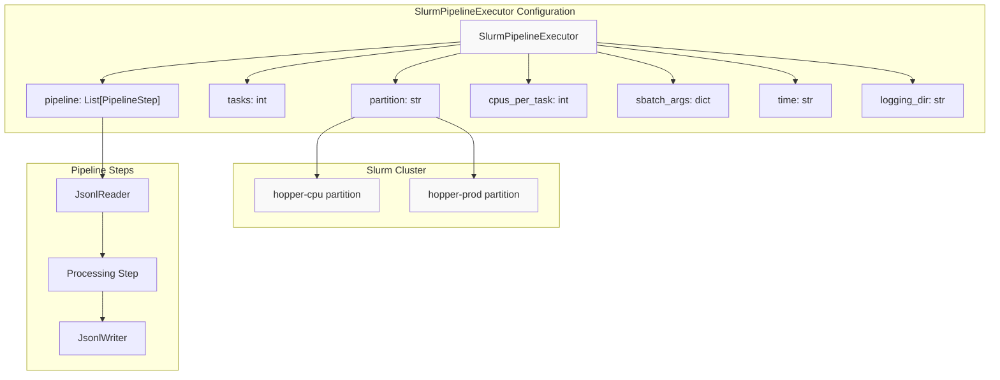
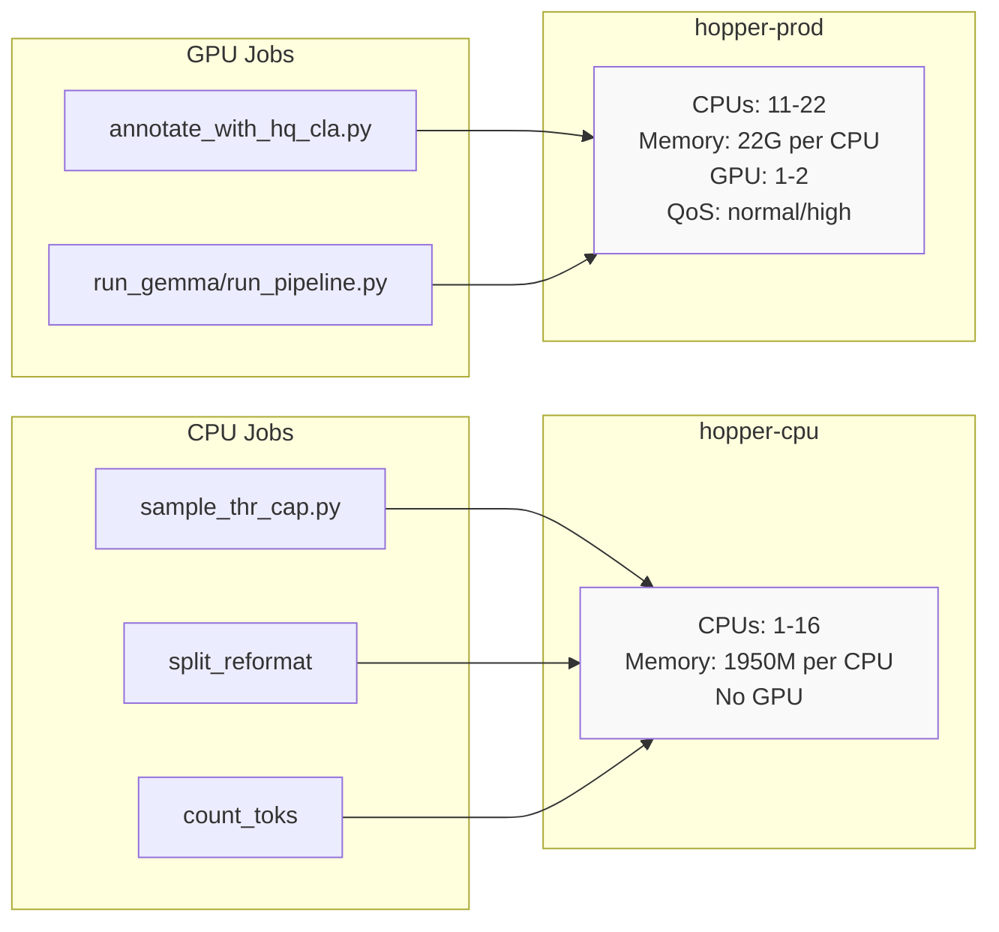
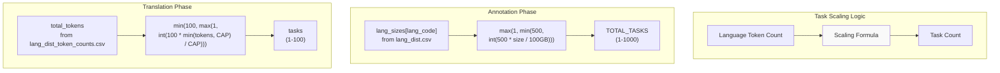
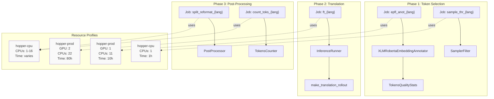
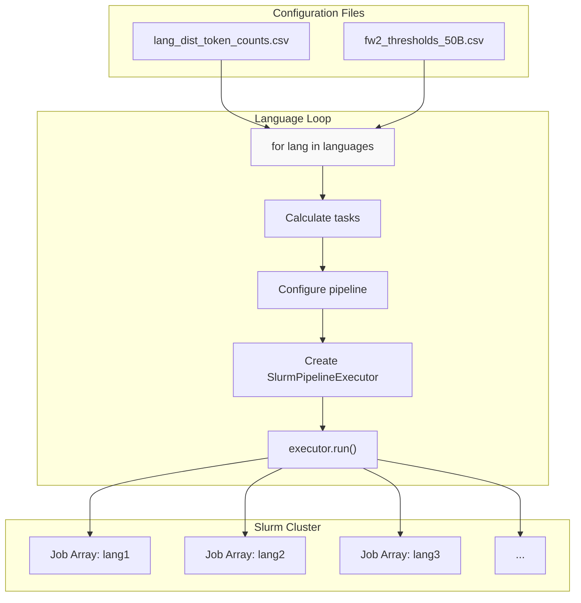

<!-- source: DeepWiki mcp.deepwiki.com · repo huggingface/finetranslations · page 6.2 Slurm Execution Environment · fetched 2026-10-26 -->

# Slurm Execution Environment

<details>
<summary>Relevant source files</summary>

The following files were used as context for generating this wiki page:

- [1_token_selection/4_sample_thr_cap.py](1_token_selection/4_sample_thr_cap.py)
- [1_token_selection/annotate_with_hq_cla.py](1_token_selection/annotate_with_hq_cla.py)
- [2_run_gemma/run_pipeline.py](2_run_gemma/run_pipeline.py)

</details>


## Purpose and Scope

This document describes how the finetranslations pipeline leverages Slurm for distributed execution across CPU and GPU resources. It covers the `SlurmPipelineExecutor` configuration patterns, partition usage strategies, dynamic task scaling mechanisms, and resource allocation across the three pipeline phases. For information about the data storage structure that these jobs read from and write to, see [Data Storage Architecture](#6.1). For details on the specific pipeline steps being executed, see sections [3](#3), [4](#4), and [5](#5).

## SlurmPipelineExecutor Architecture

The pipeline uses the `SlurmPipelineExecutor` class from the datatrove framework to orchestrate distributed execution on a Slurm cluster. Each pipeline phase (token selection, translation, post-processing) is launched as a separate Slurm job array with language-specific configurations.



**Diagram: SlurmPipelineExecutor Configuration Components**

The executor accepts a pipeline consisting of reader, processing, and writer steps, along with resource specifications. It then generates a Slurm job array where each task processes a subset of the data in parallel.

**Sources:** [1_token_selection/annotate_with_hq_cla.py:158-182](), [1_token_selection/4_sample_thr_cap.py:27-37](), [2_run_gemma/run_pipeline.py:372-389]()

## Partition Configuration

The pipeline uses two primary Slurm partitions with distinct resource profiles:

| Partition | Purpose | Typical Resources | Used By |
|-----------|---------|-------------------|---------|
| `hopper-cpu` | CPU-intensive tasks | 1-16 CPUs, ~2GB RAM/CPU | Sampling, reformatting, token counting |
| `hopper-prod` | GPU-accelerated tasks | 1-2 GPUs, 8-24 CPUs, ~22GB RAM/CPU | Quality annotation, translation |



**Diagram: Partition Assignment by Job Type**

**Sources:** [1_token_selection/4_sample_thr_cap.py:34](), [1_token_selection/annotate_with_hq_cla.py:176](), [2_run_gemma/run_pipeline.py:376]()

## Resource Allocation Patterns

### CPU-Based Jobs

CPU-based jobs handle data manipulation tasks that don't require GPU acceleration. These jobs use the `hopper-cpu` partition with conservative memory allocation.

**Sampling Jobs Configuration:**

```
partition: hopper-cpu
cpus_per_task: 1
tasks: 1000
mem-per-cpu: 1950M
time: 01:00:00
```

The sampling phase [1_token_selection/4_sample_thr_cap.py:27-37]() creates 1000 parallel tasks, each with a single CPU and ~2GB memory. This configuration is optimized for I/O-bound filtering operations that read from S3, apply sampling filters, and write filtered data back.

**Sources:** [1_token_selection/4_sample_thr_cap.py:27-37]()

### GPU-Based Jobs

GPU-based jobs require significantly more resources for model inference. The configuration varies between annotation and translation tasks.

**Annotation Jobs Configuration:**

```
partition: hopper-prod
cpus_per_task: 11
workers: 24
tasks: dynamic (1-1000)
mem-per-cpu: 1950M
gres: gpu:1
time: 10:00:00
qos: normal
```

The annotation phase [1_token_selection/annotate_with_hq_cla.py:158-182]() uses 1 GPU per task with 24 workers (via `workers=8*3` parameter) and 11 CPUs per task. The `workers` parameter controls the number of parallel data processing threads that feed data to the GPU.

**Translation Jobs Configuration:**

```
partition: hopper-prod
cpus_per_task: 22 (11 * tp, where tp=2)
tasks: dynamic (1-100)
mem-per-cpu: 22G
gres: gpu:2
time: 80:00:00
qos: high
```

The translation phase [2_run_gemma/run_pipeline.py:372-389]() uses 2 GPUs (tensor parallelism with `tp=2`) and scales CPUs accordingly. Memory requirements are substantially higher (22G per CPU) to accommodate the Gemma-3-27B model.

**Sources:** [1_token_selection/annotate_with_hq_cla.py:158-182](), [2_run_gemma/run_pipeline.py:335-389]()

## Dynamic Task Scaling

Task counts are dynamically calculated based on language-specific data volumes to optimize resource utilization and job completion time.



**Diagram: Dynamic Task Calculation Formulas by Phase**

### Annotation Task Scaling

The annotation phase calculates tasks based on dataset size in bytes [1_token_selection/annotate_with_hq_cla.py:156]():

```python
TOTAL_TASKS = round(max(1, min(500, int(500 * (lang_sizes[lang_code] / (100 * 1024**3))))))
```

This formula:
- Scales linearly with dataset size relative to 100GB baseline
- Caps at 500 tasks maximum (1000 for Russian: `rus_Cyrl`)
- Ensures minimum of 1 task for small languages

### Translation Task Scaling

The translation phase calculates tasks based on token count [2_run_gemma/run_pipeline.py:365]():

```python
tasks = min(100, max(1, int(round(100 * min(total_tokens, TOKENS_CAP) / TOKENS_CAP))))
```

This formula:
- Scales linearly with token count up to the 50B cap (`TOKENS_CAP`)
- Caps at 100 tasks maximum
- Ensures minimum of 1 task

### Sampling Task Scaling

The sampling phase uses a fixed 1000 tasks [1_token_selection/4_sample_thr_cap.py:33]() regardless of language size, as the sampling operation is lightweight and benefits from high parallelism.

**Sources:** [1_token_selection/annotate_with_hq_cla.py:156](), [2_run_gemma/run_pipeline.py:365](), [1_token_selection/4_sample_thr_cap.py:33]()

## Job Configuration by Pipeline Phase

Each pipeline phase has distinct resource requirements and execution patterns.



**Diagram: Job Configuration and Resource Mapping by Phase**

### Phase 1: Token Selection

**Annotation Jobs** [1_token_selection/annotate_with_hq_cla.py:158-182]():

| Parameter | Value | Rationale |
|-----------|-------|-----------|
| `job_name` | `epfl_anot_{lang_code}` | Language-specific identification |
| `partition` | `hopper-prod` | GPU required for XLM-RoBERTa inference |
| `workers` | 24 | Parallel data loading threads |
| `cpus_per_task` | 11 | Support 24 workers + GPU overhead |
| `tasks` | Dynamic (1-1000) | Scales with language dataset size |
| `sbatch_args["gres"]` | `gpu:1` | Single GPU for model inference |
| `sbatch_args["mem-per-cpu"]` | `1950M` | ~21GB total memory per task |
| `qos` | `normal` | Standard priority |
| `time` | `10:00:00` | 10-hour time limit |

The annotation job loads the `XLMRobertaEmbeddingAnnotator` which performs GPU-accelerated inference with XLM-RoBERTa base model and language-specific binary classifiers.

**Sampling Jobs** [1_token_selection/4_sample_thr_cap.py:27-37]():

| Parameter | Value | Rationale |
|-----------|-------|-----------|
| `job_name` | `sample_thr_{lang}` | Language-specific identification |
| `partition` | `hopper-cpu` | No GPU needed for filtering |
| `cpus_per_task` | 1 | Single-threaded filtering |
| `tasks` | 1000 | High parallelism for I/O-bound operations |
| `sbatch_args["mem-per-cpu"]` | `1950M` | ~2GB per task |
| `time` | `01:00:00` | 1-hour time limit |

The sampling job applies `SamplerFilter` with a rate calculated as `TOKENS_CAP/total_tokens` to reduce token counts to the 50B cap.

**Sources:** [1_token_selection/annotate_with_hq_cla.py:158-182](), [1_token_selection/4_sample_thr_cap.py:27-37]()

### Phase 2: Translation

**Translation Jobs** [2_run_gemma/run_pipeline.py:372-389]():

| Parameter | Value | Rationale |
|-----------|-------|-----------|
| `job_name` | `ft_{lang}` | Shortened for character limit |
| `partition` | `hopper-prod` | GPU required for Gemma inference |
| `cpus_per_task` | 22 (`11 * tp`) | Support tensor parallelism + vLLM workers |
| `tasks` | Dynamic (1-100) | Scales with token count |
| `sbatch_args["gres"]` | `gpu:2` | Tensor parallelism across 2 GPUs |
| `sbatch_args["mem-per-cpu"]` | `22G` | ~484GB total for 27B parameter model |
| `qos` | `high` | Higher priority for expensive jobs |
| `time` | `80:00:00` | 80-hour time limit |
| `env_command` | `module load cuda/12.4` | CUDA environment setup |

The translation job runs `InferenceRunner` with vLLM backend serving the `google/gemma-3-27b-it` model. The `InferenceConfig` [2_run_gemma/run_pipeline.py:342-351]() specifies:
- `tp=2` for tensor parallelism across 2 GPUs
- `max_concurrent_generations=1000` for high throughput
- `max_concurrent_documents=1050` for pipeline buffering

**Sources:** [2_run_gemma/run_pipeline.py:335-389]()

### Phase 3: Post-Processing

Post-processing jobs (reformatting and token counting) follow similar CPU-based patterns to the sampling phase, using `hopper-cpu` partition with minimal resource requirements. These jobs are not shown in the provided file excerpts but follow the established CPU job pattern.

## Error Handling and Retry Logic

The translation phase implements exponential backoff retry logic to handle transient Slurm submission failures [2_run_gemma/run_pipeline.py:392-400]():

```python
delay = 2  # start with 2 seconds
while True:
    try:
        executor.run()
        break
    except Exception as e:
        print(f"Error launching job: {e}")
        time.sleep(delay)
        delay = min(delay * 2, 60 * 60)  # cap at 60 minutes
```

This pattern:
- Starts with 2-second delay
- Doubles delay on each failure (exponential backoff)
- Caps maximum delay at 60 minutes
- Retries indefinitely until successful submission

Additionally, the translation rollout handles context length errors during inference [2_run_gemma/run_pipeline.py:256-264]():

```python
except InferenceError as error:
    error_message = str(error)
    if "maximum context length" in error_message and "BadRequestError" in error_message:
        split_chunks, split_tokens = _split_chunk_in_half(chunk, chunk_token_count)
        if not split_chunks:
            raise
        chunks[index : index + 1] = split_chunks
        chunk_tokens[index : index + 1] = split_tokens
        continue
    raise
```

When a chunk exceeds the model's context window, the system automatically splits it in half and retries, enabling processing of documents that would otherwise fail.

**Sources:** [2_run_gemma/run_pipeline.py:256-264](), [2_run_gemma/run_pipeline.py:392-400]()

## Language Loop Execution Pattern

All three phases iterate over languages from configuration files, launching separate Slurm jobs for each language. This pattern enables:

1. **Language-specific resource allocation** - Each language gets appropriate task counts based on data volume
2. **Independent failure domains** - One language's job failure doesn't affect others
3. **Parallel language processing** - Multiple languages execute simultaneously on the cluster
4. **Targeted re-execution** - Failed languages can be re-run without reprocessing successful ones



**Diagram: Language Loop Execution Pattern**

The loop structure is consistent across phases:

**Annotation** [1_token_selection/annotate_with_hq_cla.py:154]():
```python
for lang_code in language_codes:
    TOTAL_TASKS = round(...)
    execut = SlurmPipelineExecutor(...)
    execut.run()
```

**Sampling** [1_token_selection/4_sample_thr_cap.py:17]():
```python
for lang, total_tokens in zip(...):
    if total_tokens > TOKENS_CAP:
        pipeline = [...]
        execut = SlurmPipelineExecutor(...)
        execut.run()
```

**Translation** [2_run_gemma/run_pipeline.py:306]():
```python
for lang, language_name, total_tokens in zip(...):
    pipeline = []
    # Configure pipeline...
    executor = SlurmPipelineExecutor(...)
    executor.run()
```

Each iteration creates a new executor instance with language-specific paths, ensuring proper isolation and logging per language.

**Sources:** [1_token_selection/annotate_with_hq_cla.py:154-182](), [1_token_selection/4_sample_thr_cap.py:17-37](), [2_run_gemma/run_pipeline.py:306-401]()

## Logging and Monitoring

Each job specifies a unique `logging_dir` parameter that organizes logs by phase, language, and threshold:

**Annotation logs:**
```
/path/to/local/pipeline/1_token_selection/logs/epfl_anot/{lang_code}
```

**Sampling logs:**
```
/path/to/local/pipeline/1_token_selection/logs/sampled_thr_cap/{THRESHOLD}B/{lang}
```

**Translation logs:**
```
/path/to/local/pipeline/3_launch_pipeline/logs/{lang}/{THRESHOLD}B
```

The `SlurmPipelineExecutor` automatically creates per-task log files within these directories, enabling debugging of individual task failures. The structured logging hierarchy facilitates:
- Identifying failed languages or tasks
- Comparing execution times across languages
- Tracking resource utilization patterns
- Debugging pipeline-specific issues

**Sources:** [1_token_selection/annotate_with_hq_cla.py:175](), [1_token_selection/4_sample_thr_cap.py:30](), [2_run_gemma/run_pipeline.py:379]()

## Resource Optimization Strategies

The pipeline employs several optimization strategies to maximize cluster utilization:

### 1. Tiered Partitioning
CPU-bound tasks use `hopper-cpu` while GPU-bound tasks use `hopper-prod`, ensuring GPU resources are reserved for operations that require them.

### 2. Dynamic Task Scaling
Task counts scale with data volume, preventing over-provisioning for small languages and under-provisioning for large ones.

### 3. Batch Size Tuning
Annotation jobs use configurable batch sizes [1_token_selection/annotate_with_hq_cla.py:163-164]():
```python
tokenizer_batch_size=5120,
model_batch_size=5120,
```

These parameters balance memory usage against throughput, optimized for the XLM-RoBERTa model's characteristics.

### 4. Memory Allocation
Memory is specified per-CPU rather than per-task, enabling flexible resource allocation:
- Annotation: `1950M * 11 = 21.45GB` per task
- Translation: `22G * 22 = 484GB` per task
- Sampling: `1950M * 1 = 1.95GB` per task

### 5. QoS Prioritization
Translation jobs use `qos="high"` [2_run_gemma/run_pipeline.py:377]() to prioritize expensive GPU operations, while annotation uses `qos="normal"` for standard priority.

### 6. Time Limit Calibration
Time limits are calibrated based on empirical execution times:
- Short tasks (sampling): 1 hour
- Medium tasks (annotation): 10 hours
- Long tasks (translation): 80 hours

This prevents premature termination while avoiding excessive resource locks.

**Sources:** [1_token_selection/annotate_with_hq_cla.py:163-164](), [1_token_selection/annotate_with_hq_cla.py:173](), [2_run_gemma/run_pipeline.py:377]()

---

