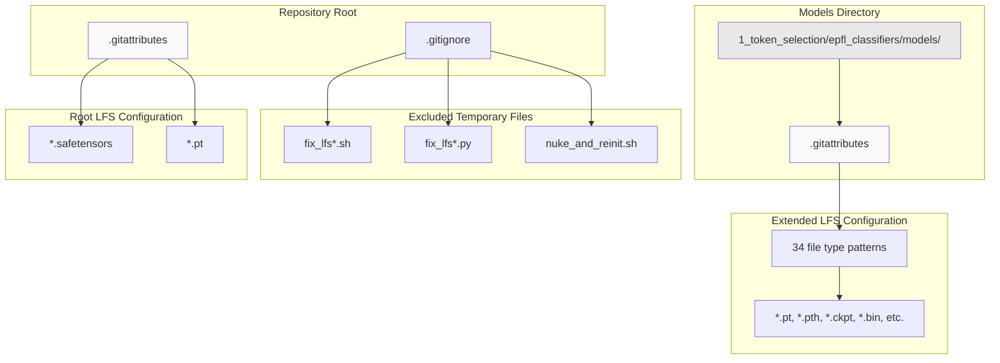
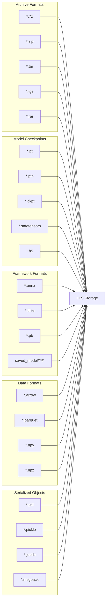
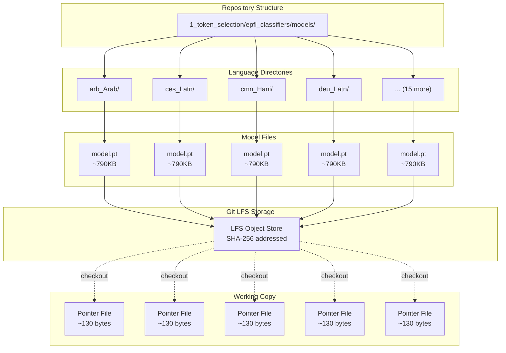
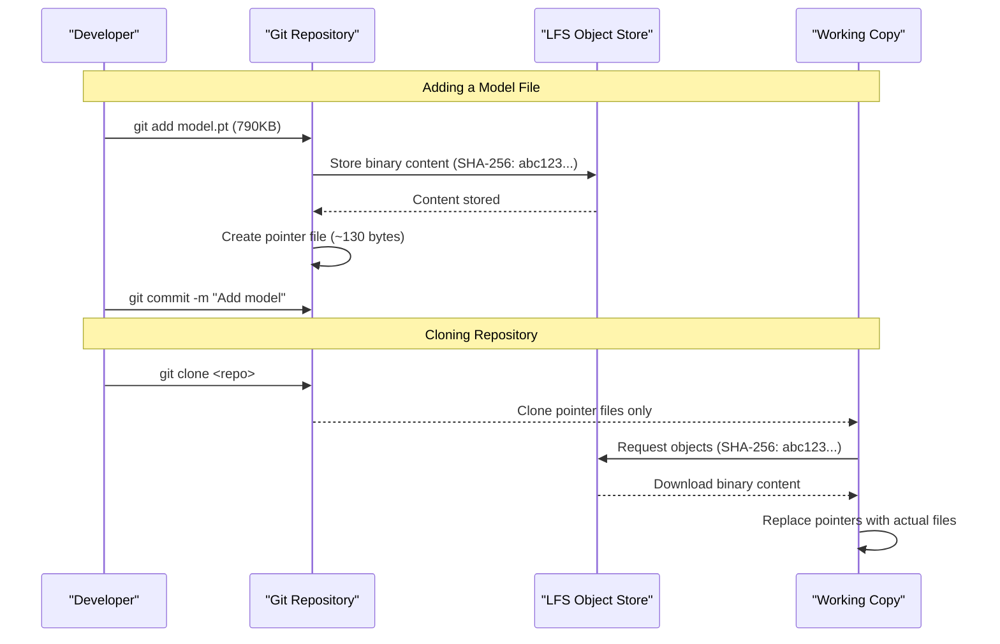
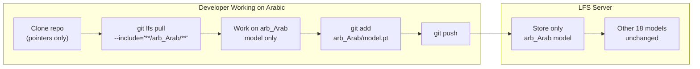

<!-- source: DeepWiki mcp.deepwiki.com · repo huggingface/finetranslations · page 6.3 Model Management with Git LFS · fetched 2026-10-26 -->

# Model Management with Git LFS

<details>
<summary>Relevant source files</summary>

The following files were used as context for generating this wiki page:

- [.gitattributes](.gitattributes)
- [.gitignore](.gitignore)
- [1_token_selection/epfl_classifiers/models/.gitattributes](1_token_selection/epfl_classifiers/models/.gitattributes)

</details>


## Purpose and Scope

This document explains how Git Large File Storage (LFS) is used to manage binary model files in the finetranslations repository. Git LFS enables version control of the 19 language-specific EPFL classifier models (~790KB each) without bloating the repository size. This page covers LFS configuration files, tracked file types, the pointer file mechanism, and best practices for working with LFS-managed models.

For information about the classifier models themselves, see [Model Architecture and Training](#3.4.1). For details on how models are loaded and used during inference, see [Quality Score Annotation](#3.1).

## Git LFS Configuration Overview

The repository uses a two-tier LFS configuration strategy to manage different types of large files. The root `.gitattributes` file handles model checkpoint files used throughout the project, while a specialized configuration in the models directory manages a comprehensive set of machine learning artifact types.



**Diagram: Git LFS Configuration Hierarchy**

Sources: [.gitattributes:1-3](), [.gitignore:1-5](), [1_token_selection/epfl_classifiers/models/.gitattributes:1-36]()

## Root-Level LFS Configuration

The root `.gitattributes` file defines LFS tracking for two primary model file formats used across the repository:

| File Pattern | Format | Primary Use Case |
|-------------|--------|------------------|
| `*.safetensors` | SafeTensors format | Modern PyTorch model checkpoints (safer serialization) |
| `*.pt` | PyTorch checkpoint | EPFL classifier models, general PyTorch artifacts |

Both patterns use the standard LFS configuration: `filter=lfs diff=lfs merge=lfs -text`, which instructs Git to:
- Apply the LFS filter during add/commit operations
- Use LFS-aware diff algorithms
- Use LFS-aware merge strategies
- Treat files as binary (disable text processing)

Sources: [.gitattributes:1-3]()

## Models Directory Extended Configuration

The `1_token_selection/epfl_classifiers/models/` directory contains a comprehensive `.gitattributes` file that tracks 34 different file type patterns commonly used in machine learning workflows. This configuration ensures any model-related artifact added to this directory is automatically tracked by LFS.

### Tracked File Categories



**Diagram: File Types Managed by LFS in Models Directory**

Sources: [1_token_selection/epfl_classifiers/models/.gitattributes:1-36]()

### Complete File Type Reference

| Category | File Extensions | Line References |
|----------|----------------|-----------------|
| PyTorch Checkpoints | `.pt`, `.pth`, `.ckpt` | [22-23, 5]() |
| Modern Formats | `.safetensors`, `.onnx` | [25, 16]() |
| TensorFlow | `.pb`, `.tflite`, `saved_model/**/*` | [19, 29, 26]() |
| Compression | `.7z`, `.bz2`, `.gz`, `.rar`, `.tar`, `.tgz`, `.xz`, `.zip`, `.zst` | [1, 4, 7, 24, 28, 30, 32, 33, 34]() |
| Data Storage | `.arrow`, `.parquet`, `.npy`, `.npz` | [2, 18, 14, 15]() |
| Serialization | `.bin`, `.pkl`, `.pickle`, `.joblib`, `.msgpack` | [3, 21, 20, 9, 13]() |
| Other ML | `.h5`, `.ftz`, `.mlmodel`, `.model`, `.ot`, `.wasm` | [8, 6, 11, 12, 17, 31]() |
| Logs | `*tfevents*` | [35]() |

Sources: [1_token_selection/epfl_classifiers/models/.gitattributes:1-36]()

## EPFL Classifier Model Storage

The 19 language-specific EPFL classifier models are stored as `.pt` files within language-specific subdirectories under `1_token_selection/epfl_classifiers/models/`. Each model file is tracked by Git LFS through the configurations described above.



**Diagram: EPFL Model Storage Architecture**

This architecture allows the repository to maintain version history of 19 models (totaling ~15MB) without requiring users to download all models unless needed.

Sources: [1_token_selection/epfl_classifiers/models/.gitattributes:22]()

## LFS Pointer File Mechanism

Git LFS replaces large binary files in the Git repository with small pointer files that reference the actual content stored in LFS. This mechanism is transparent to most Git operations but fundamentally changes how file content is stored and retrieved.

### Pointer File Structure

When a file is tracked by LFS, Git stores a text pointer file in the repository instead of the binary content. A typical pointer file for an EPFL classifier model contains:

```
version https://git-lfs.github.com/spec/v1
oid sha256:<64-character-hex-digest>
size <file-size-in-bytes>
```

| Component | Description | Example Value |
|-----------|-------------|---------------|
| `version` | LFS specification version | `https://git-lfs.github.com/spec/v1` |
| `oid` | SHA-256 hash of file content | `sha256:a1b2c3d4...` (64 chars) |
| `size` | Original file size in bytes | `810240` (~790KB) |

The pointer file itself is typically ~130 bytes, regardless of the actual model size.

### Storage and Retrieval Flow



**Diagram: LFS Storage and Retrieval Workflow**

Sources: [.gitattributes:1-3](), [1_token_selection/epfl_classifiers/models/.gitattributes:22]()

## Working with LFS Files

### Common Operations

When working with LFS-tracked files in this repository, standard Git commands work transparently. However, understanding the underlying mechanics helps troubleshoot issues.

| Operation | Command | LFS Behavior |
|-----------|---------|--------------|
| Clone repository | `git clone <url>` | Downloads pointer files; LFS objects fetched automatically |
| Checkout branch | `git checkout <branch>` | Swaps pointer files; downloads new LFS objects if needed |
| Pull changes | `git pull` | Updates pointer files; fetches new LFS objects |
| Add model | `git add models/lang/model.pt` | Uploads content to LFS; commits pointer file |
| View file status | `git lfs ls-files` | Lists all LFS-tracked files in working copy |
| Check LFS status | `git lfs status` | Shows LFS files to be committed |

### Excluded Temporary Files

The `.gitignore` file excludes several temporary scripts used for LFS maintenance operations:

- `fix_lfs*.sh` - Shell scripts for repairing LFS configuration
- `fix_lfs*.py` - Python scripts for LFS migration/repair
- `nuke_and_reinit.sh` - Nuclear option for completely reinitializing LFS

These files are intentionally excluded to prevent accidental commits of environment-specific maintenance scripts.

Sources: [.gitignore:1-5]()

## Benefits of LFS in This Repository

### Repository Size Management

Without LFS, the 19 EPFL classifier models would add ~15MB to every clone of the repository. With LFS:

| Metric | Without LFS | With LFS |
|--------|-------------|----------|
| Repository size | ~15MB + code | ~2.5KB pointers + code |
| Clone time | Downloads all 19 models | Downloads only needed models |
| History size | 15MB × commits | Pointer changes only |
| Bandwidth | 15MB per clone | Model downloads on demand |

### Version Control Benefits

LFS provides full version control for binary model files:

- **Diff-friendly**: Pointer files show which model changed, even if binary content differs
- **History preservation**: All model versions remain accessible via SHA-256 hashes
- **Selective fetching**: Download only models for specific languages when needed
- **Atomic updates**: Model updates are atomic with code changes in the same commit

### Language-Specific Workflows

The LFS configuration enables efficient workflows for language-specific model development:



**Diagram: Selective LFS Workflow for Language-Specific Development**

This workflow allows developers to work on individual language models without downloading all 19 models (~15MB), reducing setup time and disk usage.

Sources: [.gitattributes:1-3](), [1_token_selection/epfl_classifiers/models/.gitattributes:1-36]()

## LFS Configuration Best Practices

### Adding New Model Types

When adding new types of model files to the repository, update the appropriate `.gitattributes` file:

1. For project-wide model formats (used across multiple directories), add to root `.gitattributes`
2. For models specific to the `epfl_classifiers/models/` directory, the existing comprehensive configuration already covers most cases

### Verifying LFS Tracking

To verify that model files are correctly tracked by LFS:

```bash
# List all LFS-tracked files
git lfs ls-files

# Check if a specific file is tracked by LFS
git lfs ls-files | grep model.pt

# View LFS attributes for a file
git check-attr filter -- path/to/model.pt
```

Expected output for a tracked file:
```
path/to/model.pt: filter: lfs
```

### Migration Considerations

If model files were committed before LFS configuration:

1. Existing files remain in Git history as regular blobs
2. New commits will use LFS for matching patterns
3. Use migration tools (`git lfs migrate`) to rewrite history if needed
4. Temporary migration scripts (excluded by `.gitignore`) assist with this process

Sources: [.gitignore:1-5](), [.gitattributes:1-3](), [1_token_selection/epfl_classifiers/models/.gitattributes:1-36]()

---

