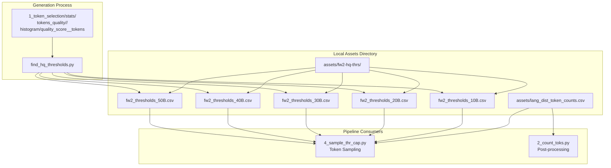
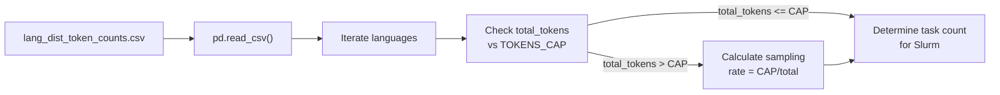
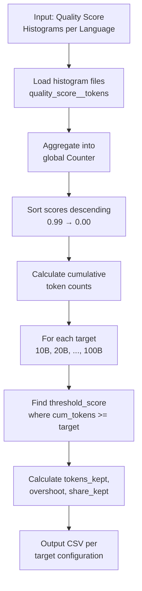
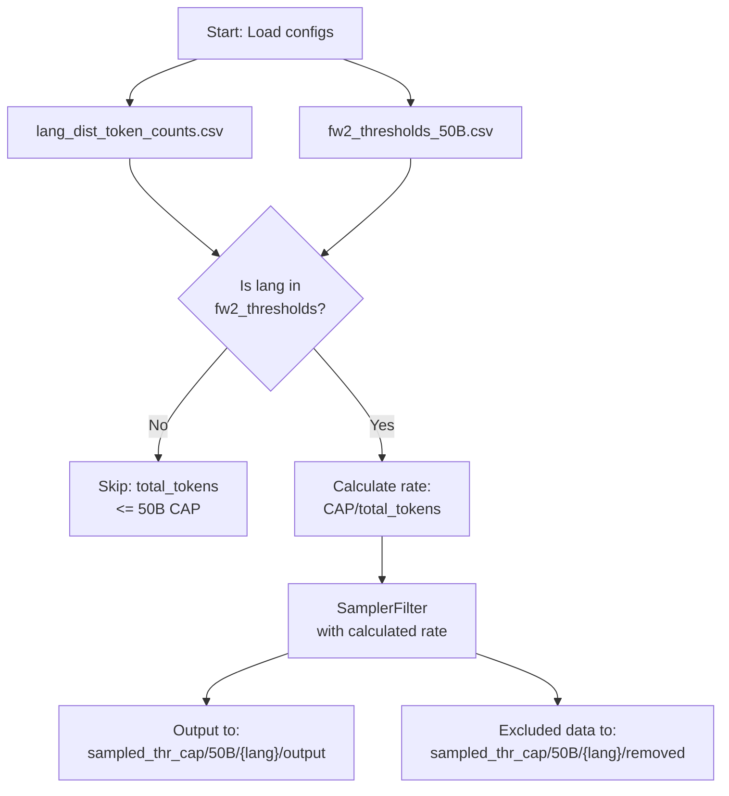
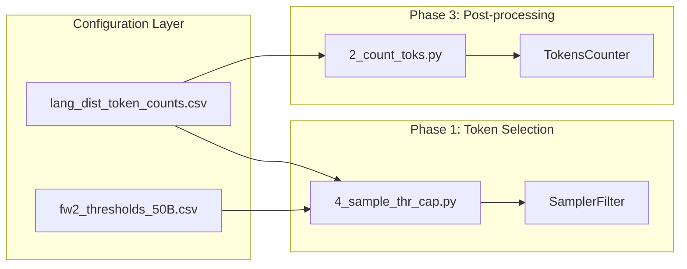

<!-- source: DeepWiki mcp.deepwiki.com · repo huggingface/finetranslations · page 7 Configuration Files and Assets · fetched 2026-10-26 -->

# Configuration Files and Assets

<details>
<summary>Relevant source files</summary>

The following files were used as context for generating this wiki page:

- [1_token_selection/4_sample_thr_cap.py](1_token_selection/4_sample_thr_cap.py)
- [1_token_selection/find_hq_thresholds.py](1_token_selection/find_hq_thresholds.py)
- [3_postprocessing/2_count_toks.py](3_postprocessing/2_count_toks.py)

</details>


## Purpose and Scope

This document describes the configuration files and static assets that control pipeline behavior across all three phases of the finetranslations system. These files define language-specific parameters, quality thresholds, and token count targets that determine which data is processed and how sampling decisions are made.

For information about the S3 storage structure where processed data resides, see [Data Storage Architecture](#6.1). For details about the Slurm execution configuration, see [Slurm Execution Environment](#6.2).

## Configuration Assets Overview

The pipeline relies on two primary configuration file types stored in the local assets directory:

1. **`lang_dist_token_counts.csv`** - Defines the 19 supported languages and their total token counts
2. **`fw2_thresholds_*.csv`** - Contains quality score thresholds calculated for specific token caps (10B, 20B, 30B, 40B, 50B)

These files are read by multiple pipeline stages to make language-specific processing decisions, control sampling rates, and determine whether languages require threshold-based filtering.



**Configuration Asset Storage and Usage**

Sources: [1_token_selection/4_sample_thr_cap.py:10-14](), [1_token_selection/find_hq_thresholds.py:18-21](), [3_postprocessing/2_count_toks.py:10-11]()

## Language Distribution Configuration

### File Structure: `lang_dist_token_counts.csv`

The `lang_dist_token_counts.csv` file defines the corpus of languages processed by the pipeline. Each row represents one language with its metadata and total available tokens.

| Column | Type | Description |
|--------|------|-------------|
| `subset` | string | Language code in ISO 639-3 + script format (e.g., `arb_Arab`, `ces_Latn`) |
| `name` | string | Human-readable language name |
| `total_tokens` | integer | Total token count available for this language in the source dataset |

This file serves as the authoritative source for:
- The 19 languages supported by the pipeline
- Language iteration order in processing loops
- Total token counts used for sampling rate calculations
- Task scaling decisions in Slurm execution

Sources: [1_token_selection/4_sample_thr_cap.py:10-17](), [3_postprocessing/2_count_toks.py:10-18]()

### Usage Patterns

The configuration file is loaded at the beginning of pipeline scripts and iterated to process each language independently:



**Language Processing Decision Flow**

#### Token Sampling (Phase 1)

In [1_token_selection/4_sample_thr_cap.py:17-24](), the script determines whether a language requires sampling:

- If `total_tokens > TOKENS_CAP` (50B): Apply `SamplerFilter` with `rate = TOKENS_CAP/total_tokens`
- If `total_tokens <= TOKENS_CAP`: Skip sampling, language not in `fw2_thresholds_df`
- Excluded data written to `sampled_thr_cap/{THRESHOLD}B/{lang}/removed`

#### Task Scaling (Phase 3)

In [3_postprocessing/2_count_toks.py:19](), task counts are dynamically calculated:

```
tasks = min(200, max(1, 2 * int(round(100 * min(total_tokens, TOKENS_CAP) / TOKENS_CAP))))
```

This formula scales task parallelism based on the language's token volume relative to the 50B cap.

Sources: [1_token_selection/4_sample_thr_cap.py:17-26](), [3_postprocessing/2_count_toks.py:18-19]()

## Quality Threshold Configuration

### File Structure: `fw2_thresholds_*.csv`

The threshold files are generated for multiple token caps (10B, 20B, 30B, 40B, 50B) and contain calculated quality score thresholds per language. Each file follows the naming pattern `fw2_thresholds_{THRESHOLD}B.csv`.

| Column | Type | Description |
|--------|------|-------------|
| `lang` | string | Language code matching `subset` in `lang_dist_token_counts.csv` |
| `total_tokens` | integer | Total available tokens for this language |
| `threshold_score` | float | Minimum quality score (0.0-1.0) to achieve target token count |
| `tokens_kept` | integer | Actual number of tokens kept at this threshold |
| `overshoot` | integer | Tokens kept above target (always >= 0) |
| `share_kept` | float | Percentage of total tokens kept (0-100) |

These files are generated by [find_hq_thresholds.py]() and control which tokens are selected during the sampling phase.

Sources: [1_token_selection/find_hq_thresholds.py:108-115](), [1_token_selection/find_hq_thresholds.py:132-137]()

### Threshold Generation Process

The threshold calculation process analyzes quality score histograms to determine optimal cutoff points:



**Quality Threshold Calculation Algorithm**

The algorithm processes each language independently:

1. **Load histograms** from `1_token_selection/stats/tokens_quality/{lang}/histogram/quality_score__tokens`
2. **Aggregate** multiple histogram files using async I/O ([find_hq_thresholds.py:44-66]())
3. **Sort** quality scores in descending order ([find_hq_thresholds.py:67]())
4. **Compute cumulative sums** of token counts ([find_hq_thresholds.py:72]())
5. **Find threshold index** where cumulative tokens >= target ([find_hq_thresholds.py:79-95]())
6. **Record metadata** including overshoot and percentage kept ([find_hq_thresholds.py:96-115]())

The process runs concurrently for all 19 languages using `ProcessPoolExecutor` ([find_hq_thresholds.py:122-128]()).

Sources: [1_token_selection/find_hq_thresholds.py:31-119]()

#### Target Configurations

The script generates thresholds for 10 token count targets:

```python
TARGET_CONFIGS = [i for i in range(int(10e9), int(100e9) + 1, int(10e9))]
```

This produces configurations at: **10B, 20B, 30B, 40B, 50B, 60B, 70B, 80B, 90B, 100B**

The pipeline primarily uses the **50B** threshold configuration ([4_sample_thr_cap.py:7-8]()).

Sources: [1_token_selection/find_hq_thresholds.py:18](), [1_token_selection/4_sample_thr_cap.py:7-8]()

### Usage in Sampling Pipeline

The threshold files control the sampling process by determining which languages require filtering:



**Sampling Decision Logic**

In [4_sample_thr_cap.py:18-26](), the script:

1. Checks if `lang in fw2_thresholds_df["lang"].values`
2. If present: Language exceeds 50B and requires sampling
3. If absent: Language already under cap, skip to translation
4. Applies `SamplerFilter` with `rate = TOKENS_CAP/total_tokens`
5. Writes excluded data to separate S3 path for audit trail

The `SamplerFilter` randomly samples documents to achieve the target rate, providing probabilistic reduction of the dataset while maintaining quality score distributions.

Sources: [1_token_selection/4_sample_thr_cap.py:17-36]()

## Configuration File Locations

### Directory Structure

All configuration assets are stored locally in the pipeline assets directory:

```
/path/to/local/pipeline/assets/
├── lang_dist_token_counts.csv
└── fw2-hq-thrs/
    ├── fw2_thresholds_10B.csv
    ├── fw2_thresholds_20B.csv
    ├── fw2_thresholds_30B.csv
    ├── fw2_thresholds_40B.csv
    ├── fw2_thresholds_50B.csv
    ├── fw2_thresholds_60B.csv
    ├── fw2_thresholds_70B.csv
    ├── fw2_thresholds_80B.csv
    ├── fw2_thresholds_90B.csv
    └── fw2_thresholds_100B.csv
```

These files are version-controlled in the repository and remain static during pipeline execution. They are not stored in S3 but read from the local filesystem where scripts execute.

Sources: [1_token_selection/4_sample_thr_cap.py:10-14](), [1_token_selection/find_hq_thresholds.py:19]()

## Integration with Pipeline Phases

The configuration files integrate with multiple pipeline phases:

| Phase | Script | Configuration Used | Purpose |
|-------|--------|-------------------|---------|
| **1 - Sampling** | `4_sample_thr_cap.py` | Both CSV files | Determine sampling rates and filter languages exceeding cap |
| **3 - Post-processing** | `2_count_toks.py` | `lang_dist_token_counts.csv` | Scale Slurm task counts based on token volume |



**Configuration File Integration Across Phases**

The configuration files enable:
- **Language-specific processing**: Each of 19 languages handled independently
- **Dynamic resource allocation**: Task counts scale with token volumes
- **Conditional sampling**: Only languages exceeding cap are filtered
- **Audit trail**: Threshold metadata records exact cutoff points used

Sources: [1_token_selection/4_sample_thr_cap.py:1-37](), [3_postprocessing/2_count_toks.py:1-39]()