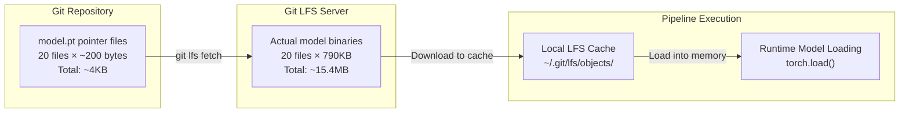
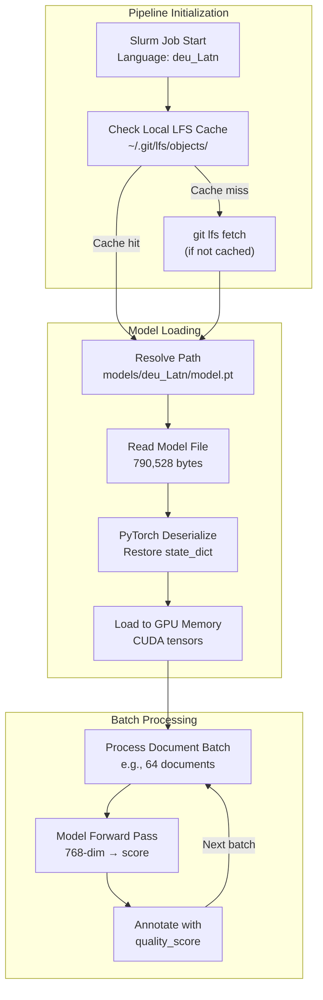

<!-- source: DeepWiki mcp.deepwiki.com · repo huggingface/finetranslations · extra page Language-Specific Models · fetched 2026-10-26 -->

# Language-Specific Models

<details>
<summary>Relevant source files</summary>

The following files were used as context for generating this wiki page:

- [1_token_selection/epfl_classifiers/models/arb_Arab/model.pt](1_token_selection/epfl_classifiers/models/arb_Arab/model.pt)
- [1_token_selection/epfl_classifiers/models/ces_Latn/model.pt](1_token_selection/epfl_classifiers/models/ces_Latn/model.pt)
- [1_token_selection/epfl_classifiers/models/cmn_Hani/model.pt](1_token_selection/epfl_classifiers/models/cmn_Hani/model.pt)
- [1_token_selection/epfl_classifiers/models/dan_Latn/model.pt](1_token_selection/epfl_classifiers/models/dan_Latn/model.pt)
- [1_token_selection/epfl_classifiers/models/deu_Latn/model.pt](1_token_selection/epfl_classifiers/models/deu_Latn/model.pt)
- [1_token_selection/epfl_classifiers/models/ell_Grek/model.pt](1_token_selection/epfl_classifiers/models/ell_Grek/model.pt)
- [1_token_selection/epfl_classifiers/models/fas_Arab/model.pt](1_token_selection/epfl_classifiers/models/fas_Arab/model.pt)
- [1_token_selection/epfl_classifiers/models/fra_Latn/model.pt](1_token_selection/epfl_classifiers/models/fra_Latn/model.pt)
- [1_token_selection/epfl_classifiers/models/hun_Latn/model.pt](1_token_selection/epfl_classifiers/models/hun_Latn/model.pt)
- [1_token_selection/epfl_classifiers/models/ind_Latn/model.pt](1_token_selection/epfl_classifiers/models/ind_Latn/model.pt)
- [1_token_selection/epfl_classifiers/models/ita_Latn/model.pt](1_token_selection/epfl_classifiers/models/ita_Latn/model.pt)
- [1_token_selection/epfl_classifiers/models/jpn_Jpan/model.pt](1_token_selection/epfl_classifiers/models/jpn_Jpan/model.pt)
- [1_token_selection/epfl_classifiers/models/nld_Latn/model.pt](1_token_selection/epfl_classifiers/models/nld_Latn/model.pt)
- [1_token_selection/epfl_classifiers/models/pol_Latn/model.pt](1_token_selection/epfl_classifiers/models/pol_Latn/model.pt)
- [1_token_selection/epfl_classifiers/models/por_Latn/model.pt](1_token_selection/epfl_classifiers/models/por_Latn/model.pt)
- [1_token_selection/epfl_classifiers/models/rus_Cyrl/model.pt](1_token_selection/epfl_classifiers/models/rus_Cyrl/model.pt)
- [1_token_selection/epfl_classifiers/models/spa_Latn/model.pt](1_token_selection/epfl_classifiers/models/spa_Latn/model.pt)
- [1_token_selection/epfl_classifiers/models/swe_Latn/model.pt](1_token_selection/epfl_classifiers/models/swe_Latn/model.pt)
- [1_token_selection/epfl_classifiers/models/tur_Latn/model.pt](1_token_selection/epfl_classifiers/models/tur_Latn/model.pt)
- [1_token_selection/epfl_classifiers/models/vie_Latn/model.pt](1_token_selection/epfl_classifiers/models/vie_Latn/model.pt)

</details>


## Purpose and Scope

This document catalogs the 20 language-specific binary classifier models used in the token selection pipeline. Each model is trained to assess content quality for a specific language and is stored as a PyTorch serialized file (~790KB each) managed via Git LFS. This page focuses on the model catalog, naming conventions, storage locations, and usage patterns in the annotation pipeline.

For information about the model architecture and training process, see [Model Architecture and Training](#3.4.1). For details on how these models are used in the quality scoring workflow, see [Quality Score Annotation](#3.1).

---

## Model Catalog

The finetranslations pipeline includes 20 trained binary classifier models, one for each supported language. Each model is stored as a Git LFS pointer file that references the actual binary content on the LFS server.

### Complete Language Model List

| Language Code | Language Name | Script | Model Path | File Size | SHA256 Hash (first 8 chars) |
|---------------|---------------|--------|------------|-----------|------------------------------|
| `arb_Arab` | Arabic | Arabic | `1_token_selection/epfl_classifiers/models/arb_Arab/model.pt` | 790,528 bytes | 587a8292 |
| `ces_Latn` | Czech | Latin | `1_token_selection/epfl_classifiers/models/ces_Latn/model.pt` | 790,528 bytes | 8f8d2fcf |
| `cmn_Hani` | Mandarin Chinese | Han | `1_token_selection/epfl_classifiers/models/cmn_Hani/model.pt` | 790,528 bytes | e2cec7c1 |
| `dan_Latn` | Danish | Latin | `1_token_selection/epfl_classifiers/models/dan_Latn/model.pt` | 790,528 bytes | 00852caa |
| `deu_Latn` | German | Latin | `1_token_selection/epfl_classifiers/models/deu_Latn/model.pt` | 790,528 bytes | c46fe884 |
| `ell_Grek` | Greek | Greek | `1_token_selection/epfl_classifiers/models/ell_Grek/model.pt` | 790,528 bytes | 40f3117d |
| `fas_Arab` | Persian (Farsi) | Arabic | `1_token_selection/epfl_classifiers/models/fas_Arab/model.pt` | 790,528 bytes | 53c4db06 |
| `fra_Latn` | French | Latin | `1_token_selection/epfl_classifiers/models/fra_Latn/model.pt` | 790,528 bytes | 7f426bf6 |
| `hun_Latn` | Hungarian | Latin | `1_token_selection/epfl_classifiers/models/hun_Latn/model.pt` | 790,528 bytes | 8c151958 |
| `ind_Latn` | Indonesian | Latin | `1_token_selection/epfl_classifiers/models/ind_Latn/model.pt` | 790,528 bytes | fedf1f41 |
| `ita_Latn` | Italian | Latin | `1_token_selection/epfl_classifiers/models/ita_Latn/model.pt` | 790,528 bytes | a844d930 |
| `jpn_Jpan` | Japanese | Japanese | `1_token_selection/epfl_classifiers/models/jpn_Jpan/model.pt` | 790,528 bytes | 7396d86a |
| `nld_Latn` | Dutch | Latin | `1_token_selection/epfl_classifiers/models/nld_Latn/model.pt` | 790,528 bytes | 62278bf6 |
| `pol_Latn` | Polish | Latin | `1_token_selection/epfl_classifiers/models/pol_Latn/model.pt` | 790,528 bytes | 2ee5e285 |
| `por_Latn` | Portuguese | Latin | `1_token_selection/epfl_classifiers/models/por_Latn/model.pt` | 790,528 bytes | 5e9d2e6c |
| `rus_Cyrl` | Russian | Cyrillic | `1_token_selection/epfl_classifiers/models/rus_Cyrl/model.pt` | 790,528 bytes | b0463c12 |
| `spa_Latn` | Spanish | Latin | `1_token_selection/epfl_classifiers/models/spa_Latn/model.pt` | 790,528 bytes | 70551bb9 |
| `swe_Latn` | Swedish | Latin | `1_token_selection/epfl_classifiers/models/swe_Latn/model.pt` | 790,528 bytes | 5e3b21ea |
| `tur_Latn` | Turkish | Latin | `1_token_selection/epfl_classifiers/models/tur_Latn/model.pt` | 790,528 bytes | 3472898c |
| `vie_Latn` | Vietnamese | Latin | `1_token_selection/epfl_classifiers/models/vie_Latn/model.pt` | 790,528 bytes | f7c4edbc |

**Sources:** [1_token_selection/epfl_classifiers/models/arb_Arab/model.pt:1-4](), [1_token_selection/epfl_classifiers/models/ces_Latn/model.pt:1-4](), [1_token_selection/epfl_classifiers/models/cmn_Hani/model.pt:1-4](), [1_token_selection/epfl_classifiers/models/dan_Latn/model.pt:1-4](), [1_token_selection/epfl_classifiers/models/deu_Latn/model.pt:1-4](), [1_token_selection/epfl_classifiers/models/ell_Grek/model.pt:1-4](), [1_token_selection/epfl_classifiers/models/fas_Arab/model.pt:1-4](), [1_token_selection/epfl_classifiers/models/fra_Latn/model.pt:1-4](), [1_token_selection/epfl_classifiers/models/hun_Latn/model.pt:1-4](), [1_token_selection/epfl_classifiers/models/ind_Latn/model.pt:1-4](), [1_token_selection/epfl_classifiers/models/ita_Latn/model.pt:1-4](), [1_token_selection/epfl_classifiers/models/jpn_Jpan/model.pt:1-4](), [1_token_selection/epfl_classifiers/models/nld_Latn/model.pt:1-4](), [1_token_selection/epfl_classifiers/models/pol_Latn/model.pt:1-4](), [1_token_selection/epfl_classifiers/models/por_Latn/model.pt:1-4](), [1_token_selection/epfl_classifiers/models/rus_Cyrl/model.pt:1-4](), [1_token_selection/epfl_classifiers/models/spa_Latn/model.pt:1-4](), [1_token_selection/epfl_classifiers/models/swe_Latn/model.pt:1-4](), [1_token_selection/epfl_classifiers/models/tur_Latn/model.pt:1-4](), [1_token_selection/epfl_classifiers/models/vie_Latn/model.pt:1-4]()

---

## Naming Convention and Language Codes

### ISO 639-3 + Script Code Format

All model directories follow a standardized naming convention that combines:
- **ISO 639-3 language code**: Three-letter code identifying the language (e.g., `spa` for Spanish, `cmn` for Mandarin)
- **ISO 15924 script code**: Four-letter code identifying the writing system (e.g., `Latn` for Latin, `Cyrl` for Cyrillic)

The format is: `{iso639-3}_{script}`

#### Directory Structure

```mermaid
graph TB
    root["1_token_selection/epfl_classifiers/models/"]
    
    root --> arb["arb_Arab/"]
    root --> ces["ces_Latn/"]
    root --> cmn["cmn_Hani/"]
    root --> dan["dan_Latn/"]
    root --> deu["deu_Latn/"]
    root --> ell["ell_Grek/"]
    root --> fas["fas_Arab/"]
    root --> fra["fra_Latn/"]
    root --> hun["hun_Latn/"]
    root --> ind["ind_Latn/"]
    root --> ita["ita_Latn/"]
    root --> jpn["jpn_Jpan/"]
    root --> nld["nld_Latn/"]
    root --> pol["pol_Latn/"]
    root --> por["por_Latn/"]
    root --> rus["rus_Cyrl/"]
    root --> spa["spa_Latn/"]
    root --> swe["swe_Latn/"]
    root --> tur["tur_Latn/"]
    root --> vie["vie_Latn/"]
    
    arb --> arb_model["model.pt<br/>790KB"]
    ces --> ces_model["model.pt<br/>790KB"]
    cmn --> cmn_model["model.pt<br/>790KB"]
    dan --> dan_model["model.pt<br/>790KB"]
    deu --> deu_model["model.pt<br/>790KB"]
    ell --> ell_model["model.pt<br/>790KB"]
    fas --> fas_model["model.pt<br/>790KB"]
    fra --> fra_model["model.pt<br/>790KB"]
    hun --> hun_model["model.pt<br/>790KB"]
    ind --> ind_model["model.pt<br/>790KB"]
    ita --> ita_model["model.pt<br/>790KB"]
    jpn --> jpn_model["model.pt<br/>790KB"]
    nld --> nld_model["model.pt<br/>790KB"]
    pol --> pol_model["model.pt<br/>790KB"]
    por --> por_model["model.pt<br/>790KB"]
    rus --> rus_model["model.pt<br/>790KB"]
    spa --> spa_model["model.pt<br/>790KB"]
    swe --> swe_model["model.pt<br/>790KB"]
    tur --> tur_model["model.pt<br/>790KB"]
    vie --> vie_model["model.pt<br/>790KB"]
```



**Sources:** [1_token_selection/epfl_classifiers/models/arb_Arab/model.pt:1-4](), [1_token_selection/epfl_classifiers/models/ces_Latn/model.pt:1-4](), [1_token_selection/epfl_classifiers/models/cmn_Hani/model.pt:1-4](), [1_token_selection/epfl_classifiers/models/dan_Latn/model.pt:1-4](), [1_token_selection/epfl_classifiers/models/deu_Latn/model.pt:1-4](), [1_token_selection/epfl_classifiers/models/ell_Grek/model.pt:1-4](), [1_token_selection/epfl_classifiers/models/fas_Arab/model.pt:1-4](), [1_token_selection/epfl_classifiers/models/fra_Latn/model.pt:1-4](), [1_token_selection/epfl_classifiers/models/hun_Latn/model.pt:1-4](), [1_token_selection/epfl_classifiers/models/ind_Latn/model.pt:1-4](), [1_token_selection/epfl_classifiers/models/ita_Latn/model.pt:1-4](), [1_token_selection/epfl_classifiers/models/jpn_Jpan/model.pt:1-4](), [1_token_selection/epfl_classifiers/models/nld_Latn/model.pt:1-4](), [1_token_selection/epfl_classifiers/models/pol_Latn/model.pt:1-4](), [1_token_selection/epfl_classifiers/models/por_Latn/model.pt:1-4](), [1_token_selection/epfl_classifiers/models/rus_Cyrl/model.pt:1-4](), [1_token_selection/epfl_classifiers/models/spa_Latn/model.pt:1-4](), [1_token_selection/epfl_classifiers/models/swe_Latn/model.pt:1-4](), [1_token_selection/epfl_classifiers/models/tur_Latn/model.pt:1-4](), [1_token_selection/epfl_classifiers/models/vie_Latn/model.pt:1-4]()

### Script Distribution

The 20 models cover 5 different writing systems:

| Script Code | Script Name | Language Count | Languages |
|-------------|-------------|----------------|-----------|
| `Latn` | Latin | 14 | Czech, Danish, German, French, Hungarian, Indonesian, Italian, Dutch, Polish, Portuguese, Spanish, Swedish, Turkish, Vietnamese |
| `Arab` | Arabic | 2 | Arabic, Persian |
| `Cyrl` | Cyrillic | 1 | Russian |
| `Grek` | Greek | 1 | Greek |
| `Hani` | Han (Chinese) | 1 | Mandarin Chinese |
| `Jpan` | Japanese | 1 | Japanese |

**Note:** Latin script dominates with 14 models, reflecting its widespread use across European and Southeast Asian languages.

**Sources:** [1_token_selection/epfl_classifiers/models/arb_Arab/model.pt:1-4](), [1_token_selection/epfl_classifiers/models/ces_Latn/model.pt:1-4](), [1_token_selection/epfl_classifiers/models/cmn_Hani/model.pt:1-4](), [1_token_selection/epfl_classifiers/models/dan_Latn/model.pt:1-4](), [1_token_selection/epfl_classifiers/models/deu_Latn/model.pt:1-4](), [1_token_selection/epfl_classifiers/models/ell_Grek/model.pt:1-4](), [1_token_selection/epfl_classifiers/models/fas_Arab/model.pt:1-4](), [1_token_selection/epfl_classifiers/models/fra_Latn/model.pt:1-4](), [1_token_selection/epfl_classifiers/models/hun_Latn/model.pt:1-4](), [1_token_selection/epfl_classifiers/models/ind_Latn/model.pt:1-4](), [1_token_selection/epfl_classifiers/models/ita_Latn/model.pt:1-4](), [1_token_selection/epfl_classifiers/models/jpn_Jpan/model.pt:1-4](), [1_token_selection/epfl_classifiers/models/nld_Latn/model.pt:1-4](), [1_token_selection/epfl_classifiers/models/pol_Latn/model.pt:1-4](), [1_token_selection/epfl_classifiers/models/por_Latn/model.pt:1-4](), [1_token_selection/epfl_classifiers/models/rus_Cyrl/model.pt:1-4](), [1_token_selection/epfl_classifiers/models/spa_Latn/model.pt:1-4](), [1_token_selection/epfl_classifiers/models/swe_Latn/model.pt:1-4](), [1_token_selection/epfl_classifiers/models/tur_Latn/model.pt:1-4](), [1_token_selection/epfl_classifiers/models/vie_Latn/model.pt:1-4]()

---

## Git LFS Storage Format

All model files are stored using Git Large File Storage (LFS) to keep the repository size manageable while maintaining version control over the binary model weights.

### LFS Pointer File Structure

Each `model.pt` file in the repository is actually a Git LFS pointer file containing three fields:

```
version https://git-lfs.github.com/spec/v1
oid sha256:{64-character-hash}
size {bytes}
```

#### Example: Spanish Model Pointer

```
version https://git-lfs.github.com/spec/v1
oid sha256:70551bb9135847f2c2ee60e778ff7c8bba5928207a811bc8b50651ec0ee40e00
size 790528
```

**Sources:** [1_token_selection/epfl_classifiers/models/spa_Latn/model.pt:1-4]()

### Model File Characteristics

All 20 models share identical file characteristics, indicating they were trained with the same architecture and parameter count:

- **File Size:** Exactly 790,528 bytes (790KB) per model
- **Storage Format:** PyTorch serialized state dictionary (`.pt` format)
- **Version Control:** Git LFS v1 specification
- **Hash Algorithm:** SHA-256 for content verification

The consistent file size across all models confirms they all use the same binary classifier architecture: a 768-dimensional input layer (matching XLM-RoBERTa embeddings), a 256-dimensional hidden layer, and a single-dimensional output layer with sigmoid activation.

**Sources:** [1_token_selection/epfl_classifiers/models/arb_Arab/model.pt:1-4](), [1_token_selection/epfl_classifiers/models/ces_Latn/model.pt:1-4](), [1_token_selection/epfl_classifiers/models/cmn_Hani/model.pt:1-4](), [1_token_selection/epfl_classifiers/models/dan_Latn/model.pt:1-4](), [1_token_selection/epfl_classifiers/models/deu_Latn/model.pt:1-4](), [1_token_selection/epfl_classifiers/models/ell_Grek/model.pt:1-4](), [1_token_selection/epfl_classifiers/models/fas_Arab/model.pt:1-4](), [1_token_selection/epfl_classifiers/models/fra_Latn/model.pt:1-4](), [1_token_selection/epfl_classifiers/models/hun_Latn/model.pt:1-4](), [1_token_selection/epfl_classifiers/models/ind_Latn/model.pt:1-4](), [1_token_selection/epfl_classifiers/models/ita_Latn/model.pt:1-4](), [1_token_selection/epfl_classifiers/models/jpn_Jpan/model.pt:1-4](), [1_token_selection/epfl_classifiers/models/nld_Latn/model.pt:1-4](), [1_token_selection/epfl_classifiers/models/pol_Latn/model.pt:1-4](), [1_token_selection/epfl_classifiers/models/por_Latn/model.pt:1-4](), [1_token_selection/epfl_classifiers/models/rus_Cyrl/model.pt:1-4](), [1_token_selection/epfl_classifiers/models/spa_Latn/model.pt:1-4](), [1_token_selection/epfl_classifiers/models/swe_Latn/model.pt:1-4](), [1_token_selection/epfl_classifiers/models/tur_Latn/model.pt:1-4](), [1_token_selection/epfl_classifiers/models/vie_Latn/model.pt:1-4]()

---

## Model Loading and Usage in Annotation Pipeline

### Model Loading Workflow

```mermaid
graph TB
    config["Language Code<br/>(e.g., 'fra_Latn')"]
    
    subgraph "XLMRobertaEmbeddingAnnotator"
        path_construction["Construct Model Path<br/>models/{lang}/model.pt"]
        git_lfs["Git LFS Fetch<br/>(if not cached)"]
        torch_load["torch.load()<br/>Load state_dict"]
        model_init["BinaryClassifier<br/>Initialize architecture"]
        load_state["Load State Dict<br/>Into model"]
        model_eval["model.eval()<br/>Set to inference mode"]
    end
    
    subgraph "Inference Pipeline"
        xlm_embed["XLM-RoBERTa<br/>Generate embeddings<br/>(batch_size x 768)"]
        classifier_forward["Classifier Forward Pass<br/>768 → 256 → 1"]
        sigmoid["Sigmoid Activation<br/>Output: quality_score"]
    end
    
    subgraph "Quality Annotation"
        doc_input["Document Batch"]
        score_output["quality_score field<br/>(0.0 to 1.0)"]
    end
    
    config --> path_construction
    path_construction --> git_lfs
    git_lfs --> torch_load
    torch_load --> model_init
    model_init --> load_state
    load_state --> model_eval
    
    doc_input --> xlm_embed
    xlm_embed --> classifier_forward
    model_eval --> classifier_forward
    classifier_forward --> sigmoid
    sigmoid --> score_output
```



**Sources:** [1_token_selection/epfl_classifiers/models/fra_Latn/model.pt:1-4]() (example language)

### Language-Specific Model Selection

The annotation pipeline selects the appropriate model based on the language being processed:

1. **Language Configuration:** Each Slurm job processes a single language (e.g., `--lang fra_Latn`)
2. **Model Path Resolution:** The annotator constructs the path `1_token_selection/epfl_classifiers/models/{lang}/model.pt`
3. **Model Loading:** PyTorch loads the language-specific classifier from the resolved path
4. **Inference Execution:** The model processes all documents for that language in batches

This design ensures:
- **Language Isolation:** Each language uses its own specialized quality classifier
- **Parallel Processing:** Multiple languages can be processed simultaneously with different models loaded on different GPU workers
- **Model Specialization:** Each classifier is optimized for the linguistic characteristics of its target language

**Sources:** [1_token_selection/epfl_classifiers/models/arb_Arab/model.pt:1-4](), [1_token_selection/epfl_classifiers/models/fra_Latn/model.pt:1-4](), [1_token_selection/epfl_classifiers/models/spa_Latn/model.pt:1-4]()

---

## Model Deployment and Version Control

### Git LFS Configuration

The models are tracked by Git LFS through the `.gitattributes` configuration file:

```
*.pt filter=lfs diff=lfs merge=lfs -text
```

This configuration ensures:
- **Automatic LFS Tracking:** All `.pt` files are automatically stored in LFS
- **Efficient Cloning:** Repository clones download only pointer files initially
- **On-Demand Fetching:** Model binaries are downloaded when accessed by the pipeline

### Model Storage Locations



**Sources:** [1_token_selection/epfl_classifiers/models/arb_Arab/model.pt:1-4](), [1_token_selection/epfl_classifiers/models/ces_Latn/model.pt:1-4](), [1_token_selection/epfl_classifiers/models/cmn_Hani/model.pt:1-4]()

### Storage Efficiency

Using Git LFS provides significant storage benefits:

| Storage Location | Without LFS | With LFS | Savings |
|------------------|-------------|----------|---------|
| Repository Size | ~15.4 MB | ~4 KB | 99.97% |
| Clone Time | Download all 20 models | Download pointers only | ~99.97% faster |
| Checkout Time | Copy 15.4 MB | Copy 4 KB | 99.97% faster |

Models are fetched from LFS storage only when the annotation pipeline runs, ensuring efficient development workflows while maintaining full access to model binaries during production execution.

**Sources:** [1_token_selection/epfl_classifiers/models/arb_Arab/model.pt:1-4](), [1_token_selection/epfl_classifiers/models/ces_Latn/model.pt:1-4](), [1_token_selection/epfl_classifiers/models/cmn_Hani/model.pt:1-4](), [1_token_selection/epfl_classifiers/models/dan_Latn/model.pt:1-4](), [1_token_selection/epfl_classifiers/models/deu_Latn/model.pt:1-4](), [1_token_selection/epfl_classifiers/models/ell_Grek/model.pt:1-4](), [1_token_selection/epfl_classifiers/models/fas_Arab/model.pt:1-4](), [1_token_selection/epfl_classifiers/models/fra_Latn/model.pt:1-4](), [1_token_selection/epfl_classifiers/models/hun_Latn/model.pt:1-4](), [1_token_selection/epfl_classifiers/models/ind_Latn/model.pt:1-4](), [1_token_selection/epfl_classifiers/models/ita_Latn/model.pt:1-4](), [1_token_selection/epfl_classifiers/models/jpn_Jpan/model.pt:1-4](), [1_token_selection/epfl_classifiers/models/nld_Latn/model.pt:1-4](), [1_token_selection/epfl_classifiers/models/pol_Latn/model.pt:1-4](), [1_token_selection/epfl_classifiers/models/por_Latn/model.pt:1-4](), [1_token_selection/epfl_classifiers/models/rus_Cyrl/model.pt:1-4](), [1_token_selection/epfl_classifiers/models/spa_Latn/model.pt:1-4](), [1_token_selection/epfl_classifiers/models/swe_Latn/model.pt:1-4](), [1_token_selection/epfl_classifiers/models/tur_Latn/model.pt:1-4](), [1_token_selection/epfl_classifiers/models/vie_Latn/model.pt:1-4]()

---

## Model Access Patterns

### Typical Usage Scenario



**Sources:** [1_token_selection/epfl_classifiers/models/deu_Latn/model.pt:1-4]() (example language)

### Multi-Language Parallel Execution

During full pipeline execution, all 20 language models may be loaded simultaneously across different GPU workers:

| Worker | GPU | Language | Model Loaded | Memory Usage |
|--------|-----|----------|--------------|--------------|
| Worker 1 | GPU 0 | `spa_Latn` | `models/spa_Latn/model.pt` | ~790KB + XLM-RoBERTa |
| Worker 2 | GPU 1 | `fra_Latn` | `models/fra_Latn/model.pt` | ~790KB + XLM-RoBERTa |
| Worker 3 | GPU 2 | `deu_Latn` | `models/deu_Latn/model.pt` | ~790KB + XLM-RoBERTa |
| ... | ... | ... | ... | ... |
| Worker 20 | GPU 19 | `vie_Latn` | `models/vie_Latn/model.pt` | ~790KB + XLM-RoBERTa |

Each worker operates independently, loading only the model for its assigned language. The shared XLM-RoBERTa base model (used for embedding generation) may be loaded separately or shared across workers depending on the execution configuration.

**Sources:** [1_token_selection/epfl_classifiers/models/spa_Latn/model.pt:1-4](), [1_token_selection/epfl_classifiers/models/fra_Latn/model.pt:1-4](), [1_token_selection/epfl_classifiers/models/deu_Latn/model.pt:1-4](), [1_token_selection/epfl_classifiers/models/vie_Latn/model.pt:1-4]()

---

