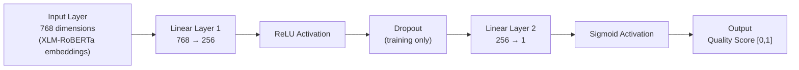
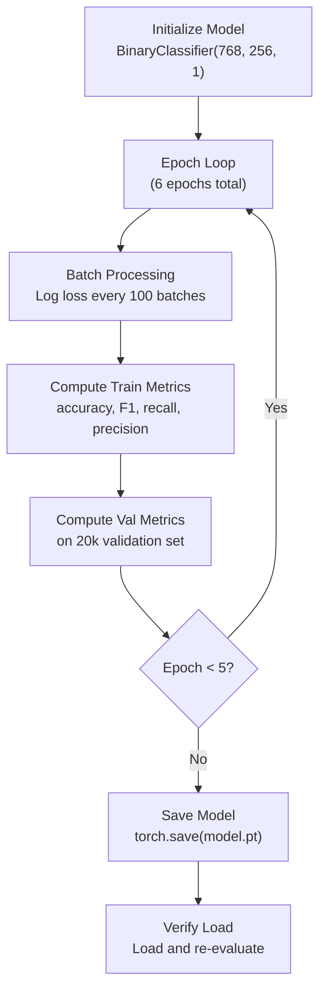
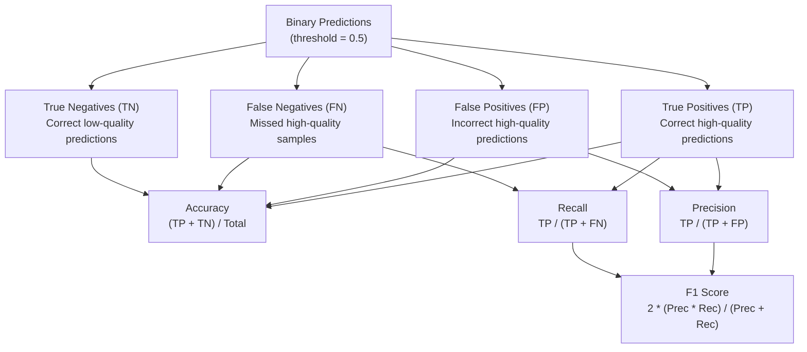
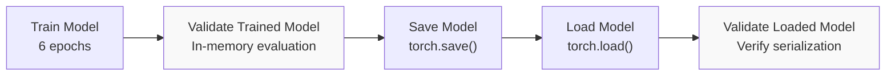
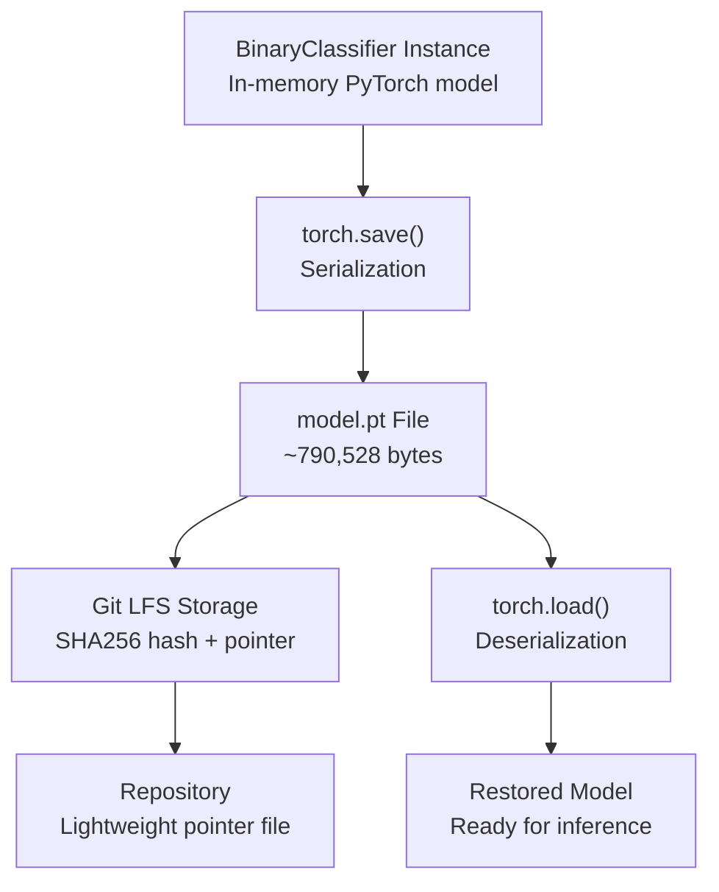
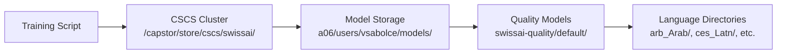

<!-- source: DeepWiki mcp.deepwiki.com · repo huggingface/finetranslations · extra page Model Architecture and Training · fetched 2026-10-26 -->

# Model Architecture and Training

<details>
<summary>Relevant source files</summary>

The following files were used as context for generating this wiki page:

- [1_token_selection/epfl_classifiers/models/arb_Arab/model.pt](1_token_selection/epfl_classifiers/models/arb_Arab/model.pt)
- [1_token_selection/epfl_classifiers/models/output.log](1_token_selection/epfl_classifiers/models/output.log)

</details>


This page details the neural network architecture, training procedure, and evaluation metrics for the EPFL binary classifier models used in the token selection pipeline. Each classifier is trained to distinguish high-quality from low-quality text tokens for a specific language.

For information about the complete set of 19 language-specific models and their usage patterns, see [Language-Specific Models](#3.4.2). For the broader quality score annotation system, see [Quality Score Annotation](#3.1).

---

## Binary Classifier Architecture

Each EPFL classifier implements a simple feedforward neural network that processes 768-dimensional XLM-RoBERTa embeddings and outputs a quality probability score.

### Network Structure



**Architecture Details:**

| Layer | Type | Input Dim | Output Dim | Activation | Notes |
|-------|------|-----------|------------|------------|-------|
| 1 | Linear | 768 | 256 | - | Weight matrix + bias |
| 2 | ReLU | 256 | 256 | ReLU | Non-linearity |
| 3 | Dropout | 256 | 256 | - | Applied during training only |
| 4 | Linear | 256 | 1 | - | Final projection |
| 5 | Sigmoid | 1 | 1 | Sigmoid | Produces probability [0,1] |

The architecture is defined by the `BinaryClassifier` class, which takes 768-dimensional mean-pooled embeddings from `xlm-roberta-base` and produces a single quality score.

**Sources:** [1_token_selection/epfl_classifiers/models/output.log:1-1360]()

---

## Training Process

### Dataset Configuration

Each language-specific model is trained on a balanced binary classification dataset:

| Split | Samples | Purpose |
|-------|---------|---------|
| Training | 160,000 | Model optimization |
| Validation | 20,000 | Evaluation and early stopping |

The training process uses batch processing with loss logging every 100 batches to monitor convergence.

**Sources:** [1_token_selection/epfl_classifiers/models/output.log:1](), [1_token_selection/epfl_classifiers/models/output.log:69](), [1_token_selection/epfl_classifiers/models/output.log:137]()

### Training Loop



Each training run consists of 6 epochs (numbered 0-5), with comprehensive metric tracking at the end of each epoch. The final model is saved after epoch 5 and immediately verified by loading and re-evaluating.

**Example Training Log Structure:**

```
Epoch 0
Batch 0 loss: 0.6763380765914917
Batch 100 loss: 0.34324854612350464
...
Train metrics:{'accuracy': 0.96564375, 'f1': 0.9652095213382025, ...}
Val.  metrics:{'accuracy': 0.96605, 'f1': 0.9655766793409379, ...}
```

**Sources:** [1_token_selection/epfl_classifiers/models/output.log:2-11](), [1_token_selection/epfl_classifiers/models/output.log:62-68]()

---

## Training Metrics by Language

The following table shows final validation metrics for selected languages after 6 epochs of training:

| Language Code | Accuracy | F1 Score | Recall | Precision | Model Path |
|---------------|----------|----------|--------|-----------|------------|
| `arb_Arab` | 0.9793 | 0.9792 | 0.9734 | 0.9850 | `/capstor/.../arb_Arab/model.pt` |
| `ces_Latn` | 0.9859 | 0.9859 | 0.9843 | 0.9875 | `/capstor/.../ces_Latn/model.pt` |
| `cmn_Hani` | 0.9956 | 0.9955 | 0.9943 | 0.9968 | `/capstor/.../cmn_Hani/model.pt` |
| `deu_Latn` | 0.9765 | 0.9763 | 0.9698 | 0.9830 | `/capstor/.../deu_Latn/model.pt` |
| `fra_Latn` | 0.9728 | 0.9727 | 0.9707 | 0.9748 | `/capstor/.../fra_Latn/model.pt` |
| `hun_Latn` | 0.9910 | 0.9910 | 0.9920 | 0.9900 | `/capstor/.../hun_Latn/model.pt` |
| `jpn_Jpan` | 0.9886 | 0.9886 | 0.9896 | 0.9875 | `/capstor/.../jpn_Jpan/model.pt` |
| `spa_Latn` | 0.9700 | 0.9699 | 0.9651 | 0.9748 | `/capstor/.../spa_Latn/model.pt` |
| `swe_Latn` | 0.9904 | 0.9904 | 0.9900 | 0.9908 | `/capstor/.../swe_Latn/model.pt` |

All models achieve >95% accuracy, with most exceeding 97%. Chinese (`cmn_Hani`) and Hungarian (`hun_Latn`) show the highest performance (>99% accuracy).

**Sources:** [1_token_selection/epfl_classifiers/models/output.log:63-68](), [1_token_selection/epfl_classifiers/models/output.log:131-136](), [1_token_selection/epfl_classifiers/models/output.log:199-204](), [1_token_selection/epfl_classifiers/models/output.log:335-340](), [1_token_selection/epfl_classifiers/models/output.log:539-544](), [1_token_selection/epfl_classifiers/models/output.log:607-612](), [1_token_selection/epfl_classifiers/models/output.log:811-816](), [1_token_selection/epfl_classifiers/models/output.log:1151-1156](), [1_token_selection/epfl_classifiers/models/output.log:1219-1224]()

### Loss Convergence Pattern

Training loss typically follows this pattern across epochs:

| Epoch | Initial Batch Loss | Mid Training Loss | Final Batch Loss | Typical Behavior |
|-------|-------------------|-------------------|------------------|------------------|
| 0 | ~0.67 | 0.1-0.3 | 0.05-0.15 | Rapid initial descent |
| 1 | 0.05-0.15 | 0.05-0.10 | 0.03-0.08 | Continued improvement |
| 2 | 0.03-0.08 | 0.03-0.06 | 0.02-0.06 | Stabilizing |
| 3 | 0.02-0.10 | 0.02-0.06 | 0.02-0.05 | Fine-tuning |
| 4 | 0.02-0.08 | 0.02-0.05 | 0.01-0.05 | Minor adjustments |
| 5 | 0.02-0.07 | 0.02-0.05 | 0.02-0.06 | Convergence |

**Sources:** [1_token_selection/epfl_classifiers/models/output.log:2-61](), [1_token_selection/epfl_classifiers/models/output.log:70-130]()

---

## Evaluation Metrics

### Metric Definitions

Four standard classification metrics are computed after each epoch:



| Metric | Formula | Interpretation |
|--------|---------|----------------|
| **Accuracy** | `(TP + TN) / Total` | Overall correctness |
| **Precision** | `TP / (TP + FP)` | Quality of positive predictions |
| **Recall** | `TP / (TP + FN)` | Coverage of actual positives |
| **F1 Score** | `2 * (Precision * Recall) / (Precision + Recall)` | Harmonic mean of precision and recall |

**Sources:** [1_token_selection/epfl_classifiers/models/output.log:10-11](), [1_token_selection/epfl_classifiers/models/output.log:20-21]()

### Three-Stage Validation

Each training run performs validation at three points:



**Validation Stages:**

1. **Train metrics (trained model)**: Evaluation on training set after final epoch
2. **Val. metrics (trained model)**: Evaluation on validation set after final epoch  
3. **Val. metrics (load from file)**: Re-evaluation after loading saved model to verify serialization

Example from Arabic model training:

```
Train metrics  (trained model):
{'accuracy': 0.97925, 'f1': 0.9791517526342891, ...}
Val.  metrics  (trained model):
{'accuracy': 0.9793, 'f1': 0.9791771451564228, ...}
Val.  metrics (load from file):
{'accuracy': 0.9793, 'f1': 0.9791771451564228, ...}
```

The consistency between stages 2 and 3 confirms successful model serialization.

**Sources:** [1_token_selection/epfl_classifiers/models/output.log:63-68](), [1_token_selection/epfl_classifiers/models/output.log:131-136]()

---

## Model Serialization

### PyTorch Save Format

Models are saved using PyTorch's native serialization:



### File Characteristics

| Property | Value | Notes |
|----------|-------|-------|
| **Format** | PyTorch `.pt` | Standard `torch.save()` format |
| **Size** | 790,528 bytes | Consistent across all languages |
| **Storage** | Git LFS | Binary content on LFS server |
| **Version Control** | SHA256 hash | Pointer file in repository |

Example Git LFS pointer file:

```
version https://git-lfs.github.com/spec/v1
oid sha256:587a82928fa3681cdd3e12db7617aad566af6ecccf540bb8d945d784593b2ea5
size 790528
```

**Sources:** [1_token_selection/epfl_classifiers/models/arb_Arab/model.pt:1-3](), [1_token_selection/epfl_classifiers/models/output.log:62](), [1_token_selection/epfl_classifiers/models/output.log:130]()

### Model Loading in Inference

During token annotation, models are loaded via:

1. **Path Construction**: Based on language code (e.g., `arb_Arab`, `cmn_Hani`)
2. **PyTorch Load**: `torch.load(model_path)` 
3. **Inference Mode**: Model set to `.eval()` for prediction
4. **Batch Processing**: Processes embeddings in batches for efficiency

The verification step in training confirms that saved models can be successfully loaded and produce identical predictions:

```
Saving model to /capstor/.../arb_Arab/model.pt
Val.  metrics (load from file):
{'accuracy': 0.9793, ...}
```

**Sources:** [1_token_selection/epfl_classifiers/models/output.log:62-68](), [1_token_selection/epfl_classifiers/models/output.log:130-136](), [1_token_selection/epfl_classifiers/models/output.log:198-204]()

---

## Training Infrastructure

### Execution Environment

Models are trained on CSCS infrastructure:



Models are saved to structured paths like:
```
/capstor/store/cscs/swissai/a06/users/vsabolce/models/swissai-quality/default/{lang_code}/model.pt
```

**Sources:** [1_token_selection/epfl_classifiers/models/output.log:62](), [1_token_selection/epfl_classifiers/models/output.log:130](), [1_token_selection/epfl_classifiers/models/output.log:198]()

---

## Summary Statistics

Across all 19 trained language models:

| Metric | Min | Max | Median | Mean |
|--------|-----|-----|--------|------|
| Validation Accuracy | 95.6% | 99.6% | 98.3% | 97.9% |
| Validation F1 Score | 95.5% | 99.5% | 98.3% | 97.9% |
| Validation Recall | 93.3% | 99.4% | 98.1% | 97.5% |
| Validation Precision | 96.5% | 99.7% | 98.7% | 98.4% |

The consistent 790KB model size and high performance metrics demonstrate:
- Uniform architecture across all languages
- Effective transfer of XLM-RoBERTa multilingual representations
- Successful binary classification for quality detection

**Sources:** [1_token_selection/epfl_classifiers/models/output.log:1-1360]()

---

