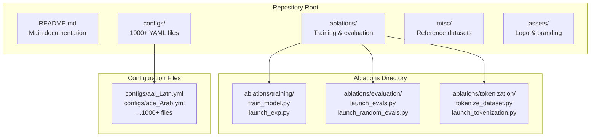
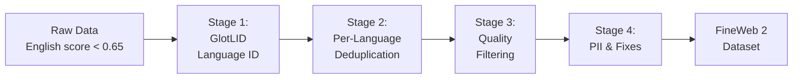
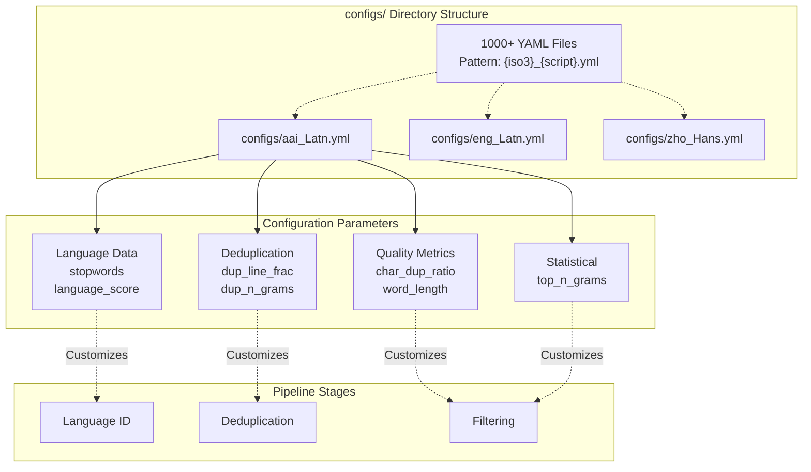
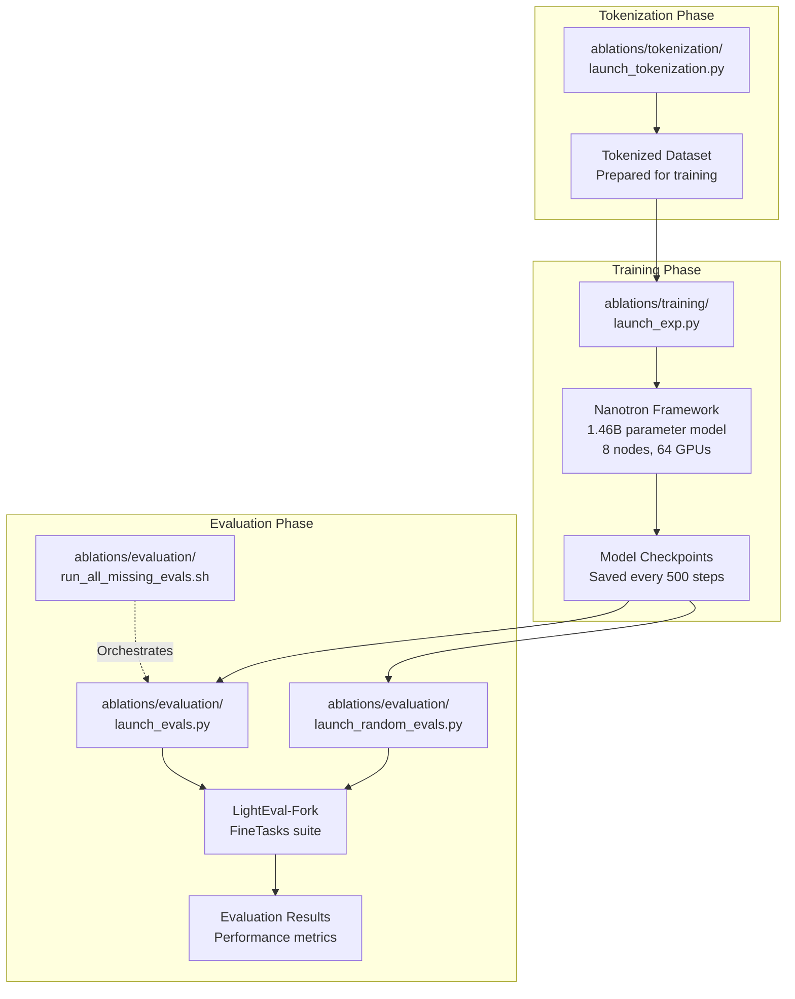
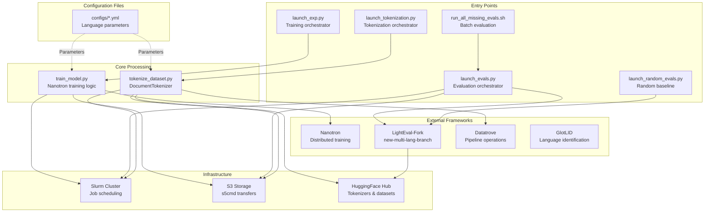
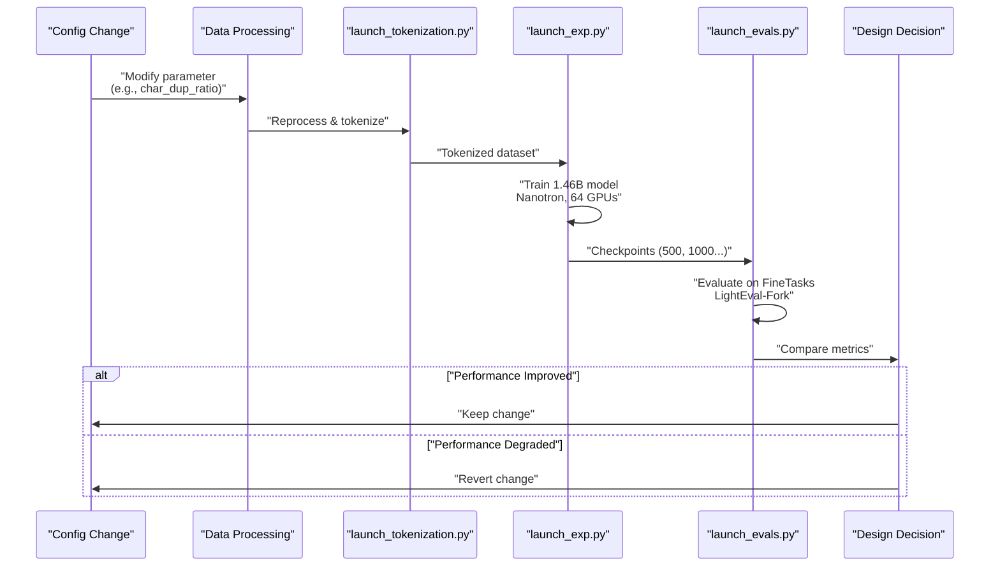

<!-- source: DeepWiki mcp.deepwiki.com · repo huggingface/fineweb-2 · page 1 Overview · fetched 2026-10-26 -->

# Overview

<details>
<summary>Relevant source files</summary>

The following files were used as context for generating this wiki page:

- [README.md](README.md)

</details>


## Purpose and Scope

This document provides a high-level overview of the FineWeb 2 codebase, including its purpose, architecture, and major system components. FineWeb 2 is a multilingual pretraining dataset processing and validation framework that extends the original FineWeb to support 1000+ languages.

For detailed information about the dataset itself and its research goals, see [What is FineWeb 2](#1.1). For architectural details and component interactions, see [System Architecture](#1.2). For information about the actual data processing steps, see [Data Processing Pipeline](#2). For details on language-specific configurations, see [Configuration System](#3).

**Sources:** [README.md:1-10]()

## FineWeb 2 at a Glance

FineWeb 2 is a repository containing the code and configurations used to create a multilingual web-scale pretraining dataset covering 1000+ languages. The dataset is hosted at `https://huggingface.co/datasets/HuggingFaceFW/fineweb-2`, while this repository contains the processing pipeline, evaluation framework, and training scripts used to create and validate the dataset.

**Key characteristics:**
- **Input data:** Non-English Common Crawl data (English score < 0.65 from original FineWeb processing)
- **Output data:** Cleaned, deduplicated, filtered multilingual corpus with per-document metadata
- **Language coverage:** 1000+ languages with per-language configuration files
- **Validation methodology:** Empirical ablation testing using 1.46B parameter models
- **Configuration-driven:** Each language has a dedicated YAML file in `configs/{iso3_lang}_{script}.yml`

**Sources:** [README.md:1-13]()

## Repository Structure



**Sources:** [README.md:11-90]()

## System Architecture Overview

FineWeb 2 consists of three major interconnected systems:

### 1. Data Processing Pipeline

A four-stage pipeline that transforms raw Common Crawl data into cleaned multilingual corpus:



Each stage is parameterized by language-specific configuration files. See [Data Processing Pipeline](#2) for detailed documentation.

**Sources:** [README.md:9-64]()

### 2. Configuration System

Language-specific YAML configuration files drive all processing decisions:



See [Configuration System](#3) for detailed parameter documentation.

**Sources:** [README.md:10-11]()

### 3. Ablation & Evaluation Framework

An empirical validation system that tests each pipeline design choice:



See [Ablation and Evaluation Framework](#4) for detailed workflow documentation.

**Sources:** [README.md:65-77]()

## Code-to-System Mapping

The following diagram maps major system components to their implementation files:



**Sources:** [README.md:68-90]()

## Processing Pipeline Details

The data processing pipeline consists of four stages, each implemented using the Datatrove framework:

| Stage | Purpose | Key Tool | Configuration Parameters |
|-------|---------|----------|-------------------------|
| **Language Identification** | Identify language and script | GlotLID (2000+ labels) | `language_score` threshold per language |
| **Deduplication** | Remove duplicate content globally per language | Datatrove MinHash | `dup_line_frac`, `dup_n_grams`, `minhash_cluster_size` |
| **Quality Filtering** | Apply FineWeb filters with language-specific thresholds | Datatrove Filters | `char_dup_ratio`, word length, stopwords |
| **PII & Fixes** | Anonymize PII, fix encoding, clean artifacts | FTFY, Trafilatura fixes | Global rules (no per-language config) |

**Key differences from original FineWeb:**
- Language identification uses **GlotLID** instead of fasttext176 [README.md:21]()
- Deduplication is **per-language globally** rather than per-snapshot [README.md:25]()
- **Rehydration mechanism** using `minhash_cluster_size` metadata [README.md:25-51]()
- Modified filter thresholds: `char_dup_ratio` changed from 0.01 to 0.1 [README.md:56]()
- Removed `short_line_thr` and C4 filters [README.md:56-58]()

**Sources:** [README.md:9-64]()

## Rehydration Mechanism

A unique feature of FineWeb 2 is the deduplication rehydration mechanism. During deduplication, cluster sizes are preserved in metadata, allowing post-processing upsampling:

```python
# Example from README.md:37-51
class Rehydrater(PipelineStep):
    def run(self, data: DocumentsPipeline, rank: int = 0, world_size: int = 1):
        upsampling_weights = {1: 1, 2: 2, 3: 3, 5: 5, 100: 8, 1000: 1}
        limits = sorted(upsampling_weights.keys())
        
        for doc in data:
            upsampling_weight = upsampling_weights[
                limits[bisect.bisect_right(limits, doc.metadata["minhash_cluster_size"]) - 1]]
            for _ in range(upsampling_weight):
                yield doc
```

**Upsampling strategy:**
- No duplicates (N=1): 1x
- Small clusters (N=2,3): Nx
- Medium clusters (N=4): 3x
- Large clusters (5≤N<100): 5x
- Very large clusters (100≤N<1000): 8x
- Extremely large clusters (N≥1000): 1x (assumed lower quality)

**Sources:** [README.md:24-51]()

## Validation Methodology

Every pipeline design choice is validated through empirical testing:



**Validation components:**
- **Model architecture:** 1.46B parameter LLaMA-style model (14 layers, 2048 hidden size)
- **Training framework:** Nanotron with pure data parallelism (DP=64, PP=1, TP=1)
- **Evaluation suite:** FineTasks (language-specific tasks)
- **Checkpoint frequency:** Every 500 training steps

See [Ablation and Evaluation Framework](#4) for detailed documentation.

**Sources:** [README.md:65-72]()

## External Dependencies

FineWeb 2 integrates multiple external tools and frameworks:

| Category | Tool | Purpose | Version/Branch |
|----------|------|---------|----------------|
| **Language Processing** | GlotLID | Language identification (2000+ labels) | Latest |
| | FTFY | Encoding fixes | Latest |
| | Trafilatura | HTML extraction + table fixes | Modified |
| **Data Processing** | Datatrove | Pipeline operations, readers, writers, filters | Latest |
| | s5cmd | High-performance S3 transfers | Latest |
| **ML Frameworks** | Nanotron | Distributed model training | Latest |
| | LightEval-Fork | Multilingual evaluation | `new-multi-lang-branch` |
| | torch.distributed | Multi-GPU coordination | PyTorch latest |
| **Infrastructure** | Slurm | Job scheduling and resource management | Cluster-dependent |
| | S3 | Data and checkpoint storage | AWS/Compatible |
| | HuggingFace Hub | Tokenizers and dataset hosting | Latest |

**Critical version note:** LightEval must use the `new-multi-lang-branch` fork [README.md:89]() for multilingual support.

**Sources:** [README.md:81-90]()

## Word and Sentence Tokenization

Many pipeline stages require word and sentence tokenization, but most languages lack dedicated tokenizers. FineWeb 2 solves this through automatic language-family-based tokenizer assignment.

**Tokenizer assignment strategy:**
- Languages are grouped by language family
- Each family is assigned a similar tokenizer
- Tokenizer mappings are available at `https://huggingface.co/spaces/HuggingFaceFW-Dev/lang-word-tokenizers`

This enables consistent text processing across 1000+ languages without requiring language-specific tokenizer development.

**Sources:** [README.md:81-82]()

## License and Citation

**Code license:** Apache License 2.0 [README.md:93]()

**Dataset license:** Open Data Commons Attribution License (ODC-By) [README.md:93]()

**Research paper:** Available at `https://huggingface.co/papers/2506.20920` [README.md:7]()

**Citation:**
```bibtex
@misc{penedo2025fineweb2pipelinescale,
    title={FineWeb2: One Pipeline to Scale Them All -- Adapting Pre-Training Data Processing to Every Language}, 
    author={Guilherme Penedo and Hynek Kydlíček and Vinko Sabolčec and Bettina Messmer and Negar Foroutan and Amir Hossein Kargaran and Colin Raffel and Martin Jaggi and Leandro Von Werra and Thomas Wolf},
    year={2025},
    eprint={2506.20920},
    archivePrefix={arXiv},
    primaryClass={cs.CL},
    url={https://arxiv.org/abs/2506.20920}, 
}
```

**Sources:** [README.md:92-106]()

## Next Steps

For detailed information about specific subsystems:

- **Dataset goals and research context:** See [What is FineWeb 2](#1.1)
- **Detailed architecture:** See [System Architecture](#1.2)
- **Data processing stages:** See [Data Processing Pipeline](#2)
- **Configuration files:** See [Configuration System](#3)
- **Evaluation framework:** See [Ablation and Evaluation Framework](#4)
- **Training system:** See [Training System](#5)
- **Tokenization:** See [Tokenization System](#6)
- **External tools:** See [External Tools and Dependencies](#7)

---

