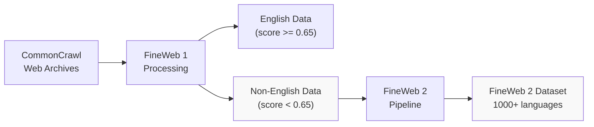
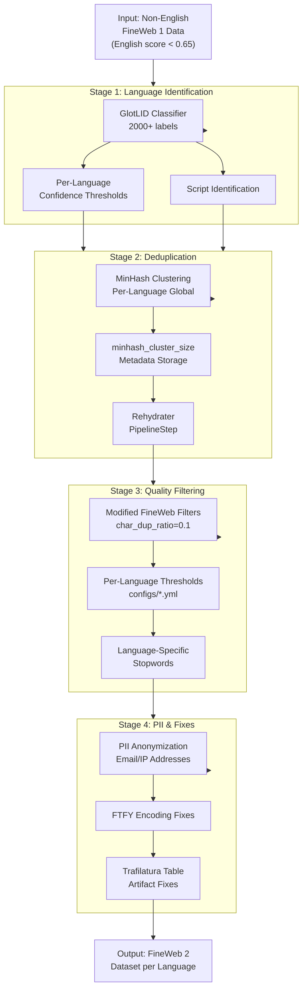
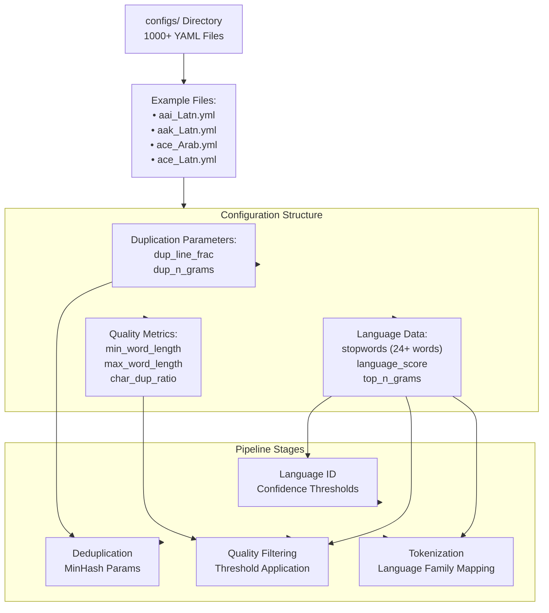
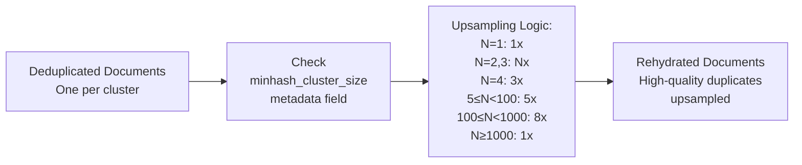
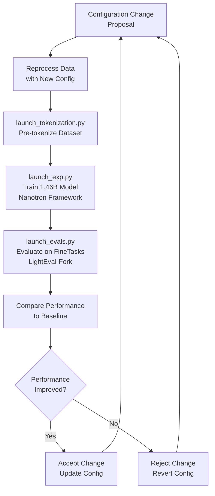

<!-- source: DeepWiki mcp.deepwiki.com · repo huggingface/fineweb-2 · page 1.1 What is FineWeb 2 · fetched 2026-10-26 -->

# What is FineWeb 2

Relevant source files

The following files were used as context for generating this wiki page:

- [README.md](README.md)

This document introduces the FineWeb 2 dataset, explaining its purpose as a large-scale multilingual pretraining corpus, its key characteristics, and the architecture that enables processing over 1000 languages. For details on the processing pipeline stages, see [Data Processing Pipeline](#2). For information about the configuration system that enables language-specific processing, see [Configuration System](#3). For the empirical validation methodology, see [Ablation and Evaluation Framework](#4).

## Overview

FineWeb 2 is a multilingual web-scale pretraining dataset that extends the high-quality data curation approach of the original FineWeb dataset to over 1000 languages. The dataset is designed to provide high-quality pretraining data for language models across a diverse range of languages, scripts, and language families.

### Key Statistics

| Metric | Value |
|--------|-------|
| **Languages Supported** | 1000+ |
| **Language Labels** | 2000+ (via GlotLID) |
| **Configuration Files** | 1000+ YAML files |
| **Source Data** | Non-English portion of original FineWeb (English score < 0.65) |
| **License** | ODC-By (Open Data Commons Attribution) |
| **Code License** | Apache 2.0 |

The dataset is publicly available at `HuggingFaceFW/fineweb-2` on the HuggingFace Hub, with the processing code and ablation experiments documented in this repository.

**Sources:** [README.md:1-106]()

## Dataset Purpose and Scope

FineWeb 2 addresses the scarcity of high-quality pretraining data for low-resource and mid-resource languages. While the original FineWeb focused on English content, FineWeb 2 applies similar quality curation principles to a massively multilingual setting, with three key innovations:

1. **Language-Specific Processing**: Rather than applying universal thresholds, each language has individually tuned filter thresholds, stopwords, and quality metrics defined in per-language configuration files at `configs/{iso3_lang}_{script}.yml`.

2. **Global Per-Language Deduplication**: Unlike FineWeb's per-snapshot deduplication, FineWeb 2 deduplicates globally within each language across all CommonCrawl snapshots, with a "re-hydration" mechanism that can upsample high-quality duplicates.

3. **Empirical Validation**: Every pipeline design decision is validated through ablation experiments that train 1.46B models and evaluate them on the FineTasks evaluation suite.

**Sources:** [README.md:4-11](), [README.md:25-35]()

## Data Source and Scope

**Diagram: Data Source Flow**

FineWeb 2 begins with the non-English portion of data processed during FineWeb 1 creation. Documents with an English language confidence score below 0.65 (as determined by fasttext176 during FineWeb 1 processing) are fed into the FineWeb 2 pipeline. This represents the starting point before language re-identification using GlotLID.

**Sources:** [README.md:13-14]()

## Four-Stage Processing Pipeline

The FineWeb 2 pipeline consists of four sequential stages, each configurable through the per-language YAML configuration files:

**Diagram: Four-Stage Pipeline Architecture**

### Stage Details

| Stage | Primary Tool | Key Feature | Configuration |
|-------|-------------|-------------|---------------|
| **1. Language ID** | GlotLID | 2000+ language labels, script detection | Per-language confidence thresholds |
| **2. Deduplication** | MinHash (Datatrove) | Global per-language, cluster size tracking | `dup_line_frac`, `dup_n_grams` |
| **3. Filtering** | Modified FineWeb filters | Language-specific stopwords and thresholds | `language_score`, word length limits |
| **4. PII & Fixes** | FTFY, Trafilatura patches | Encoding fixes, table artifact removal | Global application |

**Sources:** [README.md:14-64]()

## Configuration-Driven Architecture

A key architectural principle of FineWeb 2 is the separation of processing logic from language-specific parameters. This enables scaling to 1000+ languages without code changes:

**Diagram: Configuration System Architecture**

The configuration files follow the naming convention `{iso3_lang}_{script}.yml`, where `iso3_lang` is the ISO 639-3 language code and `script` is the script identifier (e.g., `Latn` for Latin, `Arab` for Arabic). This allows a single language like Acehnese to have multiple configurations for different scripts (`ace_Arab.yml` and `ace_Latn.yml`).

**Sources:** [README.md:10-11]()

## Re-Hydration Mechanism

A unique feature of FineWeb 2 is the deduplication re-hydration mechanism implemented through the `Rehydrater` class:

**Diagram: Deduplication Re-Hydration Flow**

The `Rehydrater` class (shown in the example code at [README.md:38-51]()) uses the `minhash_cluster_size` metadata field to determine upsampling weights. Documents from larger clusters (indicating more copies found on the web) are upsampled more aggressively, based on the assumption that widespread content is often higher quality. However, extremely large clusters (N ≥ 1000) are downsampled to 1x, as these likely represent low-quality templated content.

**Sources:** [README.md:25-51]()

## Empirical Validation Methodology

Every design choice in FineWeb 2 is validated through a rigorous ablation testing workflow:

**Diagram: Ablation Testing Workflow**

This workflow is implemented through three main scripts:

| Script | Purpose | Framework |
|--------|---------|-----------|
| `ablations/tokenization/tokenize_dataset.py` | Pre-tokenize processed data | Datatrove DocumentTokenizer |
| `ablations/training/train_model.py` | Train 1.46B ablation models | Nanotron (8 nodes, 64 GPUs) |
| `ablations/evaluation/launch_evals.py` | Evaluate checkpoints on FineTasks | LightEval-Fork |

The use of relatively small 1.46B models enables rapid iteration while still providing meaningful performance signals for pipeline optimization.

**Sources:** [README.md:65-78]()

## Dataset Delivery and Access

FineWeb 2 is delivered through multiple channels:

| Delivery Method | Location | Purpose |
|----------------|----------|---------|
| **Dataset Hub** | `HuggingFaceFW/fineweb-2` | Primary dataset access |
| **Research Paper** | `https://huggingface.co/papers/2506.20920` | Methodology documentation |
| **Processing Code** | This repository | Full pipeline reproducibility |
| **Ablation Code** | `ablations/` directory | Validation experiments |
| **Reference Datasets** | `misc/reference_datasets/` | Baseline comparison data |

The combination of dataset, paper, and code provides full transparency and reproducibility for the FineWeb 2 processing pipeline.

**Sources:** [README.md:4-7](), [README.md:84-93]()

## Key Differences from FineWeb 1

| Aspect | FineWeb 1 | FineWeb 2 |
|--------|-----------|-----------|
| **Language Scope** | English only | 1000+ languages |
| **Language ID Tool** | fasttext176 | GlotLID (2000+ labels) |
| **Deduplication Scope** | Per-snapshot | Global per-language |
| **Filter Thresholds** | Universal | Per-language configurations |
| **Configuration Files** | Not applicable | 1000+ YAML files |
| **Script Support** | Latin script only | 100+ scripts identified |
| **Re-Hydration** | Not applicable | Upsampling by cluster size |

The shift to per-language configurations represents a fundamental architectural change that enables FineWeb 2 to scale to thousands of languages while maintaining quality standards tailored to each language's characteristics.

**Sources:** [README.md:1-64]()

---

