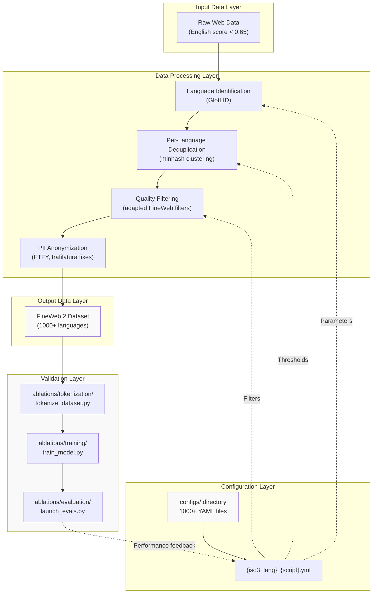
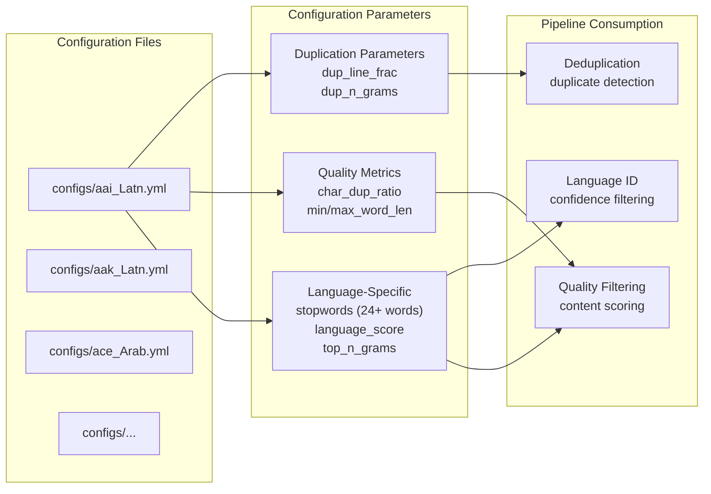
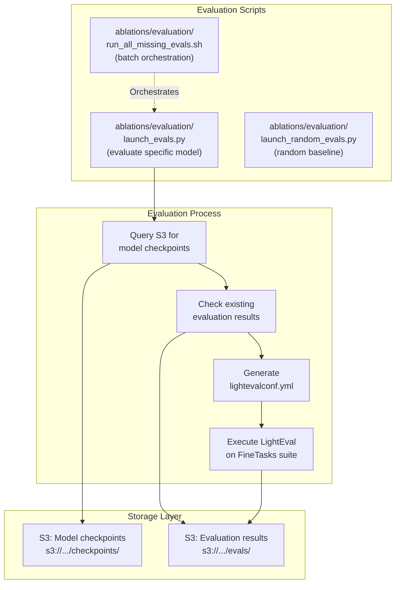
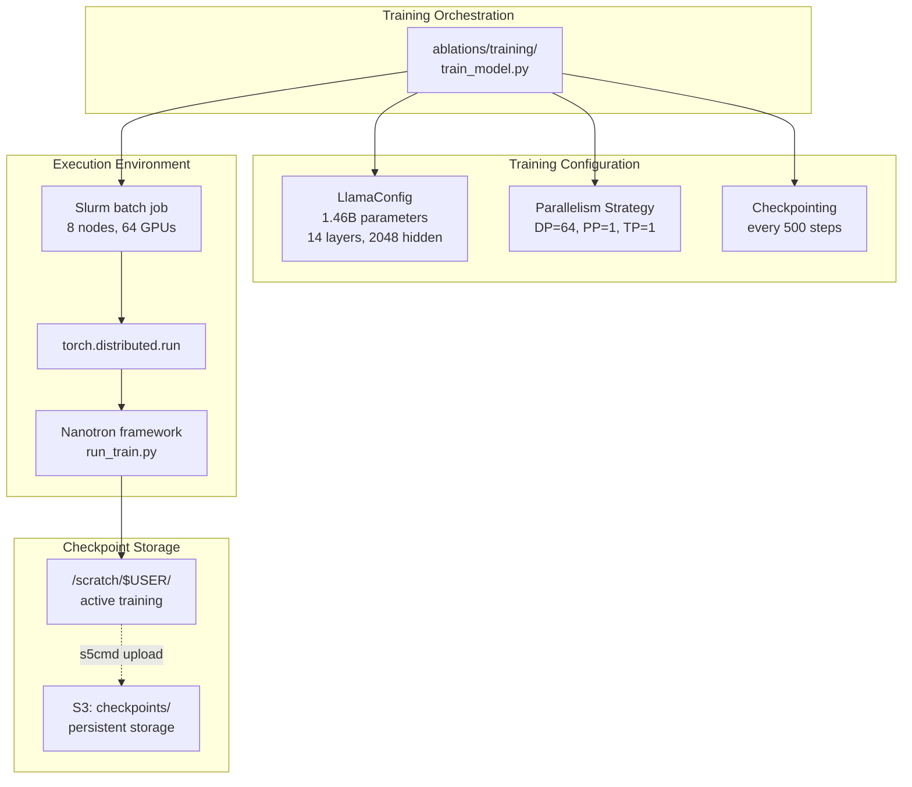
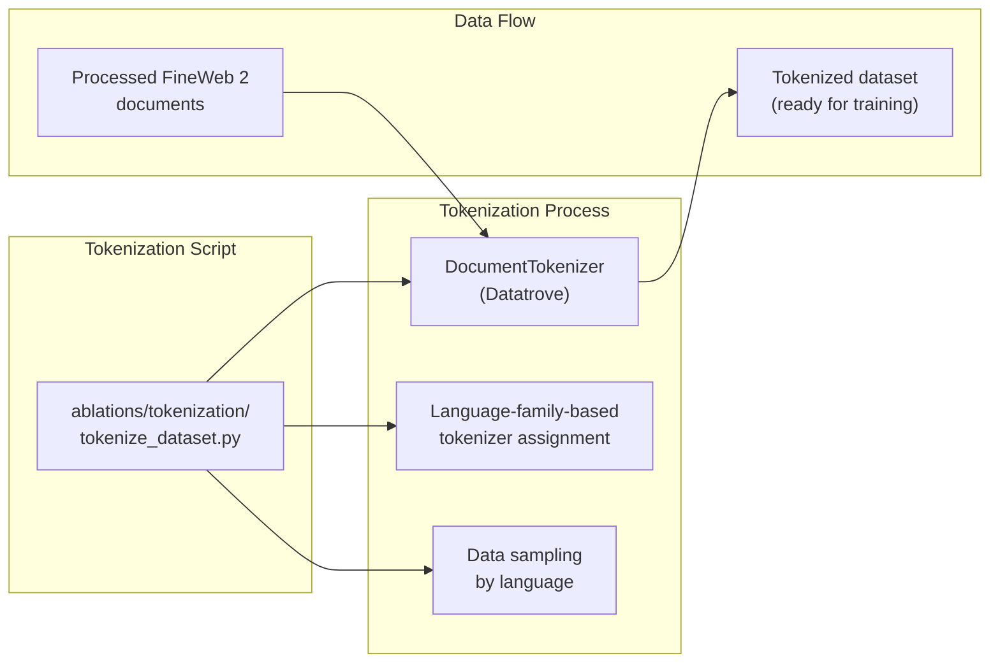
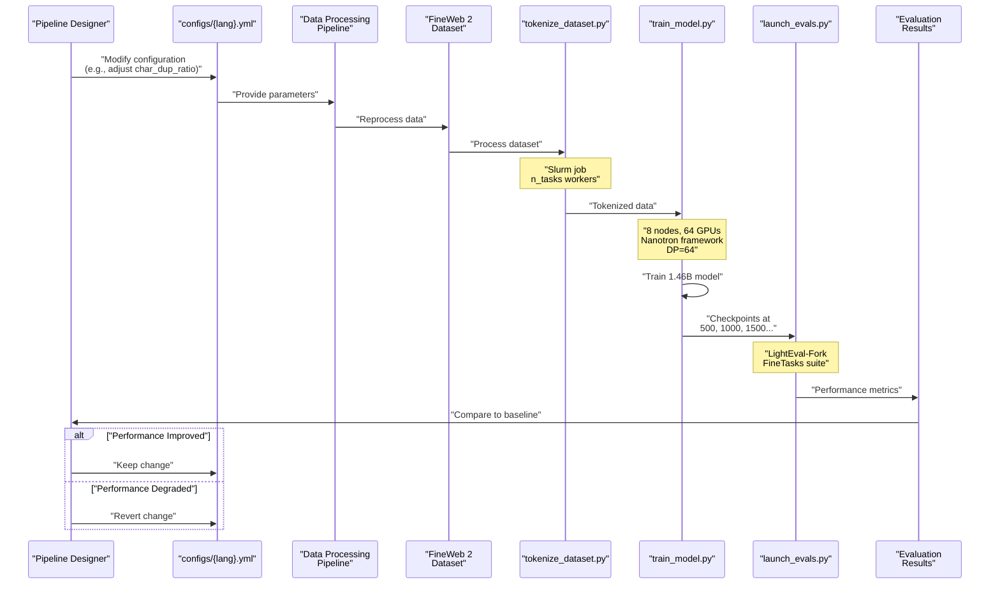
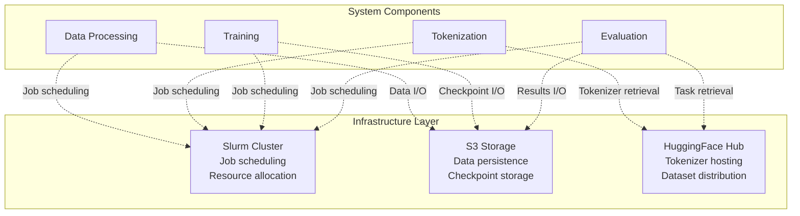

<!-- source: DeepWiki mcp.deepwiki.com · repo huggingface/fineweb-2 · page 1.2 System Architecture · fetched 2026-10-26 -->

# System Architecture

Relevant source files

The following files were used as context for generating this wiki page:

- [README.md](README.md)

## Purpose and Scope

This document describes the overall architecture of the FineWeb 2 system and how its major components interact to produce a high-quality multilingual pretraining dataset covering 1000+ languages. The architecture consists of four primary subsystems: the data processing pipeline, the configuration system, the ablation and evaluation framework, and the training system.

For detailed information about specific subsystems:
- Data processing stages: [Data Processing Pipeline](#2)
- Language-specific configuration: [Configuration System](#3)
- Empirical validation: [Ablation and Evaluation Framework](#4)
- Model training: [Training System](#5)
- Data tokenization: [Tokenization System](#6)
- External dependencies: [External Tools and Dependencies](#7)

**Sources:** [README.md:1-107]()

## High-Level Architecture Overview

The FineWeb 2 system is designed around a configuration-driven, empirically-validated architecture. Every design decision in the data processing pipeline is validated through a complete cycle of data processing, model training, and evaluation.

**Diagram: Overall System Architecture** - The system processes raw web data through four stages (language identification, deduplication, filtering, PII anonymization) parameterized by 1000+ language-specific YAML configuration files. The output dataset feeds into a validation layer that trains models and evaluates them to provide empirical feedback on configuration choices.

**Sources:** [README.md:9-64]()

## Major System Components

### Data Processing Pipeline

The data processing pipeline consists of four sequential stages that transform raw web documents into clean, language-specific datasets:

| Stage | Primary Tool | Configuration | Output |
|-------|-------------|---------------|---------|
| Language Identification | GlotLID | `language_score` threshold | Language-tagged documents |
| Deduplication | Datatrove (minhash) | `dup_line_frac`, `dup_n_grams` | Deduplicated clusters with metadata |
| Quality Filtering | Datatrove filters | `char_dup_ratio`, stopwords | Filtered documents |
| PII Anonymization | FTFY, trafilatura | N/A | Final clean documents |

Each stage reads its parameters from language-specific YAML files in `configs/` directory, enabling independent tuning for each language.

**Sources:** [README.md:9-64]()

### Configuration System

The configuration system enables scaling to 1000+ languages through a file-per-language architecture:

**Diagram: Configuration-Driven Architecture** - Each language has a dedicated YAML config file (e.g., `aai_Latn.yml`) containing duplication parameters, quality metrics, and language-specific data. Pipeline stages consume these configs to customize processing behavior without code changes.

**Sources:** [README.md:10-11]()

### Ablation and Evaluation Framework

The ablation framework validates all pipeline decisions through empirical testing:

**Diagram: Evaluation Framework Architecture** - The evaluation system consists of three entry points: `launch_evals.py` for single model evaluation, `launch_random_evals.py` for baseline testing, and `run_all_missing_evals.sh` for batch orchestration. All scripts query S3 for checkpoints, check for existing results, generate LightEval configs, and persist results back to S3.

**Sources:** [README.md:66-71]()

### Training System

The training system orchestrates distributed model training for ablation studies:

**Diagram: Training System Architecture** - The `train_model.py` script generates Nanotron configurations specifying model architecture (1.46B Llama), parallelism strategy (pure data parallelism with DP=64), and checkpointing behavior. Training executes on Slurm using 8 nodes with 64 GPUs total, writing checkpoints to local scratch and uploading to S3 for persistence.

**Sources:** [README.md:73-74]()

### Tokenization System

The tokenization system prepares processed datasets for training:

**Diagram: Tokenization System** - The `tokenize_dataset.py` script uses Datatrove's `DocumentTokenizer` to convert processed documents into tokenized format. It automatically assigns tokenizers based on language families and supports data sampling by language.

**Sources:** [README.md:76-77](), [README.md:81-82]()

## System Integration

The following diagram shows how data flows through the integrated system during a complete ablation cycle:

**Diagram: Integrated System Data Flow** - Complete ablation cycle showing how a pipeline designer modifies language configurations, triggers data reprocessing, tokenization, model training, and evaluation, then uses the results to make informed decisions about keeping or reverting changes.

**Sources:** [README.md:65-66]()

## Key System Characteristics

### Configuration-Driven Design

The system's primary design principle is configuration-driven processing. All language-specific behavior is defined in YAML configuration files rather than code:

| Configuration Type | Location | Parameters | Usage |
|-------------------|----------|------------|-------|
| Language configs | `configs/{iso3}_{script}.yml` | Thresholds, stopwords, n-grams | All pipeline stages |
| Evaluation configs | Generated `lightevalconf.yml` | Tasks, checkpoints, languages | Evaluation execution |
| Training configs | Generated Nanotron YAML | Model arch, parallelism | Training execution |

**Sources:** [README.md:10-11]()

### Empirical Validation

Every pipeline decision undergoes empirical validation through the ablation framework:

1. **Data Reprocessing**: Apply proposed change to configuration
2. **Tokenization**: Execute `tokenize_dataset.py` with Slurm parallelization
3. **Training**: Train 1.46B model using `train_model.py` on 64 GPUs
4. **Evaluation**: Evaluate checkpoints using `launch_evals.py` on FineTasks
5. **Decision**: Compare results to baseline and accept/reject change

This methodology ensures all design choices are empirically justified rather than based on assumptions.

**Sources:** [README.md:65-66]()

### Language Scalability

The system supports 1000+ languages through:

- **One config per language**: Each language has independent configuration in `configs/` directory
- **Automatic tokenizer assignment**: Language-family-based tokenizer mapping eliminates manual configuration
- **Per-language processing**: All pipeline stages (identification, deduplication, filtering) operate independently per language
- **Per-language evaluation**: Evaluation scripts support language-specific task execution

Adding support for a new language requires only creating a new YAML configuration file.

**Sources:** [README.md:10-11](), [README.md:81-82]()

### Infrastructure Requirements

The system relies on three infrastructure components:

**Diagram: Infrastructure Dependencies** - All system components depend on Slurm for distributed job execution, S3 for data and checkpoint persistence, and HuggingFace Hub for tokenizers and tasks.

**Sources:** [README.md:87-90]()

## External Tool Integration

The system integrates several external frameworks:

| Tool | Purpose | Integration Point | Version |
|------|---------|------------------|---------|
| Datatrove | Data pipeline operations | All processing stages | Latest from GitHub |
| GlotLID | Language identification | Language ID stage | Latest |
| FTFY | Text encoding fixes | PII/fixes stage | Latest |
| Trafilatura | HTML extraction | PII/fixes stage | Latest |
| Nanotron | Model training | Training system | Latest from GitHub |
| LightEval-Fork | Model evaluation | Evaluation system | `new-multi-lang-branch` |

**Note**: The system uses a forked version of LightEval (branch `new-multi-lang-branch`) with modifications for multilingual evaluation support.

**Sources:** [README.md:87-90]()

## Summary

The FineWeb 2 system architecture achieves scalability to 1000+ languages through:

1. **Configuration-driven design**: All language-specific behavior defined in YAML files
2. **Modular pipeline**: Four independent stages (identification, deduplication, filtering, PII)
3. **Empirical validation**: Complete ablation framework for testing design decisions
4. **Distributed execution**: Slurm-based parallelization for all compute-intensive operations
5. **External tool integration**: Leverages existing frameworks (Datatrove, Nanotron, LightEval)

The architecture separates concerns between data processing (configured by language YAML files), model training (orchestrated by `train_model.py`), and evaluation (orchestrated by `launch_evals.py`), enabling independent iteration on each component while maintaining a tight feedback loop for validation.

**Sources:** [README.md:1-107]()

---

