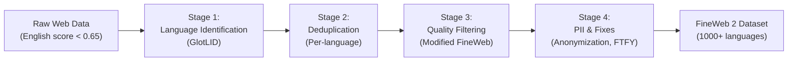
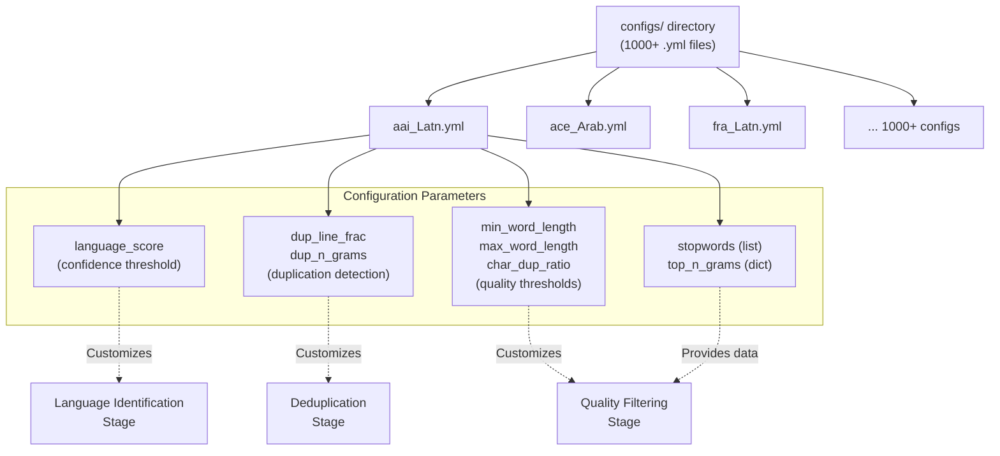
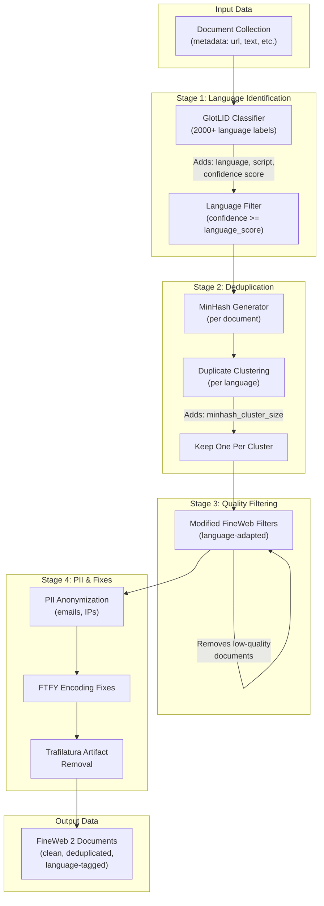
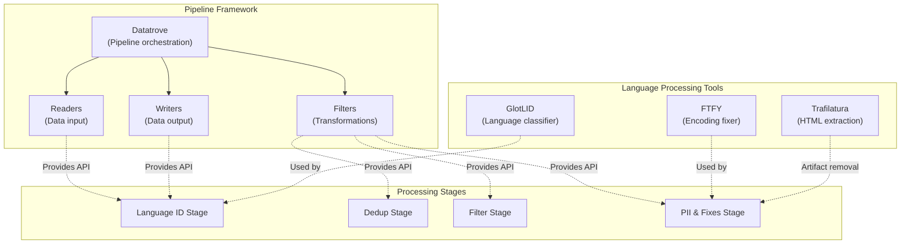
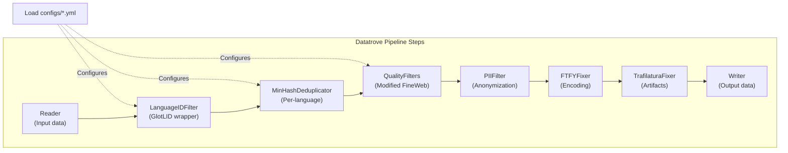

<!-- source: DeepWiki mcp.deepwiki.com · repo huggingface/fineweb-2 · page 2 Data Processing Pipeline · fetched 2026-10-26 -->

# Data Processing Pipeline

Relevant source files

The following files were used as context for generating this wiki page:

- [README.md](README.md)

## Purpose and Scope

This document provides an overview of the FineWeb 2 data processing pipeline, which transforms raw multilingual web data into high-quality pretraining data across 1000+ languages. The pipeline consists of four sequential stages that clean, deduplicate, filter, and anonymize text data. For detailed information about individual stages, see:
- Language Identification: [#2.1](#2.1)
- Deduplication: [#2.2](#2.2)
- Quality Filtering: [#2.3](#2.3)
- PII Anonymization and Fixes: [#2.4](#2.4)

For information about the configuration files that parameterize the pipeline, see [Configuration System](#3).

## Pipeline Overview

The FineWeb 2 processing pipeline transforms raw web data through four stages, each optimized for multilingual content processing. The pipeline operates on documents that scored below 0.65 in English language identification during the original FineWeb processing, ensuring focus on non-English content.

### Four-Stage Architecture

Sources: [README.md:9-18]()

Each stage is implemented as a series of pipeline steps using the Datatrove framework, which provides readers, writers, and filters for data processing operations. The pipeline is configuration-driven, with language-specific parameters defined in YAML files located in `configs/{iso3_lang}_{script}.yml`.

### Stage Summary

| Stage | Primary Tool | Purpose | Configuration Dependency |
|-------|-------------|---------|-------------------------|
| Language Identification | GlotLID | Classify documents by language and script, filter by confidence thresholds | `language_score` per language |
| Deduplication | Datatrove MinHash | Remove duplicate content globally per language, save cluster sizes | `dup_line_frac`, `dup_n_grams` |
| Quality Filtering | Modified FineWeb filters | Apply text quality heuristics adapted for each language | `min_word_length`, `max_word_length`, `char_dup_ratio` |
| PII Anonymization | Regex + FTFY | Remove personally identifiable information and fix encoding/artifacts | None (global rules) |

Sources: [README.md:9-64]()

## Configuration-Driven Architecture

The FineWeb 2 pipeline uses a configuration-driven architecture where each of the 1000+ supported languages has its own YAML configuration file. This design enables language-specific behavior without code changes.

Sources: [README.md:10-11]()

Configuration files define language-specific parameters including:
- **Language identification thresholds**: Minimum confidence scores for accepting a document as belonging to the language
- **Deduplication parameters**: Line fraction and n-gram settings for duplicate detection
- **Quality metrics**: Word length bounds, character repetition ratios, and text structure constraints
- **Language-specific data**: Stopwords lists (24+ words per language) and common n-gram patterns

For detailed information about configuration structure and parameter definitions, see [Configuration System](#3).

## Data Flow Through Pipeline

The following diagram shows how data flows through the pipeline, including the key transformations and metadata added at each stage:

Sources: [README.md:14-64]()

### Metadata Enrichment

As documents progress through the pipeline, metadata is added:

| Stage | Metadata Added | Purpose |
|-------|----------------|---------|
| Language Identification | `language`, `script`, `confidence_score` | Document language classification and script detection |
| Deduplication | `minhash_cluster_size` | Size of duplicate cluster, enables re-hydration (upsampling) |
| Quality Filtering | (removes documents) | No metadata added; documents that fail filters are discarded |
| PII & Fixes | (modifies text) | No metadata added; text content is cleaned in-place |

The `minhash_cluster_size` metadata is particularly important as it enables the "re-hydration" mechanism described in [README.md:25-51](), where documents from larger duplicate clusters can be upsampled during training to improve performance.

## External Tool Integration

The FineWeb 2 pipeline integrates several external tools, each serving a specific role in the processing stages:

Sources: [README.md:87-90]()

### Datatrove Framework

Datatrove serves as the pipeline orchestration framework, providing:
- **Readers**: Input data sources (files, S3, etc.)
- **Filters**: Transformation and filtering operations
- **Writers**: Output data sinks
- **Pipeline execution**: Distributed processing across workers

The pipeline leverages Datatrove's `PipelineStep` abstraction, as shown in the re-hydration example at [README.md:38-51](), where custom steps inherit from `PipelineStep` and implement the `run` method.

### Language Processing Tools

| Tool | Version/Source | Role | Stage |
|------|----------------|------|-------|
| GlotLID | [cisnlp/GlotLID](https://github.com/cisnlp/GlotLID) | Language and script identification with 2000+ labels | Language Identification |
| FTFY | Python package | Fix Unicode encoding issues in text | PII & Fixes |
| Trafilatura | Python package | HTML extraction; custom fixes for table artifacts | PII & Fixes |

Sources: [README.md:21-22](), [README.md:62-63](), [README.md:87-90]()

## Differences from FineWeb 1

The FineWeb 2 pipeline introduces several key architectural changes compared to the original FineWeb:

### Per-Language Global Deduplication

**FineWeb 1 Approach**: Data was deduplicated per CommonCrawl snapshot, meaning duplicates across snapshots were retained.

**FineWeb 2 Approach**: Deduplication is performed globally per language across all CommonCrawl snapshots, with cluster size tracking for re-hydration.

Sources: [README.md:25-26]()

### Language Identifier

| Aspect | FineWeb 1 | FineWeb 2 |
|--------|-----------|-----------|
| Tool | fasttext176 | GlotLID |
| Language Labels | 176 | 2000+ |
| Script Detection | No | Yes (part of label) |
| Confidence Thresholds | Fixed | Per-language (configurable) |

Sources: [README.md:21-22]()

### Filter Modifications

The FineWeb 2 pipeline modifies the original FineWeb filter set:

**Removed Filters**:
- `short_line_thr`: Removed entirely
- C4 filters: Not included due to performance degradation in multilingual settings
- Paragraph-related repetition filters: Disabled because trafilatura does not preserve paragraph structure

**Modified Filter Parameters**:
- `char_dup_ratio`: Changed from 0.01 to 0.1 (more lenient)

Sources: [README.md:54-58]()

### Configuration-Driven Design

**FineWeb 1**: Fixed English-centric parameters

**FineWeb 2**: Language-specific configurations in `configs/*.yml` files, enabling:
- Per-language confidence thresholds for language identification
- Per-language stopwords lists
- Per-language quality metric thresholds
- Per-language deduplication parameters

This architecture enables scaling to 1000+ languages without code modifications.

Sources: [README.md:10-11]()

## Pipeline Implementation Details

### Re-Hydration Mechanism

Unlike FineWeb 1, which completely removed duplicates, FineWeb 2 preserves duplicate cluster information in the `minhash_cluster_size` metadata field. This enables "re-hydration" through upsampling during training.

The re-hydration logic uses the following upsampling weights:

| Cluster Size (N) | Upsampling Weight | Rationale |
|-----------------|-------------------|-----------|
| 1 (no duplicates) | 1× | Original document appears once |
| 2-3 | N× | Moderate duplication indicates quality |
| 4 | 3× | Reduced weight for larger clusters |
| 5-99 | 5× | Significant duplication, likely high quality |
| 100-999 | 8× | Very popular content, maximum upsampling |
| ≥1000 | 1× | Assumed low quality (e.g., boilerplate) |

The reference implementation at [README.md:38-51]() shows a `Rehydrater` class that inherits from `PipelineStep` and uses `bisect.bisect_right` to efficiently map cluster sizes to upsampling weights.

Sources: [README.md:25-51]()

### Processing Stages Code Structure

While the specific implementation files are not provided, the pipeline follows this general structure:

Each `PipelineStep` processes a stream of documents, yielding modified or filtered documents to the next stage. The configuration system injects language-specific parameters into each step, enabling multilingual processing without hardcoded values.

Sources: [README.md:9-64](), [README.md:87-90]()

---

