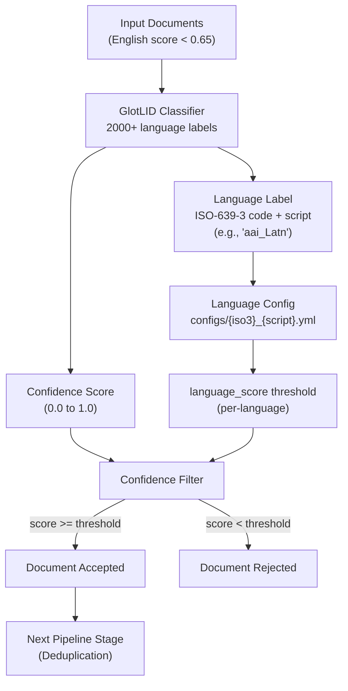
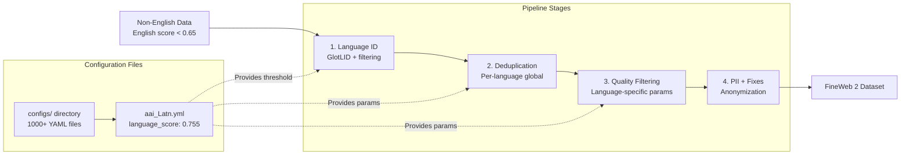
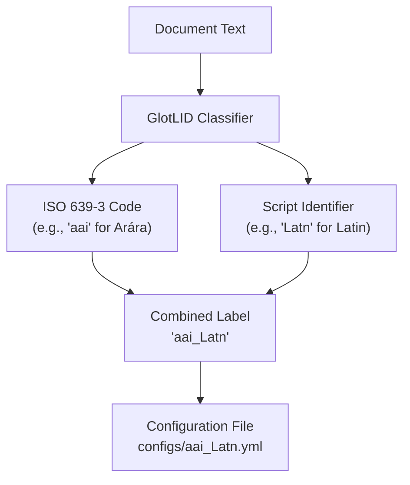

<!-- source: DeepWiki mcp.deepwiki.com · repo huggingface/fineweb-2 · page 2.1 Language Identification · fetched 2026-10-26 -->

# Language Identification

<details>
<summary>Relevant source files</summary>

The following files were used as context for generating this wiki page:

- [README.md](README.md)
- [configs/aai_Latn.yml](configs/aai_Latn.yml)

</details>


## Purpose and Scope

This document explains the language identification stage of the FineWeb 2 data processing pipeline. Language identification is the first processing step that determines which language each document is written in and filters documents based on per-language confidence thresholds.

For information about subsequent pipeline stages, see [Deduplication](#2.2), [Quality Filtering](#2.3), and [PII Anonymization and Fixes](#2.4). For details on how language-specific parameters are configured, see [Configuration System](#3).

Sources: [README.md:9-23]()

## Overview

Language identification in FineWeb 2 uses **GlotLID**, a multilingual language identifier that replaces the fasttext176 classifier used in the original FineWeb dataset. GlotLID provides two critical capabilities:

1. **Extensive Language Coverage**: Supports 2000+ language labels compared to fasttext176's 176 languages
2. **Script Identification**: Identifies not only the language but also the script used in each document (e.g., Latin, Cyrillic, Arabic)

The starting point for FineWeb 2 is the non-English data (documents with English scores < 0.65) obtained when processing the original FineWeb. Language identification assigns a language label and confidence score to each document, then filters based on per-language thresholds.

Sources: [README.md:13-14](), [README.md:20-22]()

## Architecture

### Language Identification Flow



**Diagram: Language Identification Process Flow**

This diagram shows how documents flow through language identification. GlotLID produces both a language label (ISO-639-3 code with script suffix) and a confidence score. Each language has a configuration file that specifies the minimum confidence threshold (`language_score`). Documents are accepted only if their confidence meets or exceeds the language-specific threshold.

Sources: [README.md:20-22](), [configs/aai_Latn.yml:15]()

### Integration with Data Pipeline



**Diagram: Language Identification in Pipeline Context**

Language identification is the first of four pipeline stages. It uses per-language configuration files (stored in `configs/` directory) that provide the `language_score` threshold. The same configuration files also parameterize subsequent deduplication and filtering stages.

Sources: [README.md:13-18](), [configs/aai_Latn.yml]()

## Per-Language Confidence Thresholds

### Configuration Structure

Each supported language has a dedicated YAML configuration file named using the pattern `{iso639-3}_{script}.yml`, where:
- `{iso639-3}` is the three-letter ISO 639-3 language code
- `{script}` is the script identifier (e.g., `Latn` for Latin, `Arab` for Arabic, `Cyrl` for Cyrillic)

The `language_score` parameter in each configuration file specifies the minimum GlotLID confidence score required for a document to be accepted as that language.

### Example Configuration

```yaml
# configs/aai_Latn.yml
language_score: 0.755
dup_line_frac: 0.387
stopwords:
  - i
  - ana
  - naatu
  # ... additional parameters
```

In this example, documents identified as Arára (aai) written in Latin script must have a GlotLID confidence score of at least 0.755 to be included in the dataset.

Sources: [configs/aai_Latn.yml:15](), [README.md:11](), [README.md:22]()

### Threshold Variation Across Languages

The `language_score` threshold is **not uniform** across all languages. Different languages use different thresholds based on:

1. **Language similarity**: Languages that are easily confused with similar languages may require higher thresholds
2. **Available training data**: Languages with less GlotLID training data may need adjusted thresholds
3. **Empirical performance**: Thresholds are tuned based on ablation studies using the evaluation framework (see [Ablation and Evaluation Framework](#4))

This per-language tuning is a key difference from the original FineWeb, which used a single global threshold for language identification.

Sources: [README.md:22](), [README.md:10-11]()

## Configuration Parameters

### Language Score Parameter

| Parameter | Type | Range | Purpose |
|-----------|------|-------|---------|
| `language_score` | float | 0.0 - 1.0 | Minimum GlotLID confidence score for document acceptance |

The language score represents GlotLID's confidence that a document is written in the specified language and script. A score of:
- **1.0** indicates maximum confidence
- **0.0** indicates minimum confidence
- **Higher thresholds** create stricter filtering, accepting only high-confidence documents
- **Lower thresholds** create more permissive filtering, accepting more documents with potential language ambiguity

Sources: [configs/aai_Latn.yml:15]()

## Language and Script Identification

### Label Structure

GlotLID produces labels in the format `{iso639-3}_{script}`, enabling fine-grained language identification that distinguishes between the same language written in different scripts. This is particularly important for languages that use multiple writing systems.



**Diagram: Language Label Structure**

This script identification capability allows FineWeb 2 to:
- Distinguish between languages like Serbian written in Latin (srp_Latn) vs Cyrillic (srp_Cyrl)
- Apply different processing parameters to the same language in different scripts
- Support languages that use multiple writing systems

Sources: [README.md:21](), [configs/aai_Latn.yml]()

## Advantages Over fasttext176

The choice of GlotLID over fasttext176 (used in original FineWeb) provides several benefits:

| Aspect | fasttext176 | GlotLID |
|--------|-------------|---------|
| **Language Coverage** | 176 languages | 2000+ languages |
| **Script Identification** | No | Yes |
| **Low-Resource Languages** | Limited | Extensive |
| **Configuration Granularity** | N/A | Per-language + per-script |

This extended coverage enables FineWeb 2 to support 1000+ languages with proper script identification, making it suitable for truly multilingual pretraining.

Sources: [README.md:21]()

## Relationship to Configuration System

Language identification is tightly coupled with the configuration system:

1. **Input**: GlotLID produces a language label (e.g., `aai_Latn`) and confidence score
2. **Configuration Lookup**: The system loads `configs/aai_Latn.yml` for that language
3. **Threshold Application**: The document is filtered using the `language_score` threshold from that configuration
4. **Pipeline Propagation**: If accepted, the same configuration file parameterizes all subsequent pipeline stages

For detailed information about the configuration system and how to create language-specific configurations, see [Configuration System](#3) and [Creating Language Configs](#3.5).

Sources: [README.md:11](), [configs/aai_Latn.yml]()

---

