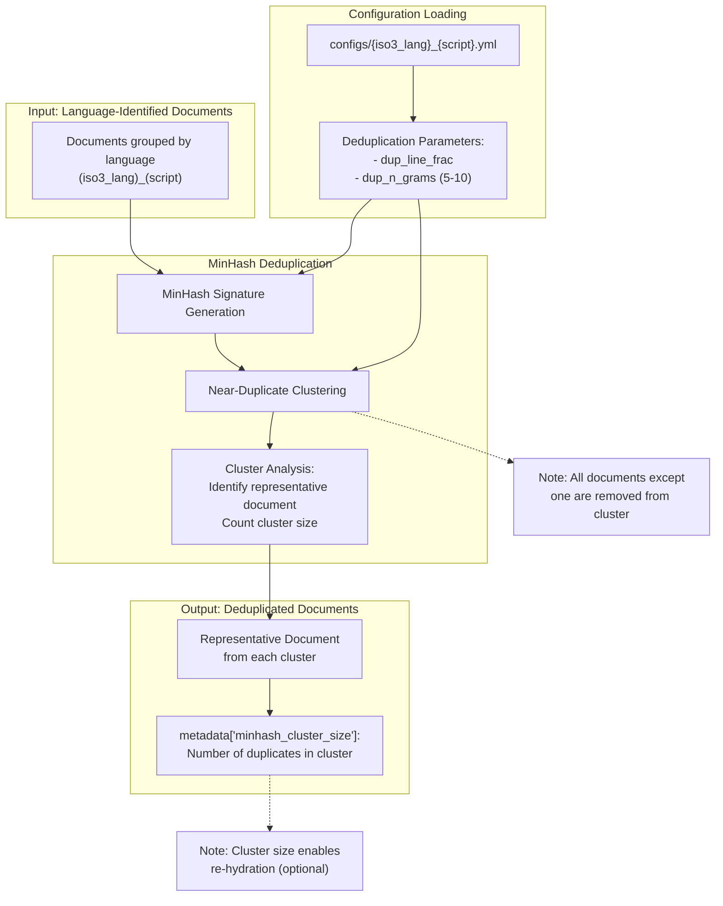
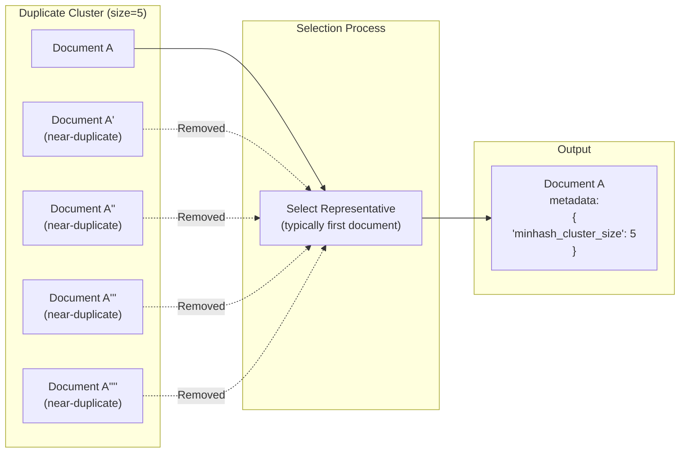
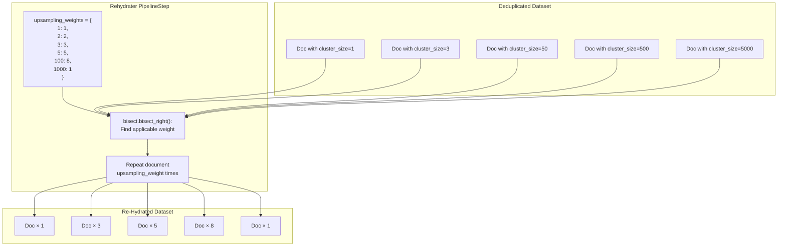
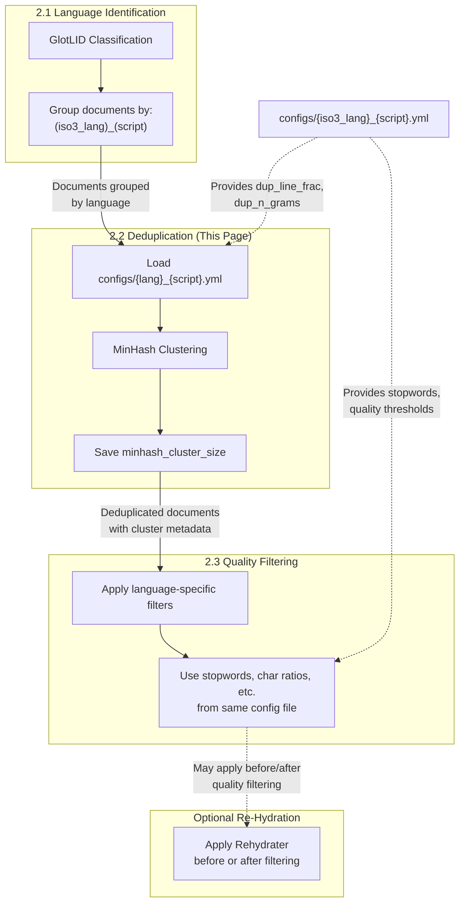

<!-- source: DeepWiki mcp.deepwiki.com · repo huggingface/fineweb-2 · page 2.2 Deduplication · fetched 2026-10-26 -->

# Deduplication

<details>
<summary>Relevant source files</summary>

The following files were used as context for generating this wiki page:

- [README.md](README.md)
- [configs/aak_Latn.yml](configs/aak_Latn.yml)

</details>


## Purpose and Scope

This page documents the deduplication stage of the FineWeb 2 data processing pipeline. Deduplication removes duplicate or near-duplicate documents while preserving cluster size metadata to enable optional re-hydration. This stage operates after Language Identification ([2.1](#2.1)) and before Quality Filtering ([2.3](#2.3)).

For configuration parameters that control deduplication behavior, see [Duplication Parameters](#3.2).

Sources: [README.md:24-51]()

## Deduplication Strategy

FineWeb 2 uses **per-language global deduplication**, a significant departure from the original FineWeb approach. Instead of deduplicating within individual CommonCrawl snapshots, all documents for each language are deduplicated globally across all snapshots and sources.

This design choice ensures:
- **Consistency**: Documents are never duplicated across different temporal snapshots
- **Language isolation**: Deduplication boundaries align with language boundaries
- **Scalability**: Processing can be parallelized by language without cross-language coordination

The deduplication process uses MinHash-based clustering to identify near-duplicate document groups.

Sources: [README.md:24-26]()

### Deduplication vs. FineWeb 1

| Aspect | FineWeb 1 | FineWeb 2 |
|--------|-----------|-----------|
| Deduplication scope | Per CommonCrawl snapshot | Per language globally |
| Language handling | English only | 1000+ languages |
| Cluster metadata | Not preserved | Saved as `minhash_cluster_size` |
| Re-hydration | Not supported | Supported via upsampling |

Sources: [README.md:24-26]()

## Deduplication Process Flow



Sources: [README.md:24-26](), [configs/aak_Latn.yml:1-14]()

## Configuration Parameters

Each language defines deduplication thresholds in its configuration file. These parameters control when documents are considered near-duplicates.

### `dup_line_frac`

Defines the fraction of duplicate lines allowed before documents are considered duplicates. Lower values result in more aggressive deduplication.

**Example**: For `aak_Latn` (Ankave language), `dup_line_frac: 0.358` means documents sharing more than 35.8% of their lines are considered duplicates.

### `dup_n_grams`

A list of n-gram size and threshold pairs. Documents exceeding the threshold for character-level n-gram overlap are considered duplicates.

**Example configuration**:
```yaml
dup_n_grams:
- [5, 0.359]  # 5-grams: 35.9% threshold
- [6, 0.35]   # 6-grams: 35.0% threshold
- [7, 0.336]  # 7-grams: 33.6% threshold
- [8, 0.32]   # 8-grams: 32.0% threshold
- [9, 0.304]  # 9-grams: 30.4% threshold
- [10, 0.285] # 10-grams: 28.5% threshold
```

Generally, thresholds decrease for longer n-grams, as longer matching sequences provide stronger duplication signals.

Sources: [configs/aak_Latn.yml:1-14](), [README.md:11]()

## Cluster Size Tracking

Unlike typical deduplication implementations that simply discard duplicates, FineWeb 2 preserves critical metadata about the duplicate cluster size.

### `minhash_cluster_size` Metadata Field

When a document cluster is identified during deduplication:
1. **One representative document** is selected and retained
2. **All other documents** in the cluster are removed
3. **Cluster size** is saved in the representative document's metadata

This metadata field records the total number of documents that were in the duplicate cluster (including the representative).



Sources: [README.md:25-26]()

## Re-Hydration Mechanism

The preserved `minhash_cluster_size` metadata enables **re-hydration**: upsampling documents based on their duplicate cluster size. This process has shown **performance improvements**, particularly for high-resource languages.

### Motivation

While deduplication removes redundant content, the frequency of content in the original corpus carries information. Popular or frequently occurring content (indicated by larger cluster sizes) may be more valuable for training.

### Upsampling Weight Mapping

FineWeb 2 uses a non-linear upsampling strategy based on empirical observations:

| Cluster Size (N) | Upsampling Weight | Rationale |
|------------------|-------------------|-----------|
| N = 1 | 1× | No duplicates, use once |
| N = 2 or N = 3 | N× | Small clusters, preserve exactly |
| N = 4 | 3× | Moderate deduplication |
| 5 ≤ N < 100 | 5× | Popular content, emphasize moderately |
| 100 ≤ N < 1000 | 8× | Very popular, emphasize strongly |
| N ≥ 1000 | 1× | Extremely large clusters likely low quality |

The non-monotonic behavior at N ≥ 1000 reflects the assumption that extremely large clusters may represent boilerplate, spam, or template content rather than valuable data.

Sources: [README.md:28-34]()

### Re-Hydration Implementation

The re-hydration process uses a `PipelineStep` that reads the `minhash_cluster_size` metadata and duplicates documents accordingly:



Sources: [README.md:36-51]()

### Reference Implementation

The README provides a complete reference implementation of the `Rehydrater` class:

[README.md:38-51]()

Key implementation details:
- Uses `bisect.bisect_right()` for efficient weight lookup in sorted limits
- Implements as generator function (`yield`) for memory efficiency
- Accesses `doc.metadata["minhash_cluster_size"]` for cluster size
- Repeats documents in-place without copying large content

Sources: [README.md:38-51]()

## Integration with Pipeline Stages

Deduplication is tightly integrated with surrounding pipeline stages:



Sources: [README.md:14-19](), [README.md:24-51]()

## Deduplication with Datatrove

While specific implementation files are not provided in the repository context, FineWeb 2 uses the [Datatrove](https://github.com/huggingface/datatrove) framework for pipeline operations, as indicated in the system architecture diagrams.

Datatrove provides:
- **Readers**: Load documents from storage
- **Filters**: Apply deduplication logic with MinHash
- **Writers**: Save deduplicated documents with metadata
- **Pipeline orchestration**: Coordinate distributed processing

The configuration parameters (`dup_line_frac`, `dup_n_grams`) are passed to Datatrove's deduplication filters to customize behavior per language.

Sources: [README.md:88]()

## Key Design Decisions

### Why Per-Language Global Deduplication?

1. **Cross-snapshot consistency**: Prevents the same content from appearing multiple times across different crawl dates
2. **Language-specific patterns**: Different languages exhibit different duplication characteristics
3. **Independent processing**: Enables parallel processing without cross-language dependencies
4. **Scalability**: Reduces coordination overhead when processing 1000+ languages

### Why Preserve Cluster Size?

1. **Information retention**: Duplicate frequency signals content importance
2. **Flexibility**: Enables downstream experimentation with upsampling strategies
3. **Ablation testing**: Allows comparing deduplicated vs. re-hydrated datasets empirically
4. **Minimal overhead**: Storing a single integer per document is negligible

### Why Non-Monotonic Upsampling?

The upsampling curve peaks at cluster sizes 100-999 (8× weight) then drops to 1× for N ≥ 1000. This reflects empirical observation that:
- **Medium-large clusters** (100-999): Popular, valuable content worth emphasizing
- **Extremely large clusters** (≥1000): Likely boilerplate, templates, or spam

Sources: [README.md:24-34]()

## Configuration Example

Full deduplication configuration for Ankave language (`aak_Latn`):

```yaml
dup_line_frac: 0.358
dup_n_grams:
- [5, 0.359]
- [6, 0.35]
- [7, 0.336]
- [8, 0.32]
- [9, 0.304]
- [10, 0.285]
```

These thresholds were tuned through ablation testing ([4](#4)) to balance:
- **Removing true duplicates**: Avoiding redundant training data
- **Preserving near-duplicates**: Retaining legitimate variations
- **Language-specific characteristics**: Different languages have different n-gram distributions

Sources: [configs/aak_Latn.yml:1-14](), [README.md:10-11]()

---

