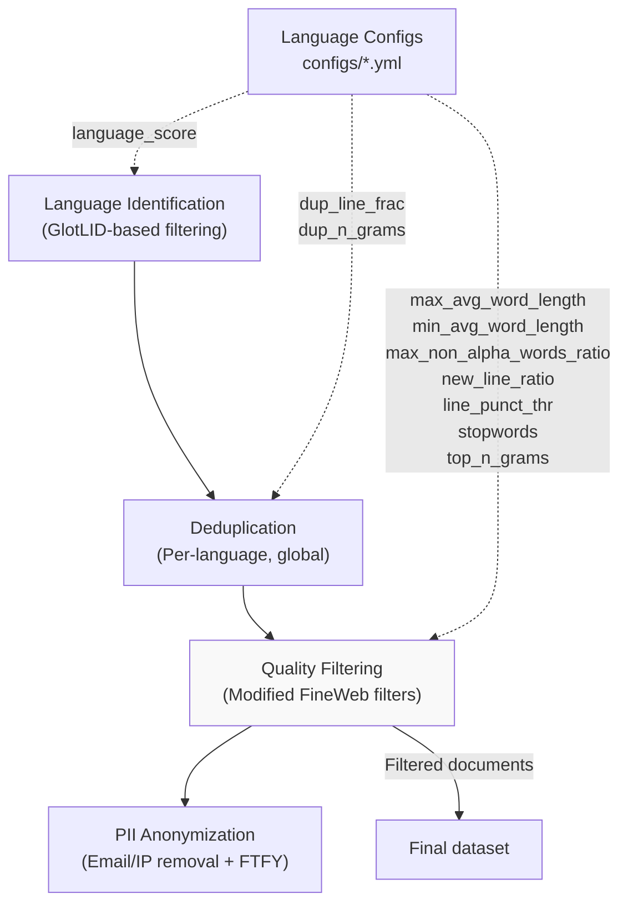
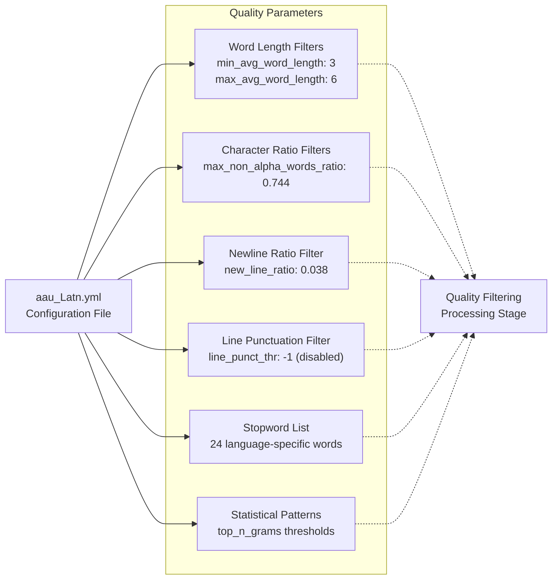
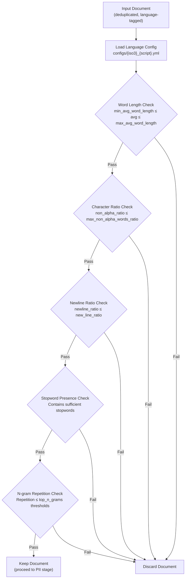
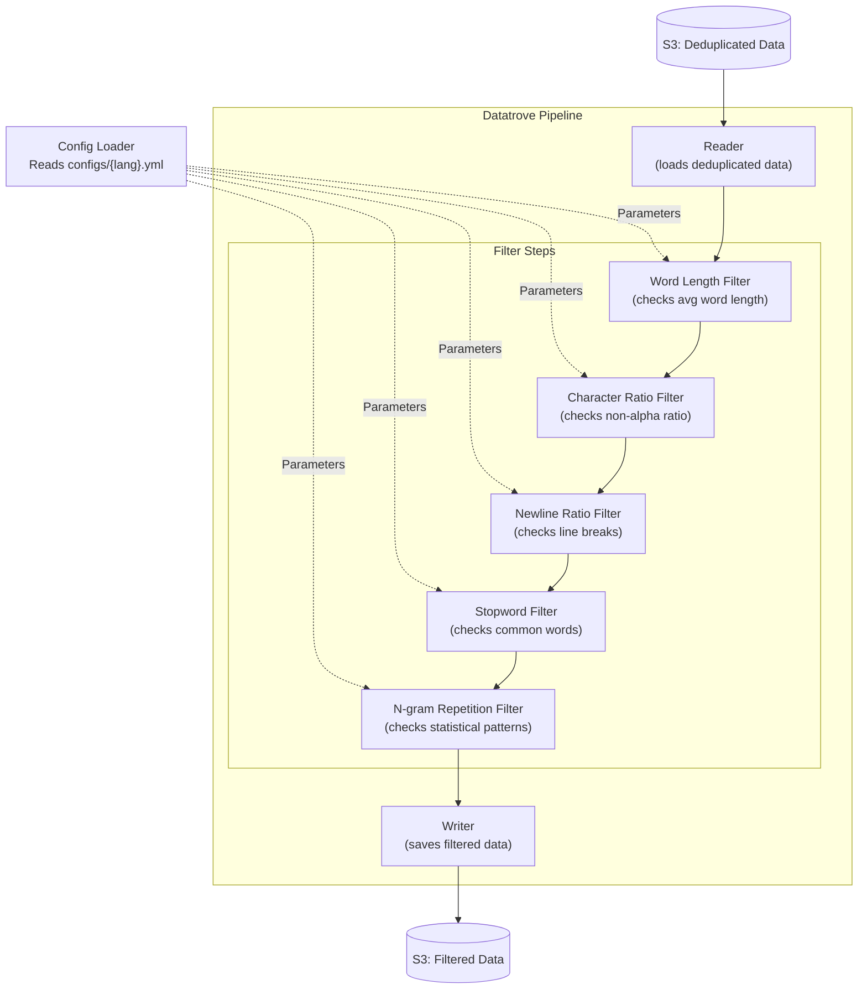
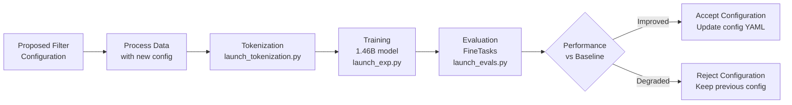

<!-- source: DeepWiki mcp.deepwiki.com · repo huggingface/fineweb-2 · page 2.3 Quality Filtering · fetched 2026-10-26 -->

# Quality Filtering

<details>
<summary>Relevant source files</summary>

The following files were used as context for generating this wiki page:

- [README.md](README.md)
- [configs/aau_Latn.yml](configs/aau_Latn.yml)
- [configs/aaz_Latn.yml](configs/aaz_Latn.yml)

</details>


## Purpose and Scope

This document describes the quality filtering stage of the FineWeb 2 data processing pipeline. Quality filtering is the third stage of data processing, applied after language identification and deduplication, and before PII anonymization. It adapts the original FineWeb quality filters for multilingual settings through extensive ablation testing and language-specific parameterization.

For information about:
- Language identification and confidence thresholds, see [Language Identification](#2.1)
- Deduplication strategies, see [Deduplication](#2.2)
- PII removal and text fixes, see [PII Anonymization and Fixes](#2.4)
- Configuration parameter structure, see [Configuration Structure](#3.1)
- Quality metric parameters in detail, see [Quality Metrics](#3.3)

## Overview

Quality filtering in FineWeb 2 applies a set of heuristic filters to remove low-quality documents from the dataset. Unlike the original FineWeb (which focused on English), FineWeb 2 had to adapt these filters for over 1000 languages. Rather than creating language-specific filters, the approach keeps the original FineWeb filter set but extensively tunes thresholds and parameters on a per-language basis.

The quality filtering stage operates on documents that have already been:
1. Identified as belonging to a specific language with sufficient confidence
2. Deduplicated globally per language
3. Tagged with metadata including `minhash_cluster_size`



**Sources:** [README.md:9-63]()

## Key Changes from Original FineWeb

Based on extensive ablation testing using the FineTasks evaluation suite, several modifications were made to the original FineWeb filters:

### Disabled Filters

| Filter | Original Value | FineWeb 2 Value | Reason |
|--------|---------------|-----------------|---------|
| `short_line_thr` | Active | Removed | Degraded multilingual performance |
| `line_punct_thr` | Active | Set to -1 (disabled) | Language-specific punctuation patterns vary widely |
| Paragraph-related repetition filters | Active | Disabled | Trafilatura does not preserve paragraph structure |

### Modified Filters

| Filter | Original Value | FineWeb 2 Value | Reason |
|--------|---------------|-----------------|---------|
| `char_dup_ratio` | 0.01 | 0.1 | More tolerant threshold for multilingual content |

### Excluded Filters

The C4 filter set was not included in FineWeb 2, as ablation experiments showed it degraded performance in the multilingual setting.

**Sources:** [README.md:53-63]()

## Language-Specific Configuration

Each language has a dedicated configuration file at `configs/{iso3_lang}_{script}.yml` that defines quality filtering parameters. These configurations allow the same filter logic to apply different thresholds based on the linguistic characteristics of each language.



**Sources:** [configs/aau_Latn.yml:1-57](), [configs/aaz_Latn.yml:1-51]()

## Filter Parameters

### Word Length Filters

These filters ensure that documents contain words of appropriate length for the language:

- **`min_avg_word_length`**: Minimum average word length in the document (typically 3)
- **`max_avg_word_length`**: Maximum average word length in the document (typically 6)

Documents with average word lengths outside this range are removed, as they likely contain concatenated text, URL fragments, or other non-natural text.

Example from `aau_Latn.yml`:
```yaml
min_avg_word_length: 3
max_avg_word_length: 6
```

**Sources:** [configs/aau_Latn.yml:17-19](), [configs/aaz_Latn.yml:17-19]()

### Character Ratio Filters

- **`max_non_alpha_words_ratio`**: Maximum ratio of words containing non-alphabetic characters (varies by language, e.g., 0.744 for aau_Latn, 0.788 for aaz_Latn)

This filter removes documents with excessive non-alphabetic content, which typically indicates low-quality or machine-generated text. The threshold is language-specific because some writing systems naturally have more non-alphabetic characters.

**Sources:** [configs/aau_Latn.yml:18](), [configs/aaz_Latn.yml:18]()

### Newline Ratio Filter

- **`new_line_ratio`**: Maximum ratio of newline characters to total characters (varies by language, e.g., 0.038 for aau_Latn, 0.045 for aaz_Latn)

This filter removes documents with excessive line breaks, which often indicates lists, tables, or other non-prose content.

**Sources:** [configs/aau_Latn.yml:20](), [configs/aaz_Latn.yml:20]()

### Line Punctuation Filter

- **`line_punct_thr`**: Threshold for line-ending punctuation patterns (set to -1 in FineWeb 2, effectively disabling this filter)

In the original FineWeb, this filter removed documents where lines consistently lacked proper punctuation. However, for multilingual content, punctuation conventions vary significantly across languages, so this filter was disabled.

**Sources:** [configs/aau_Latn.yml:16](), [configs/aaz_Latn.yml:16]()

### Stopword-Based Filters

- **`stopwords`**: A language-specific list of common words (typically 24 words per language)

Stopwords are used in quality filters to verify that documents contain natural language. The specific stopwords are selected based on linguistic analysis of each language. Documents lacking sufficient stopword coverage may be filtered out as non-natural text.

Example from `aau_Latn.yml`:
```yaml
stopwords:
- me
- ma
- mon
- so
- hiykwe
# ... 19 more words
```

**Sources:** [configs/aau_Latn.yml:21-49](), [configs/aaz_Latn.yml:21-43]()

### Statistical N-gram Filters

- **`top_n_grams`**: Thresholds for repetitive n-gram patterns at different n-gram lengths

These filters detect and remove documents with excessive repetition of common n-gram patterns, which indicates automatically generated or low-quality content.

Example from `aau_Latn.yml`:
```yaml
top_n_grams:
- - 2  # bigram
  - 0.165  # threshold
- - 3  # trigram
  - 0.168
- - 4  # 4-gram
  - 0.167
```

**Sources:** [configs/aau_Latn.yml:50-57](), [configs/aaz_Latn.yml:44-51]()

## Filter Processing Flow

The quality filtering stage processes documents through multiple filters in sequence. Each filter evaluates the document against language-specific thresholds and decides whether to keep or discard it.



**Sources:** [README.md:53-63]()

## Implementation Architecture

Quality filtering in FineWeb 2 is implemented using the Datatrove framework, which provides a pipeline abstraction for data processing. Each filter is typically implemented as a `PipelineStep` that can be chained together.



**Sources:** [README.md:88]()

## Relationship to Deduplication Parameters

While this document focuses on quality filtering, it's important to note that some configuration parameters in the YAML files relate to deduplication rather than quality filtering:

- **`dup_line_frac`**: Threshold for duplicate line detection (used in deduplication stage)
- **`dup_n_grams`**: N-gram thresholds for duplicate detection (used in deduplication stage)

These parameters are documented in detail in [Duplication Parameters](#3.2).

**Sources:** [configs/aau_Latn.yml:1-14](), [configs/aaz_Latn.yml:1-14]()

## Ablation Testing Methodology

Every quality filtering parameter and threshold was validated through ablation testing. The process involved:

1. **Data Processing**: Process data with candidate filter configuration
2. **Tokenization**: Tokenize the filtered dataset
3. **Training**: Train a 1.46B parameter model using Nanotron
4. **Evaluation**: Evaluate on FineTasks suite
5. **Decision**: Compare performance to baseline and decide whether to keep the configuration

This empirical approach ensures that filter adaptations improve downstream model performance rather than being based purely on heuristics.



For detailed information about the ablation framework, see [Ablation and Evaluation Framework](#4).

**Sources:** [README.md:65-78]()

## Configuration Example

Here is a complete example configuration file showing all quality filtering parameters:

```yaml
# configs/aau_Latn.yml

# Deduplication parameters (not part of quality filtering)
dup_line_frac: 0.398
dup_n_grams:
- - 5
  - 0.4
# ... more dup_n_grams

# Language identification parameter
language_score: 0.683

# Quality filtering parameters
line_punct_thr: -1  # Disabled
max_avg_word_length: 6
max_non_alpha_words_ratio: 0.744
min_avg_word_length: 3
new_line_ratio: 0.038

# Stopwords for natural language detection
stopwords:
- me
- ma
- mon
# ... 21 more words

# Statistical n-gram patterns
top_n_grams:
- - 2
  - 0.165
- - 3
  - 0.168
- - 4
  - 0.167
```

**Sources:** [configs/aau_Latn.yml:1-57]()

---

