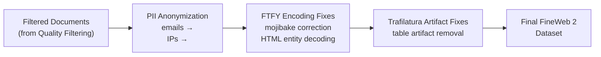
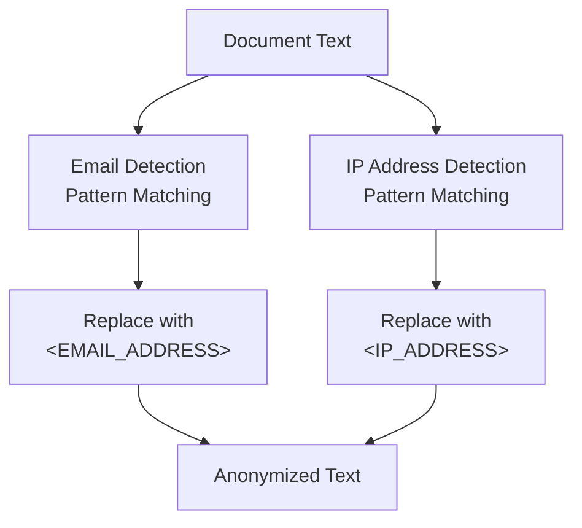
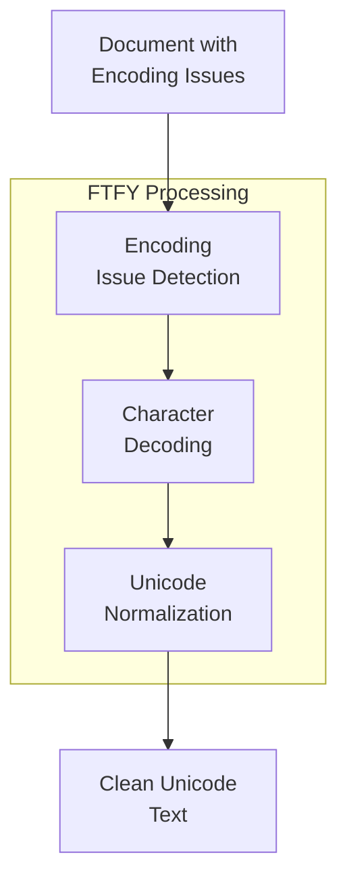
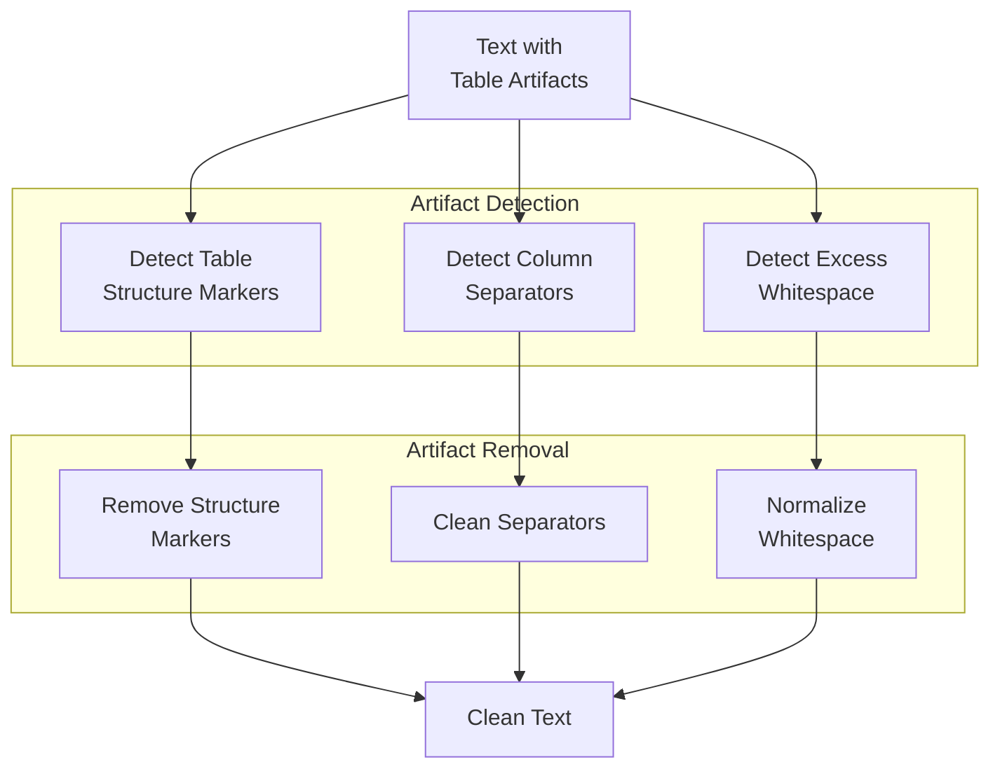
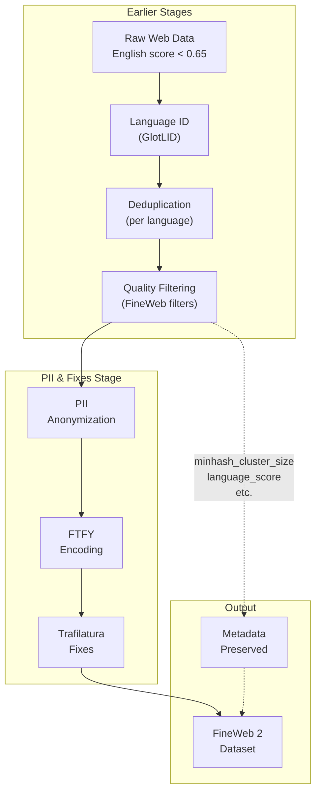
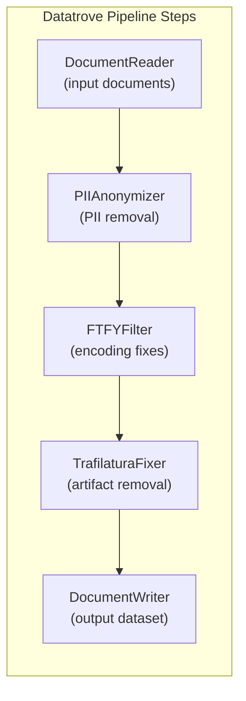

<!-- source: DeepWiki mcp.deepwiki.com · repo huggingface/fineweb-2 · page 2.4 PII Anonymization and Fixes · fetched 2026-10-26 -->

# PII Anonymization and Fixes

Relevant source files

The following files were used as context for generating this wiki page:

- [README.md](README.md)

## Purpose and Scope

This document describes the final stage of the FineWeb 2 data processing pipeline: PII (Personally Identifiable Information) anonymization and various text fixes. This stage applies three critical transformations to ensure data quality and privacy compliance:

1. **PII Anonymization**: Removal of emails and IP addresses
2. **Encoding Fixes**: Correction of text encoding issues using FTFY
3. **HTML Artifact Fixes**: Removal of trafilatura-generated table artifacts

This is the fourth and final stage in the data processing pipeline, applied after [Language Identification](#2.1), [Deduplication](#2.2), and [Quality Filtering](#2.3). The output from this stage produces the final FineWeb 2 dataset ready for distribution.

For information about the broader data processing architecture, see [Data Processing Pipeline](#2). For details on external tool integration, see [Data Processing Tools](#7.1).

---

## Overview of Processing Stage

The PII anonymization and fixes stage performs three independent transformations on each document in the pipeline. Unlike earlier stages that may filter out documents entirely, this stage modifies document content while preserving the document in the dataset.

**Sources**: [README.md:60-63]()

### Processing Order

The three transformations are applied sequentially:

| Order | Transformation | Purpose | Preservation |
|-------|---------------|---------|--------------|
| 1 | PII Anonymization | Privacy compliance | Text replaced with tokens |
| 2 | FTFY Encoding Fixes | Character encoding correction | Text normalized |
| 3 | Trafilatura Fixes | Artifact removal | Text cleaned |

Each transformation operates independently and does not affect the applicability of subsequent transformations.

**Sources**: [README.md:60-63]()

---

## PII Anonymization

### Overview

PII anonymization replaces personally identifiable information with placeholder tokens to ensure privacy compliance across all 1000+ languages in FineWeb 2. The implementation follows the same approach as the original FineWeb dataset, providing consistency across versions.

**Sources**: [README.md:61]()

### Anonymized Entities

The system anonymizes two types of PII:

#### Email Addresses

Email addresses are detected using pattern matching and replaced with the token `<EMAIL_ADDRESS>`. This applies to all standard email formats across languages:

- Standard format: `user@domain.com` → `<EMAIL_ADDRESS>`
- International domains: `user@例え.jp` → `<EMAIL_ADDRESS>`
- Subdomains: `user@mail.company.org` → `<EMAIL_ADDRESS>`

#### IP Addresses

IP addresses (both IPv4 and IPv6) are detected and replaced with the token `<IP_ADDRESS>`:

- IPv4: `192.168.1.1` → `<IP_ADDRESS>`
- IPv6: `2001:0db8:85a3::8a2e:0370:7334` → `<IP_ADDRESS>`

### Language-Agnostic Detection

The PII detection system uses pattern-based matching that works across all languages without requiring language-specific configuration. Email and IP address formats are standardized globally, making them suitable for universal pattern matching.

| PII Type | Detection Method | Token Replacement | Language-Specific? |
|----------|------------------|-------------------|-------------------|
| Email | Regex pattern | `<EMAIL_ADDRESS>` | No |
| IP Address | Regex pattern | `<IP_ADDRESS>` | No |

**Sources**: [README.md:61]()

---

## FTFY Encoding Fixes

### Overview

FTFY (Fixes Text For You) is applied to correct text encoding issues that commonly occur in web-scraped data. These issues, often called "mojibake", result from incorrect character encoding/decoding operations during data collection and processing.

**Sources**: [README.md:62]()

### Common Encoding Issues Fixed

FTFY addresses several categories of encoding problems:

#### Mojibake Correction

Mojibake occurs when text is decoded with the wrong character encoding. Examples:

| Corrupted Text | Correct Text | Issue Type |
|---------------|--------------|------------|
| `’` | `'` | UTF-8 decoded as Latin-1 |
| `é` | `é` | UTF-8 decoded as Latin-1 |
| `中文` | `中文` | Double encoding |
| `&#x263A;` | `☺` | HTML entity not decoded |

#### HTML Entity Decoding

FTFY decodes HTML entities that may have been preserved during earlier HTML extraction:

- Named entities: `&lt;` → `<`, `&amp;` → `&`
- Numeric entities: `&#8217;` → `'`, `&#233;` → `é`
- Hex entities: `&#x2019;` → `'`, `&#xE9;` → `é`

#### Unicode Normalization

FTFY applies Unicode normalization to ensure consistent representation:

- Combining characters are properly composed
- Half-width/full-width variants are normalized
- Multiple representations of the same character are unified

**Sources**: [README.md:62]()

### Multilingual Support

FTFY's encoding fixes are particularly valuable for FineWeb 2's multilingual scope. Different languages have different historical encoding schemes (UTF-8, Latin-1, Windows-1252, Shift-JIS, etc.), and web data often contains encoding errors specific to each language family.

The tool works across all 1000+ languages without requiring language-specific configuration, making it suitable for the configuration-driven architecture described in [Configuration System](#3).

**Sources**: [README.md:62]()

---

## Trafilatura Artifact Fixes

### Overview

Trafilatura is the HTML extraction tool used in FineWeb 2's upstream processing. While it effectively extracts main content from HTML, it can introduce artifacts when processing complex table structures. This stage applies fixes to remove or correct these artifacts.

**Sources**: [README.md:63]()

### Table-Related Artifacts

Trafilatura's table extraction can introduce several types of artifacts:

#### Structure Markers

When extracting tables, trafilatura may insert markers to preserve table structure:

- Cell boundaries that appear as extra characters
- Row separators that don't exist in the original content
- Column alignment markers

#### Separator Issues

Table column separators may be rendered inconsistently:

| Artifact Pattern | Expected Output | Issue |
|-----------------|-----------------|-------|
| Multiple pipes (`\|\|`) | Single space | Duplicate separators |
| Mixed tabs/spaces | Normalized spacing | Inconsistent whitespace |
| Trailing separators | Clean line end | Extra punctuation |

#### Whitespace Normalization

Tables often introduce excess whitespace that needs normalization:

- Multiple consecutive spaces within cells
- Leading/trailing whitespace in extracted rows
- Empty lines between table rows

**Sources**: [README.md:63]()

### Language Independence

Like PII anonymization, trafilatura artifact fixes are language-agnostic. Table structure artifacts are introduced by the HTML extraction process, not by language-specific content, so the same fixes apply across all 1000+ languages.

**Sources**: [README.md:63]()

---

## Pipeline Integration

### Position in Processing Flow

The PII anonymization and fixes stage is the final transformation in the data processing pipeline. All documents that reach this stage have already passed through:

1. **Language Identification**: Documents are assigned to specific languages
2. **Deduplication**: Duplicate content has been removed per language
3. **Quality Filtering**: Low-quality documents have been filtered out

**Sources**: [README.md:14-18](), [README.md:60-63]()

### Datatrove Integration

The PII anonymization and fixes stage is implemented as part of the Datatrove pipeline framework. Each transformation (PII, FTFY, trafilatura) is implemented as a Datatrove pipeline step that can be composed with other processing steps.

For more details on Datatrove integration, see [Data Processing Tools](#7.1).

**Sources**: [README.md:88]()

### Metadata Preservation

Unlike filtering stages that may add new metadata fields (e.g., `minhash_cluster_size` from deduplication), the PII and fixes stage does not modify document metadata. All metadata from earlier stages is preserved:

- `language`: Language identifier from GlotLID
- `language_score`: Confidence score from language identification
- `minhash_cluster_size`: Cluster size from deduplication
- Quality filter metadata: Various scores from filtering stage

Only the document `text` field is modified by this stage.

**Sources**: [README.md:25]()

---

## Configuration and Parameters

### No Language-Specific Configuration

Unlike earlier pipeline stages that require per-language configuration (see [Configuration System](#3)), the PII anonymization and fixes stage uses the same configuration for all languages. This is because:

1. **PII patterns are universal**: Email and IP address formats are standardized globally
2. **Encoding issues are tool-specific**: FTFY's fixes apply to encoding problems regardless of language
3. **HTML artifacts are structure-based**: Trafilatura artifacts result from HTML structure, not language content

### Global Parameters

The PII and fixes stage operates with fixed behavior:

| Parameter | Value | Reason |
|-----------|-------|--------|
| Email replacement | `<EMAIL_ADDRESS>` | Standard privacy token |
| IP replacement | `<IP_ADDRESS>` | Standard privacy token |
| FTFY normalization | Enabled | Always fix encoding |
| Trafilatura fixes | Enabled | Always clean artifacts |

**Sources**: [README.md:60-63]()

### Comparison with Configurable Stages

The following table shows how the PII and fixes stage differs from earlier configurable stages:

| Stage | Language-Specific Config | Config Location | Reason for Approach |
|-------|-------------------------|-----------------|---------------------|
| Language ID | Yes | `configs/{lang}.yml` | Different confidence thresholds per language |
| Deduplication | Yes | `configs/{lang}.yml` | Different duplication tolerance per language |
| Quality Filtering | Yes | `configs/{lang}.yml` | Different quality metrics per language |
| **PII & Fixes** | **No** | **Global** | **Universal patterns and tool-specific fixes** |

For details on language-specific configuration, see [Configuration Structure](#3.1).

**Sources**: [README.md:10-11](), [README.md:60-63]()

---

## Processing Guarantees

### Document Preservation

The PII and fixes stage guarantees that all documents entering the stage will exit the stage. Unlike filtering stages that may remove documents, this stage only modifies document content.

- **Input**: N documents from quality filtering
- **Output**: N documents with anonymized PII and fixed encoding

### Idempotency

The PII and fixes transformations are designed to be idempotent:

- Running PII anonymization twice produces the same result as running it once
- FTFY encoding fixes converge to a stable normalized form
- Trafilatura artifact removal is idempotent

This property ensures that the transformations can be safely reapplied if needed during pipeline development or debugging.

### Text Modification Scope

Each transformation has a well-defined scope of modifications:

| Transformation | Modifies | Preserves |
|---------------|----------|-----------|
| PII Anonymization | Email addresses, IP addresses | All other text, punctuation, structure |
| FTFY | Character encoding, HTML entities | Word boundaries, language content |
| Trafilatura Fixes | Table artifacts, excess whitespace | Main content, formatting |

**Sources**: [README.md:60-63]()

---

## Summary

The PII anonymization and fixes stage is the final transformation in the FineWeb 2 data processing pipeline. It consists of three independent operations:

1. **PII Anonymization**: Replaces emails and IP addresses with standard tokens
2. **FTFY Encoding Fixes**: Corrects text encoding issues and mojibake
3. **Trafilatura Artifact Fixes**: Removes HTML table extraction artifacts

Unlike earlier pipeline stages, this stage:
- Does not require language-specific configuration
- Modifies all documents without filtering any out
- Operates with universal patterns and tool-specific fixes
- Preserves all metadata from earlier stages

The output from this stage is the final FineWeb 2 dataset, ready for distribution and use in model pretraining across 1000+ languages.

**Sources**: [README.md:1-18](), [README.md:60-63]()

---

