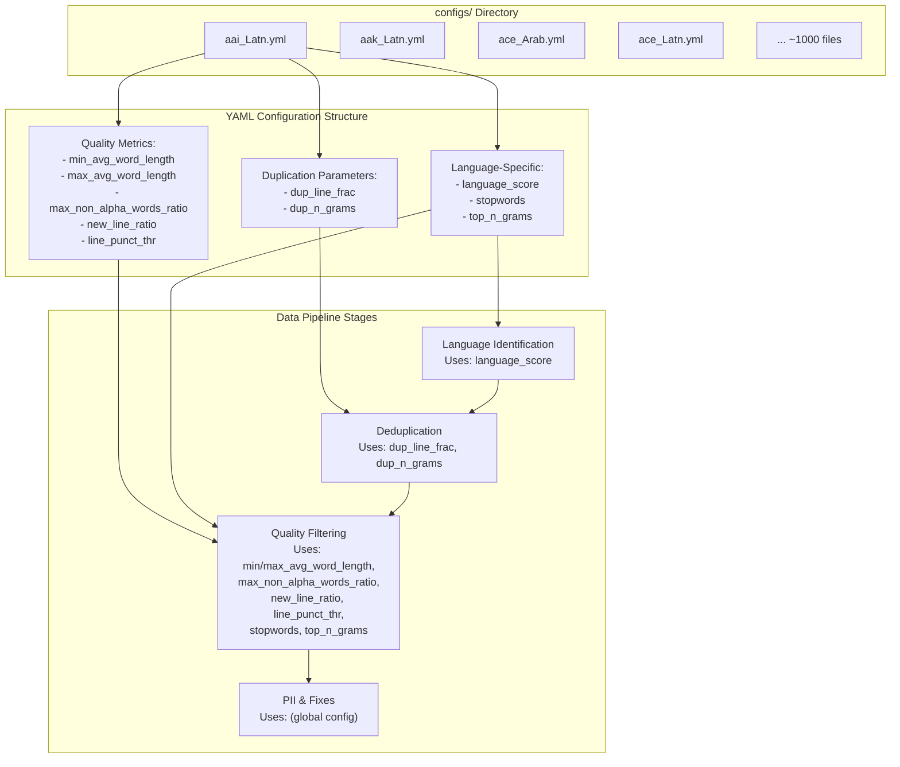
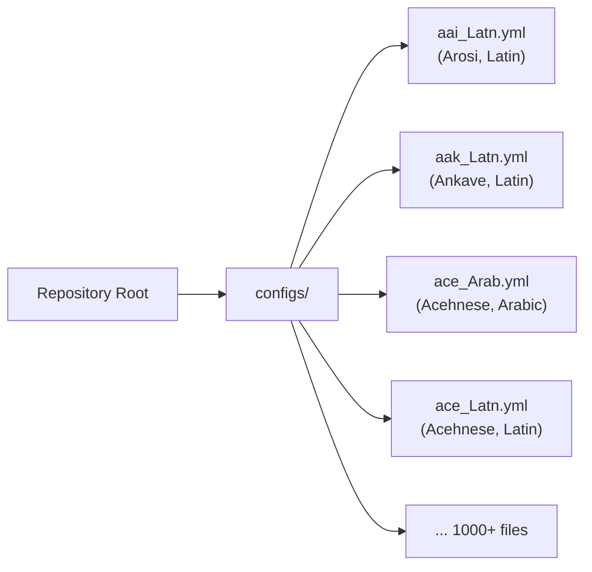
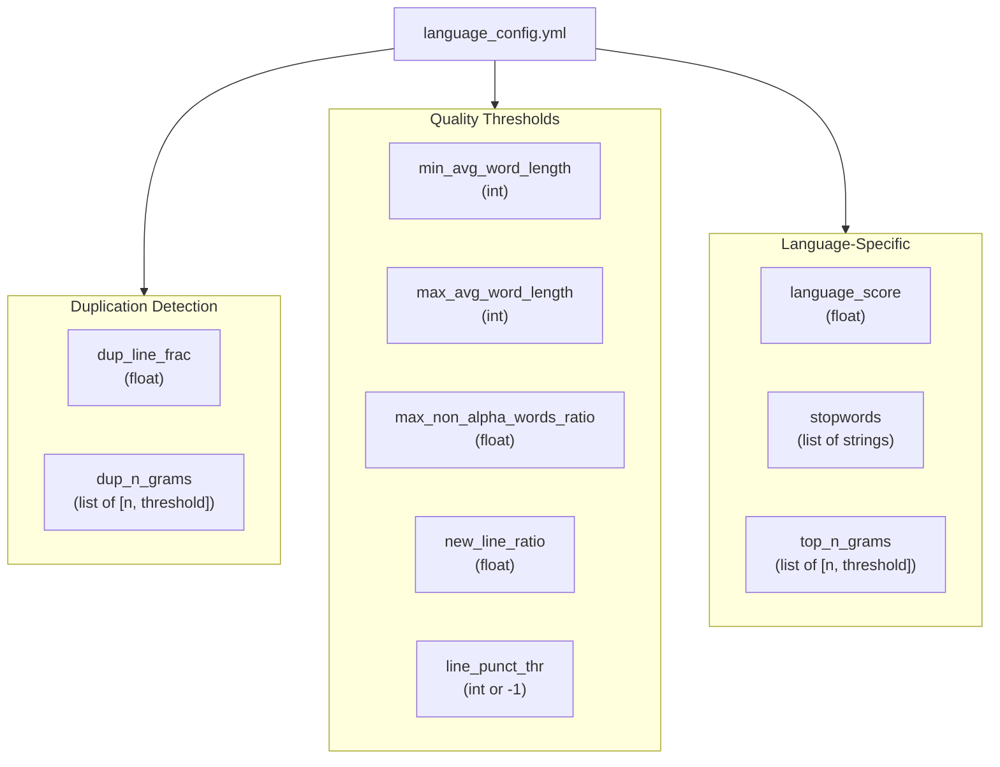
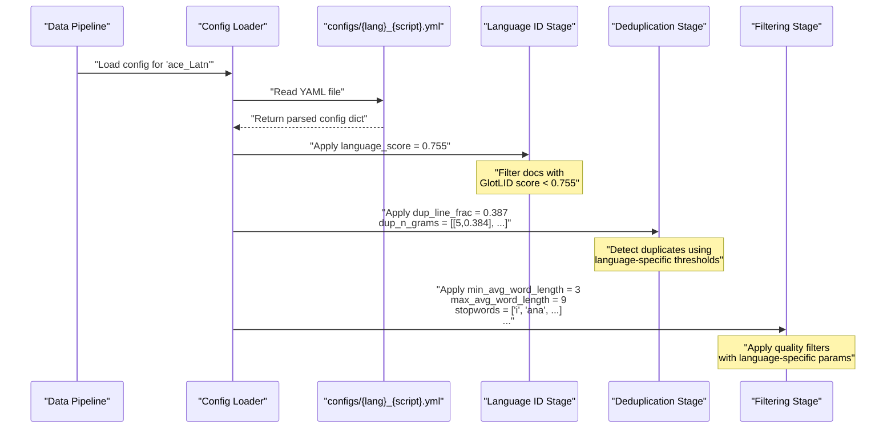
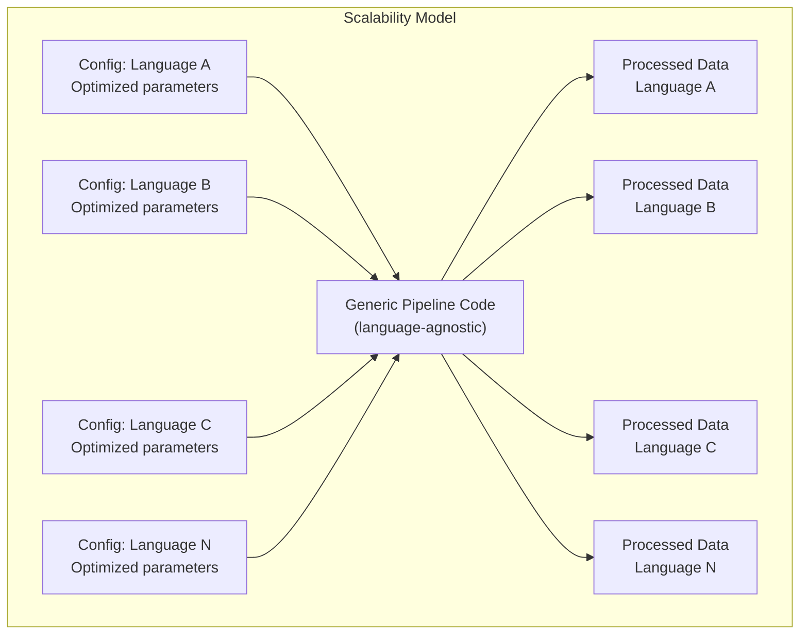

<!-- source: DeepWiki mcp.deepwiki.com · repo huggingface/fineweb-2 · page 3 Configuration System · fetched 2026-10-26 -->

# Configuration System

Relevant source files

The following files were used as context for generating this wiki page:

- [README.md](README.md)
- [configs/aai_Latn.yml](configs/aai_Latn.yml)

## Purpose and Scope

The Configuration System enables FineWeb 2 to scale processing across 1000+ languages by defining language-specific parameters in individual YAML files. Each configuration file customizes thresholds, stopwords, and quality metrics for a single language without requiring code changes. This document explains the overall architecture, file organization, and how configurations integrate with the data pipeline.

For details on specific parameter types, see [Duplication Parameters](#3.2), [Quality Metrics](#3.3), and [Language-Specific Data](#3.4). For guidance on creating new configurations, see [Creating Language Configs](#3.5). For information on how configurations are consumed during data processing, see [Data Processing Pipeline](#2).

## Architecture Overview

The Configuration System follows a **one-config-per-language** design pattern where each language has a dedicated YAML file containing all parameters needed to customize the four-stage data processing pipeline (Language Identification, Deduplication, Filtering, and PII Anonymization).

**Diagram: Configuration System Architecture**

The system separates configuration (YAML files) from implementation (pipeline code), enabling language-specific tuning without modifying processing logic. Each configuration file is loaded by pipeline stages to customize behavior for that language's documents.

**Sources:** [README.md:1-106](), [configs/aai_Latn.yml:1-52]()

## Configuration File Organization

### File Naming Convention

Configuration files follow the pattern `{iso3_lang}_{script}.yml` where:

| Component | Description | Example |
|-----------|-------------|---------|
| `iso3_lang` | ISO 639-3 three-letter language code | `aai`, `ace`, `fra` |
| `script` | ISO 15924 four-letter script code | `Latn`, `Arab`, `Cyrl` |
| `.yml` | YAML file extension | (fixed) |

This naming convention allows the same language to have multiple configurations when written in different scripts (e.g., `ace_Arab.yml` and `ace_Latn.yml` for Acehnese in Arabic and Latin scripts).

### Directory Structure

**Diagram: Configuration Directory Organization**

All configuration files reside in a flat directory structure at `configs/` in the repository root. The consistent naming pattern enables programmatic discovery and loading based on language and script identifiers detected during Language Identification.

**Sources:** [README.md:11]()

## Configuration File Structure

Each YAML configuration file contains 10 standard parameters organized into three functional categories:

### Parameter Overview

**Diagram: Configuration Parameter Categories**

**Sources:** [configs/aai_Latn.yml:1-52]()

### Example Configuration

The following table shows parameter values from `configs/aai_Latn.yml`:

| Parameter | Value | Purpose |
|-----------|-------|---------|
| `dup_line_frac` | 0.387 | Maximum fraction of duplicate lines in document |
| `dup_n_grams` | `[[5,0.384], [6,0.376], ...]` | N-gram duplication thresholds |
| `language_score` | 0.755 | Minimum GlotLID confidence score |
| `line_punct_thr` | -1 | Line punctuation filter (-1 = disabled) |
| `max_avg_word_length` | 9 | Maximum average word length |
| `max_non_alpha_words_ratio` | 0.8 | Maximum ratio of non-alphabetic words |
| `min_avg_word_length` | 3 | Minimum average word length |
| `new_line_ratio` | 0.071 | Newline character ratio threshold |
| `stopwords` | `['i', 'ana', 'naatu', ...]` | 24 language-specific stopwords |
| `top_n_grams` | `[[2,0.172], [3,0.17], [4,0.177]]` | Most common n-gram thresholds |

**Sources:** [configs/aai_Latn.yml:1-52]()

## Integration with Data Pipeline

The Configuration System integrates with all four stages of the data processing pipeline through a load-and-apply pattern:

**Diagram: Configuration Loading and Application Sequence**

### Stage-Specific Parameter Usage

| Pipeline Stage | Parameters Used |
|----------------|-----------------|
| **Language Identification** | `language_score` |
| **Deduplication** | `dup_line_frac`, `dup_n_grams` |
| **Quality Filtering** | `min_avg_word_length`, `max_avg_word_length`, `max_non_alpha_words_ratio`, `new_line_ratio`, `line_punct_thr`, `stopwords`, `top_n_grams` |
| **PII Anonymization** | (uses global configuration, not per-language) |

**Sources:** [README.md:14-64]()

## Configuration-Driven Scalability

The Configuration System enables language scalability through three key design principles:

### 1. Separation of Concerns

Processing logic (code) is decoupled from processing parameters (YAML). Pipeline stages implement generic filtering algorithms that accept parameters, while configurations provide language-specific values.

### 2. Zero-Code Language Addition

Adding support for a new language requires only:
1. Creating a new YAML file following the `{iso3_lang}_{script}.yml` naming convention
2. Defining the 10 required parameters
3. Tuning parameter values through ablation testing

No modifications to pipeline code are necessary.

### 3. Independent Language Tuning

Each language's configuration can be optimized independently through ablation experiments (see [Ablation and Evaluation Framework](#4)). This allows language-specific tuning without affecting other languages' processing.

**Diagram: Configuration-Driven Scalability Model**

The same generic pipeline code processes all languages by loading language-specific configurations. This architecture enabled FineWeb 2 to scale from English-only (FineWeb 1) to 1000+ languages without exponential code complexity growth.

**Sources:** [README.md:4-11](), [README.md:54-58]()

## Global Configuration Modifications

While most parameters are language-specific, some global changes were applied across all configurations based on ablation results:

| Original FineWeb Setting | FineWeb 2 Modification | Rationale |
|-------------------------|------------------------|-----------|
| `short_line_thr` (enabled) | Removed | Filter not effective in multilingual context |
| `char_dup_ratio = 0.01` | Changed to `0.1` | Less aggressive duplicate detection for non-English |
| Paragraph-related repetition filters | Disabled | Trafilatura HTML extractor does not preserve paragraphs |
| C4 filters (enabled) | Not included | Degraded performance in multilingual setting |

These modifications affect the baseline behavior that language-specific configurations build upon.

**Sources:** [README.md:54-58]()

## Summary

The Configuration System is the architectural foundation enabling FineWeb 2's multilingual scale. By encoding all language-specific processing parameters in individual YAML files with a consistent structure, the system allows:

- **Pipeline customization** without code changes
- **Independent language optimization** through isolated parameter tuning
- **Linear scalability** where adding languages requires linear effort (one config file per language)
- **Transparency and reproducibility** with all processing decisions documented in version-controlled YAML files

The subsequent sections ([Configuration Structure](#3.1), [Duplication Parameters](#3.2), [Quality Metrics](#3.3), [Language-Specific Data](#3.4)) provide detailed documentation of individual parameter types and their effects on pipeline behavior.

**Sources:** [README.md:1-106](), [configs/aai_Latn.yml:1-52]()

---

