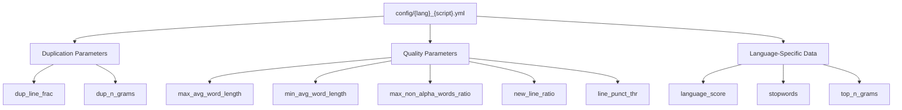
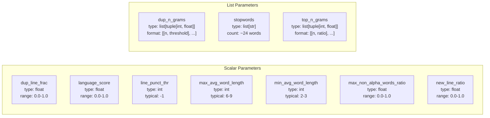
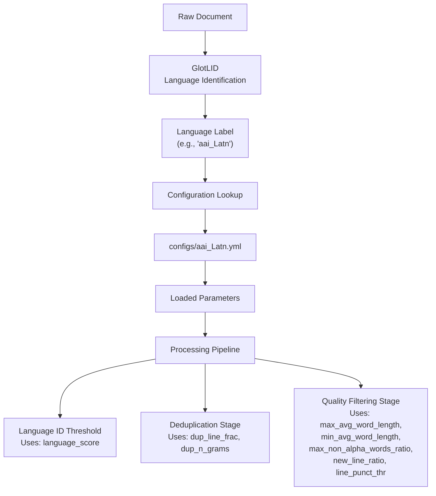
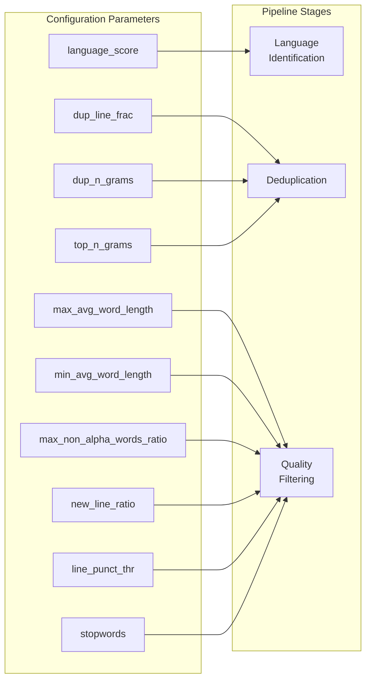
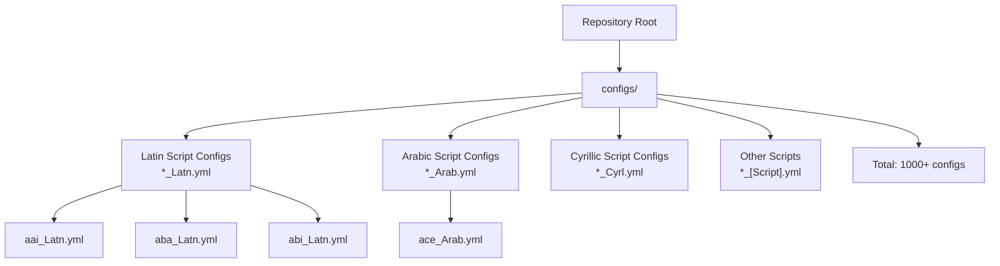
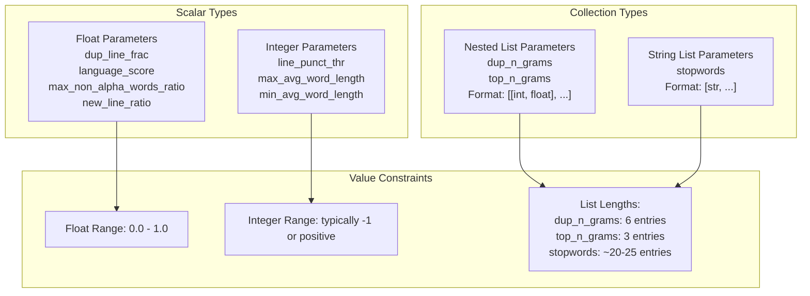

<!-- source: DeepWiki mcp.deepwiki.com · repo huggingface/fineweb-2 · page 3.1 Configuration Structure · fetched 2026-10-26 -->

# Configuration Structure

<details>
<summary>Relevant source files</summary>

The following files were used as context for generating this wiki page:

- [configs/aai_Latn.yml](configs/aai_Latn.yml)
- [configs/aba_Latn.yml](configs/aba_Latn.yml)
- [configs/abi_Latn.yml](configs/abi_Latn.yml)

</details>


## Purpose and Scope

This document describes the structure and organization of language-specific YAML configuration files that parameterize all data processing operations in FineWeb 2. Each of the 1000+ supported languages has a dedicated configuration file in the `configs/` directory that defines thresholds, patterns, and quality metrics specific to that language.

For detailed explanations of individual parameter types, see:
- Duplication detection parameters: [3.2](#3.2)
- Quality filtering parameters: [3.3](#3.3)
- Language-specific data (stopwords, n-grams): [3.4](#3.4)
- Creating new configurations: [3.5](#3.5)

For how configurations affect the processing pipeline stages, see:
- Language Identification: [2.1](#2.1)
- Deduplication: [2.2](#2.2)
- Quality Filtering: [2.3](#2.3)

## File Naming Convention

Configuration files follow a strict naming pattern that encodes language identity:

```
configs/{language_code}_{script}.yml
```

Where:
- `{language_code}`: ISO 639-3 three-letter language code
- `{script}`: ISO 15924 four-letter script code (e.g., `Latn`, `Arab`, `Cyrl`)

Examples:
- `aai_Latn.yml`: Arifama-Miniafia language in Latin script
- `aba_Latn.yml`: Abé language in Latin script
- `ace_Arab.yml`: Acehnese language in Arabic script

This naming convention matches GlotLID's output format, enabling automatic configuration lookup during pipeline processing.

**Sources:** [configs/aai_Latn.yml:1](), [configs/aba_Latn.yml:1](), [configs/abi_Latn.yml:1]()

## Configuration File Structure

### Overall Organization



**Sources:** [configs/aai_Latn.yml:1-52](), [configs/aba_Latn.yml:1-55](), [configs/abi_Latn.yml:1-48]()

### Parameter Categories

Each configuration file contains exactly 10 parameters organized into three functional categories:

| Category | Parameters | Purpose |
|----------|------------|---------|
| **Duplication** | `dup_line_frac`, `dup_n_grams` | Control duplicate content detection during deduplication stage |
| **Quality** | `max_avg_word_length`, `min_avg_word_length`, `max_non_alpha_words_ratio`, `new_line_ratio`, `line_punct_thr` | Define text quality thresholds for filtering stage |
| **Language-Specific** | `language_score`, `stopwords`, `top_n_grams` | Store language-specific patterns and thresholds |

**Sources:** [configs/aai_Latn.yml:1-52](), [configs/aba_Latn.yml:1-55](), [configs/abi_Latn.yml:1-48]()

## Complete Parameter Reference

### Data Types and Structure



**Sources:** [configs/aai_Latn.yml:1-52](), [configs/aba_Latn.yml:1-55](), [configs/abi_Latn.yml:1-48]()

### Parameter Specifications

| Parameter | Type | Format | Description |
|-----------|------|--------|-------------|
| `dup_line_frac` | `float` | Single value (0.0-1.0) | Threshold for duplicate line detection |
| `dup_n_grams` | `list` | `[[n, threshold], ...]` | N-gram thresholds for duplicate detection (n=5-10) |
| `language_score` | `float` | Single value (0.0-1.0) | Minimum GlotLID confidence threshold |
| `line_punct_thr` | `int` | Single value | Line punctuation threshold (typically -1 for disabled) |
| `max_avg_word_length` | `int` | Single value | Maximum average word length filter |
| `max_non_alpha_words_ratio` | `float` | Single value (0.0-1.0) | Maximum ratio of non-alphabetic words |
| `min_avg_word_length` | `int` | Single value | Minimum average word length filter |
| `new_line_ratio` | `float` | Single value (0.0-1.0) | Maximum newline character ratio |
| `stopwords` | `list` | `[str, ...]` | Language-specific stopwords (~24 per language) |
| `top_n_grams` | `list` | `[[n, ratio], ...]` | Top n-gram frequency ratios (n=2-4) |

**Sources:** [configs/aai_Latn.yml:1-52](), [configs/aba_Latn.yml:1-55](), [configs/abi_Latn.yml:1-48]()

## Example Configurations

### Basic Configuration Example

The following example shows the complete structure of `aai_Latn.yml`:

```yaml
dup_line_frac: 0.387
dup_n_grams:
- - 5
  - 0.384
- - 6
  - 0.376
- - 7
  - 0.364
- - 8
  - 0.348
- - 9
  - 0.329
- - 10
  - 0.311
language_score: 0.755
line_punct_thr: -1
max_avg_word_length: 9
max_non_alpha_words_ratio: 0.8
min_avg_word_length: 3
new_line_ratio: 0.071
stopwords:
- i
- ana
- naatu
# ... (21 more stopwords)
top_n_grams:
- - 2
  - 0.172
- - 3
  - 0.17
- - 4
  - 0.177
```

**Sources:** [configs/aai_Latn.yml:1-52]()

### Structural Variations

While all configuration files contain the same 10 parameters, values vary significantly across languages. The table below shows how parameter values differ across three example languages:

| Parameter | aai_Latn | aba_Latn | abi_Latn |
|-----------|----------|----------|----------|
| `dup_line_frac` | 0.387 | 0.534 | 0.546 |
| `language_score` | 0.755 | 0.3 | 0.3 |
| `max_avg_word_length` | 9 | 8 | 6 |
| `min_avg_word_length` | 3 | 2 | 3 |
| `max_non_alpha_words_ratio` | 0.8 | 0.765 | 0.778 |
| `new_line_ratio` | 0.071 | 0.1 | 0.053 |
| `stopwords` count | 24 | 25 | 19 |

**Sources:** [configs/aai_Latn.yml:1-52](), [configs/aba_Latn.yml:1-55](), [configs/abi_Latn.yml:1-48]()

## Configuration Usage in Processing Pipeline

### Configuration Loading Flow



**Sources:** [configs/aai_Latn.yml:1-52](), [configs/aba_Latn.yml:1-55](), [configs/abi_Latn.yml:1-48]()

### Parameter Usage by Pipeline Stage

The following diagram maps each configuration parameter to its usage point in the data processing pipeline:



**Sources:** [configs/aai_Latn.yml:1-52](), [configs/aba_Latn.yml:1-55](), [configs/abi_Latn.yml:1-48]()

## N-Gram List Format

### Duplicate N-Grams Structure

The `dup_n_grams` parameter uses a nested list structure where each entry is a `[n, threshold]` pair:

```yaml
dup_n_grams:
- - 5        # n-gram size
  - 0.384    # threshold value
- - 6
  - 0.376
- - 7
  - 0.364
# ... continues for n=8, 9, 10
```

Standard configuration: 6 entries covering n-gram sizes 5 through 10.

**Sources:** [configs/aai_Latn.yml:2-14](), [configs/aba_Latn.yml:2-14](), [configs/abi_Latn.yml:2-14]()

### Top N-Grams Structure

The `top_n_grams` parameter follows the same nested list pattern but with different semantics:

```yaml
top_n_grams:
- - 2        # n-gram size
  - 0.172    # frequency ratio
- - 3
  - 0.17
- - 4
  - 0.177
```

Standard configuration: 3 entries covering n-gram sizes 2 through 4.

**Sources:** [configs/aai_Latn.yml:45-51](), [configs/aba_Latn.yml:48-54](), [configs/abi_Latn.yml:41-47]()

## Stopwords List Format

### Structure and Encoding

Stopwords are stored as a YAML list with special character encoding:

```yaml
stopwords:
- i              # ASCII characters
- ana
- naatu
- "na'atube"    # Quoted for special characters
- boro
# ... typically 20-25 words per language
```

Key characteristics:
- List length: Typically 19-25 words per language
- Encoding: UTF-8 with YAML escape sequences (e.g., `\u2019`, `\xEB`)
- Quoting: Required for words containing special characters
- Case sensitivity: Preserved as specified

**Sources:** [configs/aai_Latn.yml:21-44](), [configs/aba_Latn.yml:21-47](), [configs/abi_Latn.yml:21-40]()

## Configuration File Distribution

### Directory Structure



All configuration files reside in the `configs/` directory at the repository root, with no subdirectories. This flat structure enables simple programmatic lookup using the pattern `configs/{language_code}_{script}.yml`.

**Sources:** [configs/aai_Latn.yml:1](), [configs/aba_Latn.yml:1](), [configs/abi_Latn.yml:1]()

## Configuration Schema Validation

### Required Parameters

Every configuration file must contain all 10 parameters. Missing parameters will cause pipeline failures. The following table shows the required presence of each parameter:

| Parameter | Required | Default Value Available |
|-----------|----------|------------------------|
| `dup_line_frac` | ✓ | No |
| `dup_n_grams` | ✓ | No |
| `language_score` | ✓ | No |
| `line_punct_thr` | ✓ | No |
| `max_avg_word_length` | ✓ | No |
| `max_non_alpha_words_ratio` | ✓ | No |
| `min_avg_word_length` | ✓ | No |
| `new_line_ratio` | ✓ | No |
| `stopwords` | ✓ | No |
| `top_n_grams` | ✓ | No |

All parameters are mandatory with no default values. Missing parameters indicate incomplete configuration and will prevent processing for that language.

**Sources:** [configs/aai_Latn.yml:1-52](), [configs/aba_Latn.yml:1-55](), [configs/abi_Latn.yml:1-48]()

### Type Constraints



**Sources:** [configs/aai_Latn.yml:1-52](), [configs/aba_Latn.yml:1-55](), [configs/abi_Latn.yml:1-48]()

---

