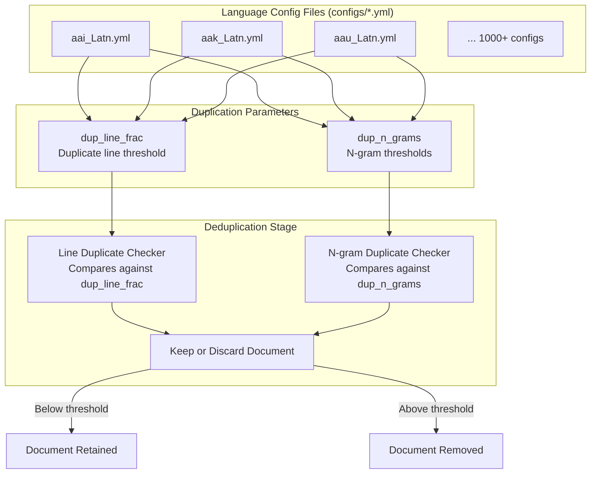
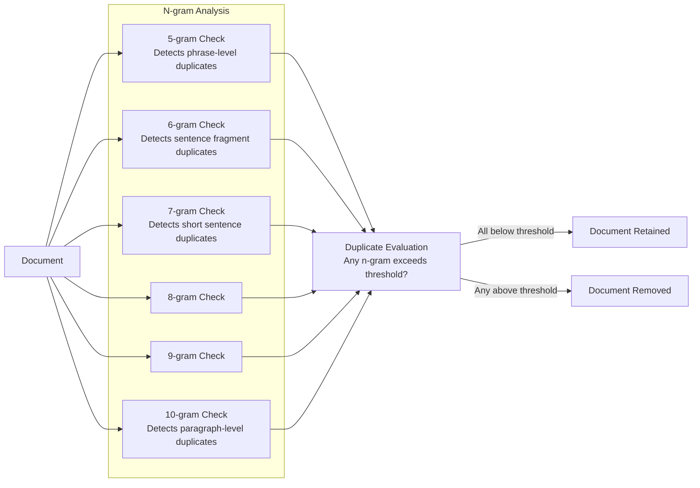
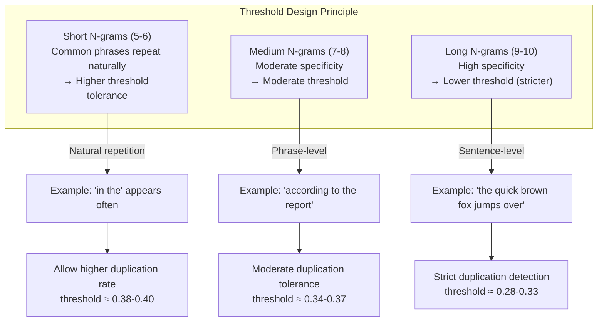
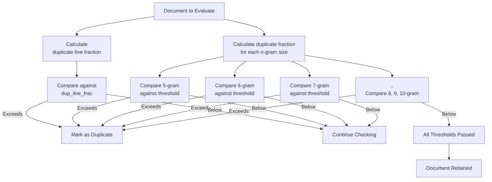
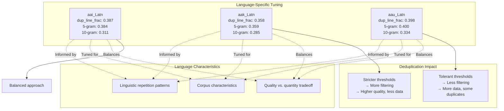

<!-- source: DeepWiki mcp.deepwiki.com · repo huggingface/fineweb-2 · page 3.2 Duplication Parameters · fetched 2026-10-26 -->

# Duplication Parameters

<details>
<summary>Relevant source files</summary>

The following files were used as context for generating this wiki page:

- [configs/aai_Latn.yml](configs/aai_Latn.yml)
- [configs/aak_Latn.yml](configs/aak_Latn.yml)
- [configs/aau_Latn.yml](configs/aau_Latn.yml)

</details>


## Purpose and Scope

This document explains the duplication detection parameters in FineWeb 2's per-language configuration files. These parameters control the thresholds used during the deduplication stage to identify and remove duplicate content within each language.

For information about the overall configuration file structure and other parameter types, see [Configuration Structure](#3.1). For details on the actual deduplication pipeline execution, see [Deduplication](#2.2). For quality filtering parameters, see [Quality Metrics](#3.3).

## Overview

Each language configuration file contains two primary duplication parameters that control duplicate content detection:

| Parameter | Type | Purpose |
|-----------|------|---------|
| `dup_line_frac` | float | Maximum fraction of duplicate lines allowed in a document |
| `dup_n_grams` | list of [int, float] pairs | N-gram size thresholds for duplicate n-gram detection |

These parameters enable language-specific tuning of deduplication sensitivity. Languages with more repetitive grammatical structures may require higher thresholds to avoid excessive filtering, while languages with diverse vocabulary may use lower thresholds.



**Diagram: Duplication Parameter Flow from Configuration to Deduplication**

Sources: [configs/aai_Latn.yml:1-14](), [configs/aak_Latn.yml:1-14](), [configs/aau_Latn.yml:1-14]()

## dup_line_frac Parameter

### Definition

The `dup_line_frac` parameter specifies the maximum allowed fraction of duplicate lines in a document. It is expressed as a float value between 0 and 1.

### Syntax

```yaml
dup_line_frac: 0.387
```

### Behavior

During deduplication, the pipeline calculates the fraction of lines in a document that are duplicates of lines found elsewhere in the corpus. If this fraction exceeds the `dup_line_frac` threshold, the document is marked as duplicate content and removed.

### Language-Specific Examples

Different languages use different thresholds based on their linguistic characteristics:

| Language Code | `dup_line_frac` | File Reference |
|---------------|-----------------|----------------|
| aai_Latn | 0.387 | [configs/aai_Latn.yml:1]() |
| aak_Latn | 0.358 | [configs/aak_Latn.yml:1]() |
| aau_Latn | 0.398 | [configs/aau_Latn.yml:1]() |

The variation in thresholds (0.358 to 0.398 in these examples) reflects language-specific tuning. Languages with more formulaic or repetitive content may require higher thresholds to avoid over-filtering legitimate documents.

Sources: [configs/aai_Latn.yml:1](), [configs/aak_Latn.yml:1](), [configs/aau_Latn.yml:1]()

## dup_n_grams Parameter

### Definition

The `dup_n_grams` parameter defines a list of n-gram size thresholds for detecting duplicate content at different granularities. Each entry is a pair of `[n, threshold]` where:
- `n` is the n-gram size (integer)
- `threshold` is the maximum allowed fraction of duplicate n-grams (float between 0 and 1)

### Syntax

```yaml
dup_n_grams:
- - 5
  - 0.384
- - 6
  - 0.376
- - 7
  - 0.364
- - 8
  - 0.348
- - 9
  - 0.329
- - 10
  - 0.311
```

This YAML structure represents a list of lists, where each inner list contains two elements: the n-gram size and its corresponding threshold.

Sources: [configs/aai_Latn.yml:2-14]()

### Multi-Granularity Detection

The use of multiple n-gram sizes enables detection of duplicate content at different levels:



**Diagram: Multi-Granularity N-gram Duplicate Detection**

Sources: [configs/aai_Latn.yml:2-14]()

### Threshold Patterns

Examining the three example configurations reveals a consistent pattern: thresholds generally decrease as n-gram size increases.

#### aai_Latn Thresholds

| N-gram Size | Threshold |
|-------------|-----------|
| 5 | 0.384 |
| 6 | 0.376 |
| 7 | 0.364 |
| 8 | 0.348 |
| 9 | 0.329 |
| 10 | 0.311 |

**Pattern**: Decreases from 0.384 to 0.311 (delta: -0.073)

#### aak_Latn Thresholds

| N-gram Size | Threshold |
|-------------|-----------|
| 5 | 0.359 |
| 6 | 0.350 |
| 7 | 0.336 |
| 8 | 0.320 |
| 9 | 0.304 |
| 10 | 0.285 |

**Pattern**: Decreases from 0.359 to 0.285 (delta: -0.074)

#### aau_Latn Thresholds

| N-gram Size | Threshold |
|-------------|-----------|
| 5 | 0.400 |
| 6 | 0.393 |
| 7 | 0.382 |
| 8 | 0.368 |
| 9 | 0.352 |
| 10 | 0.334 |

**Pattern**: Decreases from 0.400 to 0.334 (delta: -0.066)

### Rationale for Decreasing Thresholds

The decreasing threshold pattern reflects a key insight: longer n-grams are more specific and less likely to occur naturally by chance. Therefore:

- **Smaller n-grams** (5-6): Higher thresholds tolerate more repetition because common phrases naturally recur
- **Larger n-grams** (9-10): Lower thresholds are stricter because long identical sequences strongly indicate duplicate content



**Diagram: N-gram Size vs. Threshold Strictness**

Sources: [configs/aai_Latn.yml:2-14](), [configs/aak_Latn.yml:2-14](), [configs/aau_Latn.yml:2-14]()

## Parameter Interaction

### Combined Filtering Logic

During deduplication, both `dup_line_frac` and `dup_n_grams` parameters are evaluated. A document is flagged as duplicate if it exceeds **any** of the configured thresholds:



**Diagram: Combined Duplication Threshold Logic**

### Logical Relationship

The filtering operates as a logical OR:
```
document_is_duplicate = (
    duplicate_line_fraction > dup_line_frac
    OR duplicate_5gram_fraction > dup_n_grams[5]
    OR duplicate_6gram_fraction > dup_n_grams[6]
    OR duplicate_7gram_fraction > dup_n_grams[7]
    OR duplicate_8gram_fraction > dup_n_grams[8]
    OR duplicate_9gram_fraction > dup_n_grams[9]
    OR duplicate_10gram_fraction > dup_n_grams[10]
)
```

This OR logic ensures that duplicate content is caught at multiple granularities. A document might pass the line-level check but fail on 7-gram duplicates, or vice versa.

Sources: [configs/aai_Latn.yml:1-14](), [configs/aak_Latn.yml:1-14](), [configs/aau_Latn.yml:1-14]()

## Cross-Language Variation

### Comparative Analysis

The three example languages show how duplication thresholds vary across languages:

| Parameter | aai_Latn | aak_Latn | aau_Latn | Observation |
|-----------|----------|----------|----------|-------------|
| `dup_line_frac` | 0.387 | 0.358 | 0.398 | aau_Latn most tolerant, aak_Latn strictest |
| 5-gram threshold | 0.384 | 0.359 | 0.400 | aau_Latn most tolerant |
| 10-gram threshold | 0.311 | 0.285 | 0.334 | aau_Latn most tolerant |
| Threshold range | 0.073 | 0.074 | 0.066 | Similar decay rates |



**Diagram: Cross-Language Threshold Variation and Impact**

### Tuning Considerations

Language-specific duplication thresholds are influenced by:

1. **Linguistic Structure**: Languages with more formulaic expressions or fixed phrases may need higher thresholds
2. **Corpus Size**: Smaller corpora may use higher thresholds to preserve more data
3. **Content Domain**: Technical or religious texts may have more legitimate repetition
4. **Empirical Validation**: Thresholds are tuned based on ablation study results (see [Evaluation Philosophy](#4.1))

Sources: [configs/aai_Latn.yml:1-14](), [configs/aak_Latn.yml:1-14](), [configs/aau_Latn.yml:1-14]()

## Implementation Context

### File Structure

Duplication parameters are defined in YAML configuration files following the naming pattern `{language_code}_{script}.yml` in the `configs/` directory. Each language has its own configuration file containing these parameters.

### Parameter Usage in Pipeline

These parameters are consumed during the deduplication stage of the data processing pipeline:

1. **Configuration Loading**: The deduplication pipeline loads the appropriate language config file
2. **Document Evaluation**: For each document, duplicate fractions are calculated
3. **Threshold Comparison**: Calculated fractions are compared against `dup_line_frac` and each `dup_n_grams` threshold
4. **Filtering Decision**: Documents exceeding any threshold are marked as duplicates and removed

For implementation details of how these parameters are used in the actual deduplication process, see [Deduplication](#2.2).

### Relationship to Other Parameters

While `dup_line_frac` and `dup_n_grams` control duplicate detection, they work alongside other configuration parameters:

- **Quality metrics** ([Quality Metrics](#3.3)): `max_avg_word_length`, `min_avg_word_length`, `max_non_alpha_words_ratio`, etc.
- **Language-specific data** ([Language-Specific Data](#3.4)): `stopwords`, `language_score`, `top_n_grams`

All parameters in a language config file collectively define the complete processing behavior for that language.

Sources: [configs/aai_Latn.yml](), [configs/aak_Latn.yml](), [configs/aau_Latn.yml]()

## Summary

Duplication parameters in FineWeb 2 provide fine-grained, language-specific control over duplicate content detection:

- **`dup_line_frac`**: Single threshold for line-level duplicate detection
- **`dup_n_grams`**: Multi-granularity thresholds (typically 5-10 grams) for detecting duplicates at phrase, sentence, and paragraph levels

The consistent pattern of decreasing thresholds with increasing n-gram size reflects the principle that longer matching sequences are stronger indicators of duplication. Language-specific tuning enables optimal balance between data quality and quantity for each of the 1000+ supported languages.

Sources: [configs/aai_Latn.yml:1-14](), [configs/aak_Latn.yml:1-14](), [configs/aau_Latn.yml:1-14]()

---

