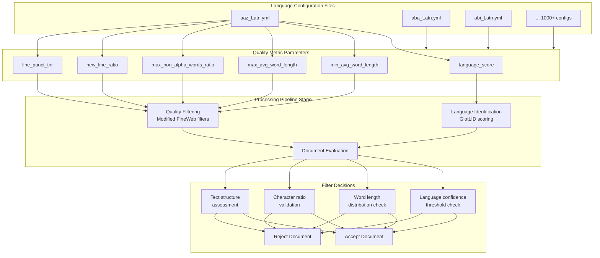
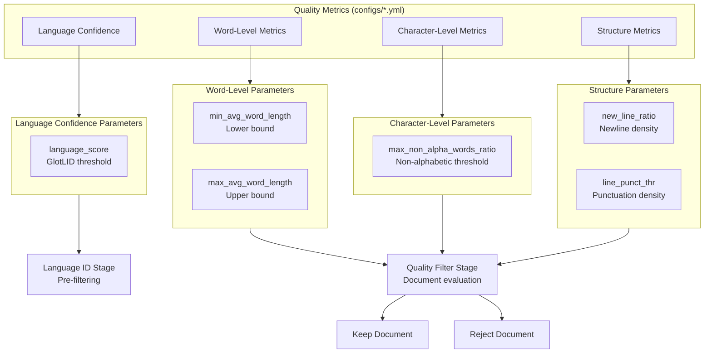
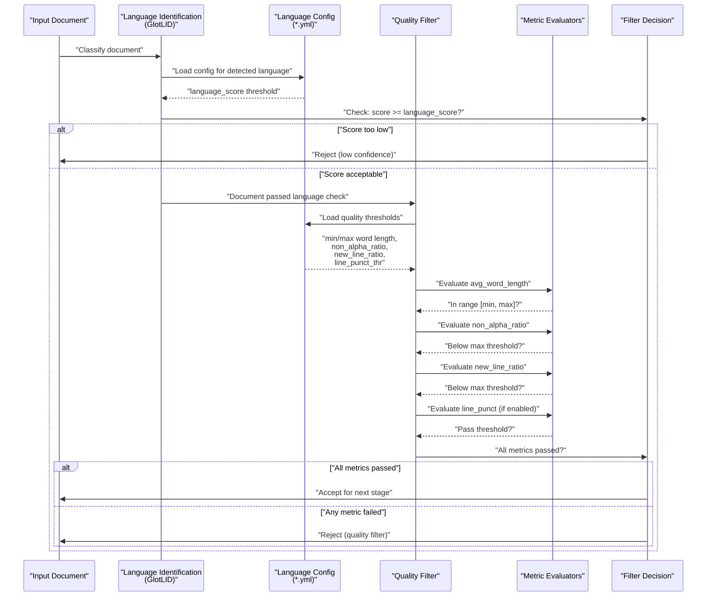
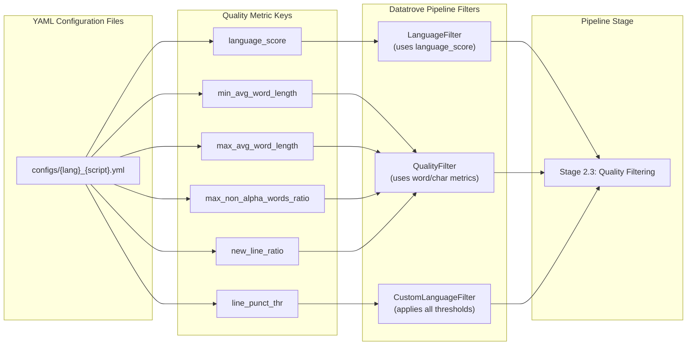

<!-- source: DeepWiki mcp.deepwiki.com · repo huggingface/fineweb-2 · page 3.3 Quality Metrics · fetched 2026-10-26 -->

# Quality Metrics

<details>
<summary>Relevant source files</summary>

The following files were used as context for generating this wiki page:

- [configs/aaz_Latn.yml](configs/aaz_Latn.yml)
- [configs/aba_Latn.yml](configs/aba_Latn.yml)
- [configs/abi_Latn.yml](configs/abi_Latn.yml)

</details>


This page documents the quality metrics parameters defined in language-specific configuration files. These parameters control text quality assessment during the filtering stage of the FineWeb 2 data processing pipeline.

Quality metrics evaluate document-level characteristics such as word length distributions, character ratios, text structure, and language confidence scores. For information about duplication detection parameters, see [Duplication Parameters](#3.2). For language-specific patterns and stopwords, see [Language-Specific Data](#3.4).

## Purpose and Scope

Quality metrics serve as thresholds for filtering out low-quality documents during the processing pipeline. Each of the 1000+ language configurations defines these parameters to account for language-specific text characteristics. For example, some languages naturally have longer average word lengths, while others use different punctuation patterns or line break conventions.

These parameters are consumed by the quality filtering stage (see [Quality Filtering](#2.3)) and applied to documents after language identification and before PII anonymization.

## Quality Metric Parameters

Each language configuration file defines seven quality metric parameters that assess different aspects of document quality:

| Parameter | Type | Purpose | Default/Typical Range |
|-----------|------|---------|----------------------|
| `language_score` | float | Minimum GlotLID confidence score | 0.3 - 0.704 |
| `min_avg_word_length` | int | Minimum average characters per word | 2 - 3 |
| `max_avg_word_length` | int | Maximum average characters per word | 6 - 8 |
| `max_non_alpha_words_ratio` | float | Maximum ratio of non-alphabetic words | 0.765 - 0.788 |
| `new_line_ratio` | float | Maximum ratio of newline characters | 0.045 - 0.1 |
| `line_punct_thr` | int | Line-level punctuation threshold | -1 (disabled) or positive value |

Sources: [configs/aaz_Latn.yml:15-20](), [configs/aba_Latn.yml:15-20](), [configs/abi_Latn.yml:15-20]()

## Parameter Flow Through System



**Diagram: Quality Metrics Configuration Flow** - Shows how parameters from language configs flow through the processing pipeline to make filtering decisions.

Sources: [configs/aaz_Latn.yml](), [configs/aba_Latn.yml](), [configs/abi_Latn.yml]()

## Parameter Descriptions

### language_score

The `language_score` parameter defines the minimum confidence threshold for GlotLID language identification. Documents scoring below this threshold during language identification are filtered out.

**Configuration variations:**
- High-resource languages (e.g., `aaz_Latn`): `0.704` - stricter threshold
- Low-resource languages (e.g., `aba_Latn`, `abi_Latn`): `0.3` - more permissive threshold

This parameter directly influences the precision-recall tradeoff in language identification. Higher thresholds increase precision (fewer false positives) but reduce recall (more false negatives).

Sources: [configs/aaz_Latn.yml:15](), [configs/aba_Latn.yml:15](), [configs/abi_Latn.yml:15]()

### min_avg_word_length and max_avg_word_length

These parameters bound the acceptable average word length for documents. Documents with average word lengths outside this range are filtered out.

**Language-specific examples:**
```yaml
# aaz_Latn.yml - Amarasi language
min_avg_word_length: 3
max_avg_word_length: 6

# aba_Latn.yml - Abé language  
min_avg_word_length: 2
max_avg_word_length: 8

# abi_Latn.yml - Abidji language
min_avg_word_length: 3
max_avg_word_length: 6
```

These bounds account for natural variation in word formation across languages. Languages with agglutinative morphology may have higher maximum word lengths, while isolating languages may have lower bounds.

Sources: [configs/aaz_Latn.yml:17-19](), [configs/aba_Latn.yml:17-19](), [configs/abi_Latn.yml:17-19]()

### max_non_alpha_words_ratio

This parameter defines the maximum acceptable ratio of words containing non-alphabetic characters (numbers, punctuation, symbols) to total words. Documents exceeding this ratio are considered low-quality and filtered out.

**Typical values:**
- `aaz_Latn`: `0.788` (78.8% max)
- `aba_Latn`: `0.765` (76.5% max)
- `abi_Latn`: `0.778` (77.8% max)

High ratios of non-alphabetic content often indicate:
- Machine-generated lists
- Data tables extracted from HTML
- Navigation menus and UI elements
- Poorly cleaned web scraping artifacts

Sources: [configs/aaz_Latn.yml:18](), [configs/aba_Latn.yml:18](), [configs/abi_Latn.yml:18]()

### new_line_ratio

The `new_line_ratio` parameter defines the maximum acceptable ratio of newline characters to total characters. Documents with excessive newlines are typically formatting artifacts or poorly structured content.

**Configuration examples:**
- `aaz_Latn`: `0.045` (4.5% max) - strict
- `aba_Latn`: `0.1` (10% max) - permissive  
- `abi_Latn`: `0.053` (5.3% max) - moderate

Lower thresholds filter out:
- Poetry or verse with excessive line breaks
- Lists with one item per line
- Tables with heavy vertical formatting
- Code snippets embedded in text

Sources: [configs/aaz_Latn.yml:20](), [configs/aba_Latn.yml:20](), [configs/abi_Latn.yml:20]()

### line_punct_thr

The `line_punct_thr` parameter sets a threshold for line-level punctuation density. A value of `-1` disables this filter entirely, which is the most common configuration across languages.

When enabled (positive values), this parameter filters lines that contain punctuation ratios exceeding the threshold, typically targeting:
- Menu items with excessive special characters
- URL fragments with path separators
- Malformed sentences with punctuation errors

**Current usage:**
All three example configurations use `line_punct_thr: -1`, indicating this filter is disabled by default across most languages.

Sources: [configs/aaz_Latn.yml:16](), [configs/aba_Latn.yml:16](), [configs/abi_Latn.yml:16]()

## Quality Metric Parameter Groups



**Diagram: Quality Metrics Parameter Grouping** - Logical organization of quality metric parameters by evaluation level.

Sources: [configs/aaz_Latn.yml:15-20](), [configs/aba_Latn.yml:15-20](), [configs/abi_Latn.yml:15-20]()

## Example Configuration Comparison

The following table compares quality metric configurations across three different languages, illustrating how parameters are tuned for language-specific characteristics:

| Parameter | aaz_Latn (Amarasi) | aba_Latn (Abé) | abi_Latn (Abidji) | Notes |
|-----------|-------------------|----------------|-------------------|-------|
| `language_score` | 0.704 | 0.3 | 0.3 | Amarasi has stricter identification requirements |
| `min_avg_word_length` | 3 | 2 | 3 | Abé allows shorter words on average |
| `max_avg_word_length` | 6 | 8 | 6 | Abé permits longer words (agglutination) |
| `max_non_alpha_words_ratio` | 0.788 | 0.765 | 0.778 | Similar tolerance for non-alphabetic content |
| `new_line_ratio` | 0.045 | 0.1 | 0.053 | Abé is most permissive for line breaks |
| `line_punct_thr` | -1 | -1 | -1 | Disabled across all three languages |

Sources: [configs/aaz_Latn.yml:15-20](), [configs/aba_Latn.yml:15-20](), [configs/abi_Latn.yml:15-20]()

## Integration with Processing Pipeline



**Diagram: Quality Metrics Evaluation Sequence** - Shows the sequential evaluation of quality metrics during document processing.

Sources: [configs/aaz_Latn.yml](), [configs/aba_Latn.yml](), [configs/abi_Latn.yml]()

## Configuration File Structure

Quality metrics are defined in the middle section of each language configuration file, positioned between duplication parameters and language-specific data:

```yaml
# Duplication parameters (see section 3.2)
dup_line_frac: 0.328
dup_n_grams: [...]

# Quality metrics (this section)
language_score: 0.704
line_punct_thr: -1
max_avg_word_length: 6
max_non_alpha_words_ratio: 0.788
min_avg_word_length: 3
new_line_ratio: 0.045

# Language-specific data (see section 3.4)
stopwords: [...]
top_n_grams: [...]
```

The alphabetical ordering of parameters within this section is consistent across all configuration files, facilitating automated parsing and validation.

Sources: [configs/aaz_Latn.yml:1-51]()

## Parameter Tuning Guidelines

Quality metric parameters are typically tuned through an ablation-driven process (see [Evaluation Philosophy](#4.1)):

1. **Start with baseline values** from similar languages or language families
2. **Adjust `language_score`** based on GlotLID performance for the language
3. **Tune word length bounds** by analyzing word length distributions in clean corpora
4. **Set `max_non_alpha_words_ratio`** based on acceptable noise levels in web-scraped text
5. **Configure `new_line_ratio`** to balance filtering of lists vs. preserving formatted text
6. **Evaluate impact** by training models on filtered data and measuring downstream performance

For detailed guidance on creating new language configurations, see [Creating Language Configs](#3.5).

## Code Entity Mapping



**Diagram: Quality Metrics Code Entity Mapping** - Maps configuration parameters to Datatrove filter implementations.

Sources: [configs/aaz_Latn.yml](), [configs/aba_Latn.yml](), [configs/abi_Latn.yml]()

## Related Configuration Sections

Quality metrics work in conjunction with other configuration parameters:

- **[Duplication Parameters](#3.2)**: `dup_line_frac` and `dup_n_grams` control duplicate content detection
- **[Language-Specific Data](#3.4)**: `stopwords`, `language_score`, and `top_n_grams` provide language-specific validation patterns
- **[Configuration Structure](#3.1)**: Overall YAML file format and parsing

Together, these parameter groups form a complete language configuration that guides all processing stages from language identification through final quality filtering.

---

