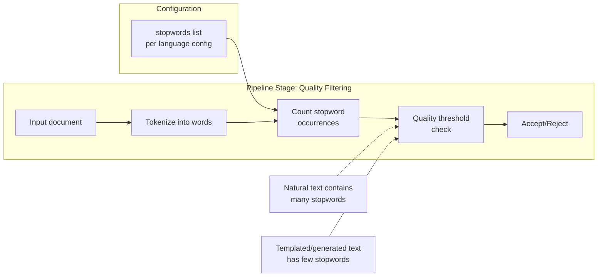
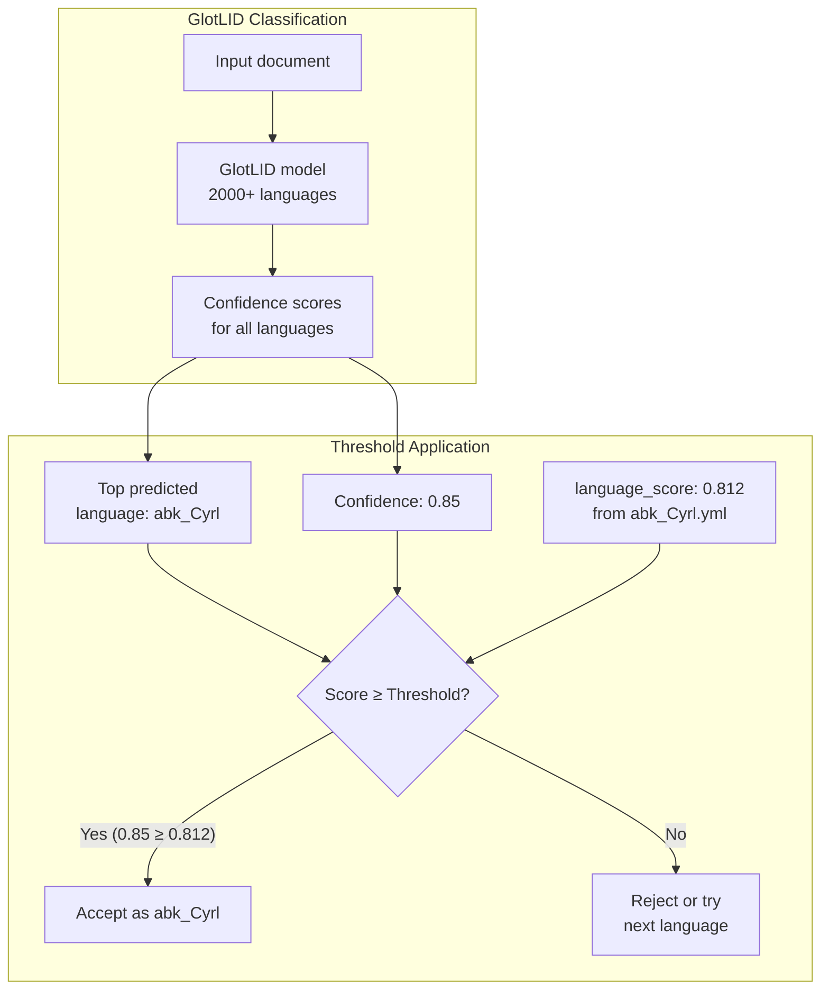
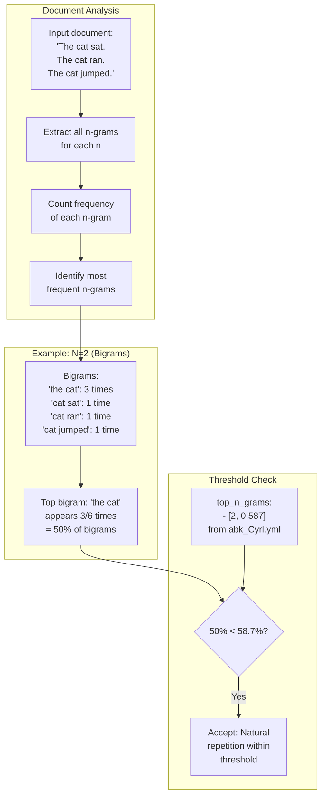
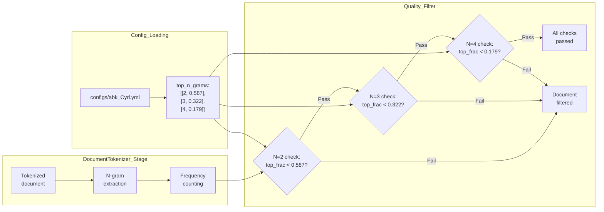
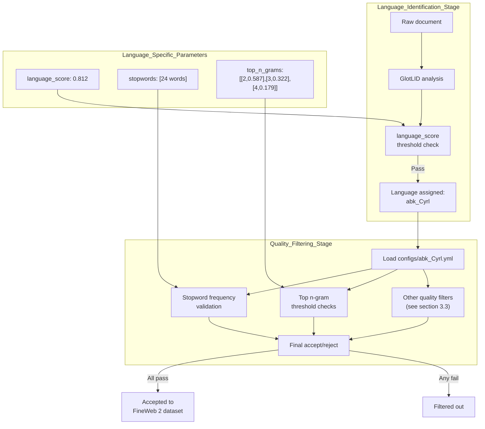
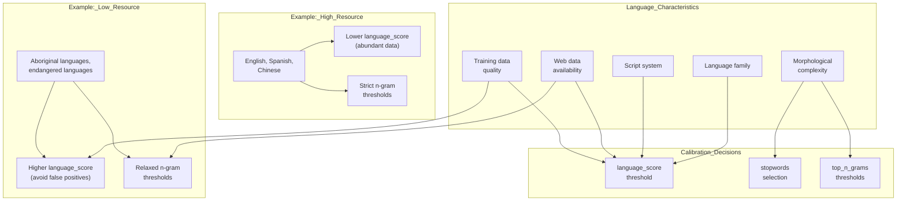

<!-- source: DeepWiki mcp.deepwiki.com · repo huggingface/fineweb-2 · page 3.4 Language-Specific Data · fetched 2026-10-26 -->

# Language-Specific Data

<details>
<summary>Relevant source files</summary>

The following files were used as context for generating this wiki page:

- [configs/abk_Cyrl.yml](configs/abk_Cyrl.yml)
- [configs/abn_Latn.yml](configs/abn_Latn.yml)
- [configs/abq_Cyrl.yml](configs/abq_Cyrl.yml)

</details>


## Purpose and Scope

This document describes the language-specific parameters in FineWeb 2 configuration files: `stopwords`, `language_score`, and `top_n_grams`. These parameters capture linguistic characteristics and statistical patterns unique to each language, enabling accurate language identification and quality assessment across 1000+ languages.

For information about configuration file structure and parameter types, see [Configuration Structure](#3.1). For duplication detection parameters, see [Duplication Parameters](#3.2). For text structure and format parameters, see [Quality Metrics](#3.3).

## Configuration Parameters Overview

Each language configuration file contains three categories of language-specific data:

| Parameter | Type | Purpose | Example Value |
|-----------|------|---------|---------------|
| `stopwords` | List[str] | Common words for language validation | 24 words for `abk_Cyrl` |
| `language_score` | float | Minimum confidence threshold for language ID | 0.812 for `abk_Cyrl` |
| `top_n_grams` | List[[int, float]] | Statistical thresholds for n-gram repetition | [[2, 0.587], [3, 0.322]] |

These parameters work together to ensure documents are correctly identified and meet language-specific quality standards.

**Sources**: [configs/abk_Cyrl.yml:1-46](), [configs/abn_Latn.yml:1-40](), [configs/abq_Cyrl.yml:1-54]()

## Stopwords

### Definition and Purpose

The `stopwords` parameter defines a list of common function words in each language. These words are high-frequency terms that appear naturally in fluent text, such as articles, prepositions, conjunctions, and common verbs. FineWeb 2 uses stopwords for two primary purposes:

1. **Language Validation**: Verifying that identified language matches expected linguistic patterns
2. **Quality Assessment**: Ensuring documents contain natural language rather than auto-generated or templated content

### Structure

```yaml
stopwords:
- "word1"
- "word2"
- "word3"
# ... typically 10-24 words
```

### Language-Specific Examples

#### Abkhaz (abk_Cyrl) - Cyrillic Script
```yaml
stopwords:
- "рыҥсәазаара"  # meaning/function word in Abkhaz
- "иалҵит"
- "иит"
- "лаҵарамза"
# ... 20 total words
```

#### Aboriginal English (abn_Latn) - Latin Script
```yaml
stopwords:
- "phọ"
- "bọ"
- "kụ"
- "ni"
- "mọ"
- "dị"
- "ghan"
# ... 11 total words
```

#### Abaza (abq_Cyrl) - Cyrillic Script
```yaml
stopwords:
- "ауи"
- "сара"
- "йхӏыхвиту"
- "ауат"
# ... 24 total words
```

### Script and Encoding Considerations

Stopwords reflect the writing system used by each language:
- **Cyrillic scripts** (abk_Cyrl, abq_Cyrl): Use Unicode Cyrillic characters
- **Latin scripts** (abn_Latn): Use Latin characters with diacritics
- **Other scripts**: Arabic, Devanagari, Chinese characters, etc. (in other config files)

The stopword lists preserve exact Unicode representations, including:
- Combining diacritics (e.g., `\u0525`, `\u04D3`)
- Language-specific characters (e.g., `ҥ`, `ҵ`, `ӏ`)
- Tone marks and special punctuation

**Sources**: [configs/abk_Cyrl.yml:21-38](), [configs/abn_Latn.yml:21-31](), [configs/abq_Cyrl.yml:21-46]()

### Usage in Pipeline



**Diagram**: Stopword-based quality filtering flow

Stopwords integrate with the quality filtering stage (see [Quality Filtering](#2.3)) to identify natural language text. Documents with abnormally low stopword frequency are flagged as potential low-quality or auto-generated content.

**Sources**: [configs/abk_Cyrl.yml:21-38](), [configs/abn_Latn.yml:21-31](), [configs/abq_Cyrl.yml:21-46]()

## Language Score Threshold

### Definition and Purpose

The `language_score` parameter defines the minimum confidence threshold required for a document to be accepted as belonging to a specific language. This threshold is applied to GlotLID's classification confidence scores during the language identification stage.

### Structure

```yaml
language_score: 0.812  # Range: 0.0 to 1.0
```

### Threshold Values Across Languages

Different languages require different confidence thresholds based on:
- **Linguistic distinctiveness**: Languages with unique scripts or vocabularies can use lower thresholds
- **Script ambiguity**: Languages sharing scripts with many others need higher thresholds
- **Training data quality**: Better-represented languages in GlotLID allow lower thresholds

| Language | Script | language_score | Rationale |
|----------|--------|----------------|-----------|
| abk_Cyrl | Cyrillic | 0.812 | Moderate threshold for distinct Caucasian language |
| abn_Latn | Latin | 0.3 | Low threshold for rare Aboriginal language |
| abq_Cyrl | Cyrillic | 0.876 | High threshold for endangered language with limited training data |

### Confidence Score Distribution



**Diagram**: Language score threshold application in language identification

The threshold acts as a quality gate: only documents with sufficient confidence are assigned to a language. Documents below threshold may be:
- Assigned to a different language with higher confidence
- Marked as multilingual or ambiguous
- Filtered out if no language exceeds its threshold

**Sources**: [configs/abk_Cyrl.yml:15](), [configs/abn_Latn.yml:15](), [configs/abq_Cyrl.yml:15]()

### Threshold Tuning Strategy

Lower thresholds (0.3-0.5):
- **Pros**: Capture more data for rare languages
- **Cons**: Higher false positive rate
- **Use case**: Endangered or poorly-represented languages where data is scarce

Medium thresholds (0.5-0.8):
- **Pros**: Balanced precision/recall
- **Cons**: May miss edge cases
- **Use case**: Well-represented languages with some script ambiguity

High thresholds (0.8-0.95):
- **Pros**: High precision, minimal false positives
- **Cons**: May lose valid edge cases
- **Use case**: Languages with strong script overlap or classifier uncertainty

**Sources**: [configs/abk_Cyrl.yml:15](), [configs/abn_Latn.yml:15](), [configs/abq_Cyrl.yml:15]()

## Top N-Grams

### Definition and Purpose

The `top_n_grams` parameter defines thresholds for detecting repetitive content at different n-gram sizes. Each threshold specifies the maximum allowed fraction of top n-grams in a document. Documents exceeding these thresholds contain too much repetitive content and are filtered as low-quality.

### Structure

```yaml
top_n_grams:
- [2, 0.587]   # n=2 (bigrams), max fraction: 0.587
- [3, 0.322]   # n=3 (trigrams), max fraction: 0.322
- [4, 0.179]   # n=4 (4-grams), max fraction: 0.179
```

Each entry contains:
- **N-gram size** (int): The number of consecutive words in the n-gram
- **Threshold** (float): Maximum allowed fraction of document composed of top n-grams

### How Top N-Grams Detect Low Quality



**Diagram**: Top n-gram analysis for repetitive content detection

Documents with excessive n-gram repetition are typically:
- **Template-generated pages**: Forms, menus, navigation bars
- **Spam or SEO content**: Keyword stuffing, repeated phrases
- **Machine-generated text**: Low-quality translations or chatbot outputs
- **Code or data dumps**: Structured data misclassified as natural language

**Sources**: [configs/abk_Cyrl.yml:39-45](), [configs/abn_Latn.yml:33-39](), [configs/abq_Cyrl.yml:47-53]()

### N-Gram Thresholds Across Languages

Different languages exhibit different natural repetition patterns:

| Language | N=2 | N=3 | N=4 | Pattern |
|----------|-----|-----|-----|---------|
| abk_Cyrl | 0.587 | 0.322 | 0.179 | Typical decrease |
| abn_Latn | 1.262 | 1.118 | 0.869 | High tolerance (rare language) |
| abq_Cyrl | 0.180 | 0.177 | 0.169 | Low tolerance (high precision) |

#### Analysis:

**Abkhaz (abk_Cyrl)**: Standard decreasing pattern. Higher n-grams (more specific phrases) should be less repeated than lower n-grams (common word pairs).

**Aboriginal English (abn_Latn)**: Very high thresholds (>1.0) indicate this rare language may have:
- Limited training data for calibration
- High tolerance to avoid over-filtering scarce content
- Different linguistic structure allowing more repetition

**Abaza (abq_Cyrl)**: Very strict thresholds across all n-gram sizes, indicating:
- Strong emphasis on content diversity
- Likely response to prevalent templated content in this language
- High precision requirements

**Sources**: [configs/abk_Cyrl.yml:39-45](), [configs/abn_Latn.yml:33-39](), [configs/abq_Cyrl.yml:47-53]()

### Implementation Details



**Diagram**: Top n-gram filtering pipeline integration

The top n-gram checks are applied sequentially. A document must pass all configured n-gram thresholds to be accepted. This creates a multi-layered quality filter that catches different types of repetitive content.

**Sources**: [configs/abk_Cyrl.yml:39-45](), [configs/abn_Latn.yml:33-39](), [configs/abq_Cyrl.yml:47-53]()

## Parameter Interaction and Pipeline Integration

### Unified Quality Assessment



**Diagram**: Language-specific parameters across pipeline stages

The three language-specific parameters work in sequence:

1. **language_score** gates entry: Only documents with sufficient confidence proceed to filtering
2. **stopwords** validate linguistic naturalness: Ensures human-written, fluent text
3. **top_n_grams** detect repetition: Filters template-generated and spam content

This staged approach maximizes efficiency: expensive per-document analysis (stopwords, n-grams) is only performed on documents that pass the initial language confidence gate.

**Sources**: [configs/abk_Cyrl.yml:15](), [configs/abk_Cyrl.yml:21-38](), [configs/abk_Cyrl.yml:39-45]()

### Parameter Relationships

| Parameter | Stage | Rejects | Complements |
|-----------|-------|---------|-------------|
| language_score | Language ID | Wrong language, ambiguous documents | Language identification algorithms |
| stopwords | Quality Filtering | Template pages, generated content | max_non_alpha_words_ratio, min_avg_word_length |
| top_n_grams | Quality Filtering | Spam, SEO content, repetitive text | dup_line_frac, dup_n_grams |

**Sources**: [configs/abk_Cyrl.yml:1-46](), [configs/abn_Latn.yml:1-40](), [configs/abq_Cyrl.yml:1-54]()

## Language-Specific Calibration

### Why Different Languages Need Different Thresholds



**Diagram**: Factors influencing language-specific parameter calibration

Each language's parameters reflect its unique characteristics:

**High-resource languages** (well-represented on web, strong GlotLID training):
- Lower `language_score` thresholds (abundant true positives tolerate false positives)
- More stopwords available for validation
- Stricter `top_n_grams` (can afford to filter marginal content)

**Low-resource languages** (rare on web, limited GlotLID training):
- Higher `language_score` thresholds (precision over recall)
- Fewer stopwords (limited linguistic resources)
- Relaxed `top_n_grams` (preserve scarce content)

**Sources**: [configs/abk_Cyrl.yml:15](), [configs/abn_Latn.yml:15](), [configs/abq_Cyrl.yml:15]()

### Parameter Source and Validation

The language-specific parameters in FineWeb 2 configurations are derived through:

1. **Empirical analysis** of web-crawled data for each language
2. **Linguistic consultation** for stopword selection
3. **Ablation studies** (see [Ablation and Evaluation Framework](#4)) to validate thresholds
4. **Statistical profiling** of clean vs. low-quality documents per language

For information on creating and tuning new language configurations, see [Creating Language Configs](#3.5).

**Sources**: [configs/abk_Cyrl.yml:1-46](), [configs/abn_Latn.yml:1-40](), [configs/abq_Cyrl.yml:1-54]()

## Summary

Language-specific parameters enable FineWeb 2 to scale to 1000+ languages while maintaining quality standards appropriate for each language's characteristics. The three parameter types work together:

- **language_score**: Controls language identification precision
- **stopwords**: Validates linguistic naturalness
- **top_n_grams**: Detects repetitive low-quality content

These parameters are calibrated per-language based on linguistic properties, web data availability, and empirical performance, creating a flexible framework that adapts to each language's unique challenges.

**Sources**: [configs/abk_Cyrl.yml:1-46](), [configs/abn_Latn.yml:1-40](), [configs/abq_Cyrl.yml:1-54]()

---

