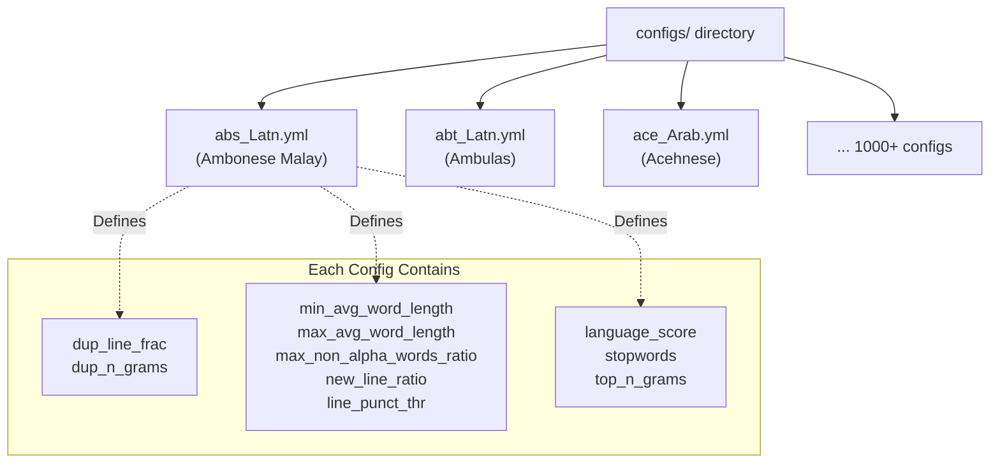
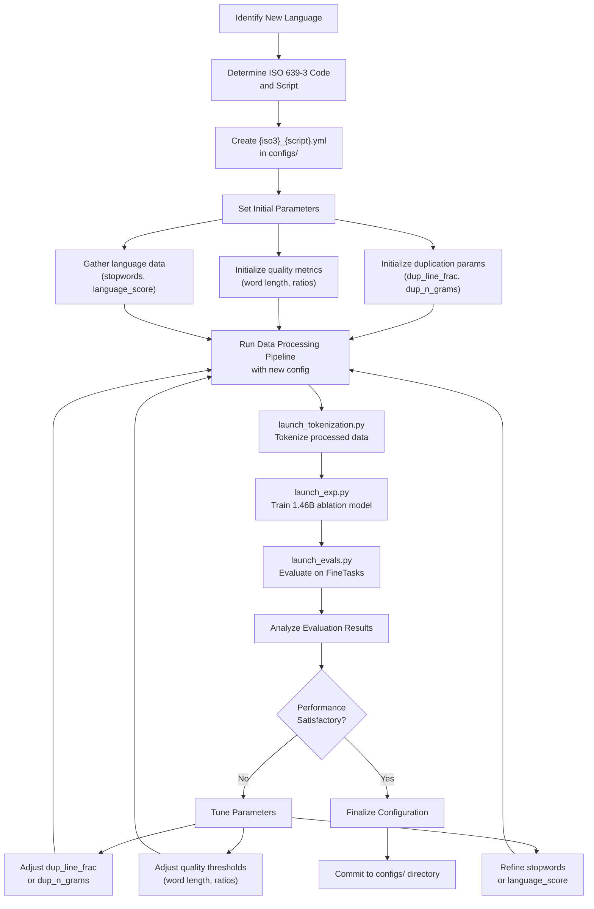

<!-- source: DeepWiki mcp.deepwiki.com · repo huggingface/fineweb-2 · page 3.5 Creating Language Configs · fetched 2026-10-26 -->

# Creating Language Configs

<details>
<summary>Relevant source files</summary>

The following files were used as context for generating this wiki page:

- [README.md](README.md)
- [configs/abs_Latn.yml](configs/abs_Latn.yml)
- [configs/abt_Latn.yml](configs/abt_Latn.yml)

</details>


This page provides a practical guide for creating and tuning new language-specific configurations in FineWeb 2. It covers the naming conventions, parameter selection strategies, and the ablation-driven tuning methodology for optimizing configurations.

For detailed explanations of configuration structure and parameter types, see [Configuration Structure](#3.1). For parameter-specific documentation, see [Duplication Parameters](#3.2), [Quality Metrics](#3.3), and [Language-Specific Data](#3.4). For information about the empirical validation process, see [Ablation and Evaluation Framework](#4).

## Config File Location and Naming

Language configurations are stored in the `configs/` directory with a standardized naming convention:

**Format**: `{iso3_code}_{script}.yml`

Where:
- `iso3_code` is the ISO 639-3 three-letter language code
- `script` is the script identifier (e.g., `Latn`, `Arab`, `Cyrl`)

**Examples**:
| File Name | Language | Script |
|-----------|----------|--------|
| `abs_Latn.yml` | Ambonese Malay | Latin |
| `abt_Latn.yml` | Ambulas | Latin |
| `ace_Arab.yml` | Acehnese | Arabic |
| `rus_Cyrl.yml` | Russian | Cyrillic |



**Diagram: Config File Organization**

Sources: [README.md:11](), [configs/abs_Latn.yml](), [configs/abt_Latn.yml]()

## Configuration Structure Overview

Each configuration file defines three categories of parameters:

| Parameter Category | Purpose | Documented In |
|-------------------|---------|---------------|
| **Duplication Parameters** | Control duplicate content detection thresholds | [Duplication Parameters](#3.2) |
| **Quality Metrics** | Define text quality filtering rules | [Quality Metrics](#3.3) |
| **Language-Specific Data** | Provide stopwords and language identification settings | [Language-Specific Data](#3.4) |

A complete configuration file contains all parameters from these categories. For example, [configs/abs_Latn.yml:1-54]() demonstrates a fully-specified configuration.

Sources: [configs/abs_Latn.yml:1-54](), [configs/abt_Latn.yml:1-48]()

## Configuration Creation Workflow

The process of creating a new language configuration follows an iterative, ablation-driven methodology:



**Diagram: Config Creation and Tuning Workflow**

This workflow leverages the ablation framework documented in [Ablation and Evaluation Framework](#4) to empirically validate each configuration decision.

Sources: [README.md:9-18](), [README.md:65-78]()

## Initial Parameter Selection Strategies

When creating a new configuration, initial parameters can be derived from several sources:

### 1. Language Family Similarity

Select an existing configuration from a linguistically similar language as a starting template:

**Example**: For a new Romance language, use parameters from `spa_Latn.yml`, `fra_Latn.yml`, or `ita_Latn.yml` as a baseline.

### 2. Script-Based Defaults

Languages using the same script often share similar characteristics for certain parameters:

| Parameter | Latin Script Default | Arabic Script Default | Cyrillic Script Default |
|-----------|---------------------|----------------------|------------------------|
| `max_avg_word_length` | 9 | 12 | 10 |
| `min_avg_word_length` | 3 | 3 | 3 |
| `max_non_alpha_words_ratio` | 0.8 | 0.85 | 0.8 |

### 3. Conservative Initial Values

When no similar language exists, start with conservative values that accept more data:

```yaml
# Conservative initial configuration
dup_line_frac: 0.5          # Mid-range duplication tolerance
dup_n_grams:
  - [5, 0.4]
  - [6, 0.38]
  - [7, 0.36]
  - [8, 0.34]
  - [9, 0.32]
  - [10, 0.3]
language_score: 0.5         # Mid-range language confidence
min_avg_word_length: 3
max_avg_word_length: 12
max_non_alpha_words_ratio: 0.85
new_line_ratio: 0.1
line_punct_thr: -1
stopwords: []               # Initially empty, add iteratively
top_n_grams:
  - [2, 0.2]
  - [3, 0.18]
  - [4, 0.16]
```

Sources: [configs/abs_Latn.yml](), [configs/abt_Latn.yml]()

## Stopwords Collection

Stopwords are critical for quality filtering. The configuration requires at least 24 stopwords per language:

### Collection Methods

**1. From Linguistic Resources**: Use existing stopword lists from NLP libraries or linguistic databases for well-resourced languages.

**2. From Native Speakers**: Consult with native speakers to identify the most common functional words (articles, prepositions, pronouns, conjunctions).

**3. From Corpus Analysis**: Analyze word frequency in sample documents from the language to identify the most common words.

### Stopwords Example

[configs/abs_Latn.yml:21-46]() demonstrates a complete stopwords list:

```yaml
stopwords:
- seng
- beta
- deng
- yang
- ada
- dapa
- pung
- di
- par
- akang
- lai
- su
- tu
- kamar
- mar
- kalo
- la
- ni
- sa
- se
- kaya
- bisa
- dar
- ka
- jadi
```

Sources: [configs/abs_Latn.yml:21-46](), [configs/abt_Latn.yml:21-40](), [README.md:10-11]()

## Parameter Tuning Through Ablations

Each parameter adjustment requires validation through the ablation framework:

```mermaid
graph TB
    subgraph "Config Parameter"
        ParamValue["Current Parameter Value<br/>(e.g., dup_line_frac: 0.5)"]
        ProposedValue["Proposed Parameter Value<br/>(e.g., dup_line_frac: 0.7)"]
    end
    
    subgraph "Data Processing"
        Pipeline["Run Processing Pipeline<br/>with modified config"]
        ProcessedData["Processed Dataset<br/>(with new parameter)"]
    end
    
    subgraph "Tokenization"
        LaunchTok["launch_tokenization.py"]
        TokenizedData["Tokenized Dataset"]
    end
    
    subgraph "Training"
        LaunchExp["launch_exp.py"]
        ModelCheckpoint["Model Checkpoint<br/>(1.46B parameters)"]
    end
    
    subgraph "Evaluation"
        LaunchEvals["launch_evals.py"]
        FineTasks["FineTasks Suite"]
        EvalResults["Evaluation Results"]
    end
    
    subgraph "Decision"
        Compare["Compare to Baseline"]
        Decision{"Improved<br/>Performance?"}
        Accept["Accept Parameter Change"]
        Reject["Revert to Previous Value"]
    end
    
    ParamValue --> ProposedValue
    ProposedValue --> Pipeline
    Pipeline --> ProcessedData
    ProcessedData --> LaunchTok
    LaunchTok --> TokenizedData
    TokenizedData --> LaunchExp
    LaunchExp --> ModelCheckpoint
    ModelCheckpoint --> LaunchEvals
    LaunchEvals --> FineTasks
    FineTasks --> EvalResults
    EvalResults --> Compare
    Compare --> Decision
    Decision -->|Yes| Accept
    Decision -->|No| Reject
```

**Diagram: Parameter Tuning via Ablation Framework**

### Tuning Specific Parameter Categories

**Duplication Parameters** ([dup_line_frac](#3.2), [dup_n_grams](#3.2)):
- **Increase** values if excessive deduplication is removing valuable content
- **Decrease** values if duplicate content is degrading quality
- Monitor `minhash_cluster_size` in dataset metadata to assess deduplication impact

**Quality Metrics** ([word length ratios](#3.3), [character ratios](#3.3)):
- **Tighten** thresholds (lower max, higher min) if low-quality content remains
- **Loosen** thresholds (higher max, lower min) if valuable content is being filtered

**Language Score** ([language_score](#3.4)):
- **Increase** if documents contain mixed languages or low-confidence language identification
- **Decrease** if over-filtering reduces dataset size without quality improvement

Sources: [README.md:65-78]()

## Integration with Pipeline Components

Configurations interact with multiple pipeline stages through specific code paths:

```mermaid
graph TB
    ConfigFile["configs/{iso3}_{script}.yml"]
    
    subgraph "Language Identification Stage"
        GlotLID["GlotLID Classifier"]
        LangScoreFilter["Language Score Filter"]
        LangScore["language_score parameter"]
    end
    
    subgraph "Deduplication Stage"
        MinHashCluster["MinHash Clustering"]
        DupDetection["Duplicate Detection"]
        DupLineFrac["dup_line_frac parameter"]
        DupNGrams["dup_n_grams parameter"]
    end
    
    subgraph "Filtering Stage"
        WordLengthFilter["Word Length Filter"]
        CharRatioFilter["Character Ratio Filter"]
        StopwordsFilter["Stopwords Filter"]
        NGramFilter["N-gram Filter"]
        
        MinWordLen["min_avg_word_length"]
        MaxWordLen["max_avg_word_length"]
        MaxNonAlpha["max_non_alpha_words_ratio"]
        NewLineRatio["new_line_ratio"]
        StopwordsList["stopwords list"]
        TopNGrams["top_n_grams parameter"]
    end
    
    ConfigFile --> LangScore
    LangScore --> LangScoreFilter
    GlotLID --> LangScoreFilter
    
    ConfigFile --> DupLineFrac
    ConfigFile --> DupNGrams
    DupLineFrac --> DupDetection
    DupNGrams --> DupDetection
    MinHashCluster --> DupDetection
    
    ConfigFile --> MinWordLen
    ConfigFile --> MaxWordLen
    ConfigFile --> MaxNonAlpha
    ConfigFile --> NewLineRatio
    ConfigFile --> StopwordsList
    ConfigFile --> TopNGrams
    
    MinWordLen --> WordLengthFilter
    MaxWordLen --> WordLengthFilter
    MaxNonAlpha --> CharRatioFilter
    NewLineRatio --> CharRatioFilter
    StopwordsList --> StopwordsFilter
    TopNGrams --> NGramFilter
```



**Diagram: Config Parameters to Pipeline Components**

Sources: [README.md:9-64]()

## Validation Checklist

Before finalizing a new configuration, verify:

| Requirement | Validation Method |
|-------------|-------------------|
| **File Naming** | Follows `{iso3}_{script}.yml` convention |
| **ISO Code** | Valid ISO 639-3 three-letter code |
| **Script Identifier** | Valid script code (Latn, Arab, Cyrl, etc.) |
| **All Parameters Present** | Config includes all required fields from [Configuration Structure](#3.1) |
| **Stopwords Count** | At least 24 stopwords provided |
| **Duplication Thresholds** | `dup_n_grams` includes entries for n=5 through n=10 |
| **Ablation Validation** | Config tested through full ablation pipeline |
| **Performance Baseline** | Evaluation results compared to similar language configs |
| **Pipeline Compatibility** | Config successfully processes sample data |

## Best Practices

### 1. Incremental Tuning

Adjust one parameter at a time to isolate the impact of each change on model performance.

### 2. Document Rationale

Maintain notes on why specific parameter values were chosen, especially when they deviate significantly from similar languages.

### 3. Resource Awareness

High-resource languages (e.g., Spanish, Russian) may benefit from stricter filtering thresholds due to abundant data. Low-resource languages require more permissive thresholds to preserve limited data.

### 4. Script-Specific Considerations

- **Latin scripts**: Often require lower `max_avg_word_length` (8-10)
- **Arabic scripts**: May need higher `max_avg_word_length` (12-15) due to character joining
- **Ideographic scripts**: May require specialized tokenization approaches documented in [Language-Family Tokenizers](#6.2)

### 5. Iterative Refinement

Expect multiple ablation iterations. Initial configurations rarely achieve optimal performance on the first attempt.

Sources: [README.md:9-18](), [README.md:54-64]()

## Example: Creating a New Config

**Scenario**: Adding support for a hypothetical language "xyz" using Latin script.

### Step 1: Create File
Create `configs/xyz_Latn.yml` in the repository.

### Step 2: Initialize Parameters
Copy parameters from a similar Latin-script language as a starting point.

### Step 3: Customize Language-Specific Data
```yaml
language_score: 0.6       # Start with moderate confidence threshold
stopwords:
  - the                    # Collect 24+ most common words
  - and
  - is
  - in
  # ... 20+ more stopwords
```

### Step 4: Run Ablation
```bash
# Process data with new config
# (Data processing pipeline invocation)

# Tokenize
python ablations/tokenization/launch_tokenization.py --language xyz_Latn

# Train model
python ablations/training/launch_exp.py --language xyz_Latn

# Evaluate
python ablations/evaluation/launch_evals.py --language xyz_Latn
```

### Step 5: Analyze and Iterate
Review FineTasks evaluation results. If performance is below baseline, adjust parameters and re-run ablation.

### Step 6: Finalize
Once performance is satisfactory, commit `xyz_Latn.yml` to the repository.

Sources: [README.md:65-78]()

---

