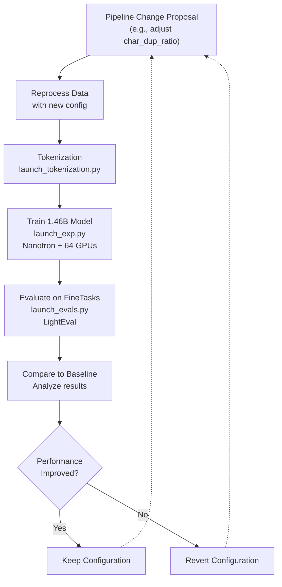
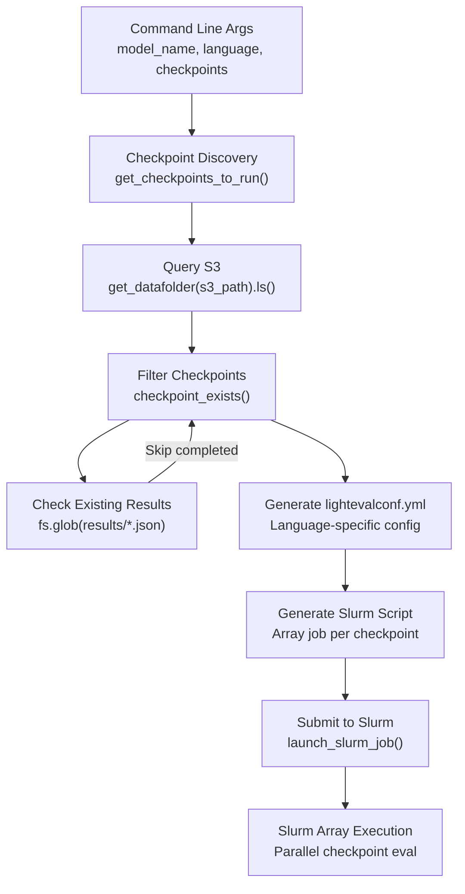
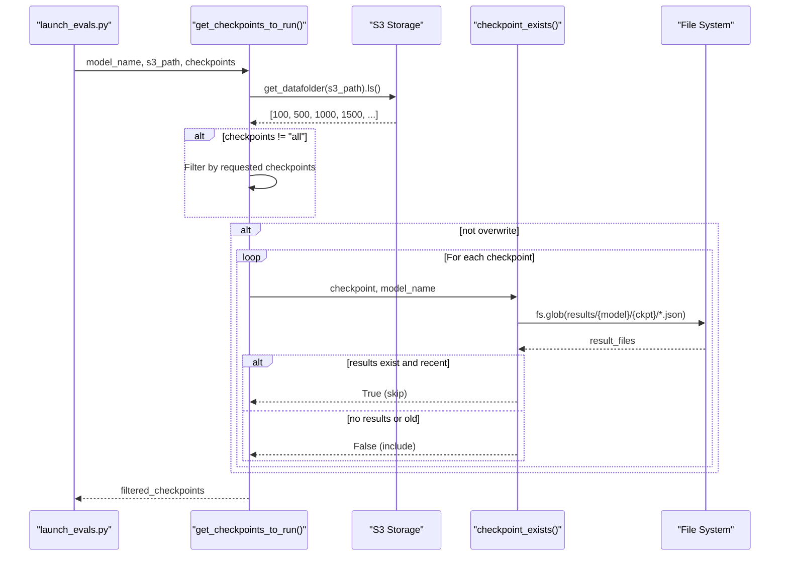
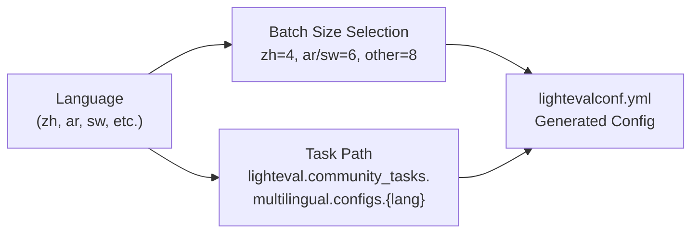
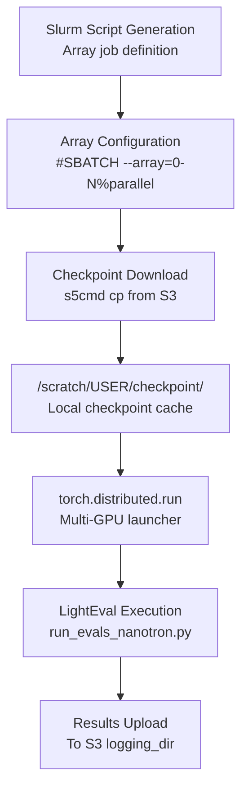
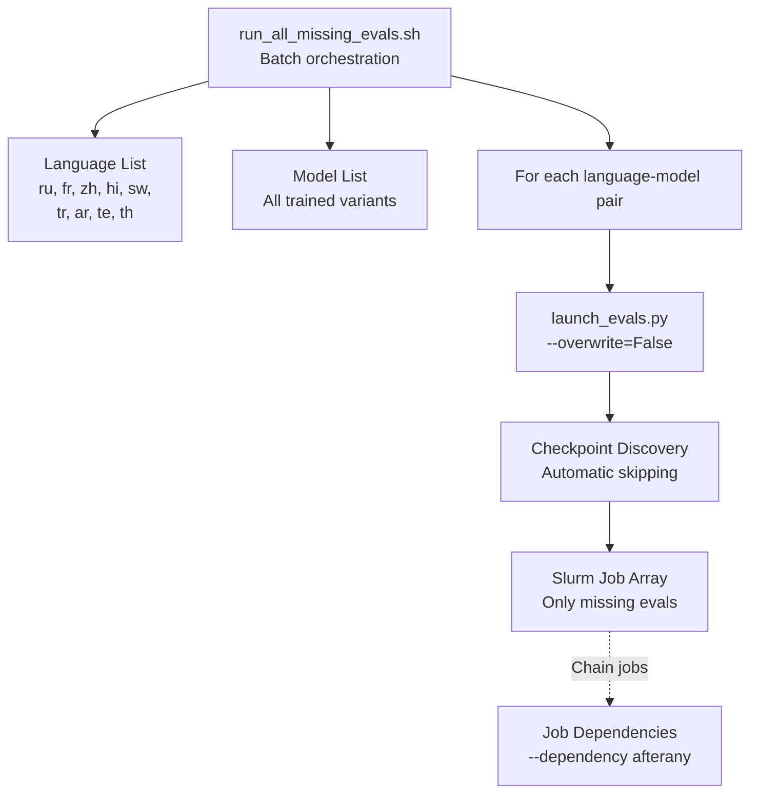
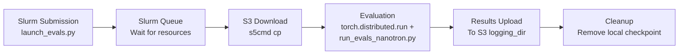

<!-- source: DeepWiki mcp.deepwiki.com · repo huggingface/fineweb-2 · page 4 Ablation and Evaluation Framework · fetched 2026-10-26 -->

# Ablation and Evaluation Framework

<details>
<summary>Relevant source files</summary>

The following files were used as context for generating this wiki page:

- [README.md](README.md)
- [ablations/evaluation/launch_evals.py](ablations/evaluation/launch_evals.py)

</details>


The Ablation and Evaluation Framework validates every design decision in the FineWeb 2 data processing pipeline through empirical testing. Each proposed change to the pipeline (e.g., adjusting `char_dup_ratio` from 0.01 to 0.1) triggers a complete cycle: data reprocessing, tokenization, model training, and evaluation on the FineTasks suite. This data-driven approach ensures that configuration choices improve downstream model performance rather than relying on heuristics.

For information about the model training system used in ablations, see [Training System](#5). For tokenization of processed data, see [Tokenization System](#6). For the evaluation benchmarks themselves (FineTasks), see the [HuggingFace FineTasks space](https://huggingface.co/spaces/HuggingFaceFW/blogpost-fine-tasks).

**Sources:** [README.md:65-78](), [ablations/evaluation/launch_evals.py:1-287]()

---

## Evaluation Philosophy

The evaluation framework implements an ablation-driven methodology where every pipeline modification undergoes rigorous validation. Rather than accepting conventional wisdom about data filtering techniques, FineWeb 2 tests each decision empirically:

1. **Ablation Scope**: Every filter threshold, stopword list, and deduplication parameter in the 1000+ language configs
2. **Model Scale**: 1.46B parameter models provide meaningful performance signals while keeping iteration costs manageable
3. **Evaluation Suite**: FineTasks, a multilingual benchmark covering 9 languages (Russian, French, Chinese, Hindi, Swahili, Turkish, Arabic, Telugu, Thai)
4. **Checkpoint Strategy**: Models evaluated at regular intervals (steps 500, 1000, 1500, etc.) to observe training dynamics

This tight feedback loop enables evidence-based decisions. For example, the decision to change `char_dup_ratio` from 0.01 to 0.1 or remove `short_line_thr` was validated through this framework.

### Ablation Workflow



**Sources:** [README.md:65-78]()

---

## Checkpoint Evaluation

The `launch_evals.py` script orchestrates evaluation of trained model checkpoints on the FineTasks benchmark. It discovers checkpoints from S3, checks for existing results to avoid redundant computation, generates language-specific LightEval configurations, and submits Slurm array jobs for parallel evaluation.

### Core Evaluation Pipeline



### Key Functions and Classes

| Function | Purpose | File Location |
|----------|---------|---------------|
| `get_checkpoints_to_run()` | Discovers available checkpoints from S3 and filters out completed evaluations | [ablations/evaluation/launch_evals.py:69-94]() |
| `checkpoint_exists()` | Checks if evaluation results already exist for a checkpoint, with optional date filtering | [ablations/evaluation/launch_evals.py:31-46]() |
| `launch_slurm_job()` | Submits Slurm batch script and returns job ID | [ablations/evaluation/launch_evals.py:49-66]() |
| `parse_date()` | Parses date strings for `--after-date` filtering | [ablations/evaluation/launch_evals.py:22-28]() |

**Sources:** [ablations/evaluation/launch_evals.py:1-287]()

### Checkpoint Discovery Process

The checkpoint discovery process ensures efficient resource usage by skipping already-evaluated checkpoints:



The `get_checkpoints_to_run()` function implements intelligent checkpoint filtering:

1. **Discovery**: Uses `get_datafolder()` from datatrove to list S3 checkpoint directories [ablations/evaluation/launch_evals.py:72-77]()
2. **Selection**: Filters by requested checkpoints (comma-separated list or "all") [ablations/evaluation/launch_evals.py:79-82]()
3. **Existence Check**: Calls `checkpoint_exists()` to check for existing results [ablations/evaluation/launch_evals.py:86-89]()
4. **Date Filtering**: Optionally filters by result timestamp using `parse_date()` [ablations/evaluation/launch_evals.py:31-46]()

**Sources:** [ablations/evaluation/launch_evals.py:69-94](), [ablations/evaluation/launch_evals.py:31-46]()

### Language-Specific Configuration

The evaluation system generates `lightevalconf.yml` files dynamically, customizing batch sizes and task definitions per language:



The batch size logic optimizes for language-specific characteristics [ablations/evaluation/launch_evals.py:163]():

| Language | Batch Size | Reason |
|----------|------------|--------|
| Chinese (zh) | 4 | Likely due to tokenization density or task complexity |
| Arabic (ar), Swahili (sw) | 6 | Medium resource requirements |
| Others (ru, fr, hi, tr, te, th) | 8 | Standard batch size |

Configuration structure [ablations/evaluation/launch_evals.py:162-187]():

```yaml
batch_size: <language-specific>
checkpoints_path: null
generation: null
logging:
  logging_dir: s3://path/to/evals/results
  save_details: true
  save_results: true
parallelism:
  dp: <num_gpus>
  pp: 1
  tp: 1
tasks:
  custom_tasks: lighteval.community_tasks.multilingual.configs.<language>
  dataset_loading_processes: <cpus>
  max_samples: 1000
  tasks: <task_list>
```

**Sources:** [ablations/evaluation/launch_evals.py:162-187]()

### Slurm Array Job Execution

The evaluation system leverages Slurm array jobs to parallelize checkpoint evaluation, with each array task processing one checkpoint:



Key Slurm configuration parameters [ablations/evaluation/launch_evals.py:195-208]():

| Parameter | Value | Purpose |
|-----------|-------|---------|
| `--array=0-N%parallel` | `%5` (default) | Run up to 5 evaluations simultaneously |
| `--gres=gpu:X` | 8 (default) | GPUs per evaluation |
| `--time` | 1:50:00 (default) | Maximum evaluation time |
| `--cpus-per-task` | 88 (CPUS_PER_NODE) | CPU allocation |
| `--requeue` | Enabled | Auto-restart on node failure |

The array job script performs these operations [ablations/evaluation/launch_evals.py:244-268]():

1. **Checkpoint Selection**: Uses `SLURM_ARRAY_TASK_ID` to index into checkpoint list [ablations/evaluation/launch_evals.py:245-246]()
2. **S3 Download**: Downloads checkpoint with `s5cmd cp --exclude "optimizer/*"` [ablations/evaluation/launch_evals.py:255]()
3. **Local Caching**: Stores in `/scratch/USER/checkpoint/{model_name}/$STEP` [ablations/evaluation/launch_evals.py:252-255]()
4. **Distributed Launch**: Uses `torch.distributed.run` with multi-node support [ablations/evaluation/launch_evals.py:257-262]()
5. **Evaluation Execution**: Runs `run_evals_nanotron.py` from the brrr framework [ablations/evaluation/launch_evals.py:264-265]()

**Sources:** [ablations/evaluation/launch_evals.py:195-268]()

### Command-Line Interface

The `launch_evals.py` script accepts comprehensive command-line arguments for customization:

| Argument | Default | Description |
|----------|---------|-------------|
| `model_name` | (required) | Model name on S3, comma-separated for multiple models |
| `language` | (required) | Language code (e.g., "zh", "ru") |
| `--s3_prefix` | s3://path/to/models/ | Base S3 path for models |
| `--checkpoints` | "all" | Comma-separated checkpoint list or "all" |
| `--model-template` | {model_name} | Template for model name formatting |
| `--tasks` | "early-signals" | Comma-separated task list |
| `--parallel` | 5 | Concurrent evaluation tasks |
| `--gpus` | 8 | GPUs per evaluation |
| `--logging_dir` | s3://path/to/evals/results | S3 path for results |
| `--overwrite` | False | Force re-evaluation |
| `--after-date` | None | Filter checkpoints by date (DD-MM-YYYY HH:MM:SS) |

Example usage:
```bash
python launch_evals.py \
  "1p46G-control-english-fw" \
  zh \
  --checkpoints 500,1000,1500 \
  --tasks early-signals \
  --parallel 3 \
  --gpus 8
```

**Sources:** [ablations/evaluation/launch_evals.py:97-141]()

---

## Random Baseline Evaluation

The `launch_random_evals.py` script establishes baseline performance by evaluating a dummy model that produces random outputs. This provides a lower bound for comparison and helps identify tasks where models perform worse than random guessing.

The script follows the same infrastructure as `launch_evals.py` but substitutes trained checkpoints with a random output generator. This ensures that baseline and model evaluations use identical evaluation protocols, task definitions, and computational resources.

**Sources:** [README.md:70]()

---

## Batch Evaluation Orchestration

The `run_all_missing_evals.sh` script orchestrates large-scale evaluation campaigns by iterating over all language-model combinations and submitting evaluation jobs only for incomplete checkpoints. This automation is critical for managing the evaluation workload across 1000+ language configurations.

### Orchestration Strategy



Key features:
- **Automatic Skip Logic**: Leverages `checkpoint_exists()` to avoid redundant work
- **Job Chaining**: Uses Slurm dependencies to sequence evaluations and manage cluster load
- **Language Coverage**: Ensures all 9 supported languages receive evaluation
- **Fault Tolerance**: Slurm's `--requeue` allows automatic recovery from node failures

**Sources:** [README.md:71]()

---

## Evaluation Configuration

### LightEval Integration

The framework integrates with LightEval-Fork (branch: `new-multi-lang-branch`) to support multilingual evaluation tasks. The configuration system maps languages to custom task definitions in the `lighteval.community_tasks.multilingual.configs` module.

### Configuration File Structure

The dynamically generated `lightevalconf.yml` follows this structure [ablations/evaluation/launch_evals.py:162-187]():

```yaml
# Performance tuning
batch_size: 8  # Language-specific (4/6/8)
checkpoints_path: null  # Provided via CLI

# Results persistence
logging:
  logging_dir: s3://path/to/evals/results
  save_details: true
  save_results: true
  save_to_tensorboard: false

# Distributed execution
parallelism:
  dp: 8  # Data parallelism = num_gpus
  expert_parallel_size: 1
  pp: 1  # No pipeline parallelism
  tp: 1  # No tensor parallelism
  tp_mode: ALL_REDUCE

# Task configuration
tasks:
  custom_tasks: lighteval.community_tasks.multilingual.configs.zh
  dataset_loading_processes: 11  # cpus_per_node / gpus
  max_samples: 1000  # Evaluation sample limit
  tasks: early-signals  # Task suite selection
```

### Configuration Parameters

| Section | Parameter | Purpose |
|---------|-----------|---------|
| **Performance** | `batch_size` | Optimized per language for memory efficiency |
| **Logging** | `logging_dir` | S3 path for result storage |
| **Logging** | `save_details` | Store detailed per-sample results |
| **Parallelism** | `dp` | Data parallelism degree (= num_gpus) |
| **Parallelism** | `pp` | Pipeline parallelism (always 1) |
| **Parallelism** | `tp` | Tensor parallelism (always 1) |
| **Tasks** | `custom_tasks` | Language-specific task module path |
| **Tasks** | `dataset_loading_processes` | Parallel data loading workers |
| **Tasks** | `max_samples` | Limit samples per task |

The parallelism configuration (`dp=N, pp=1, tp=1`) indicates pure data parallelism where each GPU holds a full model copy and processes different data batches. This simplifies evaluation orchestration compared to complex model parallelism strategies.

**Sources:** [ablations/evaluation/launch_evals.py:162-187]()

---

## Execution Environment

### Infrastructure Requirements

The evaluation framework requires:
- **Slurm Cluster**: Job scheduling and resource management
- **S3 Storage**: Checkpoint storage and result persistence
- **GPU Nodes**: 8 GPUs per node (default configuration)
- **Local Scratch**: High-performance temporary storage at `/scratch/USER/`
- **Network**: High-bandwidth S3 connectivity for checkpoint downloads

### Environment Variables

Required environment configuration [ablations/evaluation/launch_evals.py:217-221]():

```bash
HUGGINGFACE_HUB_CACHE=/path/to/.cache/huggingface
HF_DATASETS_CACHE=/path/to/.cache/huggingface
HF_MODULES_CACHE=/path/to/.cache/huggingface
HF_HOME=/path/to/.cache/huggingface
HF_DATASETS_OFFLINE=1  # Optional: disable dataset downloads
```

### Execution Flow



The two-tier storage strategy (S3 for persistence, local scratch for performance) minimizes evaluation latency while ensuring result durability.

**Sources:** [ablations/evaluation/launch_evals.py:210-268]()

---

