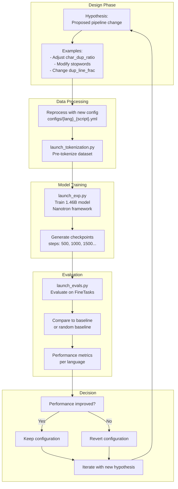
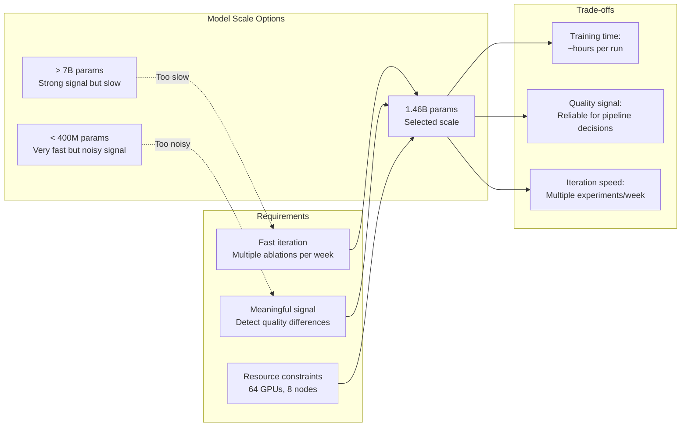
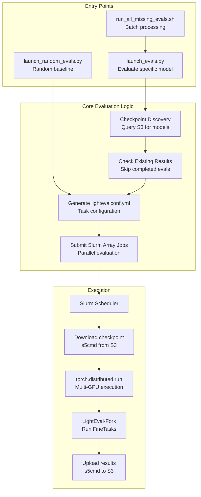
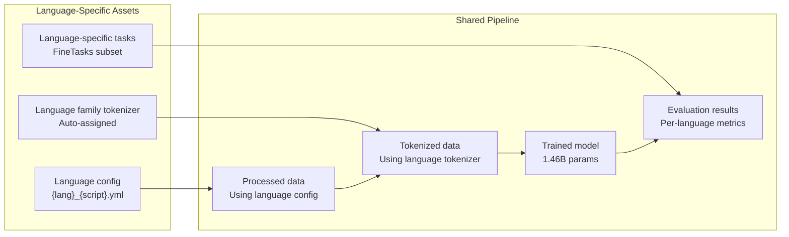
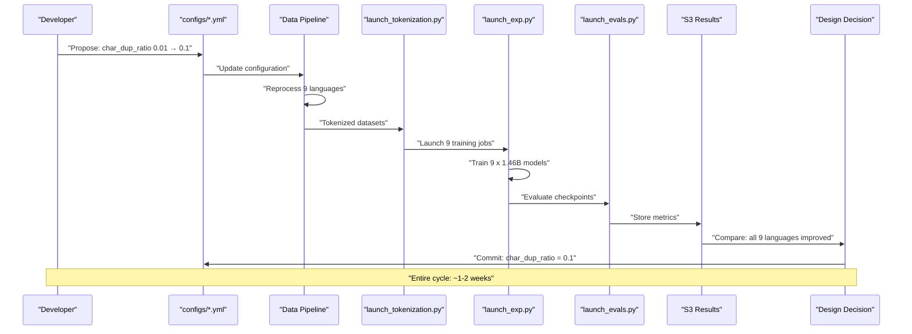

<!-- source: DeepWiki mcp.deepwiki.com · repo huggingface/fineweb-2 · page 4.1 Evaluation Philosophy · fetched 2026-10-26 -->

# Evaluation Philosophy

Relevant source files

The following files were used as context for generating this wiki page:

- [README.md](README.md)

This page documents the empirical validation methodology underlying FineWeb 2's data processing pipeline. It explains the ablation-driven development approach, the FineTasks evaluation suite, and the rationale for model scale selection in pipeline optimization.

For detailed implementation of evaluation scripts, see [Checkpoint Evaluation](#4.2), [Random Baseline Evaluation](#4.3), and [Batch Evaluation Orchestration](#4.4). For evaluation configuration details, see [Evaluation Configuration](#4.5).

## Purpose and Scope

FineWeb 2 adopts a **data-driven approach to pipeline design**: every decision about data filtering, deduplication thresholds, and processing parameters is validated through rigorous ablation testing. Rather than relying on intuition or heuristics from English-only datasets, the project trains small language models on processed data variants and measures downstream task performance to determine optimal configurations.

This methodology ensures that pipeline choices are empirically justified across the 1000+ languages supported by FineWeb 2, accounting for the unique characteristics of each language family and script system.

**Sources:** [README.md:65-71]()

## Ablation-Driven Development Methodology

The core principle of FineWeb 2's evaluation philosophy is that **all pipeline design decisions must be validated through ablation studies**. This means that for each proposed change to the processing pipeline—whether adjusting `char_dup_ratio`, modifying stopword lists, or tuning deduplication thresholds—the team:

1. **Processes data** with the proposed configuration change
2. **Tokenizes** the processed data for model training
3. **Trains** a 1.46B parameter language model using the processed data
4. **Evaluates** the trained model on language-specific tasks from FineTasks
5. **Compares** performance against the baseline configuration

This iterative cycle ensures that every configuration parameter in the `configs/*.yml` files has been empirically validated. The methodology prevents the propagation of design choices that work well for high-resource languages (like English) but degrade performance for low-resource or morphologically complex languages.

### Decision Workflow

This workflow diagram shows how pipeline changes flow through the validation process, with concrete references to the scripts used at each stage.

**Sources:** [README.md:65-71](), Diagram 3 from system architecture

## FineTasks Evaluation Suite

FineWeb 2 uses **FineTasks**, a custom multilingual evaluation suite developed specifically for this project. FineTasks provides language-specific benchmark tasks across 9 primary evaluation languages:

| Language | ISO Code | Script | Task Types |
|----------|----------|--------|------------|
| Russian | ru | Cyrillic | early-signals, m3exam |
| French | fr | Latin | early-signals, m3exam |
| Chinese | zh | Han | early-signals, m3exam |
| Hindi | hi | Devanagari | early-signals, m3exam |
| Swahili | sw | Latin | early-signals, m3exam |
| Turkish | tr | Latin | early-signals, m3exam |
| Arabic | ar | Arabic | early-signals, m3exam |
| Telugu | te | Telugu | early-signals, m3exam |
| Thai | th | Thai | early-signals, m3exam |

### Task Categories

FineTasks includes multiple task categories designed to measure model quality at different stages of training:

- **early-signals**: Tasks optimized for detecting quality differences in early training stages (useful for faster iteration on pipeline changes)
- **m3exam**: Multilingual examination tasks testing factual knowledge and reasoning

The evaluation suite is publicly available at [HuggingFace Spaces](https://huggingface.co/spaces/HuggingFaceFW/blogpost-fine-tasks) and integrates with the project through a forked version of LightEval.

### Integration with LightEval

FineWeb 2 uses a custom fork of LightEval (`new-multi-lang-branch`) to execute FineTasks evaluations. This fork includes:

- Support for multilingual task definitions
- Per-language task configuration
- Integration with the checkpoint evaluation pipeline
- Automatic result persistence to S3

**Sources:** [README.md:66](), [README.md:89](), Diagram 4 from system architecture

## Model Scale Selection: 1.46B Parameters

A critical design decision in the evaluation philosophy is the choice of **1.46B parameter models** for ablation studies. This scale balances two competing requirements:

### Rationale for 1.46B Scale

### Model Architecture Details

The 1.46B model uses a Llama-style architecture with the following configuration:

- **14 layers** (relatively shallow to keep training fast)
- **2048 hidden dimension**
- **Pure data parallelism** (DP=64, PP=1, TP=1)
- **64 GPUs across 8 nodes**
- **Checkpoint frequency**: Every 500 training steps

This configuration enables:
- **Training completion** in hours rather than days
- **Sufficient model capacity** to reflect data quality differences
- **Cost-effective iteration** on pipeline parameters
- **Multiple concurrent experiments** for different languages

The architecture intentionally prioritizes iteration speed over absolute model performance, as the goal is comparative evaluation (baseline vs. ablation) rather than state-of-the-art results.

**Sources:** [README.md:66](), Diagram 5 from system architecture

## Evaluation Execution Flow

The evaluation system provides three entry points for different use cases:

### Script Responsibilities

| Script | Purpose | Typical Use Case |
|--------|---------|------------------|
| `launch_evals.py` | Evaluate a specific model checkpoint on FineTasks for one language | After training completes, evaluate all checkpoints |
| `launch_random_evals.py` | Generate random baseline by evaluating a dummy model | Establish lower bound performance before experiments |
| `run_all_missing_evals.sh` | Discover and evaluate all unevaluated checkpoints across languages | Weekly batch processing to catch up on pending evaluations |

**Sources:** [README.md:68-71](), Diagram 4 from system architecture

## Language-Specific Evaluation Strategy

Each of the 9 evaluation languages receives independent treatment in the evaluation framework:

### Per-Language Evaluation Pipeline

This language-specific approach ensures that:

1. **Configuration independence**: Each language's pipeline parameters are tuned separately based on empirical results for that language
2. **Tokenizer appropriateness**: Languages use tokenizers matched to their language family (see [Language-Family Tokenizers](#6.2))
3. **Task relevance**: Evaluation tasks are selected or adapted for linguistic appropriateness
4. **Result isolation**: Performance changes in one language's pipeline do not affect others

### Example: Russian Evaluation Flow

For Russian (`ru_Cyrl.yml`):
1. Process data using Russian-specific `dup_line_frac`, `stopwords`, and `char_dup_ratio`
2. Tokenize using Cyrillic script tokenizer
3. Train 1.46B model on Russian data
4. Evaluate on Russian FineTasks (early-signals, m3exam)
5. Compare results to Russian baseline configuration

This per-language isolation enables parallel experimentation across languages and ensures that optimization for high-resource languages (e.g., French) doesn't degrade performance for morphologically complex languages (e.g., Turkish) or non-Latin scripts (e.g., Telugu).

**Sources:** [README.md:10-11](), [README.md:82](), Diagram 4 from system architecture

## Comparison to English-Only Approaches

Traditional English-centric dataset development often relies on:
- **Intuition** from English linguistic properties
- **Manual inspection** of filtered examples
- **Proxy metrics** like perplexity on held-out data

FineWeb 2's evaluation philosophy differs fundamentally:

| Aspect | English-Only Approach | FineWeb 2 Approach |
|--------|----------------------|-------------------|
| **Validation** | Manual inspection, perplexity | Downstream task performance |
| **Scale** | Single language | 1000+ languages |
| **Generalization** | Assume transferability | Per-language ablation |
| **Iteration** | Slow (full-scale models) | Fast (1.46B models) |
| **Baseline** | Previous version | Random + previous config |

The ablation-driven methodology scales across language families because it **measures what matters**: whether models trained on the processed data perform better on representative tasks. This approach discovered that some filters designed for English (e.g., C4 filters) actually degrade performance in multilingual settings.

**Sources:** [README.md:54-58]()

## Cost-Benefit Analysis

The evaluation infrastructure represents a significant investment in validation:

### Resource Requirements per Ablation

- **Training**: ~8 node-hours (64 GPUs) for 1.46B model
- **Tokenization**: Variable per dataset size
- **Evaluation**: ~1 GPU-hour per checkpoint per language
- **Storage**: Checkpoints (~6GB each) + results

### Return on Investment

This infrastructure enables:

1. **Confidence in decisions**: Every `configs/*.yml` parameter is empirically justified
2. **Language-specific tuning**: Optimization per language family and script
3. **Reproducibility**: All decisions are documented through evaluation results
4. **Continuous improvement**: New ablations can validate future enhancements

The cost is justified by the scale of deployment: configurations validated through this process are applied to petabytes of training data used by models with billions or trillions of parameters.

**Sources:** [README.md:65-71]()

## Integration with Development Workflow

The evaluation philosophy manifests in the project's development workflow:

This tight integration between configuration, processing, training, and evaluation creates a **data-driven feedback loop** that continuously improves the pipeline based on measured outcomes rather than assumptions.

**Sources:** [README.md:56](), Diagram 3 from system architecture

---

