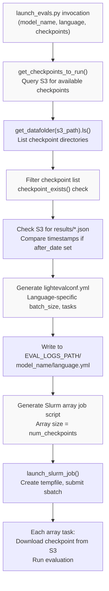
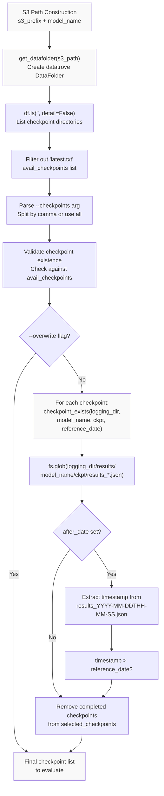
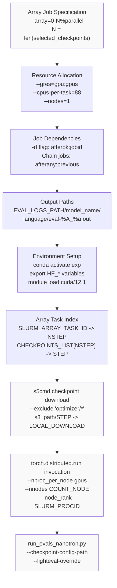
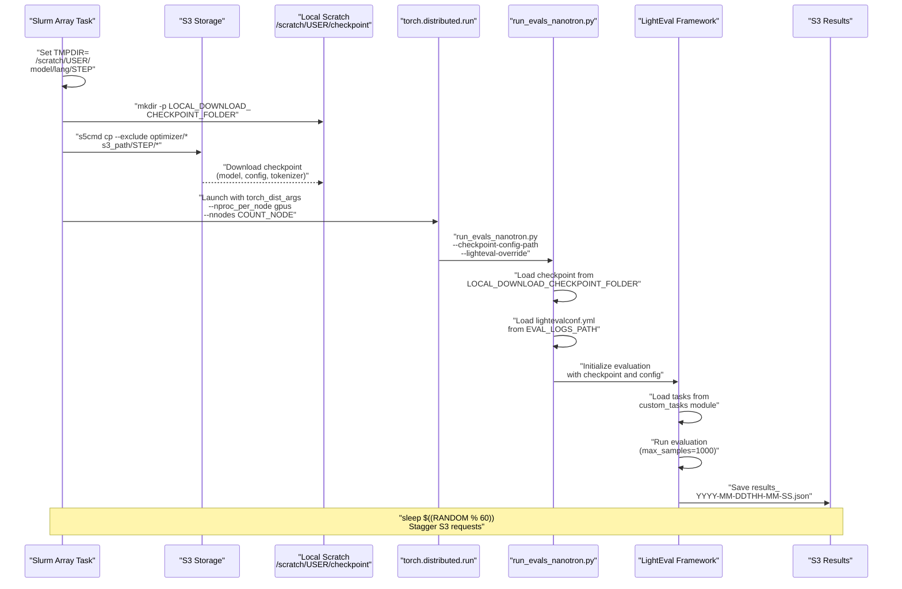
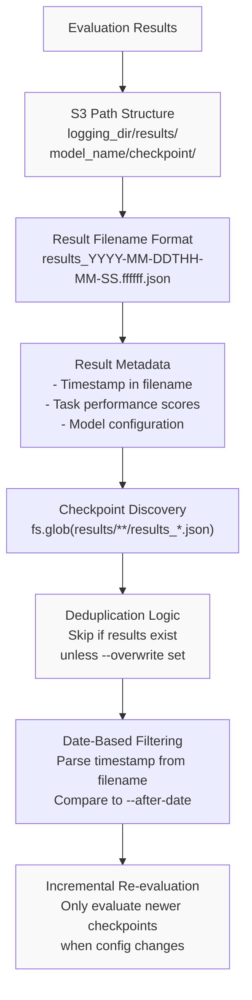

<!-- source: DeepWiki mcp.deepwiki.com · repo huggingface/fineweb-2 · page 4.2 Checkpoint Evaluation · fetched 2026-10-26 -->

# Checkpoint Evaluation

<details>
<summary>Relevant source files</summary>

The following files were used as context for generating this wiki page:

- [ablations/evaluation/launch_evals.py](ablations/evaluation/launch_evals.py)

</details>


This page documents the checkpoint evaluation system implemented in `launch_evals.py`. This script orchestrates the evaluation of trained model checkpoints on the FineTasks benchmark suite using the LightEval framework. It handles checkpoint discovery, result deduplication, configuration generation, and Slurm job submission for parallel evaluation across multiple checkpoints.

For information about establishing random baselines, see [Random Baseline Evaluation](#4.3). For batch orchestration of evaluations across multiple languages, see [Batch Evaluation Orchestration](#4.4). For details on the LightEval configuration format, see [Evaluation Configuration](#4.5).

**Sources:** [ablations/evaluation/launch_evals.py:1-287]()

## Overview

The `launch_evals.py` script serves as the primary entry point for evaluating model checkpoints on language-specific benchmarks. It automates the entire evaluation workflow:

1. **Checkpoint Discovery**: Queries S3 to find available model checkpoints
2. **Result Deduplication**: Checks existing evaluation results to avoid redundant computation
3. **Configuration Generation**: Creates LightEval configuration files with language-specific settings
4. **Job Orchestration**: Generates and submits Slurm array jobs for parallel checkpoint evaluation
5. **Resource Management**: Manages checkpoint caching and GPU allocation

The script is designed to evaluate multiple checkpoints in parallel using Slurm array jobs, with each array task handling one checkpoint. This enables efficient evaluation of entire training runs (potentially hundreds of checkpoints) with automatic dependency management and failure recovery.

**Sources:** [ablations/evaluation/launch_evals.py:97-272]()

## Evaluation Workflow



**Evaluation Workflow from Command to Execution**

This diagram shows the complete flow from command invocation to Slurm job submission. The `get_checkpoints_to_run()` function queries S3 using datatrove's `get_datafolder()`, then filters using `checkpoint_exists()` to avoid redundant work. Configuration generation creates the `lightevalconf.yml` file with language-specific parameters, and `launch_slurm_job()` handles the tempfile creation and `sbatch` submission.

**Sources:** [ablations/evaluation/launch_evals.py:69-94](), [ablations/evaluation/launch_evals.py:31-46](), [ablations/evaluation/launch_evals.py:49-66](), [ablations/evaluation/launch_evals.py:142-272]()

## Command-Line Interface

The script accepts a model name and language as required positional arguments, with numerous optional flags for customization:

| Argument | Type | Default | Description |
|----------|------|---------|-------------|
| `model_name` | str | *required* | Model name on S3, comma-separated for multiple models |
| `language` | str | *required* | Language code (e.g., `zh`, `ru`, `fr`) |
| `--s3_prefix` | str | `s3://path/to/models/` | Base S3 path for model checkpoints |
| `--checkpoints` | str | `all` | Comma-separated checkpoint list or `"all"` |
| `--model-template` | str | `{model_name}` | Template for model name formatting |
| `--tasks` | str | `early-signals` | Tasks to evaluate (`early-signals`, `m3exam`, etc.) |
| `--offline-datasets` | flag | `True` | Disable dataset downloading |
| `--seed` | str | `6` | Seeds for model template expansion |
| `--qos` | str | `normal` | Slurm QOS priority |
| `--time_limit` | str | `1:50:00` | Job time limit |
| `--parallel` | int | `5` | Maximum concurrent array tasks |
| `--gpus` | int | `8` | GPUs per evaluation task |
| `--logging_dir` | str | `s3://path/to/evals/results` | S3 path for evaluation results |
| `-d` | str | `None` | Dependency job ID (`afterok:jobid`) |
| `--overwrite` | flag | `False` | Re-evaluate completed checkpoints |
| `--after-date` | str | `None` | Only evaluate newer checkpoints (`DD-MM-YYYY HH:MM:SS`) |
| `--job-prefix` | str | `""` | Prefix for Slurm job name |

**Sources:** [ablations/evaluation/launch_evals.py:97-141]()

### Common Usage Patterns

```bash
# Evaluate all checkpoints for a specific model and language
python launch_evals.py 1p46G-control-english-fw-ft-bl-28BT-seed-6 zh

# Evaluate specific checkpoints only
python launch_evals.py model_name fr --checkpoints 500,1000,1500,2000

# Use model template with multiple seeds
python launch_evals.py base_model ru --model-template "{model_name}-{language}-seed-{seed}" --seed 1,2,3

# Re-evaluate checkpoints created after a specific date
python launch_evals.py model_name ar --after-date "15-03-2024 10:30:00"

# Chain job dependencies
python launch_evals.py model_name sw -d 12345678
```

**Sources:** [ablations/evaluation/launch_evals.py:97-141]()

## Checkpoint Discovery and Filtering



**Checkpoint Discovery and Filtering Logic**

The discovery process uses datatrove's `get_datafolder()` to access S3, listing all checkpoint directories except `latest.txt`. The `checkpoint_exists()` function checks for existing results by globbing for `results_*.json` files in the logging directory. When `--after-date` is provided, timestamps are extracted from result filenames and compared to filter out stale evaluations.

**Sources:** [ablations/evaluation/launch_evals.py:69-94](), [ablations/evaluation/launch_evals.py:31-46](), [ablations/evaluation/launch_evals.py:22-28]()

### Checkpoint Existence Detection

The `checkpoint_exists()` function implements intelligent result detection with timestamp awareness:

```python
def checkpoint_exists(logging_dir: str, model_name: str, checkpoint: str, 
                      reference_date: Optional[datetime]) -> bool
```

This function queries the logging directory for result files matching the pattern `results/{model_name}/{checkpoint}/results_*.json`. If `reference_date` is provided via `--after-date`, it extracts timestamps from filenames (format: `results_YYYY-MM-DDTHH-MM-SS.ffffff.json`) and only considers the checkpoint complete if at least one result is newer than the reference date. This enables incremental re-evaluation when evaluation code or configurations change.

**Sources:** [ablations/evaluation/launch_evals.py:31-46]()

## Configuration Generation

The script generates a language-specific LightEval configuration file (`lightevalconf.yml`) for each model-language pair. This configuration file is written to `EVAL_LOGS_PATH/{model_name}/{language}.yml` and passed to the evaluation framework.

### LightEval Configuration Structure

```yaml
batch_size: 8  # Language-specific: 4 for zh, 6 for ar/sw, 8 for others
checkpoints_path: null
generation: null
logging:
  logging_dir: s3://path/to/evals/results
  save_details: true
  save_results: true
  save_to_tensorboard: false
  tensorboard_metric_prefix: e
parallelism:
  dp: 8  # Matches --gpus argument
  expert_parallel_size: 1
  pp: 1
  pp_engine: 1f1b
  tp: 1
  tp_linear_async_communication: false
  tp_mode: ALL_REDUCE
tasks:
  custom_tasks: lighteval.community_tasks.multilingual.configs.zh
  dataset_loading_processes: 11  # CPUS_PER_NODE // gpus
  max_samples: 1000
  multichoice_continuations_start_space: null
  no_multichoice_continuations_start_space: null
  num_fewshot_seeds: null
  tasks: early-signals
```

**Sources:** [ablations/evaluation/launch_evals.py:161-187]()

### Language-Specific Batch Sizes

The configuration generation includes language-specific batch size optimization:

- **Chinese (`zh`)**: `batch_size: 4` - Lower batch size due to larger token counts per sample
- **Arabic (`ar`), Swahili (`sw`)**: `batch_size: 6` - Moderate batch size
- **Other languages**: `batch_size: 8` - Default batch size

This adaptive batch sizing prevents OOM errors while maximizing GPU utilization across different languages with varying tokenization characteristics.

**Sources:** [ablations/evaluation/launch_evals.py:163]()

### Parallelism Configuration

The parallelism section matches the GPU allocation:
- `dp: {args.gpus}` - Data parallelism degree equals GPU count
- `pp: 1`, `tp: 1` - No pipeline or tensor parallelism for evaluation
- `dataset_loading_processes: {n_cpus}` - Set to `CPUS_PER_NODE // gpus` for optimal data loading

**Sources:** [ablations/evaluation/launch_evals.py:172-179]()

## Slurm Job Generation and Submission



**Slurm Job Script Generation Flow**

The script generates a complete Slurm batch script with array job configuration. Each array task corresponds to one checkpoint, with the `SLURM_ARRAY_TASK_ID` used to index into the `CHECKPOINTS_LIST` bash array. The `%parallel` modifier limits concurrent tasks (default 5). Dependencies are chained using `afterok` for explicit dependencies and `afterany` for sequential model evaluation.

**Sources:** [ablations/evaluation/launch_evals.py:195-268]()

### Array Job Configuration

The Slurm array job enables parallel evaluation of multiple checkpoints:

```bash
#SBATCH --array=0-{len(selected_checkpoints)-1}%{args.parallel}
```

This creates one array task per checkpoint, with a maximum of `--parallel` tasks running concurrently (default 5). The array task ID (`SLURM_ARRAY_TASK_ID`) is used to select which checkpoint to evaluate:

```bash
CHECKPOINTS_LIST=(500 1000 1500 2000 2500)
NSTEP=$((SLURM_ARRAY_TASK_ID))
STEP=${CHECKPOINTS_LIST[$NSTEP]}
```

Checkpoints are sorted in reverse order (largest first) to prioritize evaluation of later training steps.

**Sources:** [ablations/evaluation/launch_evals.py:201](), [ablations/evaluation/launch_evals.py:244-246]()

### Resource Allocation

Each array task is allocated:
- **GPUs**: `--gres=gpu:{args.gpus}` (default 8)
- **CPUs**: `--cpus-per-task=88` (full node)
- **Nodes**: `--nodes=1` (single node per checkpoint)
- **Time**: `--time={args.time_limit}` (default 1:50:00)

The CPU allocation is fixed at `CPUS_PER_NODE` (88), and the number of CPUs per GPU is calculated as `n_cpus = CPUS_PER_NODE // args.gpus` for optimal data loading parallelism.

**Sources:** [ablations/evaluation/launch_evals.py:15-19](), [ablations/evaluation/launch_evals.py:159](), [ablations/evaluation/launch_evals.py:202-204]()

### Job Dependencies

The script supports two types of job dependencies:

1. **Explicit Dependencies** (`-d` flag): Creates `afterok:jobid` dependency, meaning the new job starts only if the specified job completes successfully.
2. **Sequential Dependencies** (multiple models): Creates `afterany:jobid` dependency, chaining evaluations for multiple models in sequence regardless of exit status.

```python
deps = []
if args.d:
    deps.append(f"afterok:{args.d}")
if job_id:
    deps.append(f"afterany:{job_id}")
```

**Sources:** [ablations/evaluation/launch_evals.py:189-193]()

## Evaluation Execution Flow



**Evaluation Execution Sequence**

Each array task follows this sequence: (1) create scratch directories, (2) download checkpoint from S3 excluding optimizer state, (3) launch `torch.distributed.run` with multi-GPU configuration, (4) `run_evals_nanotron.py` loads the checkpoint and LightEval config, (5) LightEval framework executes the evaluation, (6) results are saved to S3. A random sleep (0-60 seconds) staggers S3 requests across concurrent tasks to avoid rate limiting.

**Sources:** [ablations/evaluation/launch_evals.py:249-268]()

### Checkpoint Download Strategy

Checkpoints are downloaded from S3 to local scratch storage for optimal I/O performance:

```bash
LOCAL_DOWNLOAD_CHECKPOINT_FOLDER=/scratch/USER/checkpoint/{model_name}/$STEP
mkdir -p $LOCAL_DOWNLOAD_CHECKPOINT_FOLDER
s5cmd cp --exclude "optimizer/*" {s3_path}/$STEP/* $LOCAL_DOWNLOAD_CHECKPOINT_FOLDER
```

The `--exclude "optimizer/*"` flag prevents downloading optimizer state files (which can be several GB), as they're not needed for evaluation. This significantly reduces download time and scratch space usage.

**Sources:** [ablations/evaluation/launch_evals.py:252-255]()

### Torch Distributed Launch Configuration

The evaluation uses `torch.distributed.run` for multi-GPU coordination:

```bash
torch_dist_args="--nproc_per_node {args.gpus} \
    --nnodes $COUNT_NODE \
    --max_restarts 0 \
    --tee 3 \
    --node_rank $SLURM_PROCID \
    --role $SLURMD_NODENAME: "
```

Key parameters:
- `--nproc_per_node`: Number of processes (GPUs) per node
- `--nnodes`: Total number of nodes (always 1 for evaluation)
- `--max_restarts`: Disabled (0) to fail fast on errors
- `--tee`: Output mode for stdout/stderr
- `--node_rank`: Node rank from Slurm environment
- `--role`: Node identification

**Sources:** [ablations/evaluation/launch_evals.py:257-262]()

### Environment Configuration

The Slurm script configures the execution environment:

```bash
# Conda environment
source /path/to/.bashrc
source /path/to/miniconda3/etc/profile.d/conda.sh
conda activate /path/to/miniconda3/envs/exp/

# HuggingFace cache configuration
export HUGGINGFACE_HUB_CACHE=/path/to/.cache/huggingface
export HF_DATASETS_CACHE=/path/to/.cache/huggingface
export HF_MODULES_CACHE=/path/to/.cache/huggingface
export HF_HOME=/path/to/.cache/huggingface
export HF_DATASETS_OFFLINE={1 if args.offline_datasets else 0}

# CUDA configuration
export CUBLAS_WORKSPACE_CONFIG=":4096:8"
export CUDA_DEVICE_MAX_CONNECTIONS="1"
module load cuda/12.1
```

The `HF_DATASETS_OFFLINE` flag controls whether HuggingFace datasets can be downloaded (default: offline mode enabled).

**Sources:** [ablations/evaluation/launch_evals.py:211-240]()

## Result Management



**Result Storage and Management Strategy**

Results are stored in S3 with a hierarchical structure: `logging_dir/results/model_name/checkpoint/results_timestamp.json`. The timestamp in the filename enables date-based filtering for incremental re-evaluation. The `checkpoint_exists()` function checks for these files before launching evaluations, preventing redundant computation unless `--overwrite` is specified.

**Sources:** [ablations/evaluation/launch_evals.py:31-46](), [ablations/evaluation/launch_evals.py:84-94](), [ablations/evaluation/launch_evals.py:167-169]()

### Result File Structure

Evaluation results are saved to:
```
{logging_dir}/results/{model_name}/{checkpoint}/results_{timestamp}.json
```

Where:
- `logging_dir`: Specified by `--logging_dir` (default: `s3://path/to/evals/results`)
- `model_name`: Full model identifier (after template expansion)
- `checkpoint`: Checkpoint number (e.g., `500`, `1000`, `1500`)
- `timestamp`: Evaluation time in format `YYYY-MM-DDTHH-MM-SS.ffffff`

The `save_details: true` configuration ensures that detailed per-sample results are stored alongside aggregated metrics.

**Sources:** [ablations/evaluation/launch_evals.py:167-169](), [ablations/evaluation/launch_evals.py:34]()

### Avoiding Redundant Evaluations

The system implements three levels of deduplication:

1. **Existence Check**: By default, checkpoints with existing results are skipped
2. **Date-Based Filtering**: With `--after-date`, only results newer than the reference date are considered valid
3. **Force Re-evaluation**: The `--overwrite` flag bypasses all checks and re-evaluates all specified checkpoints

This enables efficient workflows:
- **Initial Evaluation**: Evaluate all checkpoints once
- **Incremental Evaluation**: Add `--after-date` when evaluation code changes
- **Full Re-evaluation**: Use `--overwrite` when results need to be regenerated

**Sources:** [ablations/evaluation/launch_evals.py:84-94]()

## Integration with External Systems

The checkpoint evaluation system integrates with multiple external components:

| System | Purpose | Configuration |
|--------|---------|---------------|
| **S3 Storage** | Checkpoint and result storage | `--s3_prefix`, `--logging_dir` |
| **Slurm** | Job scheduling and resource management | Partition: `partition`, QOS: `--qos` |
| **s5cmd** | High-performance S3 transfers | Used for checkpoint downloads |
| **torch.distributed** | Multi-GPU coordination | `--nproc_per_node {gpus}` |
| **run_evals_nanotron.py** | Nanotron evaluation script | Launched via torch.distributed.run |
| **LightEval-Fork** | Evaluation framework | Config: `lightevalconf.yml` |
| **Datatrove** | S3 filesystem access | Used by `get_datafolder()` |

**Sources:** [ablations/evaluation/launch_evals.py:9-12](), [ablations/evaluation/launch_evals.py:72](), [ablations/evaluation/launch_evals.py:255](), [ablations/evaluation/launch_evals.py:257-268]()

## Manual Execution

The script includes documentation for manual execution without Slurm (useful for debugging):

```bash
conda activate exp
LOCAL_DOWNLOAD_CHECKPOINT_FOLDER=/scratch/$USER/checkpoint/modeltest
mkdir -p $LOCAL_DOWNLOAD_CHECKPOINT_FOLDER
s5cmd cp --exclude "optimizer/*" {s3_path}/$STEP/* $LOCAL_DOWNLOAD_CHECKPOINT_FOLDER
source /etc/profile.d/modules.sh

export HF_HOME=/path/to/.cache/huggingface
export HF_DATASETS_OFFLINE=1
module load cuda/12.1

python3 -u -m torch.distributed.run --standalone \
    /path/to/brrr/run_evals_nanotron.py \
    --checkpoint-config-path ${LOCAL_DOWNLOAD_CHECKPOINT_FOLDER}/config.yaml \
    --lighteval-config /path/to/configs/testmlevals.yml
```

This bypasses Slurm entirely and runs the evaluation directly using `torch.distributed.run --standalone` mode.

**Sources:** [ablations/evaluation/launch_evals.py:273-286]()

---

