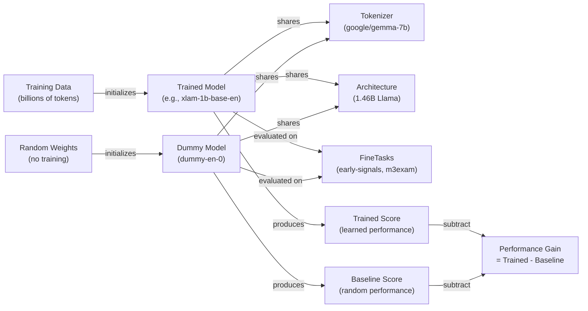
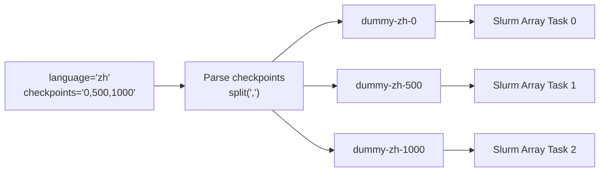
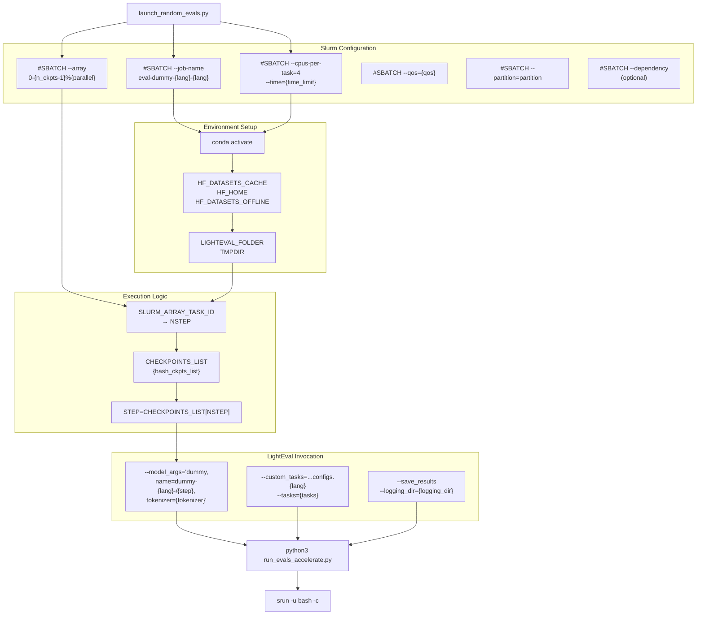
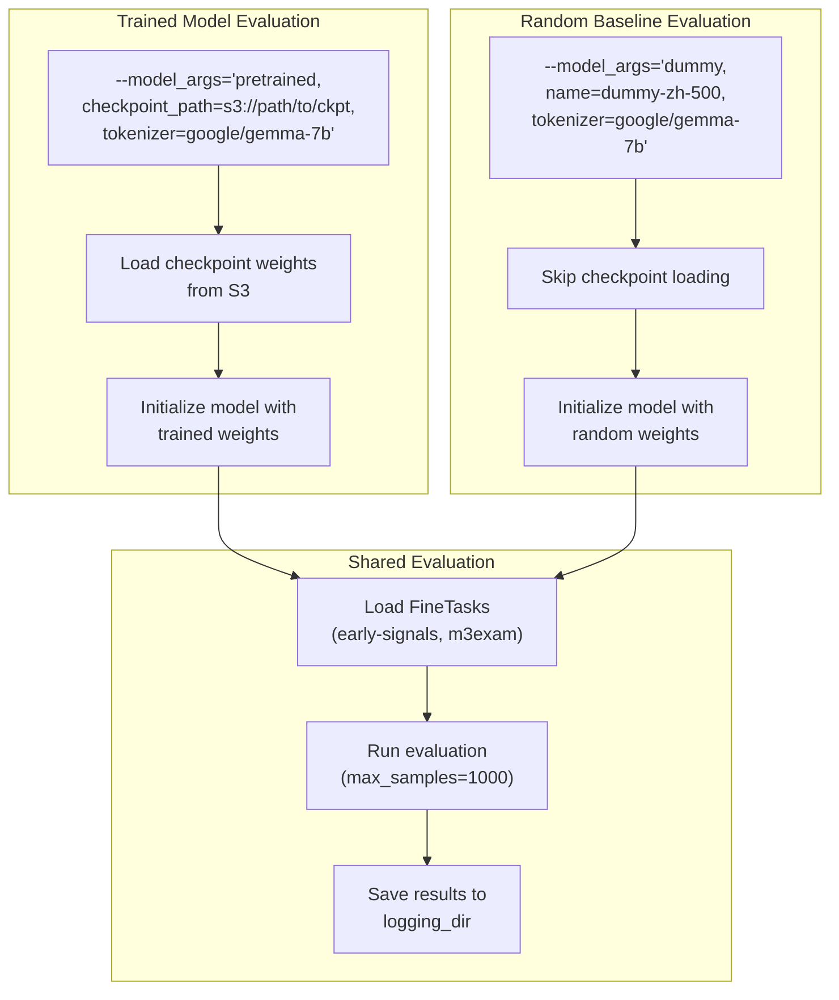
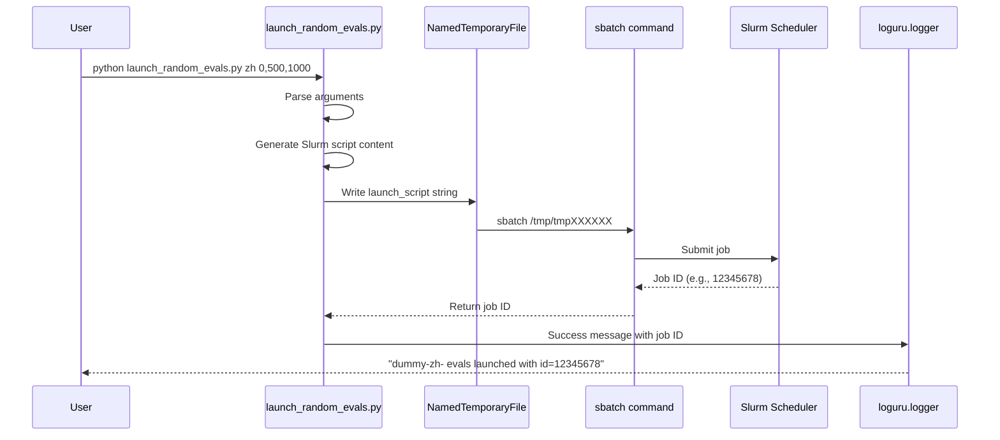

<!-- source: DeepWiki mcp.deepwiki.com · repo huggingface/fineweb-2 · page 4.3 Random Baseline Evaluation · fetched 2026-10-26 -->

# Random Baseline Evaluation

<details>
<summary>Relevant source files</summary>

The following files were used as context for generating this wiki page:

- [ablations/evaluation/launch_random_evals.py](ablations/evaluation/launch_random_evals.py)

</details>


## Purpose and Scope

This document describes the random baseline evaluation system implemented in `launch_random_evals.py`. This system establishes performance baselines by evaluating randomly-initialized models (dummy models) on the FineTasks evaluation suite. These baselines provide a reference point for measuring the effectiveness of trained models—any model performing worse than the random baseline indicates a fundamental problem with the training or evaluation setup.

For information about evaluating trained model checkpoints, see [Checkpoint Evaluation](#4.2). For details on LightEval configuration generation, see [Evaluation Configuration](#4.5).

## Overview

The random baseline evaluation system creates "dummy" models with random weights that share the same tokenizer and architecture as trained models but have never seen training data. By evaluating these random baselines on the same tasks as trained models, the system establishes a performance floor—the expected score from pure guessing or random predictions.

### Dummy Model Approach



**Diagram: Random Baseline Evaluation Methodology**

The dummy model approach isolates the effect of training by keeping architecture and tokenizer constant while using random initialization instead of trained weights.

Sources: [ablations/evaluation/launch_random_evals.py:54](), [ablations/evaluation/launch_random_evals.py:102]()

## Script Arguments and Configuration

The `launch_random_evals.py` script accepts command-line arguments that configure the evaluation job. These arguments control which language to evaluate, which checkpoint steps to simulate, and how the Slurm job should be scheduled.

### Required Arguments

| Argument | Type | Description | Example |
|----------|------|-------------|---------|
| `language` | str | Language code for evaluation | `zh`, `fr`, `ru` |
| `checkpoints` | str | Comma-separated checkpoint steps | `0,1,2` or `500,1000,1500` |

### Optional Arguments

| Argument | Type | Default | Description |
|----------|------|---------|-------------|
| `--offline-datasets` | flag | False | Disable dataset downloading (use cached) |
| `--qos` | str | `normal` | Slurm QoS (quality of service) |
| `--time_limit` | str | `01:20:00` | Maximum job runtime |
| `--parallel` / `-p` | int | 100 | Concurrent evaluation tasks |
| `--logging_dir` | str | `/path/to/eval-results` | Results output directory |
| `-d` | str | None | Job dependency ID |
| `--overwrite` / `-ow` | flag | False | Overwrite existing results |
| `--tasks` | str | `early-signals` | Tasks to evaluate (e.g., `all`, `m3exam`) |
| `--tokenizer` | str | `google/gemma-7b` | Tokenizer for model |

Sources: [ablations/evaluation/launch_random_evals.py:30-49]()

### Model Naming Convention

The script constructs dummy model names using the pattern `dummy-{language}-{checkpoint_step}`:



**Diagram: Dummy Model Name Generation**

The checkpoint steps in the dummy model name allow results to be organized identically to trained model results, facilitating comparison.

Sources: [ablations/evaluation/launch_random_evals.py:54-56]()

## Slurm Job Generation

The script generates a Slurm batch script dynamically and submits it using the `launch_slurm_job` helper function. This approach keeps job configuration flexible while ensuring consistency across evaluation runs.

### Job Configuration Structure



**Diagram: Slurm Job Generation and Execution Flow**

Sources: [ablations/evaluation/launch_random_evals.py:64-104]()

### Array Job Parallelization

The script uses Slurm array jobs to evaluate multiple checkpoint steps in parallel. Each array task evaluates one dummy model checkpoint:

| Slurm Array Parameter | Value | Description |
|----------------------|-------|-------------|
| Array range | `0-{n_checkpoints-1}` | One task per checkpoint |
| Throttle | `%{parallel}` | Limit concurrent tasks (default: 100) |
| Task ID | `$SLURM_ARRAY_TASK_ID` | Index into checkpoint list |

For example, with `checkpoints="0,500,1000"` and `parallel=100`:
- Array range: `0-2` (3 checkpoints)
- Throttle: `%100` (all 3 run simultaneously)
- Task 0 evaluates `dummy-{lang}-0`
- Task 1 evaluates `dummy-{lang}-500`
- Task 2 evaluates `dummy-{lang}-1000`

Sources: [ablations/evaluation/launch_random_evals.py:69](), [ablations/evaluation/launch_random_evals.py:96-100]()

### Bash Checkpoint List Construction

The script converts Python checkpoint strings to Bash arrays for consumption within the Slurm script:

```
Input:  checkpoints = "500,1000,1500,0"
Python: selected_checkpoints = ["500", "1000", "1500", "0"]
Sorted: ["0", "500", "1000", "1500"]  (reversed)
Bash:   bash_ckpts_list = '("1500" "500" "1000" "0")'
```

This Bash array is then indexed by `$SLURM_ARRAY_TASK_ID` to select the checkpoint for each task.

Sources: [ablations/evaluation/launch_random_evals.py:55-56](), [ablations/evaluation/launch_random_evals.py:98-100]()

## Evaluation Execution

The actual evaluation runs inside each Slurm array task using LightEval's `run_evals_accelerate.py` script with dummy model arguments.

### LightEval Model Arguments

The critical difference between random baseline and trained model evaluation is the model type specification:



**Diagram: Model Initialization Comparison**

The `dummy` model type in LightEval creates a randomly-initialized model without loading any checkpoint, while sharing the same tokenizer and architecture.

Sources: [ablations/evaluation/launch_random_evals.py:102]()

### Full LightEval Command Construction

The evaluation command constructed at line 102 includes:

| Parameter | Value | Purpose |
|-----------|-------|---------|
| `--model_args` | `'dummy,name=dummy-{lang}-/{step},tokenizer={tokenizer}'` | Specify dummy model with random weights |
| `--max_samples` | `1000` | Limit evaluation samples per task |
| `--custom_tasks` | `lighteval.community_tasks.multilingual.configs.{lang}` | Language-specific task configuration |
| `--tasks` | `{tasks}` (default: `early-signals`) | Task names to evaluate |
| `--save_results` | (flag) | Write results to disk |
| `--logging_dir` | `{logging_dir}` | Output directory for results |

The command runs with a random sleep (0-60 seconds) before execution to avoid thundering herd problems when many array tasks start simultaneously.

Sources: [ablations/evaluation/launch_random_evals.py:102-103]()

## Job Submission and Tracking

The script uses the `launch_slurm_job` helper function to submit the generated Slurm script and track job IDs.

### Submission Workflow



**Diagram: Job Submission Sequence**

Sources: [ablations/evaluation/launch_random_evals.py:11-28](), [ablations/evaluation/launch_random_evals.py:106-107]()

### Dependency Management

The script supports job dependencies through the `-d` argument, allowing random baseline evaluations to wait for preceding jobs (e.g., data preprocessing or tokenization):

```python
deps = []
if args.d:
    deps.append(f"afterok:{args.d}")  # Wait for specified job
if job_id:
    deps.append(f"afterany:{job_id}")  # Chain jobs
```

Dependencies are injected into the Slurm script as `#SBATCH --dependency=afterok:12345678,afterany:87654321`.

Sources: [ablations/evaluation/launch_random_evals.py:58-62](), [ablations/evaluation/launch_random_evals.py:74]()

## Output and Logging

The script creates a consistent directory structure for logs and results that parallels the structure used for trained model evaluations.

### Directory Structure

```
/path/to/eval-logs/
└── dummy-{language}-/
    └── {language}/
        ├── eval-{JobID}_0.out
        ├── eval-{JobID}_1.out
        └── eval-{JobID}_2.out

/path/to/eval-results/
└── results-dummy-{language}-{step}/
    └── {language}/
        └── results_{tasks}.json
```

The log directory is created at line 57, and the output path is specified in the Slurm script at lines 72-73.

Sources: [ablations/evaluation/launch_random_evals.py:57](), [ablations/evaluation/launch_random_evals.py:72-73]()

## Comparison to Checkpoint Evaluation

The random baseline evaluation system shares most infrastructure with trained model checkpoint evaluation but differs in key aspects:

| Aspect | Random Baseline | Checkpoint Evaluation |
|--------|----------------|----------------------|
| Script | `launch_random_evals.py` | `launch_evals.py` |
| Model type | `dummy` | `pretrained` |
| Checkpoint loading | Skipped | Downloaded from S3 |
| Model name | `dummy-{lang}-{step}` | Actual model name |
| Purpose | Establish baseline | Measure training effect |
| S3 checkpoint discovery | Not needed | Required |
| Results checking | Not implemented | Checks existing results |

Both systems:
- Use Slurm array jobs for parallelization
- Run LightEval with language-specific tasks
- Save results to the same logging directory structure
- Support the same task types (`early-signals`, `m3exam`, etc.)

The random baseline system is simpler because it doesn't need to discover, download, or manage actual model checkpoints.

Sources: [ablations/evaluation/launch_random_evals.py:102]()

## Usage Examples

### Basic Random Baseline for Chinese

```bash
python ablations/evaluation/launch_random_evals.py zh "0,500,1000,1500"
```

This evaluates dummy models at steps 0, 500, 1000, and 1500 for Chinese, using default tasks (`early-signals`) and tokenizer (`google/gemma-7b`).

### Custom Tasks and Tokenizer

```bash
python ablations/evaluation/launch_random_evals.py ru "0,1000,2000" \
    --tasks "all,m3exam" \
    --tokenizer "mistralai/Mistral-7B-v0.1"
```

This evaluates Russian random baselines with all available tasks using a different tokenizer.

### With Job Dependencies

```bash
python ablations/evaluation/launch_random_evals.py sw "0,500,1000" \
    -d 12345678 \
    --parallel 50 \
    --time_limit "02:00:00"
```

This waits for job 12345678 to complete before starting Swahili random baseline evaluation, limits concurrent tasks to 50, and sets a 2-hour time limit.

Sources: [ablations/evaluation/launch_random_evals.py:30-49]()

---

