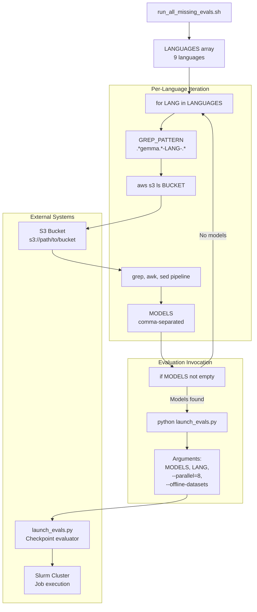
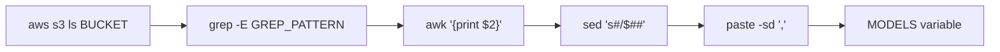
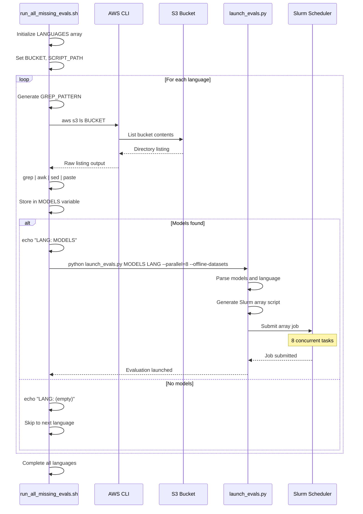

<!-- source: DeepWiki mcp.deepwiki.com · repo huggingface/fineweb-2 · page 4.4 Batch Evaluation Orchestration · fetched 2026-10-26 -->

# Batch Evaluation Orchestration

<details>
<summary>Relevant source files</summary>

The following files were used as context for generating this wiki page:

- [ablations/evaluation/run_all_missing_evals.sh](ablations/evaluation/run_all_missing_evals.sh)

</details>


## Purpose and Scope

This document describes the batch evaluation orchestration system implemented in `run_all_missing_evals.sh`, which automates evaluation across multiple languages and model checkpoints. This script serves as the top-level orchestrator that iterates through all supported languages, discovers trained model checkpoints in S3, and invokes language-specific evaluation jobs.

For information about the underlying checkpoint evaluation system that this script orchestrates, see [Checkpoint Evaluation](#4.2). For evaluation configuration details, see [Evaluation Configuration](#4.5).

## Overview

The batch evaluation orchestrator provides a single entry point for evaluating all trained models across the supported language set. Rather than manually launching evaluation jobs for each language and model combination, this script automates:

1. Iteration through a predefined set of languages
2. Discovery of model checkpoints in S3 matching language-specific patterns
3. Invocation of parallel evaluation jobs via `launch_evals.py`

The script is designed for operational efficiency during large-scale ablation experiments where dozens or hundreds of models need evaluation across multiple languages.

**Sources:** [ablations/evaluation/run_all_missing_evals.sh:1-24]()

## Supported Languages

The orchestrator operates on a fixed set of 9 languages defined in the `LANGUAGES` array:

| Language Code | Language Name |
|---------------|---------------|
| `ru` | Russian |
| `fr` | French |
| `zh` | Chinese |
| `hi` | Hindi |
| `sw` | Swahili |
| `tr` | Turkish |
| `ar` | Arabic |
| `te` | Telugu |
| `th` | Thai |

These languages represent a diverse cross-section of language families and scripts used for evaluation in the FineWeb 2 ablation studies.

**Sources:** [ablations/evaluation/run_all_missing_evals.sh:2]()

## Architecture



**Diagram: Batch Evaluation Orchestration Flow**

This diagram illustrates how `run_all_missing_evals.sh` iterates through languages, queries S3 for matching model checkpoints, and invokes `launch_evals.py` when models are found.

**Sources:** [ablations/evaluation/run_all_missing_evals.sh:1-24]()

## Model Discovery Process

### S3 Query Pattern

For each language, the script constructs a grep pattern to match model directories in S3:

```
.*gemma.*-${LANG}-.*
```

This pattern matches model names containing:
- The string `gemma` (indicating the model family)
- The language code (e.g., `-ru-`, `-fr-`)
- Additional identifiers after the language code

The pattern is intentionally flexible to capture various naming conventions used in ablation experiments.

**Sources:** [ablations/evaluation/run_all_missing_evals.sh:7]()

### Pipeline Operations

The S3 discovery process uses a Unix pipeline to transform raw S3 listing output into a comma-separated model list:



**Diagram: S3 Model Discovery Pipeline**

| Stage | Operation | Purpose |
|-------|-----------|---------|
| `aws s3 ls` | List S3 bucket contents | Retrieve all directory names |
| `grep -E` | Filter by pattern | Match language-specific models |
| `awk '{print $2}'` | Extract second column | Get directory name from listing |
| `sed 's#/$##'` | Remove trailing slashes | Clean directory names |
| `paste -sd ','` | Join with commas | Create comma-separated list |

**Sources:** [ablations/evaluation/run_all_missing_evals.sh:9-13]()

## Evaluation Invocation

### Launch Command Structure

When models are found for a language, the script invokes `launch_evals.py` with four arguments:

```bash
python ./multilingual/launch_evals.py \
    "$MODELS" \
    "$LANG" \
    --parallel=8 \
    --offline-datasets
```

**Sources:** [ablations/evaluation/run_all_missing_evals.sh:18-22]()

### Parameter Specification

| Parameter | Type | Description |
|-----------|------|-------------|
| `$MODELS` | Positional | Comma-separated list of model names to evaluate |
| `$LANG` | Positional | Language code for evaluation tasks |
| `--parallel=8` | Flag | Number of concurrent Slurm array tasks |
| `--offline-datasets` | Flag | Use pre-downloaded datasets instead of fetching from Hub |

The `--parallel=8` setting launches 8 concurrent Slurm array jobs for checkpoint evaluation, enabling efficient parallel processing across multiple model checkpoints. The `--offline-datasets` flag assumes evaluation datasets have been pre-staged locally, avoiding Hub API calls during evaluation.

**Sources:** [ablations/evaluation/run_all_missing_evals.sh:21-22]()

## Execution Flow



**Diagram: Sequential Execution Flow**

The script processes languages sequentially, launching evaluation jobs for each language before moving to the next. This design ensures predictable execution order and simplifies debugging.

**Sources:** [ablations/evaluation/run_all_missing_evals.sh:6-24]()

## Configuration Points

### S3 Bucket Location

The S3 bucket containing model checkpoints is specified at line 3:

```bash
BUCKET="s3://path/to/bucket"
```

This should be updated to point to the actual S3 location where Nanotron training jobs upload model checkpoints. The bucket structure should contain subdirectories matching the pattern `.*gemma.*-{LANG}-.*` for each language.

**Sources:** [ablations/evaluation/run_all_missing_evals.sh:3]()

### Script Path

The path to `launch_evals.py` is defined at line 4:

```bash
SCRIPT_PATH="./multilingual/launch_evals.py"
```

This assumes the script is invoked from the repository root directory. The relative path should be adjusted if the working directory differs.

**Sources:** [ablations/evaluation/run_all_missing_evals.sh:4]()

### Parallelism Level

The `--parallel=8` flag controls how many Slurm array tasks run concurrently for each language. This can be adjusted based on cluster availability and checkpoint count:

- Higher values (e.g., `--parallel=16`) increase throughput but require more resources
- Lower values (e.g., `--parallel=4`) reduce cluster load but increase total evaluation time

**Sources:** [ablations/evaluation/run_all_missing_evals.sh:21]()

## Usage Examples

### Standard Invocation

From the repository root, execute:

```bash
bash ablations/evaluation/run_all_missing_evals.sh
```

This will:
1. Query S3 for models matching each language pattern
2. Launch evaluation jobs for languages with available models
3. Print status messages showing discovered models per language

### Output Example

Typical console output:

```
ru: gemma-1.46b-ru-ablation1,gemma-1.46b-ru-ablation2
Launching evaluations for Russian models...
fr: gemma-1.46b-fr-ablation1
Launching evaluations for French models...
zh: 
Skipping Chinese - no models found
...
```

### Selective Language Evaluation

To evaluate only specific languages, modify the `LANGUAGES` array in the script:

```bash
LANGUAGES=("ru" "fr")  # Evaluate only Russian and French
```

**Sources:** [ablations/evaluation/run_all_missing_evals.sh:1-24]()

## Integration with Evaluation System

### Relationship to launch_evals.py

The batch orchestrator delegates actual evaluation work to `launch_evals.py`, which:
- Discovers individual checkpoint paths within each model directory
- Checks for existing evaluation results to avoid redundant work
- Generates Slurm array jobs with one task per checkpoint
- Configures LightEval for language-specific evaluation tasks

See [Checkpoint Evaluation](#4.2) for detailed documentation of `launch_evals.py`.

### Relationship to Evaluation Configuration

The evaluations launched by this script use configurations generated by the evaluation system, including:
- Language-specific task suites (FineTasks)
- Checkpoint discovery logic
- Result storage paths

See [Evaluation Configuration](#4.5) for configuration file generation details.

**Sources:** [ablations/evaluation/run_all_missing_evals.sh:18-22]()

## Operational Considerations

### Execution Time

The script executes synchronously, waiting for each `launch_evals.py` invocation to submit Slurm jobs before processing the next language. Actual evaluation execution happens asynchronously in Slurm, so the script typically completes within minutes even when launching hundreds of evaluation tasks.

### S3 Access Requirements

The script requires AWS CLI to be configured with appropriate credentials to access the S3 bucket. Ensure:
- AWS credentials are available in the environment
- The executing user has `s3:ListBucket` permissions on the bucket
- The bucket path is correctly specified

### Error Handling

The script uses conditional logic to skip languages without models:

```bash
if [[ $MODELS = *[!\ ]* ]]; then
    # Only launch if MODELS contains non-whitespace characters
fi
```

This prevents errors from invoking `launch_evals.py` with empty model lists.

**Sources:** [ablations/evaluation/run_all_missing_evals.sh:16-23]()

## Extensibility

### Adding Languages

To add new languages to the evaluation suite:

1. Add the language code to the `LANGUAGES` array
2. Ensure trained models exist in S3 with naming matching the pattern
3. Verify language-specific evaluation tasks are configured in LightEval

### Custom Model Patterns

To evaluate models with different naming conventions, modify the `GREP_PATTERN`:

```bash
GREP_PATTERN=".*custom-model.*-${LANG}-.*"
```

This allows the orchestrator to work with different model families or experiment naming schemes.

**Sources:** [ablations/evaluation/run_all_missing_evals.sh:2,7]()

---

