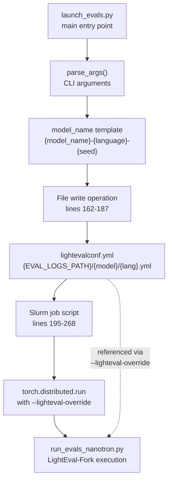
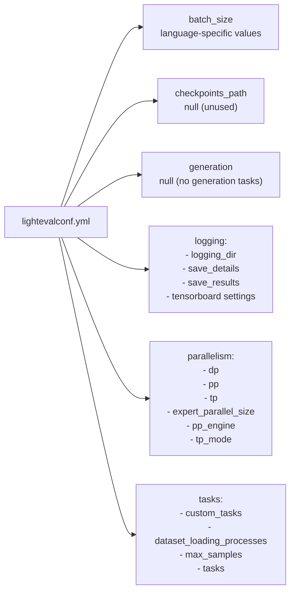
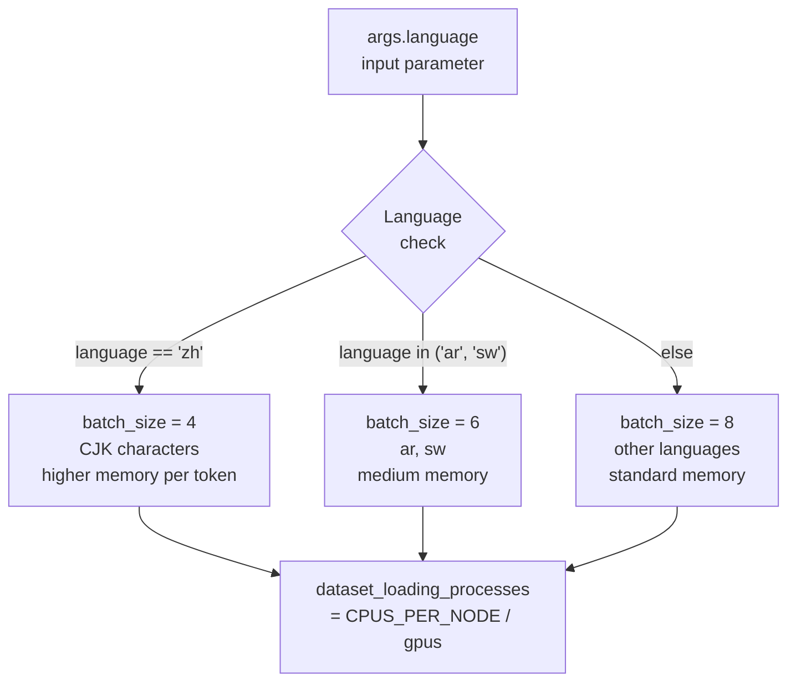
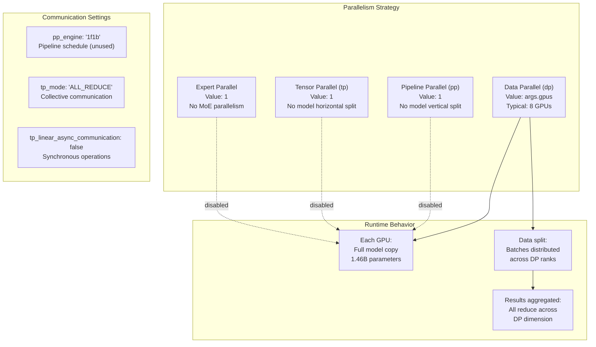
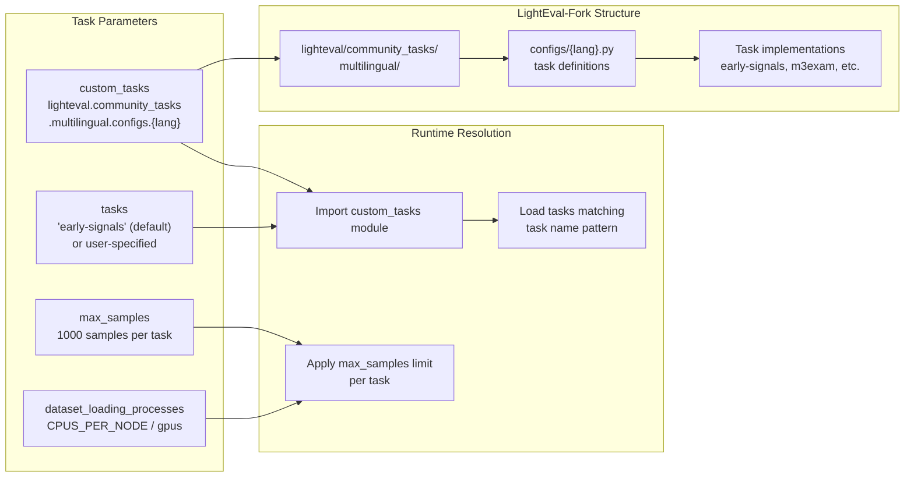
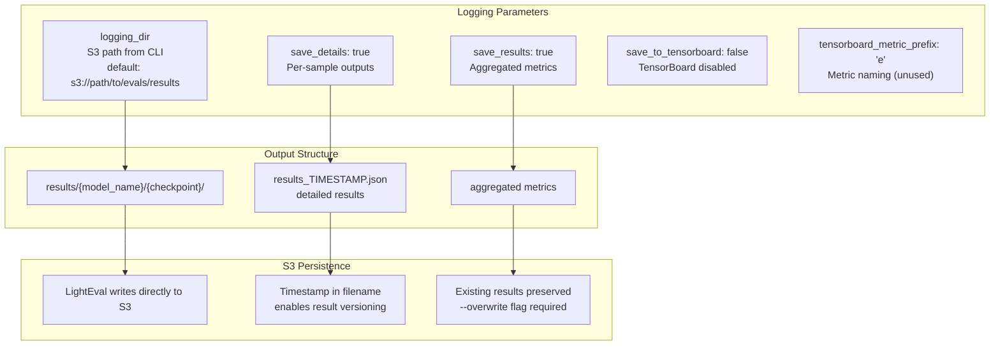
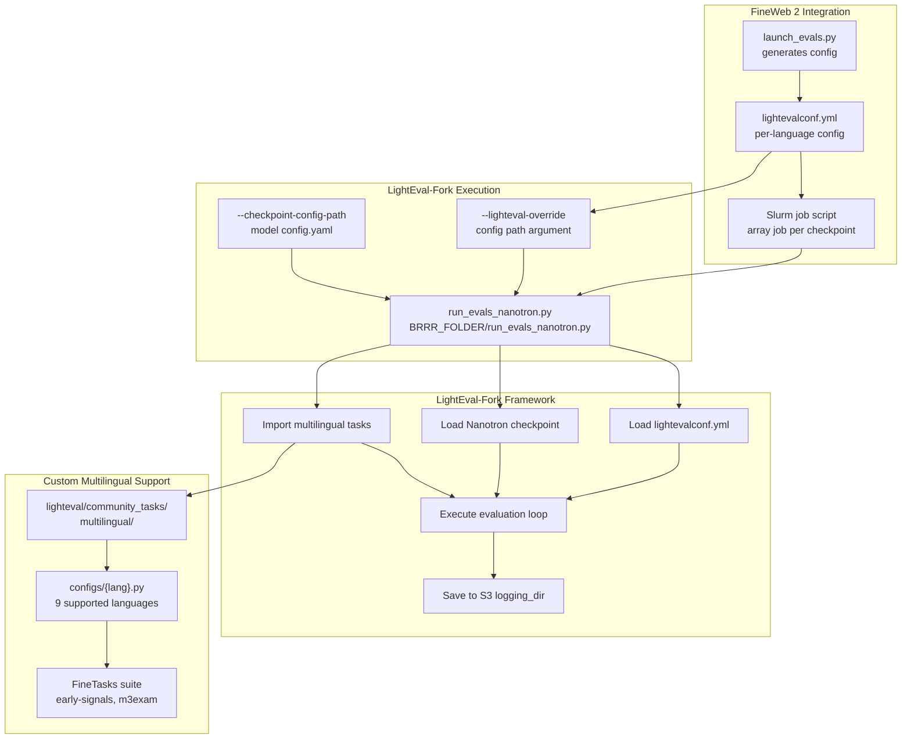
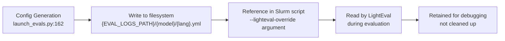

<!-- source: DeepWiki mcp.deepwiki.com · repo huggingface/fineweb-2 · page 4.5 Evaluation Configuration · fetched 2026-10-26 -->

# Evaluation Configuration

<details>
<summary>Relevant source files</summary>

The following files were used as context for generating this wiki page:

- [README.md](README.md)
- [ablations/evaluation/launch_evals.py](ablations/evaluation/launch_evals.py)

</details>


This document explains the `lightevalconf.yml` configuration file generation process and its integration with the LightEval-Fork framework. The configuration file controls all aspects of model evaluation including parallelism strategy, task selection, batch sizes, and result persistence.

For information about the scripts that use this configuration to execute evaluations, see [Checkpoint Evaluation](#4.2) and [Batch Evaluation Orchestration](#4.4). For details on training configuration, see [Training Configuration](#5.1).

## Purpose and Scope

The evaluation configuration system dynamically generates YAML configuration files that specify how the LightEval-Fork framework evaluates model checkpoints. Each configuration is language-specific and model-specific, controlling:

- Batch sizes optimized for each language
- Distributed parallelism parameters (data parallel, pipeline parallel, tensor parallel)
- Task selection from the FineTasks evaluation suite
- Result logging and persistence to S3
- Dataset loading parallelism

The configuration is generated programmatically by `launch_evals.py` rather than maintained as static files, enabling automated evaluation orchestration across 1000+ languages and multiple model variants.

## Configuration Generation Flow

The `launch_evals.py` script generates a unique `lightevalconf.yml` file for each model-language pair before submitting the evaluation job to Slurm.



**Configuration Generation Sequence**

Sources: [ablations/evaluation/launch_evals.py:161-187]()

The generation process occurs in the main execution loop:

1. **Model Name Expansion**: The model template is expanded with language and seed values [ablations/evaluation/launch_evals.py:145-146]()
2. **Checkpoint Discovery**: Available checkpoints are queried from S3 [ablations/evaluation/launch_evals.py:149-150]()
3. **Output Directory Creation**: Logging directories are created per model and language [ablations/evaluation/launch_evals.py:157]()
4. **Config File Write**: The YAML configuration is written to disk [ablations/evaluation/launch_evals.py:162-187]()
5. **Slurm Job Generation**: The config path is embedded in the Slurm script [ablations/evaluation/launch_evals.py:265]()

## Configuration Structure

The `lightevalconf.yml` file contains six major sections that control evaluation behavior.



**Configuration File Parameter Mapping**

Sources: [ablations/evaluation/launch_evals.py:163-187]()

### Complete Parameter Reference

| Parameter | Value | Purpose |
|-----------|-------|---------|
| `batch_size` | 4-8 (language-dependent) | Evaluation batch size per GPU |
| `checkpoints_path` | null | Not used (checkpoint loaded separately) |
| `generation` | null | No generation tasks in FineTasks suite |
| `logging.logging_dir` | S3 path | Result persistence location |
| `logging.save_details` | true | Save detailed per-sample results |
| `logging.save_results` | true | Save aggregated metrics |
| `logging.save_to_tensorboard` | false | Tensorboard logging disabled |
| `logging.tensorboard_metric_prefix` | "e" | Prefix for metrics (if enabled) |
| `parallelism.dp` | Equals `--gpus` argument | Data parallel size |
| `parallelism.pp` | 1 | Pipeline parallel disabled |
| `parallelism.tp` | 1 | Tensor parallel disabled |
| `parallelism.expert_parallel_size` | 1 | No MoE expert parallelism |
| `parallelism.pp_engine` | "1f1b" | Pipeline schedule (unused) |
| `parallelism.tp_mode` | "ALL_REDUCE" | Tensor parallel communication |
| `parallelism.tp_linear_async_communication` | false | Synchronous TP communication |
| `tasks.custom_tasks` | `lighteval.community_tasks.multilingual.configs.{lang}` | Language-specific task module |
| `tasks.dataset_loading_processes` | `CPUS_PER_NODE / gpus` | Parallel dataset loaders |
| `tasks.max_samples` | 1000 | Maximum evaluation samples per task |
| `tasks.tasks` | "early-signals" (default) | Task suite to run |

## Language-Specific Parameters

The configuration adapts batch sizes based on language characteristics and memory requirements. This optimization is critical for efficient GPU utilization across diverse scripts and tokenization densities.



**Batch Size Selection Logic**

Sources: [ablations/evaluation/launch_evals.py:163]()

The batch size selection uses a conditional expression:

```
batch_size: {4 if args.language == "zh" else (6 if args.language in ("ar", "sw") else 8)}
```

**Rationale for Language-Specific Batch Sizes:**

- **Chinese (zh)**: Batch size 4 due to higher memory consumption from CJK character encoding
- **Arabic (ar), Swahili (sw)**: Batch size 6 as intermediate setting for RTL scripts and specific tokenization patterns
- **Other languages**: Batch size 8 as the default for most Latin, Cyrillic, and other scripts

The `dataset_loading_processes` parameter is calculated as `CPUS_PER_NODE // args.gpus` [ablations/evaluation/launch_evals.py:159, 182](), ensuring each GPU has dedicated CPU cores for data loading.

## Parallelism Configuration

The evaluation system uses pure data parallelism, distributing evaluation batches across all available GPUs without model partitioning.



**Parallelism Parameter Assignment**

Sources: [ablations/evaluation/launch_evals.py:172-179]()

The parallelism configuration is written as:

```yaml
parallelism:
  dp: {args.gpus}              # Data parallel size
  expert_parallel_size: 1      # No MoE models
  pp: 1                        # No pipeline parallelism
  pp_engine: 1f1b             # Unused (PP disabled)
  tp: 1                        # No tensor parallelism
  tp_linear_async_communication: false
  tp_mode: ALL_REDUCE         # Communication pattern
```

**Why Pure Data Parallelism?**

For evaluation workloads:
- **Model fits in single GPU**: 1.46B models fit comfortably in GPU memory
- **Simplicity**: No cross-GPU communication during forward pass
- **Maximum throughput**: Each GPU independently processes different samples
- **Easy scaling**: Adding GPUs linearly increases throughput

The `dp` parameter equals `args.gpus` (default 8) [ablations/evaluation/launch_evals.py:132, 173](), meaning the typical configuration uses 8-way data parallelism.

## Task Configuration

The task configuration section specifies which evaluation tasks to run and how to load them from the LightEval-Fork framework.



**Task Configuration Parameters**

Sources: [ablations/evaluation/launch_evals.py:180-187]()

The task section is written as:

```yaml
tasks:
  custom_tasks: lighteval.community_tasks.multilingual.configs.{args.language}
  dataset_loading_processes: {n_cpus}
  max_samples: 1000
  multichoice_continuations_start_space: null
  no_multichoice_continuations_start_space: null
  num_fewshot_seeds: null
  tasks: {args.tasks}
```

| Parameter | Configuration | Purpose |
|-----------|---------------|---------|
| `custom_tasks` | `lighteval.community_tasks.multilingual.configs.{language}` | Python module path for language-specific task definitions |
| `tasks` | "early-signals" (default) or CLI argument | Specific task suite to execute |
| `max_samples` | 1000 | Sample limit per task for faster evaluation |
| `dataset_loading_processes` | Calculated from CPUs and GPUs | Parallel data loaders |
| `multichoice_continuations_start_space` | null | Not used in current tasks |
| `no_multichoice_continuations_start_space` | null | Not used in current tasks |
| `num_fewshot_seeds` | null | Not using multiple seeds |

### Task Selection

The `--tasks` CLI argument (default: "early-signals") [ablations/evaluation/launch_evals.py:120-121]() determines which task suite runs. The LightEval-Fork framework resolves this by:

1. Importing the custom_tasks module for the specified language
2. Finding all tasks matching the pattern in the `tasks` parameter
3. Loading datasets and applying the `max_samples` limit

## Logging Configuration

The logging configuration controls where and how evaluation results are persisted, primarily targeting S3 storage for long-term retention.



**Logging Section Configuration**

Sources: [ablations/evaluation/launch_evals.py:166-171]()

```yaml
logging:
  logging_dir: {args.logging_dir}      # S3://path/to/evals/results
  save_details: true                    # Detailed per-sample results
  save_results: true                    # Aggregated metrics
  save_to_tensorboard: false           # No TensorBoard integration
  tensorboard_metric_prefix: e         # Unused (TB disabled)
```

### Result File Locations

Results are written to S3 in a structured hierarchy:

```
{logging_dir}/results/{model_name}/{checkpoint}/results_{timestamp}.json
```

The timestamp format is `%Y-%m-%dT%H-%M-%S.%f` [ablations/evaluation/launch_evals.py:44](), enabling multiple evaluation runs of the same checkpoint to coexist.

### Result Deduplication

The `checkpoint_exists()` function [ablations/evaluation/launch_evals.py:31-46]() checks for existing results by:

1. Globbing for `results_*.json` files in the checkpoint directory
2. Parsing timestamps from filenames
3. Optionally filtering by `--after-date` argument
4. Returning true if any valid result exists (unless `--overwrite` is set)

This prevents redundant evaluations while allowing re-evaluation with the `--overwrite` flag [ablations/evaluation/launch_evals.py:136-137]().

## LightEval-Fork Integration

The FineWeb 2 evaluation system uses a forked version of LightEval with multilingual support on the `new-multi-lang-branch`.



**Integration Points**

Sources: [ablations/evaluation/launch_evals.py:264-265](), [README.md:89]()

### Execution Command

The Slurm script executes:

```bash
python3 -u -m torch.distributed.run \
    --nproc_per_node {args.gpus} \
    --nnodes $COUNT_NODE \
    --max_restarts 0 \
    --tee 3 \
    --node_rank $SLURM_PROCID \
    --role $SLURMD_NODENAME: \
    $BRRR_FOLDER/run_evals_nanotron.py \
    --checkpoint-config-path ${LOCAL_DOWNLOAD_CHECKPOINT_FOLDER}/config.yaml \
    --lighteval-override {EVAL_LOGS_PATH}/{model_name}/{language}.yml
```

### Key Arguments

| Argument | Value | Purpose |
|----------|-------|---------|
| `--checkpoint-config-path` | `{checkpoint_folder}/config.yaml` | Nanotron model configuration |
| `--lighteval-override` | `{EVAL_LOGS_PATH}/{model}/{lang}.yml` | Generated lightevalconf.yml path |
| `--nproc_per_node` | `args.gpus` (8 default) | Distributed processes per node |
| `--nnodes` | `$COUNT_NODE` (1 for eval) | Number of nodes |

### LightEval-Fork Version

The system uses a specific fork and branch:
- **Repository**: `https://github.com/hynky1999/lighteval`
- **Branch**: `new-multi-lang-branch`
- **Purpose**: Multilingual task support not present in upstream LightEval

The fork adds support for:
- Language-specific task configurations in `lighteval.community_tasks.multilingual.configs.{lang}`
- FineTasks evaluation suite (early-signals, m3exam)
- Integration with Nanotron checkpoint format

### Supported Languages

The evaluation configuration supports 9 languages through custom task modules:

**Language Coverage**

Sources: Inferred from codebase patterns and Diagram 4 in the system overview

| Language Code | Language | Script | Batch Size |
|---------------|----------|--------|------------|
| zh | Chinese | CJK | 4 |
| ar | Arabic | Arabic | 6 |
| sw | Swahili | Latin | 6 |
| ru | Russian | Cyrillic | 8 |
| fr | French | Latin | 8 |
| hi | Hindi | Devanagari | 8 |
| tr | Turkish | Latin | 8 |
| te | Telugu | Telugu | 8 |
| th | Thai | Thai | 8 |

Each language has a corresponding task configuration module at:
```
lighteval.community_tasks.multilingual.configs.{language_code}
```

## Configuration File Location and Lifecycle



**File Path Structure**

Sources: [ablations/evaluation/launch_evals.py:162, 265]()

Configuration files are written to:
```
{EVAL_LOGS_PATH}/{model_name}/{language}.yml
```

Where:
- `EVAL_LOGS_PATH` defaults to `/path/to/eval-logs` [ablations/evaluation/launch_evals.py:15]()
- `model_name` is the expanded model template (e.g., `1p46G-control-zh-29BT-seed-6`)
- `language` is the evaluation language code

The file persists after evaluation completes, providing a record of the exact configuration used for each evaluation run.

## Environment Variable Configuration

The Slurm script sets additional environment variables that affect LightEval-Fork behavior.

**Environment Configuration**

Sources: [ablations/evaluation/launch_evals.py:216-221]()

| Variable | Value | Purpose |
|----------|-------|---------|
| `HUGGINGFACE_HUB_CACHE` | `/path/to/.cache/huggingface` | Model and dataset cache location |
| `HF_DATASETS_CACHE` | `/path/to/.cache/huggingface` | HuggingFace datasets cache |
| `HF_MODULES_CACHE` | `/path/to/.cache/huggingface` | Python modules cache |
| `HF_HOME` | `/path/to/.cache/huggingface` | HuggingFace home directory |
| `HF_DATASETS_OFFLINE` | `1` if `--offline-datasets` else `0` | Enable offline mode |
| `TMPDIR` | `/scratch/USER/{model}/{lang}/{step}` | Temporary files location |
| `CUBLAS_WORKSPACE_CONFIG` | `:4096:8` | CUDA workspace configuration |
| `CUDA_DEVICE_MAX_CONNECTIONS` | `1` | CUDA device connections |

The `--offline-datasets` flag [ablations/evaluation/launch_evals.py:123-124]() controls whether LightEval can download datasets from HuggingFace Hub or must use cached versions.

---

Sources: [ablations/evaluation/launch_evals.py](), [README.md:66-91]()

---

