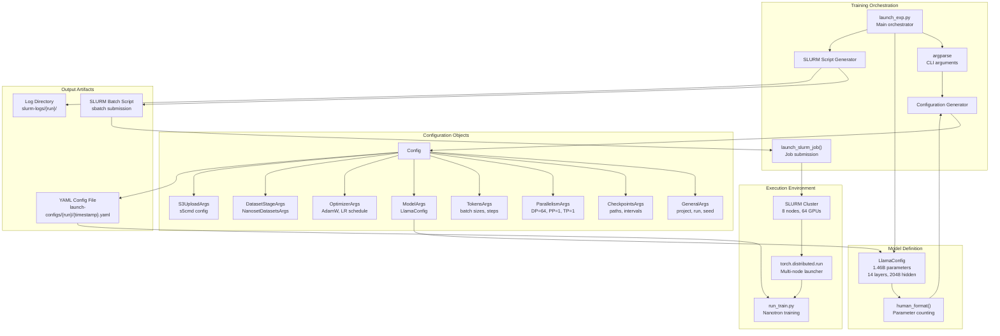
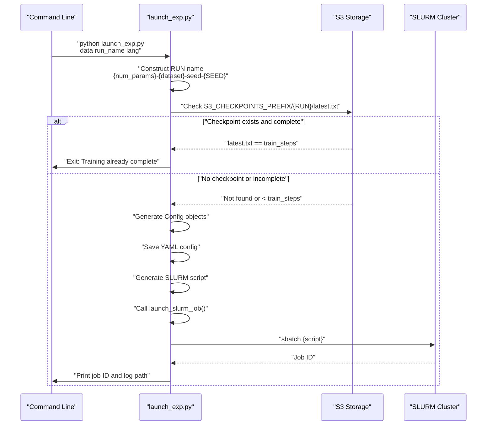
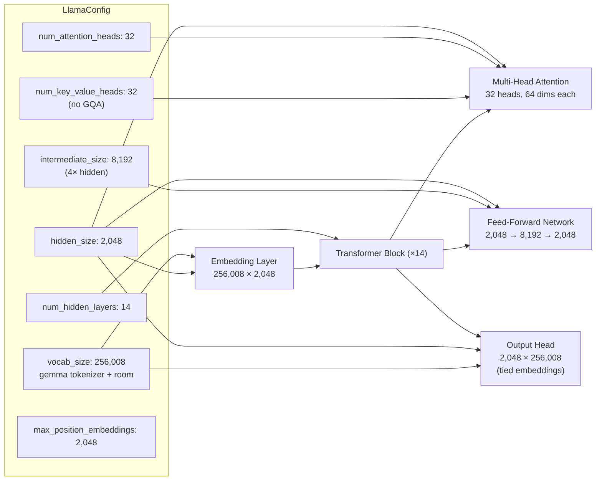

<!-- source: DeepWiki mcp.deepwiki.com · repo huggingface/fineweb-2 · page 5 Training System · fetched 2026-10-26 -->

# Training System

<details>
<summary>Relevant source files</summary>

The following files were used as context for generating this wiki page:

- [README.md](README.md)
- [ablations/training/launch_exp.py](ablations/training/launch_exp.py)

</details>


## Purpose and Scope

The Training System provides the infrastructure for training 1.46B parameter language models used in FineWeb 2's ablation studies. The system orchestrates the entire training workflow: generating Nanotron configurations, creating SLURM batch scripts, managing distributed execution across 8 nodes with 64 GPUs, and handling checkpoint persistence to S3. Each data processing pipeline variant is validated by training a model and evaluating its performance on the FineTasks benchmark.

This page covers the high-level training orchestration. For detailed information about specific subsystems, see:
- Configuration generation: [Training Configuration](#5.1)
- Distributed parallelism strategies: [Distributed Training](#5.2)
- Checkpoint saving and S3 upload: [Checkpoint Management](#5.3)
- SLURM resource allocation: [Slurm Job Configuration](#5.4)

For the evaluation of trained models, see [Ablation and Evaluation Framework](#4).

## System Architecture

The training system is built around `launch_exp.py`, which serves as the orchestrator for all model training jobs. It generates comprehensive Nanotron configurations, creates SLURM batch scripts, and submits distributed training jobs to the cluster.



**Sources:** [ablations/training/launch_exp.py:1-380]()

## Training Orchestrator: launch_exp.py

The `launch_exp.py` script is the single entry point for all training jobs. It accepts command-line arguments specifying the dataset, run name, and language, then generates all necessary configuration and submission scripts.

### Command-Line Interface

| Argument | Type | Description |
|----------|------|-------------|
| `data` | str | Dataset folder path (local or S3) |
| `run_name` | str | Experiment identifier |
| `language` | str | Language code for logging |
| `-d` | str | Optional dependency job ID |
| `--seed` | int | Random seed (default: 6) |
| `--train_steps` / `-ts` | int | Total training steps (default: 14000) |
| `--priority` / `--qos` / `-p` | str | SLURM QoS priority (default: "normal") |

**Sources:** [ablations/training/launch_exp.py:92-101]()

### Pre-Launch Validation

Before launching a job, the orchestrator checks if training has already been completed by querying S3 for an existing checkpoint at the target step count:



**Sources:** [ablations/training/launch_exp.py:109-112]()

### Configuration Assembly

The orchestrator creates a comprehensive `Config` object by assembling multiple specialized configuration objects:

**Data Configuration:**
- `DatasetStageArgs` defines a single training stage starting at step 1
- `NanosetDatasetsArgs` specifies the tokenized dataset folder
- If the dataset is on S3, it will be downloaded to local scratch during job execution

**Sources:** [ablations/training/launch_exp.py:150-163]()

**General Settings:**
- Project name and run identifier for tracking
- Random seed for reproducibility
- `ignore_sanity_checks=True` to bypass certain Nanotron validations

**Sources:** [ablations/training/launch_exp.py:165-170]()

**Checkpoint Settings:**
- Checkpoints saved to `/scratch/$USER/checkpoints/{RUN}`
- Checkpoint interval: every 500 steps
- `save_initial_state=True` to save step 0
- `checkpoints_path_is_shared_file_system=False` for local node storage

**Sources:** [ablations/training/launch_exp.py:172-177]()

**Parallelism Strategy:**
| Parameter | Value | Meaning |
|-----------|-------|---------|
| `dp` | 64 | Data Parallelism: 64 model replicas |
| `pp` | 1 | Pipeline Parallelism: no vertical split |
| `tp` | 1 | Tensor Parallelism: no horizontal split |
| `pp_engine` | "1f1b" | 1-forward-1-backward schedule |
| `tp_mode` | "REDUCE_SCATTER" | Tensor parallel communication mode |

**Sources:** [ablations/training/launch_exp.py:179-186]()

**Batch and Sequence Configuration:**
- `batch_accumulation_per_replica=4`: gradient accumulation steps
- `micro_batch_size=4`: samples per GPU per forward pass
- `sequence_length=2048`: tokens per sample
- `train_steps=14000`: total training iterations (default)
- Effective batch size: 4 × 4 × 64 = 1,024 samples per update
- Total tokens: 2048 × 4 × 4 × 64 × 14,000 ≈ 29.4B tokens

**Sources:** [ablations/training/launch_exp.py:190-196]()

**Optimizer Configuration:**
- AdamW optimizer with fused CUDA kernels
- Learning rate: 3e-4 with 500 warmup steps and cosine decay to 3e-5
- Gradient clipping: 1.0
- Weight decay: 0.1
- Beta parameters: (0.9, 0.95)

**Sources:** [ablations/training/launch_exp.py:214-232]()

**S3 Upload Configuration:**
- Automated checkpoint upload via `s5cmd`
- 16 parallel workers, 5 concurrent operations
- Checkpoints deleted from local storage after successful upload

**Sources:** [ablations/training/launch_exp.py:238-244]()

## Model Architecture: 1.46B LlamaConfig

The training system uses a standardized 1.46B parameter Llama-style decoder-only model for all ablation experiments. This size balances computational efficiency (enabling rapid iteration) with sufficient capacity to detect data quality differences.

### Model Specification



**Configuration Details:**

| Parameter | Value | Notes |
|-----------|-------|-------|
| `vocab_size` | 256,008 | Based on Gemma tokenizer with buffer |
| `hidden_size` | 2,048 | Embedding and hidden dimension |
| `num_hidden_layers` | 14 | Transformer blocks |
| `num_attention_heads` | 32 | Self-attention heads |
| `num_key_value_heads` | 32 | No grouped-query attention |
| `intermediate_size` | 8,192 | FFN hidden dimension (4× hidden) |
| `max_position_embeddings` | 2,048 | Maximum sequence length |
| `hidden_act` | "silu" | SwiGLU activation function |
| `rms_norm_eps` | 1e-05 | RMSNorm epsilon |
| `tie_word_embeddings` | True | Share input/output embeddings |
| `initializer_range` | 0.02 | Weight initialization std |

**Sources:** [ablations/training/launch_exp.py:37-55]()

### Parameter Count Calculation

The script calculates total parameters using the formula:

```
num_params = vocab_size × hidden_size + 
             num_layers × (3 × hidden × intermediate + 4 × hidden²)
```

This includes:
- Embedding matrix: 256,008 × 2,048 ≈ 524M
- Per-layer FFN: 3 × 2,048 × 8,192 ≈ 50M (gate, up, down projections)
- Per-layer attention: 4 × 2,048² ≈ 17M (Q, K, V, O projections)
- 14 layers × 67M ≈ 938M
- **Total: ~1.46B parameters**

The result is formatted using `human_format()` and incorporated into run names (e.g., "1p46B-dataset-seed-6").

**Sources:** [ablations/training/launch_exp.py:58-67]()

## Execution Flow

The complete training workflow from script invocation to model checkpoints involves several stages:

```mermaid
stateDiagram-v2
    [*] --> ParseArgs: "python launch_exp.py data run lang"
    ParseArgs --> CheckExisting: "Build RUN name"
    
    CheckExisting --> Exit: "Checkpoint complete"
    CheckExisting --> BuildConfig: "No checkpoint or incomplete"
    
    Exit --> [*]
    
    BuildConfig --> AssembleComponents: "Import Nanotron classes"
    AssembleComponents --> CreateDataArgs: "DatasetStageArgs"
    CreateDataArgs --> CreateGeneralArgs: "GeneralArgs"
    CreateGeneralArgs --> CreateCheckpointArgs: "CheckpointsArgs"
    CreateCheckpointArgs --> CreateParallelismArgs: "ParallelismArgs (DP=64)"
    CreateParallelismArgs --> CreateTokensArgs: "TokensArgs"
    CreateTokensArgs --> CreateModelArgs: "ModelArgs + LlamaConfig"
    CreateModelArgs --> CreateOptimizerArgs: "OptimizerArgs + LRScheduler"
    CreateOptimizerArgs --> CreateS3Args: "S3UploadArgs"
    CreateS3Args --> FinalConfig: "Config object"
    
    FinalConfig --> SaveYAML: "config.save_as_yaml()"
    SaveYAML --> ValidateConfig: "get_config_from_file()"
    ValidateConfig --> GenerateSLURM: "Create sbatch script"
    
    GenerateSLURM --> DataDownloadCmd: "S3 dataset → local scratch"
    DataDownloadCmd --> SlurmDirectives: "#SBATCH directives"
    SlurmDirectives --> EnvironmentSetup: "Module load, env vars"
    EnvironmentSetup --> TorchCommand: "torch.distributed.run"
    TorchCommand --> DataCleanup: "rm downloaded dataset"
    
    DataCleanup --> SubmitJob: "launch_slurm_job()"
    SubmitJob --> SlurmScheduler: "sbatch {script}"
    SlurmScheduler --> [*]: "Print job ID and log path"
```



**Sources:** [ablations/training/launch_exp.py:86-380]()

### SLURM Script Generation

The generated SLURM batch script contains several key sections:

**Resource Allocation:**
- 8 nodes with 8 GPUs each (64 total)
- 88 CPUs per node
- 1 task per node (critical for distributed training)
- hopper-prod partition with configurable QoS

**Sources:** [ablations/training/launch_exp.py:286-300]()

**S3 Dataset Download (if applicable):**
If the dataset path starts with `s3://`, the script includes commands to download data to local scratch:
```bash
srun --ntasks-per-node=1 rm -rf /scratch/$USER/dataset
srun --ntasks-per-node=1 s5cmd cp 's3://path/*' /scratch/$USER/dataset/{RUN}/
```

**Sources:** [ablations/training/launch_exp.py:283, 324]()

**Distributed Launch Configuration:**
The script sets up `torch.distributed.run` with parameters for multi-node execution:
- Master node: first node in allocation
- Master port: random port in range 1024-65535
- Node count: from SLURM environment
- Process ID: SLURM_PROCID for each node

**Sources:** [ablations/training/launch_exp.py:326-357]()

**Post-Training Cleanup:**
After training completes, downloaded datasets are removed from local scratch to free space:
```bash
srun --ntasks-per-node=1 rm -rf /scratch/$USER/dataset/{RUN}/
```

**Sources:** [ablations/training/launch_exp.py:372-374]()

## Debug Mode

The system includes a DEBUG_MODE for testing configurations with reduced resources:

| Configuration | Production | Debug Mode |
|---------------|-----------|------------|
| Nodes | 8 | 1 |
| GPUs | 64 | 8 |
| Data Parallelism | 64 | 2 |
| Pipeline Parallelism | 1 | 2 |
| Tensor Parallelism | 1 | 2 |
| Micro Batch Size | 4 | 3 |
| Batch Accumulation | 4 | 2 |

Debug mode is activated by setting the `DEBUG_MODE` environment variable to any non-zero value before running `launch_exp.py`.

**Sources:** [ablations/training/launch_exp.py:262-271]()

## Integration with Nanotron Framework

The training system delegates actual model training to the Nanotron framework via the `run_train.py` script. The integration is designed to be configuration-driven: all training parameters are specified in the generated YAML file, which Nanotron reads at runtime.

### Nanotron Invocation

The SLURM script launches Nanotron using `torch.distributed.run`:

```bash
python -u -m torch.distributed.run \
    --nproc_per_node 8 \
    --nnodes 8 \
    --rdzv-backend c10d \
    --rdzv-endpoint $MASTER_ADDR:$MASTER_PORT \
    --rdzv-id $SLURM_JOB_ID \
    --node_rank $SLURM_PROCID \
    --role $SLURMD_NODENAME: \
    --max_restarts 0 \
    --tee 3 \
    run_train.py --config-file {config.yaml}
```

The launcher:
- Spawns 8 processes per node (one per GPU)
- Uses c10d rendezvous for distributed coordination
- Assigns unique ranks to each node
- Passes the YAML config to Nanotron's training script

**Sources:** [ablations/training/launch_exp.py:347-367]()

### Configuration Validation

Before job submission, the orchestrator validates the configuration by:
1. Saving the `Config` object to YAML
2. Reloading it using `get_config_from_file()`
3. Comparing the original and reloaded configs with `print_differences()`

This ensures the configuration is serializable and will be correctly interpreted by Nanotron.

**Sources:** [ablations/training/launch_exp.py:133-149, 273-279]()

### File System Locations

| Artifact | Path Template |
|----------|--------------|
| Launch Configs | `{LAUNCH_CONFIGS_PATH}/{run_name}/{timestamp}.yaml` |
| SLURM Logs | `{LOGS_PATH}/{run_name}/train-{timestamp}-{job_name}-{id}` |
| Local Checkpoints | `/scratch/$USER/checkpoints/{RUN}/` |
| S3 Checkpoints | `{S3_CHECKPOINTS_PREFIX}/{RUN}/` |
| Downloaded Data | `/scratch/$USER/dataset/{RUN}/` (temporary) |

**Sources:** [ablations/training/launch_exp.py:16-26, 173, 239, 275, 281, 283, 373]()

## Launch Helper Function

The `launch_slurm_job()` function provides a simple interface for submitting batch scripts:

```python
def launch_slurm_job(launch_file_contents, *args):
    """
    Small helper function to save a sbatch script and call it.
    Args:
        launch_file_contents: Contents of the sbatch script
        *args: any other arguments to pass to the sbatch command
    Returns: the id of the launched slurm job
    """
    with tempfile.NamedTemporaryFile("w") as f:
        f.write(launch_file_contents)
        f.flush()
        return subprocess.check_output(["sbatch", *args, f.name]).decode("utf-8").split()[-1]
```

It creates a temporary file containing the script, submits it via `sbatch`, and parses the returned job ID from the output.

**Sources:** [ablations/training/launch_exp.py:70-83]()

---

