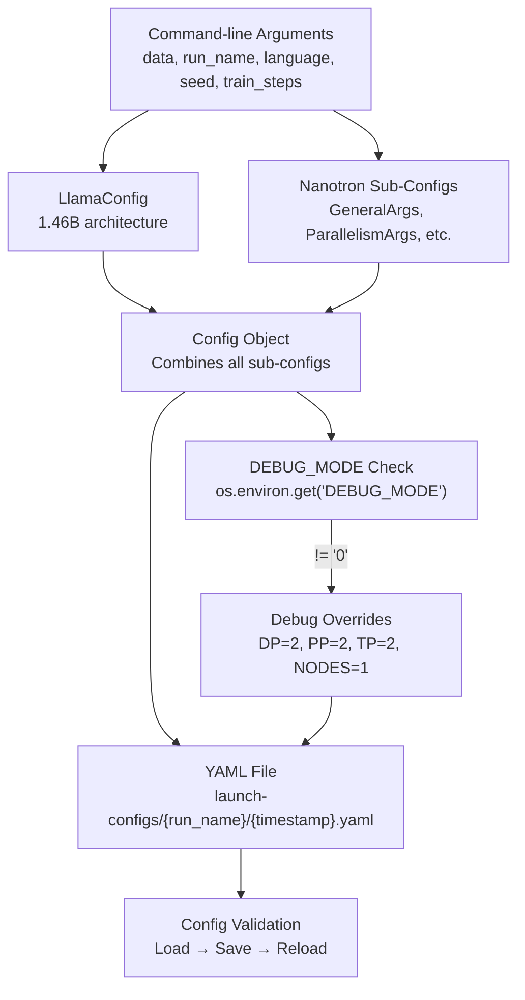
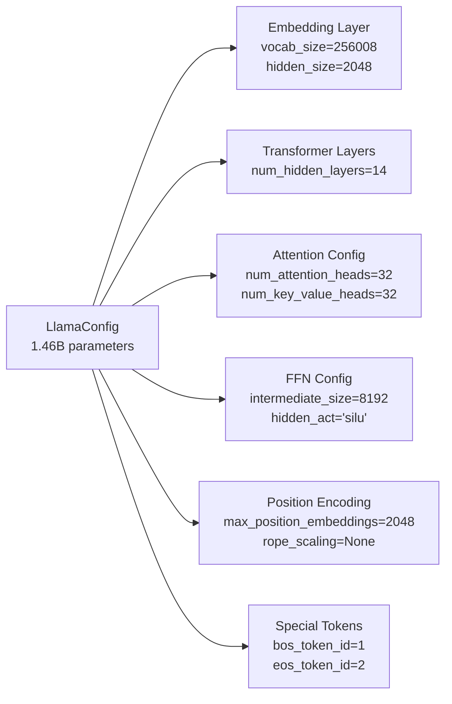
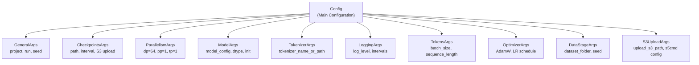
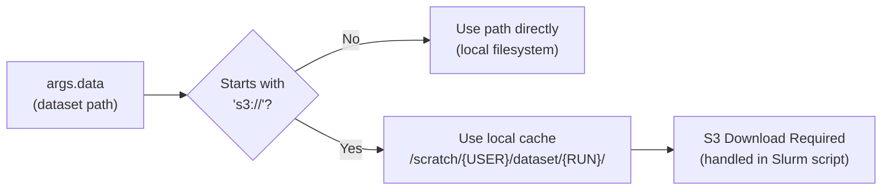
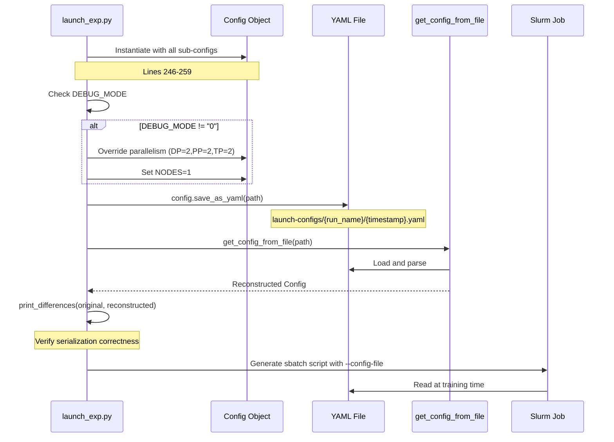
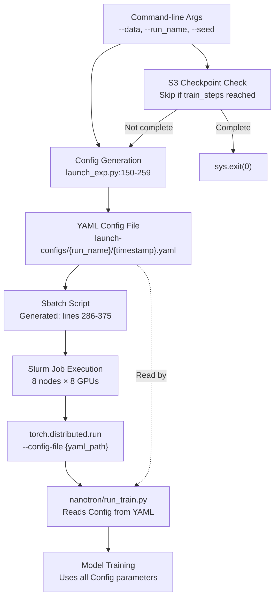

<!-- source: DeepWiki mcp.deepwiki.com · repo huggingface/fineweb-2 · page 5.1 Training Configuration · fetched 2026-10-26 -->

# Training Configuration

<details>
<summary>Relevant source files</summary>

The following files were used as context for generating this wiki page:

- [ablations/training/launch_exp.py](ablations/training/launch_exp.py)

</details>


## Purpose and Scope

This page documents the Nanotron training configuration system used in FineWeb 2's ablation framework. It covers the generation of `Config` objects in `launch_exp.py`, the model architecture definition via `LlamaConfig`, and all configuration parameters that control model training behavior.

For information about how these configurations are used during distributed training execution, see [Distributed Training](#5.2). For checkpoint persistence settings, see [Checkpoint Management](#5.3). For Slurm job generation that consumes these configs, see [Slurm Job Configuration](#5.4).

---

## Configuration Generation Overview

The `launch_exp.py` script generates comprehensive Nanotron configurations programmatically rather than using static YAML files. This allows dynamic configuration based on command-line arguments while maintaining reproducibility through YAML persistence.

**Configuration Generation Flow**



Sources: [ablations/training/launch_exp.py:86-280]()

---

## Model Architecture Configuration

### LlamaConfig Definition

The model architecture is defined using `LlamaConfig` from Nanotron, configured as a 1.46B parameter model suitable for fast ablation experiments.

**LlamaConfig Structure**



**Key Parameters**

| Parameter | Value | Purpose |
|-----------|-------|---------|
| `vocab_size` | 256008 | Gemma tokenizer vocabulary + buffer |
| `hidden_size` | 2048 | Model dimension |
| `num_hidden_layers` | 14 | Transformer depth |
| `num_attention_heads` | 32 | Parallel attention heads |
| `num_key_value_heads` | 32 | GQA heads (equal to attention heads) |
| `intermediate_size` | 8192 | FFN hidden dimension (4× hidden_size) |
| `max_position_embeddings` | 2048 | Maximum sequence length |
| `hidden_act` | "silu" | Activation function |
| `rms_norm_eps` | 1e-05 | RMSNorm epsilon |
| `initializer_range` | 0.02 | Weight initialization std |

Sources: [ablations/training/launch_exp.py:37-55]()

### Parameter Count Calculation

The total parameter count is computed and formatted for use in run naming:

```python
num_params = human_format(
    model_config.vocab_size * model_config.hidden_size +
    model_config.num_hidden_layers * (
        3 * model_config.hidden_size * model_config.intermediate_size +
        4 * model_config.hidden_size * model_config.hidden_size
    )
).replace(".", "p")
```

This formula accounts for:
- Embedding layer: `vocab_size × hidden_size`
- Per-layer FFN: `3 × hidden_size × intermediate_size` (W_gate, W_up, W_down)
- Per-layer attention: `4 × hidden_size × hidden_size` (Q, K, V, O projections)

Sources: [ablations/training/launch_exp.py:58-66]()

---

## Nanotron Config Components

The `Config` object aggregates multiple sub-configuration dataclasses, each controlling a specific aspect of training.

**Config Component Hierarchy**



Sources: [ablations/training/launch_exp.py:116-131](), [ablations/training/launch_exp.py:246-259]()

### GeneralArgs

Controls run identification and global settings.

```python
general = GeneralArgs(
    project=PROJECT,
    run=RUN,  # Format: "{num_params}-{dataset_name}-seed-{SEED}"
    ignore_sanity_checks=True,
    seed=SEED,
)
```

| Field | Purpose |
|-------|---------|
| `project` | Project name for logging and organization |
| `run` | Unique run identifier combining model size, dataset, and seed |
| `ignore_sanity_checks` | Skip Nanotron's internal validation checks |
| `seed` | Global random seed for reproducibility |

Sources: [ablations/training/launch_exp.py:165-170]()

### CheckpointsArgs

Defines checkpoint saving behavior and local storage configuration.

```python
checkpoints = CheckpointsArgs(
    checkpoints_path=Path(f"{LOCAL_TMP_PATH_ON_NODE}/checkpoints/{RUN}"),
    checkpoints_path_is_shared_file_system=False,
    checkpoint_interval=500,
    save_initial_state=True,
)
```

| Field | Value | Purpose |
|-------|-------|---------|
| `checkpoints_path` | `/scratch/{USER}/checkpoints/{RUN}` | Local node storage path |
| `checkpoints_path_is_shared_file_system` | `False` | Each node saves independently |
| `checkpoint_interval` | 500 | Save checkpoint every N steps |
| `save_initial_state` | `True` | Save before training starts |

The use of local scratch (`/scratch/{USER}`) rather than shared storage improves I/O performance. Checkpoints are later uploaded to S3 via `S3UploadArgs`.

Sources: [ablations/training/launch_exp.py:16](), [ablations/training/launch_exp.py:172-177]()

### ParallelismArgs

Configures distributed training parallelism strategy.

```python
parallelism = ParallelismArgs(
    dp=64,
    pp=1,
    tp=1,
    pp_engine="1f1b",
    tp_mode="REDUCE_SCATTER",
    tp_linear_async_communication=True,
)
```

| Field | Value | Strategy |
|-------|-------|----------|
| `dp` | 64 | **Data Parallelism**: 64 GPUs, each holds full model |
| `pp` | 1 | **Pipeline Parallelism**: No vertical model split |
| `tp` | 1 | **Tensor Parallelism**: No horizontal layer split |
| `pp_engine` | "1f1b" | 1F1B pipeline scheduling (unused with PP=1) |
| `tp_mode` | "REDUCE_SCATTER" | Tensor parallelism communication pattern |
| `tp_linear_async_communication` | `True` | Overlap communication with computation |

The configuration `(DP=64, PP=1, TP=1)` indicates **pure data parallelism**—each of 64 GPUs maintains a full copy of the 1.46B model and processes different data batches. This is optimal for models that fit in single-GPU memory.

Sources: [ablations/training/launch_exp.py:179-186]()

### TokensArgs

Controls batch sizing and training duration.

```python
tokens = TokensArgs(
    batch_accumulation_per_replica=4,
    micro_batch_size=4,
    sequence_length=2048,
    train_steps=args.train_steps,  # Default: 14000
    val_check_interval=-1,
)
```

| Field | Value | Purpose |
|-------|-------|---------|
| `batch_accumulation_per_replica` | 4 | Gradient accumulation steps per GPU |
| `micro_batch_size` | 4 | Samples per GPU per forward pass |
| `sequence_length` | 2048 | Maximum sequence length (tokens) |
| `train_steps` | 14000 | Total training steps |
| `val_check_interval` | -1 | Disable validation during training |

**Effective Batch Size Calculation:**
```
global_batch_size = micro_batch_size × batch_accumulation_per_replica × dp
                  = 4 × 4 × 64
                  = 1024 sequences/step
```

**Total Tokens Processed:**
```
total_tokens = sequence_length × train_steps × global_batch_size
             = 2048 × 14000 × 1024
             = ~29.4B tokens
```

Sources: [ablations/training/launch_exp.py:190-196]()

### ModelArgs

Wraps the `LlamaConfig` with additional initialization settings.

```python
model = ModelArgs(
    model_config=model_config,  # LlamaConfig instance
    make_vocab_size_divisible_by=1,
    init_method=RandomInit(std=0.02),
    dtype=torch.bfloat16,
)
```

| Field | Value | Purpose |
|-------|-------|---------|
| `model_config` | `LlamaConfig` | Architecture specification |
| `make_vocab_size_divisible_by` | 1 | No padding (vocab_size already suitable) |
| `init_method` | `RandomInit(std=0.02)` | Gaussian initialization |
| `dtype` | `torch.bfloat16` | Mixed-precision training format |

Sources: [ablations/training/launch_exp.py:198-205]()

### LoggingArgs

Configures logging verbosity and frequency.

```python
logging = LoggingArgs(
    log_level="info",
    log_level_replica="info",
    iteration_step_info_interval=1,
)
```

All replicas log at `info` level with statistics printed every training step.

Sources: [ablations/training/launch_exp.py:207-212]()

### OptimizerArgs

Defines AdamW optimizer and learning rate schedule.

```python
optimizer = OptimizerArgs(
    accumulate_grad_in_fp32=True,
    clip_grad=1.0,
    weight_decay=0.1,
    zero_stage=0,
    learning_rate_scheduler=LRSchedulerArgs(
        learning_rate=3e-4,
        lr_warmup_steps=500,
        lr_warmup_style="linear",
        lr_decay_style="cosine",
        min_decay_lr=3.0e-5
    ),
    optimizer_factory=AdamWOptimizerArgs(
        adam_beta1=0.9,
        adam_beta2=0.95,
        adam_eps=1.0e-8,
        torch_adam_is_fused=True,
    ),
)
```

**Optimizer Configuration**

| Field | Value | Purpose |
|-------|-------|---------|
| `accumulate_grad_in_fp32` | `True` | Accumulate gradients in FP32 for stability |
| `clip_grad` | 1.0 | Gradient clipping threshold |
| `weight_decay` | 0.1 | L2 regularization coefficient |
| `zero_stage` | 0 | No ZeRO optimization (full replication) |

**Learning Rate Schedule**

| Field | Value | Description |
|-------|-------|-------------|
| `learning_rate` | 3e-4 | Peak learning rate |
| `lr_warmup_steps` | 500 | Linear warmup duration |
| `lr_warmup_style` | "linear" | Linear warmup from 0 → peak |
| `lr_decay_style` | "cosine" | Cosine annealing after warmup |
| `min_decay_lr` | 3e-5 | Minimum learning rate (1/10 of peak) |

**AdamW Parameters**

| Field | Value | Standard |
|-------|-------|----------|
| `adam_beta1` | 0.9 | Momentum coefficient |
| `adam_beta2` | 0.95 | Second moment coefficient (higher than standard 0.999) |
| `adam_eps` | 1e-8 | Numerical stability epsilon |
| `torch_adam_is_fused` | `True` | Use fused CUDA kernel for performance |

Sources: [ablations/training/launch_exp.py:214-232]()

### TokenizerArgs

Specifies the tokenizer to use for data processing.

```python
tokenizer = TokenizerArgs(
    tokenizer_name_or_path="google/gemma-7b",
)
```

The Gemma tokenizer (vocab_size=256000) is used with 8 additional slots in the vocabulary to reach 256008, providing room for potential special tokens.

Sources: [ablations/training/launch_exp.py:234-236]()

### DataArgs

Configures dataset loading through `DatasetStageArgs`.

```python
data = [
    DatasetStageArgs(
        name="Training Stage",
        start_training_step=1,
        data=DataArgs(
            seed=SEED,
            num_loading_workers=0,
            dataset=NanosetDatasetsArgs(
                dataset_folder=args.data if not args.data.startswith("s3://") 
                               else f"{LOCAL_TMP_PATH_ON_NODE}/dataset/{RUN}/",
                dataset_weights=None,
            )
        )
    ),
]
```

**Dataset Configuration Logic**



| Field | Value | Purpose |
|-------|-------|---------|
| `seed` | User-specified | Data shuffling seed |
| `num_loading_workers` | 0 | Synchronous loading (avoid worker overhead) |
| `dataset_folder` | Local or `/scratch` path | Tokenized dataset location |
| `dataset_weights` | `None` | Single dataset (no mixing) |

Sources: [ablations/training/launch_exp.py:150-163]()

### S3UploadArgs

Configures automatic checkpoint upload to S3.

```python
s3_upload = S3UploadArgs(
    upload_s3_path=f"{S3_CHECKPOINTS_PREFIX}/{RUN}",
    remove_after_upload=True,
    s5cmd_numworkers=16,
    s5cmd_concurrency=5,
    s5cmd_path=S5CMD_PATH,
)
```

| Field | Value | Purpose |
|-------|-------|---------|
| `upload_s3_path` | `{prefix}/{RUN}` | S3 destination for checkpoints |
| `remove_after_upload` | `True` | Delete local checkpoints after upload |
| `s5cmd_numworkers` | 16 | Parallel upload workers |
| `s5cmd_concurrency` | 5 | Concurrent operations per worker |
| `s5cmd_path` | Path to `s5cmd` binary | S3 CLI tool location |

This configuration enables automatic checkpoint persistence to S3 while minimizing local storage usage through immediate cleanup.

Sources: [ablations/training/launch_exp.py:238-244]()

---

## Configuration Lifecycle

**Configuration Creation and Validation Process**



Sources: [ablations/training/launch_exp.py:273-279]()

### YAML Persistence

Configurations are saved to timestamped YAML files for reproducibility and reference:

```
path: launch-configs/{run_name}/{timestamp}.yaml
```

The `print_differences()` function validates that YAML serialization preserves all configuration values by comparing the original `Config` object with a reloaded version.

Sources: [ablations/training/launch_exp.py:133-148](), [ablations/training/launch_exp.py:274-279]()

---

## Debug Mode Configuration

For rapid testing, `launch_exp.py` supports a `DEBUG_MODE` environment variable that reconfigures training for single-node execution.

**Debug Mode Overrides**

```python
if os.environ.get("DEBUG_MODE", "0") != "0":
    print("##### WARNING DEBUG MODE #####")
    config.parallelism.dp = 2
    config.parallelism.pp = 2
    config.parallelism.tp = 2
    config.tokens.micro_batch_size = 3
    config.tokens.batch_accumulation_per_replica = 2
    config.checkpoints.save_initial_state = True
    NODES = 1
```

**Debug vs Production Configuration**

| Parameter | Production | Debug | Rationale |
|-----------|-----------|-------|-----------|
| `dp` | 64 | 2 | Reduce data parallelism |
| `pp` | 1 | 2 | Enable pipeline parallelism testing |
| `tp` | 1 | 2 | Enable tensor parallelism testing |
| `micro_batch_size` | 4 | 3 | Smaller batch for memory |
| `batch_accumulation_per_replica` | 4 | 2 | Fewer accumulation steps |
| `NODES` | 8 | 1 | Single-node execution |

Debug mode uses **mixed parallelism** (DP=2, PP=2, TP=2) to test all parallelism axes on a single 8-GPU node, where `2 × 2 × 2 = 8 GPUs`.

Sources: [ablations/training/launch_exp.py:262-271]()

---

## Configuration-to-Execution Mapping

**How Configurations Flow to Training Execution**



Before generating any configuration, the script checks if training is already complete by querying S3:

```python
df = get_datafolder(f"{S3_CHECKPOINTS_PREFIX}/{RUN}")
if df.exists("latest.txt") and df.cat_file("latest.txt") == bytes(str(args.train_steps), "utf-8"):
    print(f"Not launching as latest checkpoint is already {args.train_steps} steps")
    sys.exit(0)
```

This prevents redundant training jobs when checkpoints already exist.

Sources: [ablations/training/launch_exp.py:109-112](), [ablations/training/launch_exp.py:342-344]()

---

## Constants and Paths

**Global Configuration Constants**

| Constant | Value | Purpose |
|----------|-------|---------|
| `LOCAL_TMP_PATH_ON_NODE` | `/scratch/{USER}` | Fast local storage on compute nodes |
| `LAUNCH_CONFIGS_PATH` | `path/to/launch-configs` | Directory for saved YAML configs |
| `NANOTRON_RUN_TRAIN_SCRIPT` | `path/to/run_train.py` | Nanotron training entry point |
| `S5CMD_PATH` | `path/to/s5cmd` | S3 CLI tool for uploads |
| `S3_CHECKPOINTS_PREFIX` | `path/to/where_to_save_checkpoints` | S3 bucket prefix |
| `LOGS_PATH` | `path/to/slurm-logs` | Slurm output logs directory |
| `NUM_GPUS` | 8 | GPUs per node |
| `NUM_CPUS_IN_NODE` | 88 | CPUs per node |
| `CPUS_PER_GPU` | 11 | CPU allocation per GPU |

Sources: [ablations/training/launch_exp.py:15-35]()

---

## Summary

The training configuration system in `launch_exp.py` provides:

1. **Model Definition**: `LlamaConfig` specifying 1.46B parameter architecture
2. **Training Parameters**: Comprehensive `Config` object with 10+ sub-configurations
3. **Parallelism Strategy**: Pure data parallelism (DP=64) for efficient training
4. **Checkpoint Persistence**: Automatic S3 upload with local cleanup
5. **Reproducibility**: YAML serialization with validation
6. **Debug Support**: Single-node testing mode with mixed parallelism
7. **Optimization**: AdamW with cosine LR schedule and gradient clipping

All configurations are validated through round-trip YAML serialization before being passed to Nanotron's training framework.

Sources: [ablations/training/launch_exp.py:1-380]()

---

