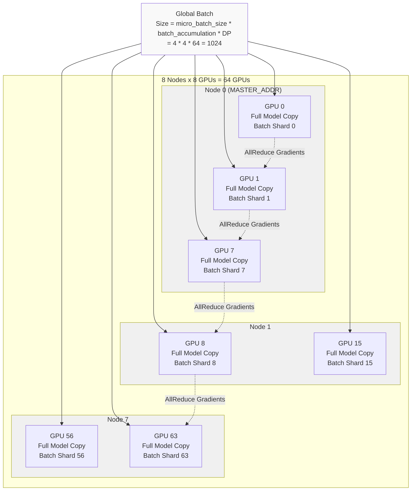
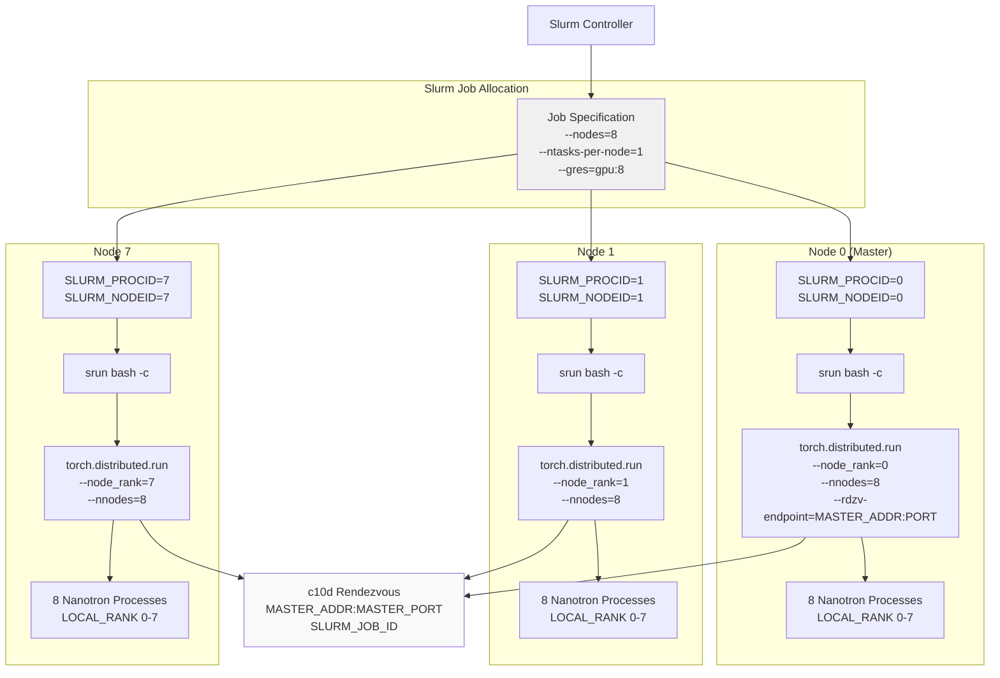
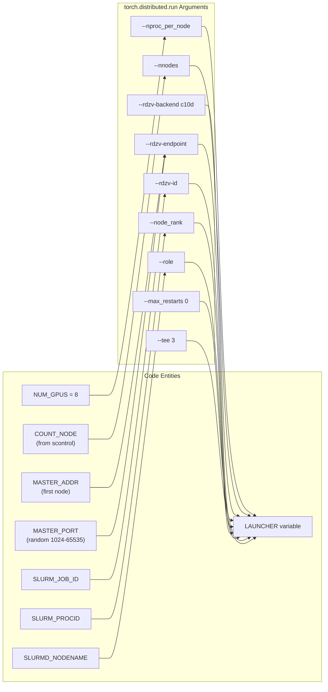
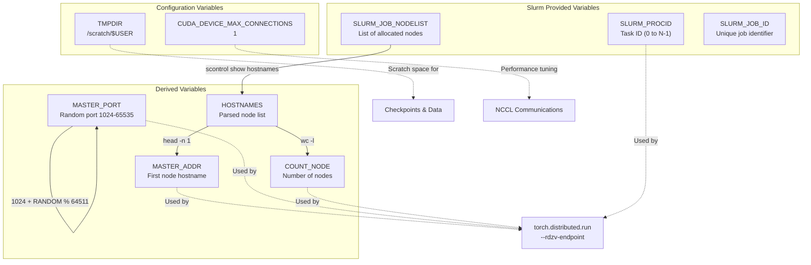
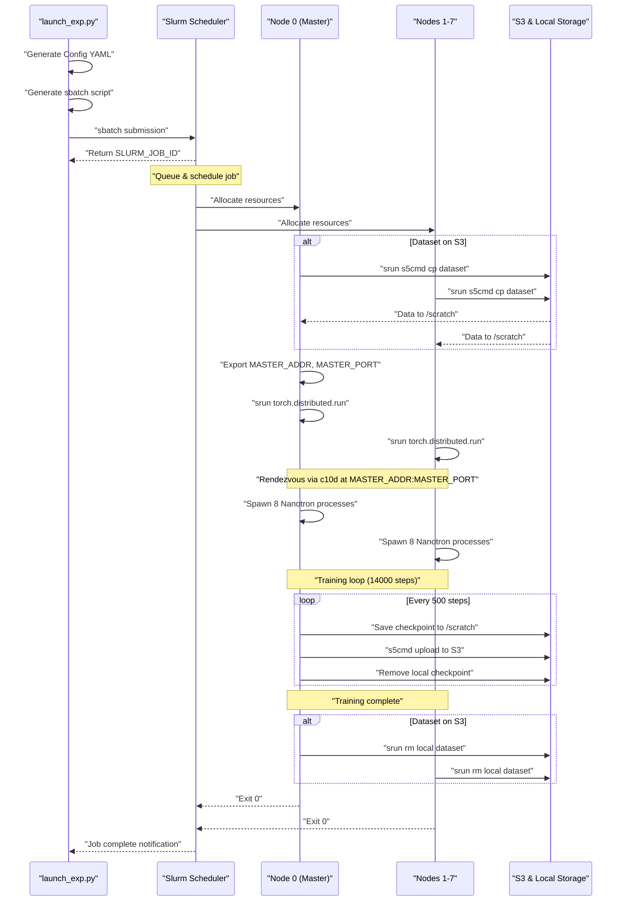

<!-- source: DeepWiki mcp.deepwiki.com · repo huggingface/fineweb-2 · page 5.2 Distributed Training · fetched 2026-10-26 -->

# Distributed Training

<details>
<summary>Relevant source files</summary>

The following files were used as context for generating this wiki page:

- [ablations/training/launch_exp.py](ablations/training/launch_exp.py)

</details>


## Purpose and Scope

This page documents the distributed training infrastructure used in FineWeb 2's ablation framework. It covers the parallelism strategies, multi-node execution setup, and Slurm integration used to train 1.46B parameter models on 64 GPUs across 8 nodes.

For information about model architecture and training hyperparameters, see [Training Configuration](#5.1). For checkpoint saving and S3 upload mechanisms, see [Checkpoint Management](#5.3). For Slurm script generation details, see [Slurm Job Configuration](#5.4).

---

## Parallelism Strategy

FineWeb 2 uses **pure data parallelism** for distributed training. Each GPU holds a complete copy of the 1.46B parameter model and processes different data batches. This strategy is configured via the `ParallelismArgs` dataclass.

### Production Configuration

The production parallelism settings are defined in [ablations/training/launch_exp.py:179-186]():

| Parameter | Value | Description |
|-----------|-------|-------------|
| `dp` | 64 | Data parallelism degree (one replica per GPU) |
| `pp` | 1 | Pipeline parallelism degree (no vertical model split) |
| `tp` | 1 | Tensor parallelism degree (no horizontal layer split) |
| `pp_engine` | "1f1b" | Pipeline parallelism schedule (unused with PP=1) |
| `tp_mode` | "REDUCE_SCATTER" | Tensor parallelism communication mode |
| `tp_linear_async_communication` | True | Asynchronous communication for tensor parallelism |

**Diagram: Data Parallelism Architecture (DP=64, PP=1, TP=1)**



Each GPU processes a different subset of the global batch (a "batch shard"). After the forward and backward passes, gradients are synchronized across all 64 GPUs using collective communication operations (AllReduce), ensuring all model replicas remain synchronized.

Sources: [ablations/training/launch_exp.py:179-186](), [ablations/training/launch_exp.py:190-196]()

### Debug Mode Configuration

A debug mode is available for testing with reduced resources [ablations/training/launch_exp.py:262-271]():

| Parameter | Production | Debug |
|-----------|------------|-------|
| `dp` | 64 | 2 |
| `pp` | 2 | 2 |
| `tp` | 2 | 2 |
| `micro_batch_size` | 4 | 3 |
| `batch_accumulation_per_replica` | 4 | 2 |
| Nodes | 8 | 1 |
| Total GPUs | 64 | 8 |

Debug mode is activated by setting the environment variable `DEBUG_MODE` to any non-zero value. This configuration uses mixed parallelism (DP=2, PP=2, TP=2) to test all parallelism dimensions on a single node.

Sources: [ablations/training/launch_exp.py:262-271]()

---

## Multi-Node Execution Architecture

FineWeb 2's distributed training spans 8 nodes with 8 GPUs each, coordinated by `torch.distributed.run`. The execution model uses one task per node, with each task launching all GPUs on that node.

**Diagram: Multi-Node Execution Flow**



The execution flow:
1. **Slurm allocates resources**: 8 nodes with 1 task per node [ablations/training/launch_exp.py:288-291]()
2. **Each task runs via srun**: The `srun` command launches the torch distributed runner on each node [ablations/training/launch_exp.py:367]()
3. **torch.distributed.run coordinates**: Each node's launcher spawns 8 processes (one per GPU) and coordinates via rendezvous
4. **Rendezvous synchronization**: All processes connect to `MASTER_ADDR:MASTER_PORT` using the c10d backend with `SLURM_JOB_ID` as the rendezvous ID

Sources: [ablations/training/launch_exp.py:286-291](), [ablations/training/launch_exp.py:347-357](), [ablations/training/launch_exp.py:367]()

---

## torch.distributed.run Configuration

The `torch.distributed.run` launcher is responsible for spawning GPU processes on each node and establishing distributed communication. The launcher command is constructed in [ablations/training/launch_exp.py:347-357]().

**Diagram: torch.distributed.run Parameter Mapping**



### Key Parameters

| Parameter | Value/Source | Purpose |
|-----------|--------------|---------|
| `--nproc_per_node` | `NUM_GPUS` (8) | Number of GPU processes to spawn per node |
| `--nnodes` | `COUNT_NODE` (8) | Total number of nodes in the job |
| `--rdzv-backend` | `c10d` | PyTorch c10d-based rendezvous backend |
| `--rdzv-endpoint` | `$MASTER_ADDR:$MASTER_PORT` | Rendezvous server address |
| `--rdzv-id` | `$SLURM_JOB_ID` | Unique job identifier for rendezvous |
| `--node_rank` | `$SLURM_PROCID` | This node's rank (0-7) |
| `--role` | `$SLURMD_NODENAME:` | Node identifier for logging |
| `--max_restarts` | 0 | Disable automatic process restarts |
| `--tee` | 3 | Redirect stdout/stderr to both console and file |

The launcher is invoked via `srun` to execute on all allocated nodes simultaneously [ablations/training/launch_exp.py:367]().

Sources: [ablations/training/launch_exp.py:32-34](), [ablations/training/launch_exp.py:347-357]()

---

## Environment Variables and Network Setup

Distributed training requires specific environment variables for process coordination and network configuration. These are set in the Slurm batch script [ablations/training/launch_exp.py:326-333]().

### Critical Environment Variables



### Variable Details

| Variable | Source | Value | Purpose |
|----------|--------|-------|---------|
| `HOSTNAMES` | scontrol | Node hostname list | Parsed from Slurm allocation |
| `MASTER_ADDR` | scontrol | First node hostname | Rendezvous server location |
| `MASTER_PORT` | Random | 1024-65535 | Rendezvous server port |
| `COUNT_NODE` | scontrol | 8 | Total nodes for validation |
| `TMPDIR` | Configuration | `/scratch/$USER` | Fast local storage path |
| `CUDA_DEVICE_MAX_CONNECTIONS` | Configuration | 1 | Limits CUDA graph complexity |

The `MASTER_ADDR` is extracted as the first node in the allocation [ablations/training/launch_exp.py:328](). The `MASTER_PORT` is randomly selected to avoid conflicts between concurrent jobs [ablations/training/launch_exp.py:329]().

Sources: [ablations/training/launch_exp.py:16](), [ablations/training/launch_exp.py:326-333]()

---

## Slurm Integration

The distributed training job is submitted to Slurm using an auto-generated batch script. The script configures resource allocation, environment setup, and distributed execution.

### Resource Allocation

The Slurm directives specify compute resources [ablations/training/launch_exp.py:286-300]():

| Directive | Value | Purpose |
|-----------|-------|---------|
| `--nodes` | 8 (or 1 in DEBUG_MODE) | Number of compute nodes |
| `--ntasks-per-node` | 1 | One task per node (crucial for torch.distributed) |
| `--cpus-per-task` | 88 (`NUM_CPUS_IN_NODE`) | CPU cores per task |
| `--gres` | `gpu:8` (`NUM_GPUS`) | GPUs per node |
| `--partition` | hopper-prod | Target partition |
| `--qos` | normal (or custom via `--priority`) | Quality of service |
| `--requeue` | Enabled | Auto-requeue on node failure |
| `--mail-type` | ALL | Email notifications |
| `--dependency` | Optional (`afterok:$JOB_ID`) | Job dependency chain |

**Critical**: The `--ntasks-per-node=1` setting is essential. Each node runs exactly one task, which then uses `torch.distributed.run` to spawn 8 GPU processes. This differs from MPI-style launches where each GPU would be a separate task.

Sources: [ablations/training/launch_exp.py:32-34](), [ablations/training/launch_exp.py:286-300]()

### Job Execution Flow

**Diagram: Slurm Job Execution Sequence**



The execution sequence:
1. **Script generation**: `launch_exp.py` creates a Nanotron config YAML and Slurm batch script [ablations/training/launch_exp.py:274-277]()
2. **Job submission**: The script is submitted via `sbatch` using the `launch_slurm_job` helper [ablations/training/launch_exp.py:70-83]()
3. **Resource allocation**: Slurm allocates 8 nodes with requested resources
4. **Dataset download** (if on S3): Each node copies data from S3 to local scratch using `s5cmd` [ablations/training/launch_exp.py:283]()
5. **Environment setup**: Master node address and port are configured [ablations/training/launch_exp.py:327-330]()
6. **Distributed launch**: `srun` executes `torch.distributed.run` on all nodes [ablations/training/launch_exp.py:367]()
7. **Training**: Nanotron trains for specified steps with periodic checkpointing
8. **Cleanup**: Local datasets are removed if downloaded from S3 [ablations/training/launch_exp.py:372-374]()

Sources: [ablations/training/launch_exp.py:70-83](), [ablations/training/launch_exp.py:283-375]()

### Dataset Download Strategy

When the dataset is stored on S3 (path starts with `s3://`), it is downloaded to local scratch storage before training [ablations/training/launch_exp.py:283]():

```bash
srun --ntasks-per-node=1 rm -rf /scratch/$USER/dataset
srun --ntasks-per-node=1 s5cmd cp 's3://path/to/data/*' /scratch/$USER/dataset/{RUN}/
```

The `--ntasks-per-node=1` ensures each node downloads the data once rather than per GPU. The dataset path in the Nanotron config is adjusted accordingly [ablations/training/launch_exp.py:158]():

```python
dataset_folder=args.data if not args.data.startswith("s3://") 
    else f"{LOCAL_TMP_PATH_ON_NODE}/dataset/{RUN}/"
```

After training completes, local datasets are cleaned up to free scratch space [ablations/training/launch_exp.py:372-374]().

Sources: [ablations/training/launch_exp.py:16](), [ablations/training/launch_exp.py:158](), [ablations/training/launch_exp.py:283](), [ablations/training/launch_exp.py:372-374]()

---

## Fault Tolerance and Job Management

The Slurm configuration includes several fault tolerance mechanisms:

### Automatic Requeuing

The `--requeue` directive [ablations/training/launch_exp.py:299]() enables automatic job requeuing on node failures. Combined with Nanotron's checkpoint resumption capabilities (see [Checkpoint Management](#5.3)), training can resume from the last saved checkpoint.

### Job Dependencies

Jobs can be chained using the `-d` argument [ablations/training/launch_exp.py:96](), which adds a dependency directive [ablations/training/launch_exp.py:300]():

```bash
sbatch -d afterok:$PREVIOUS_JOB_ID script.sh
```

This ensures sequential execution of related experiments.

### Completion Checking

Before launching a job, the script checks if training is already complete [ablations/training/launch_exp.py:109-112]():

```python
df = get_datafolder(f"{S3_CHECKPOINTS_PREFIX}/{RUN}")
if df.exists("latest.txt") and df.cat_file("latest.txt") == bytes(str(args.train_steps), "utf-8"):
    print(f"Not launching as latest checkpoint is already {args.train_steps} steps")
    sys.exit(0)
```

This prevents redundant job submissions by verifying the checkpoint count in S3.

### Notifications

Email notifications are sent for all job events via `--mail-type=ALL` and `--mail-user` [ablations/training/launch_exp.py:297-298](), enabling monitoring of job status without manual checking.

Sources: [ablations/training/launch_exp.py:96](), [ablations/training/launch_exp.py:109-112](), [ablations/training/launch_exp.py:297-300]()

---

## Performance Considerations

### CPU-to-GPU Ratio

The system allocates 88 CPUs per node [ablations/training/launch_exp.py:33]() with 8 GPUs, yielding 11 CPUs per GPU [ablations/training/launch_exp.py:34](). This high ratio supports:
- Efficient data loading (0 loading workers configured, relying on OS prefetch)
- Checkpoint saving/uploading in parallel with training
- S3 transfers using multiple `s5cmd` workers

### CUDA Device Connections

`CUDA_DEVICE_MAX_CONNECTIONS=1` [ablations/training/launch_exp.py:333]() limits concurrent CUDA operations per device. This reduces overhead for simple data-parallel workloads and improves NCCL collective performance.

### Network Optimization

The pure data parallelism strategy (DP=64, PP=1, TP=1) minimizes inter-node communication compared to model parallelism:
- **TP=1**: No tensor-parallel all-gather/reduce-scatter operations
- **PP=1**: No pipeline-parallel point-to-point transfers
- **Only AllReduce**: Gradient synchronization uses bandwidth-optimal ring allreduce

This is well-suited for high-bandwidth GPU interconnects where all-reduce scales efficiently.

### Random Startup Delay

A random delay (0-1 seconds) is inserted before training starts [ablations/training/launch_exp.py:359-363]():

```bash
random_milliseconds=$(( RANDOM % 1001 ))
sleep_time=$(bc <<< "scale=3; $random_milliseconds / 1000")
sleep $sleep_time
```

This prevents thundering herd problems when many jobs simultaneously access shared resources (e.g., HuggingFace Hub for tokenizer downloads).

Sources: [ablations/training/launch_exp.py:33-34](), [ablations/training/launch_exp.py:333](), [ablations/training/launch_exp.py:359-363]()

---

