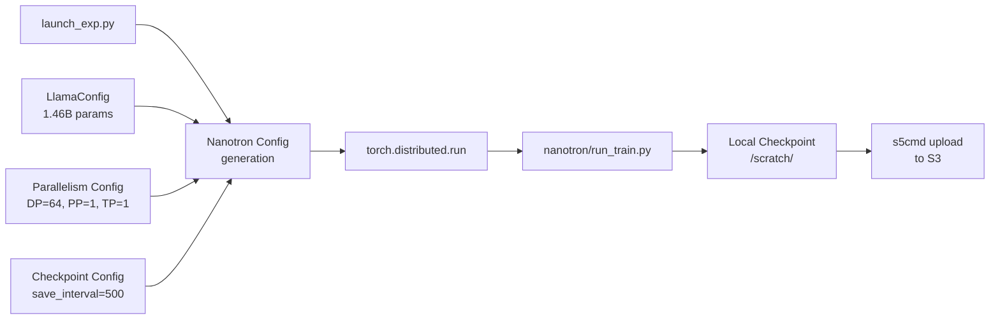
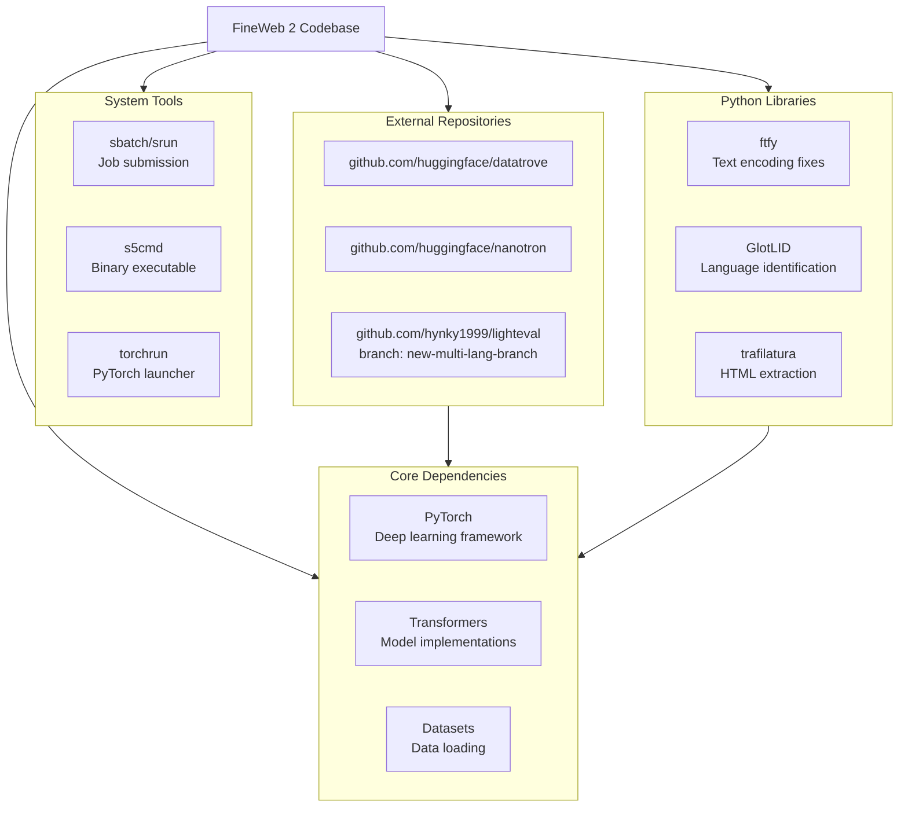

<!-- source: DeepWiki mcp.deepwiki.com · repo huggingface/fineweb-2 · page 7 External Tools and Dependencies · fetched 2026-10-26 -->

# External Tools and Dependencies

<details>
<summary>Relevant source files</summary>

The following files were used as context for generating this wiki page:

- [README.md](README.md)

</details>


This document provides comprehensive documentation of the external tools, libraries, and frameworks that FineWeb 2 integrates to enable multilingual data processing, model training, and evaluation. These dependencies are organized into three categories: data processing tools, machine learning frameworks, and infrastructure components.

For details on how these tools are used within specific pipeline stages, see [Data Processing Pipeline](#2). For information about the training and evaluation systems that leverage these frameworks, see [Training System](#5) and [Ablation and Evaluation Framework](#4).

## Overview

FineWeb 2 relies on a carefully selected set of external dependencies to handle the complexity of processing data in 1000+ languages. Rather than implementing custom solutions for every requirement, the project integrates best-in-class open-source tools and adapts them for multilingual scale.

The following table summarizes the major external dependencies:

| Category | Tool | Purpose | Version/Branch |
|----------|------|---------|----------------|
| Language Processing | GlotLID | Language identification with 2000+ labels | Latest |
| Language Processing | FTFY | Text encoding fixes | Latest |
| Language Processing | trafilatura | HTML extraction with table support | Latest |
| Data Processing | Datatrove | Pipeline orchestration and data operations | Latest |
| Data Processing | s5cmd | High-performance S3 transfers | Latest |
| ML Framework | Nanotron | Distributed model training | Latest |
| ML Framework | LightEval-Fork | Multilingual evaluation tasks | new-multi-lang-branch |
| ML Framework | torch.distributed | Multi-GPU coordination | PyTorch standard |
| Infrastructure | Slurm | Job scheduling and resource management | Cluster-dependent |
| Infrastructure | S3 | Object storage for data and checkpoints | AWS/compatible |
| Infrastructure | HuggingFace Hub | Tokenizer and dataset hosting | Latest |

Sources: [README.md:87-90]()

## Tool Integration Architecture

```mermaid
graph TB
    subgraph Pipeline["Data Processing Pipeline"]
        LangID["Language Identification"]
        Dedup["Deduplication"]
        Filter["Quality Filtering"]
        PII["PII Anonymization"]
    end
    
    subgraph Training["Training Pipeline"]
        Tokenization["launch_tokenization.py"]
        TrainScript["launch_exp.py"]
    end
    
    subgraph Evaluation["Evaluation Pipeline"]
        EvalScript["launch_evals.py"]
        RandomEval["launch_random_evals.py"]
        BatchEval["run_all_missing_evals.sh"]
    end
    
    subgraph LangTools["Language Processing Tools"]
        GlotLID["GlotLID<br/>2000+ languages"]
        FTFY["FTFY<br/>encoding fixes"]
        Trafilatura["trafilatura<br/>HTML extraction"]
    end
    
    subgraph DataTools["Data Processing Tools"]
        Datatrove["Datatrove<br/>pipeline framework"]
        S5cmd["s5cmd<br/>S3 transfers"]
    end
    
    subgraph MLFrameworks["ML Frameworks"]
        Nanotron["Nanotron<br/>training"]
        LightEval["LightEval-Fork<br/>new-multi-lang-branch"]
        TorchDist["torch.distributed<br/>launcher"]
    end
    
    subgraph Infrastructure["Infrastructure"]
        Slurm["Slurm Workload Manager"]
        S3Storage["S3 Object Storage"]
        HFHub["HuggingFace Hub"]
    end
    
    LangID --> GlotLID
    LangID --> Datatrove
    
    Dedup --> Datatrove
    Filter --> Datatrove
    
    PII --> FTFY
    PII --> Trafilatura
    PII --> Datatrove
    
    Tokenization --> Datatrove
    Tokenization --> HFHub
    Tokenization --> S5cmd
    Tokenization --> Slurm
    
    TrainScript --> Nanotron
    TrainScript --> TorchDist
    TrainScript --> S5cmd
    TrainScript --> Slurm
    TrainScript --> S3Storage
    
    EvalScript --> LightEval
    EvalScript --> TorchDist
    EvalScript --> S5cmd
    EvalScript --> Slurm
    EvalScript --> S3Storage
    
    RandomEval --> LightEval
    RandomEval --> Slurm
    
    BatchEval --> EvalScript
    
    Nanotron --> TorchDist
    LightEval --> HFHub
```



**Tool Integration Architecture**: This diagram shows how external tools integrate with FineWeb 2's main processing pipelines. Language processing tools (GlotLID, FTFY, trafilatura) are primarily used in the data processing pipeline. Data processing tools (Datatrove, s5cmd) are used across all pipelines. ML frameworks (Nanotron, LightEval-Fork, torch.distributed) support training and evaluation workflows. Infrastructure components (Slurm, S3, HuggingFace Hub) provide execution environment and storage.

Sources: [README.md:20-23](), [README.md:60-63](), [README.md:87-90]()

## Data Processing Tools

### Datatrove

Datatrove is the core pipeline orchestration framework used throughout FineWeb 2's data processing pipeline. It provides abstractions for reading, processing, filtering, and writing document collections at scale.

**Key Capabilities:**
- `DocumentsPipeline` abstraction for streaming large datasets
- `PipelineStep` base class for composable processing operations
- Built-in readers for various data formats
- Built-in writers for output serialization
- Distributed processing support via rank and world_size parameters

**Integration Points:**
- Language identification stage uses Datatrove readers and filters
- Deduplication implements custom `PipelineStep` for minhash clustering
- Quality filtering applies multiple Datatrove filter steps
- PII anonymization implements filters as pipeline steps
- Re-hydration functionality uses custom `Rehydrater` pipeline step

The re-hydration example in the README demonstrates Datatrove's `PipelineStep` pattern:

```python
class Rehydrater(PipelineStep):
    def run(self, data: DocumentsPipeline, rank: int = 0, world_size: int = 1) -> DocumentsPipeline:
        # Custom upsampling logic based on minhash_cluster_size metadata
        ...
```

Sources: [README.md:37-51](), [README.md:87-90]()

### GlotLID

GlotLID (Global Language Identification) is the language identification model used to classify documents into 2000+ language labels and identify scripts.

**Key Features:**
- 2000+ language labels (vs 176 in fasttext176 used in original FineWeb)
- Script identification capability (e.g., `aai_Latn`, `ace_Arab`)
- Per-document confidence scores
- Supports ISO 639-3 language codes

**Integration:**
- Applied after initial English filtering (< 0.65 English score)
- Produces `{iso3_lang}_{script}` identifiers for each document
- Confidence scores compared against language-specific thresholds from configuration files
- Documents below threshold are filtered out

**Configuration:**
Each language configuration file in `/configs/{iso3_lang}_{script}.yml` can specify minimum confidence thresholds for language classification.

Sources: [README.md:20-22]()

### FTFY

FTFY (Fixes Text For You) is a text encoding repair library that corrects mojibake and other encoding issues common in web-scraped data.

**Purpose:**
- Fixes encoding issues in multilingual text
- Repairs mojibake (garbled characters from encoding mismatches)
- Normalizes Unicode representation

**Integration:**
Applied during the PII Anonymization and Fixes stage, ensuring that text is properly encoded before downstream processing.

Sources: [README.md:62]()

### trafilatura

trafilatura is an HTML extraction library specialized for extracting main textual content from web pages while removing boilerplate.

**Key Features:**
- Main content extraction from HTML
- Boilerplate removal (navigation, ads, footers)
- Preservation of document structure
- Special handling for tables

**Custom Modifications:**
FineWeb 2 includes additional code to fix trafilatura-created artifacts related to table extraction, addressing edge cases in table parsing.

**Disabled Features:**
Paragraph-level metadata is not preserved as the repetition filter in FineWeb 2 does not rely on paragraph boundaries.

Sources: [README.md:63](), [README.md:57]()

### s5cmd

s5cmd is a high-performance S3 command-line tool used for efficient data transfers between local storage and S3 buckets.

**Performance Characteristics:**
- Multi-threaded transfers (typically 16 workers)
- Parallel operations for batch upload/download
- Optimized for large-scale data movement

**Usage Patterns:**
- Downloading training data from S3 to local scratch storage
- Uploading model checkpoints from local storage to S3
- Transferring evaluation results to persistent storage
- Batch operations for tokenized dataset management

**Integration Context:**
- Used in tokenization scripts for dataset downloads
- Used in training scripts for checkpoint uploads
- Used in evaluation scripts for checkpoint downloads and result uploads
- Typically invoked with `s5cmd cp` commands with parallel worker flags

Sources: Based on infrastructure diagram analysis

## ML Frameworks

### Nanotron

Nanotron is the distributed training framework used to train 1.46B parameter models for ablation studies.

**Architecture:**
- Supports data parallelism (DP), pipeline parallelism (PP), and tensor parallelism (TP)
- Integrates with PyTorch's distributed training infrastructure
- Provides checkpoint management with S3 integration
- Implements efficient gradient accumulation and mixed precision training

**FineWeb 2 Configuration:**
- Primary configuration: DP=64, PP=1, TP=1 (pure data parallelism)
- 8 nodes, 64 GPUs total for production runs
- Debug mode: DP=2, PP=2, TP=2 on 1 node, 8 GPUs
- 1.46B parameter LlamaConfig: 14 layers, 2048 hidden size
- Checkpoints saved every 500 steps

**Integration:**
The `launch_exp.py` script generates Nanotron configuration files and launches distributed training via `torch.distributed.run`.



**Nanotron Training Flow**: The `launch_exp.py` script generates comprehensive Nanotron configurations including model architecture (LlamaConfig), parallelism strategy, and checkpointing settings. Training is launched via `torch.distributed.run` which invokes Nanotron's `run_train.py` entry point. Checkpoints are saved locally and uploaded to S3 for persistence.

Sources: [README.md:66](), [README.md:90]()

### LightEval-Fork

LightEval-Fork is a customized version of the LightEval evaluation framework, modified to support multilingual evaluation tasks.

**Key Modifications:**
- Branch: `new-multi-lang-branch`
- Extended with FineWeb 2-specific multilingual tasks
- Integration with FineTasks evaluation suite
- Support for 9+ languages in evaluation

**FineTasks Suite:**
The evaluation suite designed for FineWeb 2 ablations, including:
- Language-specific tasks for Arabic, Chinese, French, Hindi, Russian, Swahili, Telugu, Thai, Turkish
- Early-signal tasks for quick performance assessment
- M3EXAM multilingual examination tasks

**Integration:**
Evaluation scripts (`launch_evals.py`, `launch_random_evals.py`) generate `lightevalconf.yml` configuration files that specify:
- Model checkpoint paths
- Task selection
- Batch sizes
- Number of few-shot examples
- Output directories

Sources: [README.md:66](), [README.md:69-71](), [README.md:89]()

### torch.distributed

PyTorch's distributed training module provides the multi-GPU coordination layer for both training and evaluation.

**Key Functions:**
- `torch.distributed.run`: Command-line launcher for distributed jobs
- Multi-process group initialization
- Communication backends (NCCL for GPUs)
- Gradient synchronization across devices

**Usage Pattern:**
Both Nanotron training and LightEval evaluation use `torch.distributed.run` as the entry point for multi-GPU execution. The launcher handles:
- Process spawning (one per GPU)
- Rank assignment
- Master address/port coordination
- Environment variable configuration

**Typical Invocation:**
```
torchrun --nproc_per_node=<gpus_per_node> \
         --nnodes=<num_nodes> \
         --master_addr=<address> \
         --master_port=<port> \
         <script.py> <args>
```

Sources: Based on distributed training architecture analysis

## Infrastructure

### Slurm Workload Manager

Slurm is the job scheduling and resource management system used to orchestrate all distributed computations in FineWeb 2.

**Core Capabilities:**
- Job submission and scheduling
- Multi-node resource allocation
- GPU resource management
- Job dependencies and chaining
- Array jobs for parallel task execution

**FineWeb 2 Usage Patterns:**

| Script | Slurm Feature | Purpose |
|--------|---------------|---------|
| `launch_tokenization.py` | Array jobs | Parallel tokenization across dataset shards |
| `launch_exp.py` | Multi-node allocation | 8-node, 64-GPU training jobs |
| `launch_evals.py` | Array jobs | Parallel checkpoint evaluation |
| `run_all_missing_evals.sh` | Batch submission | Launch evaluation jobs for multiple languages |

**Array Job Pattern:**
Evaluation scripts use Slurm array jobs to parallelize checkpoint evaluation:
```bash
#SBATCH --array=0-N
# Each array task evaluates one checkpoint
```

**Resource Specification:**
- Nodes: `--nodes=<count>`
- GPUs per node: `--gres=gpu:<count>`
- Time limits: `--time=<hours:minutes:seconds>`
- Partition selection: `--partition=<name>`

Sources: Based on job orchestration architecture analysis

### S3 Object Storage

S3-compatible object storage provides persistent storage for datasets, model checkpoints, and evaluation results.

**Storage Organization:**
- **Training data**: Tokenized datasets organized by language
- **Model checkpoints**: Organized by experiment ID and training step
- **Evaluation results**: Organized by model ID and task suite
- **Configuration files**: Language-specific YAML configurations

**Performance Optimization:**
- Local scratch storage (`/scratch/$USER/`) used during active training
- Checkpoints uploaded to S3 after each save interval
- Local copies deleted after successful S3 upload
- Evaluation jobs download checkpoints to local storage before inference

**Transfer Tool:**
All S3 operations use `s5cmd` for high-performance parallel transfers with 16 workers by default.

**Access Pattern:**
```
s3://<bucket>/
  ├── datasets/<language>/<tokenized_data>
  ├── checkpoints/<exp_id>/<step>/
  └── evaluations/<model_id>/<task>/results.json
```

Sources: Based on storage architecture and checkpoint management analysis

### HuggingFace Hub

The HuggingFace Hub provides two critical services for FineWeb 2:

**Tokenizer Repository:**
- Pre-trained tokenizers for language families
- Automatic tokenizer assignment based on language codes
- 200+ languages mapped to appropriate tokenizers
- Accessible via space: `HuggingFaceFW-Dev/lang-word-tokenizers`

**Dataset Hosting:**
- Final FineWeb 2 dataset published at `HuggingFaceFW/fineweb-2`
- Reference datasets for evaluation
- Community access and download

**Word/Sentence Tokenization:**
For languages without available tokenizers, FineWeb 2 implements automatic assignment based on language family similarity. This mapping enables word and sentence tokenization for filtering operations across 1000+ languages.

Sources: [README.md:82](), [README.md:4]()

## Dependency Management



**Dependency Hierarchy**: FineWeb 2 depends on three layers of external tools. Core dependencies (PyTorch, Transformers, Datasets) provide fundamental ML infrastructure. External repositories (Datatrove, Nanotron, LightEval-Fork) provide specialized frameworks. System tools (Slurm, s5cmd, torchrun) handle job orchestration and data movement. Python libraries (FTFY, GlotLID, trafilatura) handle text processing.

Sources: [README.md:87-90]()

## Version Pinning and Compatibility

The project maintains compatibility with the following tool versions:

| Tool | Version Strategy | Notes |
|------|------------------|-------|
| Datatrove | Latest main branch | Active development, API stable |
| Nanotron | Latest main branch | Regular updates for performance |
| LightEval-Fork | Pinned branch: new-multi-lang-branch | Custom multilingual modifications |
| GlotLID | Latest release | Model weights periodically updated |
| FTFY | Latest PyPI release | Stable API |
| trafilatura | Latest PyPI release | With custom patches |
| s5cmd | Binary from releases | Minimal version dependencies |

**Critical Dependencies:**
- **LightEval-Fork** must use the `new-multi-lang-branch` to access FineTasks
- **Slurm** version depends on cluster installation
- **PyTorch** version must support CUDA version available on cluster

Sources: [README.md:87-90]()

## Tool Selection Rationale

The choice of external tools reflects specific requirements of multilingual data processing at scale:

| Requirement | Tool Choice | Rationale |
|-------------|-------------|-----------|
| 2000+ language support | GlotLID | Only model with sufficient language coverage and script detection |
| Pipeline composability | Datatrove | Native support for streaming large datasets with modular steps |
| Distributed training | Nanotron | Optimized for 1B-scale models with flexible parallelism |
| S3 performance | s5cmd | 10x faster than aws-cli for parallel transfers |
| Multilingual evaluation | LightEval-Fork | Extensible framework with custom task support |
| HTML extraction | trafilatura | Best balance of speed and quality for table handling |
| Encoding fixes | FTFY | Standard solution for mojibake in multilingual text |

Sources: [README.md:21-22](), [README.md:87-90]()

---

