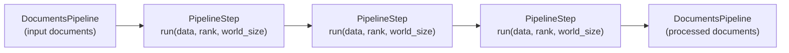
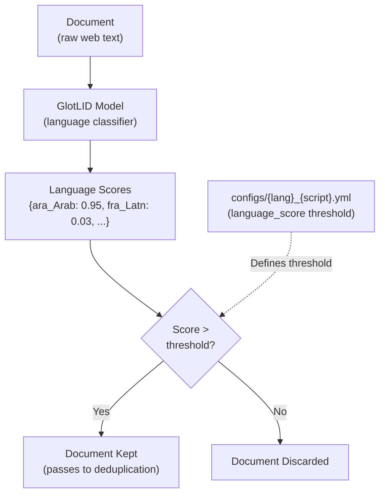
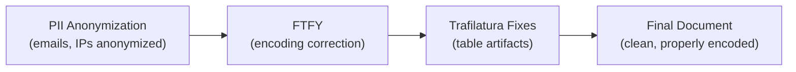
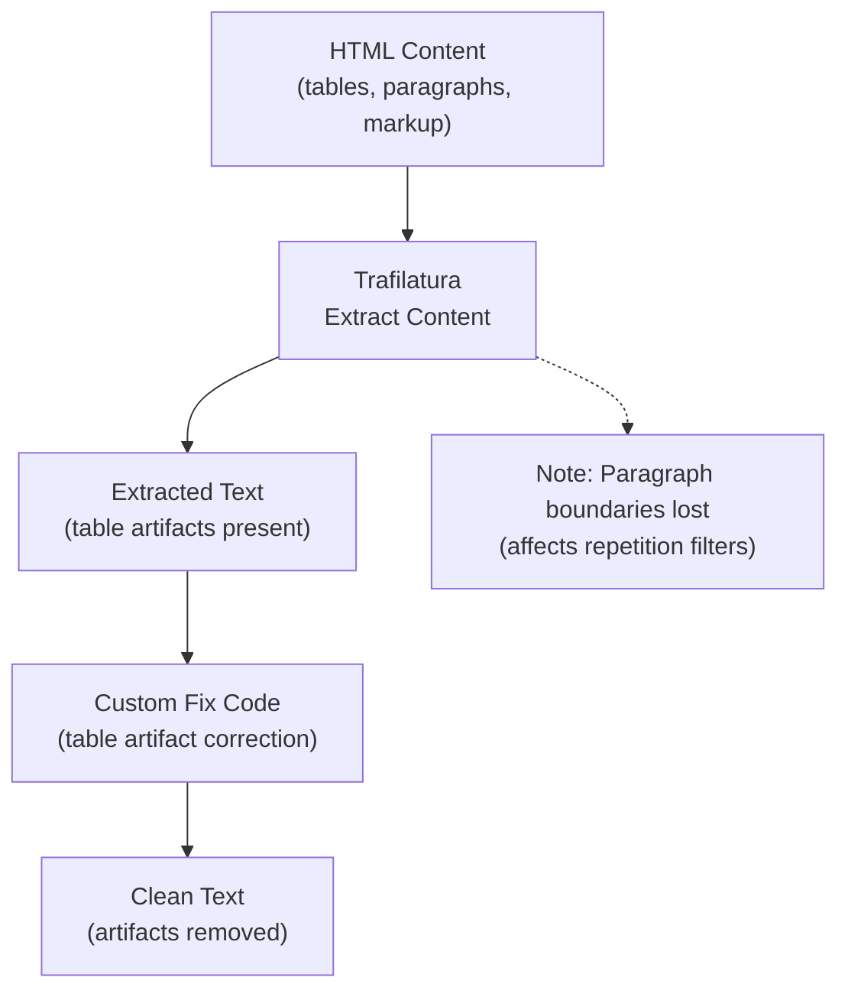
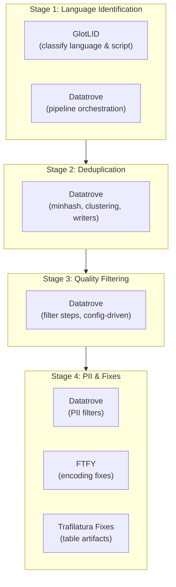

<!-- source: DeepWiki mcp.deepwiki.com · repo huggingface/fineweb-2 · page 7.1 Data Processing Tools · fetched 2026-10-26 -->

# Data Processing Tools

<details>
<summary>Relevant source files</summary>

The following files were used as context for generating this wiki page:

- [README.md](README.md)

</details>


## Purpose and Scope

This page documents the external data processing tools integrated into the FineWeb 2 pipeline. These tools handle language identification, text extraction, encoding fixes, and pipeline orchestration. For information about ML frameworks used in training and evaluation, see [ML Frameworks](#7.2). For infrastructure components like Slurm and S3, see [Infrastructure](#7.3).

The four primary data processing tools are:
- **Datatrove**: Pipeline orchestration framework
- **GlotLID**: Multilingual language identification
- **FTFY**: Text encoding correction
- **Trafilatura**: HTML content extraction

These tools support the four-stage data processing pipeline documented in [Data Processing Pipeline](#2).

**Sources:** [README.md:1-107]()

---

## Datatrove Framework

### Overview

Datatrove is the core pipeline orchestration framework used throughout FineWeb 2. It provides the fundamental building blocks for reading, transforming, filtering, and writing web data at scale. The framework enables modular pipeline construction through composable steps.

### Core Components

Datatrove provides several key abstractions that structure the entire processing pipeline:

| Component | Purpose | Usage in FineWeb 2 |
|-----------|---------|-------------------|
| `DocumentsPipeline` | Iterator over document batches | Primary data container throughout all processing stages |
| `PipelineStep` | Base class for pipeline operations | All filters, deduplication, and transformation steps inherit from this |
| `Block` | Reader for input data sources | Loads CommonCrawl data with language filtering |
| `Writer` | Output data to storage | Saves processed documents to disk/S3 |

### Integration Pattern

All processing stages in FineWeb 2 follow the Datatrove pattern where each stage implements `PipelineStep.run()`:



**Datatrove Pipeline Pattern**

### Example: Re-hydration Step

The README provides a concrete example of a custom Datatrove pipeline step that implements the deduplication re-hydration logic:

```python
class Rehydrater(PipelineStep):
    def run(self, data: DocumentsPipeline, rank: int = 0, world_size: int = 1) -> DocumentsPipeline:
        import bisect
        upsampling_weights = {1: 1, 2: 2, 3: 3, 5: 5, 100: 8, 1000: 1}
        limits = sorted(upsampling_weights.keys())

        for doc in data:
            upsampling_weight = upsampling_weights[
                limits[bisect.bisect_right(limits, doc.metadata["minhash_cluster_size"]) - 1]]
            for _ in range(upsampling_weight):
                yield doc
```

This demonstrates:
- Inheritance from `PipelineStep`
- Processing `DocumentsPipeline` iterators
- Access to document metadata (`doc.metadata["minhash_cluster_size"]`)
- Generator-based document yielding for memory efficiency
- Distributed processing support via `rank` and `world_size` parameters

**Sources:** [README.md:38-51](), [README.md:88]()

---

## GlotLID Language Identification

### Overview

GlotLID is the language identification tool used in FineWeb 2's first processing stage. It replaced fasttext176 (used in the original FineWeb) to enable broader language coverage and script detection.

### Key Capabilities

| Feature | Capability | Benefit for FineWeb 2 |
|---------|-----------|----------------------|
| Language Coverage | 2000+ available labels | Supports 1000+ languages in final dataset |
| Script Identification | Detects writing system used | Enables per-language/per-script configurations |
| Confidence Scores | Per-language probability scores | Allows language-specific confidence thresholds |

### Language and Script Labels

GlotLID outputs labels in the format `{iso3_code}_{script}`, for example:
- `eng_Latn` - English in Latin script
- `ara_Arab` - Arabic in Arabic script
- `cmn_Hans` - Mandarin Chinese in Simplified Chinese script

These labels directly correspond to the configuration files stored in `/configs/{iso3_lang}_{script}.yml`, creating a tight coupling between language identification and downstream processing parameters.



**GlotLID Language Filtering Process**

### Integration in Stage 1

GlotLID is applied in the Language Identification stage ([Stage 2.1](#2.1)) to documents that scored below 0.65 in English during original FineWeb processing. For each document:

1. GlotLID predicts language and script
2. Prediction confidence is compared against the language-specific `language_score` threshold from the config file
3. Documents meeting the threshold continue to deduplication
4. Language and script labels are stored in document metadata for subsequent per-language processing

This per-language confidence threshold approach allows tuning recall/precision tradeoffs for each language independently based on its characteristics and available training data.

**Sources:** [README.md:20-22]()

---

## FTFY Text Encoding Fixes

### Overview

FTFY (Fixes Text For You) is a text encoding correction library applied in the final PII Anonymization and Fixes stage ([Stage 2.4](#2.4)). It automatically detects and repairs common encoding issues that occur during web scraping and data transmission.

### Common Encoding Problems Fixed

FTFY addresses several categories of encoding corruption:

| Problem Type | Example | FTFY Correction |
|--------------|---------|----------------|
| Mojibake | `Café` | `Café` |
| HTML Entities | `&lt;div&gt;` | `<div>` |
| Unicode Normalization | Multiple representations of `é` | Single canonical form |
| Mixed Encodings | UTF-8 interpreted as Latin-1 | Proper UTF-8 decoding |

### Application in Pipeline

FTFY is applied after PII anonymization but before final data output. This ordering ensures:
1. PII patterns are detected before text transformation
2. Encoding issues don't interfere with downstream processing
3. Final dataset has consistent, properly-encoded text

The tool operates on document text content without modifying metadata or structure, making it a straightforward text transformation step in the Datatrove pipeline.



**Stage 2.4 Processing Order**

**Sources:** [README.md:62]()

---

## Trafilatura HTML Extraction and Fixes

### Overview

Trafilatura is an HTML extraction library that converts web pages to clean text. While it performs the initial content extraction earlier in the pipeline, FineWeb 2 applies additional fixes in Stage 2.4 to address specific artifacts created by Trafilatura's processing.

### Table Artifact Issues

Trafilatura's HTML table extraction can introduce formatting artifacts that degrade text quality. The FineWeb 2 pipeline includes custom code to detect and correct these artifacts, though the specific nature of the fixes is implementation-dependent.

Common table-related issues in web extraction include:
- Merged cell content without proper spacing
- Lost column/row structure leading to unreadable text
- Duplicate content from table headers
- Special characters from table formatting markup

### Custom Fix Implementation

The README indicates that custom code was added specifically to handle these trafilatura-created table artifacts. This code likely:
1. Detects patterns characteristic of table extraction issues
2. Applies heuristic corrections based on common artifact types
3. Optionally removes severely corrupted table content

The fixes are applied in Stage 2.4 alongside encoding corrections, ensuring all text quality issues are addressed before final output.

### Paragraph Handling

An important note about trafilatura's behavior: it does not preserve paragraph boundaries in its extraction output. This directly impacts the filtering stage, where paragraph-related repetition filters had to be disabled since trafilatura strips this structural information.



**Trafilatura Processing and Custom Fixes**

**Sources:** [README.md:57](), [README.md:63]()

---

## Tool Integration Architecture

### Pipeline Stage Mapping

The four data processing tools integrate at specific stages of the processing pipeline:



**Data Processing Tools Across Pipeline Stages**

### Data Flow Pattern

All stages follow a consistent pattern where Datatrove provides the orchestration layer while specialized tools perform specific transformations:

| Stage | Datatrove Role | Specialized Tools | Configuration Source |
|-------|---------------|-------------------|---------------------|
| Language ID | Reader, Writer, Pipeline | GlotLID | `language_score` threshold |
| Deduplication | MinHash, Clustering, Writer | None (native Datatrove) | `dup_line_frac`, `dup_n_grams` |
| Quality Filtering | Filter steps, Pipeline | None (native filters) | All quality metrics ([Section 3.3](#3.3)) |
| PII & Fixes | PII filter, Pipeline | FTFY, Trafilatura fixes | None (fixed logic) |

### Distributed Processing

All tools integrate with Datatrove's distributed processing capabilities through the `rank` and `world_size` parameters. This enables:
- Parallel processing across multiple workers
- Independent processing of language-specific document partitions
- Efficient scaling to 1000+ languages

The tools themselves don't need to implement distributed logic—Datatrove handles document partitioning and worker coordination, while the tools operate on their assigned document subset.

**Sources:** [README.md:9-64](), [README.md:88-90]()

---

## Version Information

The FineWeb 2 pipeline uses specific versions of these tools:

| Tool | Repository | Notes |
|------|-----------|-------|
| Datatrove | [github.com/huggingface/datatrove](https://github.com/huggingface/datatrove) | Main branch |
| GlotLID | [github.com/cisnlp/GlotLID](https://github.com/cisnlp/GlotLID) | 2000+ language model |
| FTFY | Standard PyPI package | Latest stable version |
| Trafilatura | Standard PyPI package | With custom fixes |

For reproducibility, users should reference the exact versions specified in the project's dependency files when replicating the pipeline.

**Sources:** [README.md:88-90]()

---

