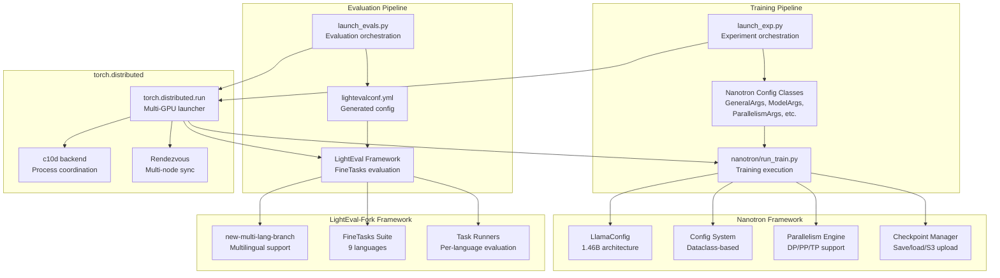
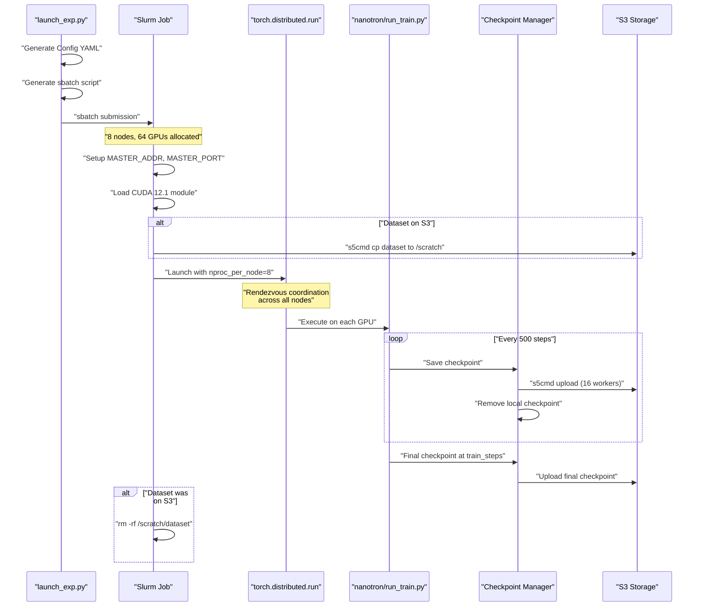
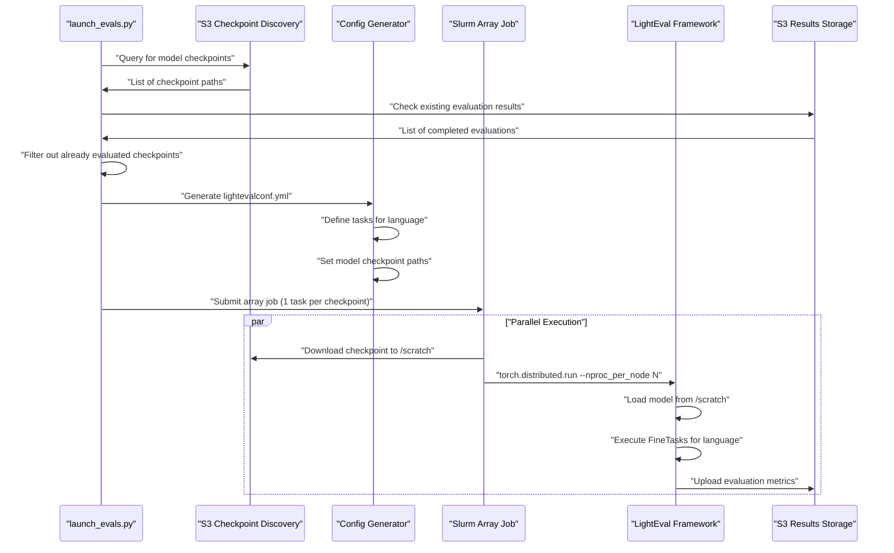
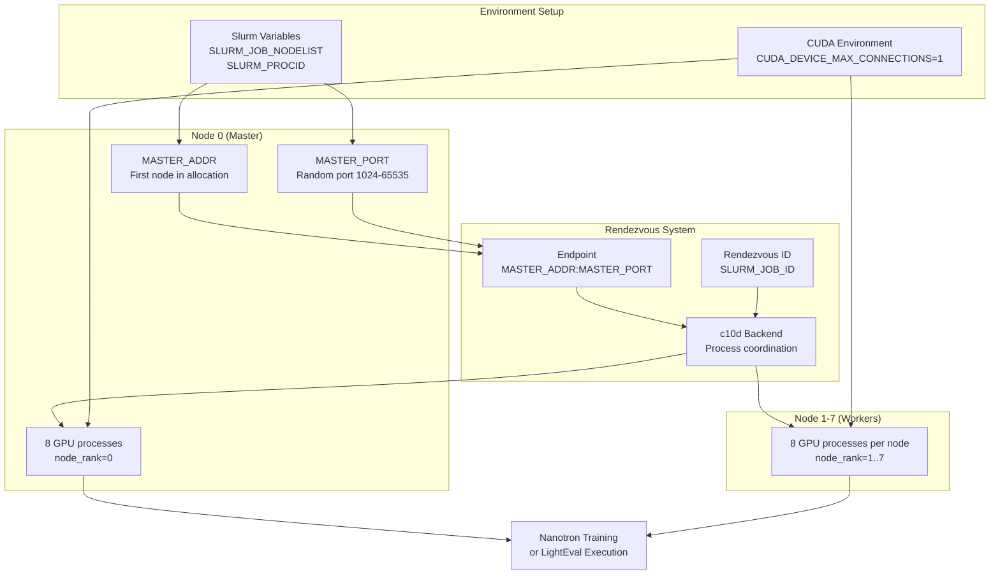

<!-- source: DeepWiki mcp.deepwiki.com · repo huggingface/fineweb-2 · page 7.2 ML Frameworks · fetched 2026-10-26 -->

# ML Frameworks

<details>
<summary>Relevant source files</summary>

The following files were used as context for generating this wiki page:

- [README.md](README.md)
- [ablations/training/launch_exp.py](ablations/training/launch_exp.py)

</details>


## Purpose and Scope

This page documents the three primary ML frameworks used in FineWeb 2's ablation and evaluation system: **Nanotron** for distributed model training, **LightEval-Fork** for multilingual evaluation, and **torch.distributed** for multi-GPU coordination. These frameworks enable the empirical validation methodology that tests every pipeline design decision through model training and evaluation.

For information about data processing tools (Datatrove, GlotLID, FTFY), see [Data Processing Tools](#7.1). For infrastructure setup (Slurm, S3, HuggingFace Hub), see [Infrastructure](#7.3).

---

## Framework Architecture Overview



**Diagram: ML Framework Integration Architecture**

This diagram shows how the three ML frameworks integrate into FineWeb 2's training and evaluation pipelines. Nanotron provides the training infrastructure with comprehensive configuration management, parallelism strategies, and checkpoint handling. LightEval-Fork (on a custom multilingual branch) executes evaluations across 9 languages using the FineTasks suite. torch.distributed coordinates all multi-GPU execution for both training and evaluation through a common launcher interface.

**Sources:** [README.md:66-90](), [ablations/training/launch_exp.py:1-380]()

---

## Nanotron: Distributed Training Framework

### Overview

Nanotron is a distributed training framework designed for large language models. FineWeb 2 uses Nanotron to train 1.46B parameter ablation models on 8 nodes with 64 GPUs total. The framework provides a dataclass-based configuration system, flexible parallelism strategies, and integrated checkpoint management with S3 upload capabilities.

**Repository:** https://github.com/huggingface/nanotron

### Model Architecture Configuration

The training system uses `LlamaConfig` to define a 1.46B parameter model architecture:

| Parameter | Value | Description |
|-----------|-------|-------------|
| `hidden_size` | 2048 | Transformer hidden dimension |
| `intermediate_size` | 8192 | FFN intermediate size |
| `num_hidden_layers` | 14 | Number of transformer layers |
| `num_attention_heads` | 32 | Number of attention heads |
| `num_key_value_heads` | 32 | Number of KV heads (GQA) |
| `max_position_embeddings` | 2048 | Maximum sequence length |
| `vocab_size` | 256008 | Vocabulary size (Gemma tokenizer + room) |
| `hidden_act` | silu | Activation function |
| `rms_norm_eps` | 1e-05 | RMS normalization epsilon |

**Sources:** [ablations/training/launch_exp.py:37-55]()

### Configuration System

Nanotron uses a comprehensive dataclass-based configuration system organized into multiple argument classes:

```mermaid
graph TB
    Config["Config<br/>Top-level configuration"]
    
    GeneralArgs["GeneralArgs<br/>project, run, seed"]
    ModelArgs["ModelArgs<br/>model_config, dtype"]
    ParallelismArgs["ParallelismArgs<br/>dp, pp, tp"]
    TokensArgs["TokensArgs<br/>batch size, seq length"]
    DataArgs["DataArgs<br/>NanosetDatasetsArgs"]
    CheckpointsArgs["CheckpointsArgs<br/>path, interval"]
    OptimizerArgs["OptimizerArgs<br/>AdamW, LR schedule"]
    TokenizerArgs["TokenizerArgs<br/>tokenizer path"]
    LoggingArgs["LoggingArgs<br/>log levels, intervals"]
    S3UploadArgs["S3UploadArgs<br/>s5cmd config"]
    
    Config --> GeneralArgs
    Config --> ModelArgs
    Config --> ParallelismArgs
    Config --> TokensArgs
    Config --> DataArgs
    Config --> CheckpointsArgs
    Config --> OptimizerArgs
    Config --> TokenizerArgs
    Config --> LoggingArgs
    Config --> S3UploadArgs
    
    ModelArgs --> LlamaConfigClass["LlamaConfig<br/>Architecture definition"]
    ParallelismArgs --> DPValue["dp=64<br/>Data parallelism"]
    ParallelismArgs --> PPValue["pp=1<br/>Pipeline parallelism"]
    ParallelismArgs --> TPValue["tp=1<br/>Tensor parallelism"]
    OptimizerArgs --> LRScheduler["LRSchedulerArgs<br/>lr, warmup, decay"]
    OptimizerArgs --> AdamWArgs["AdamWOptimizerArgs<br/>betas, eps, fused"]
    DataArgs --> DatasetStage["DatasetStageArgs<br/>Training stages"]
```



**Diagram: Nanotron Configuration Class Hierarchy**

The `Config` class aggregates all training parameters into typed dataclass arguments. Each argument class encapsulates a specific aspect of training configuration, enabling type-safe parameter management and validation.

**Sources:** [ablations/training/launch_exp.py:115-259]()

### Parallelism Configuration

FineWeb 2 uses pure data parallelism for 1.46B model training:

| Parallelism Type | Value | Description |
|------------------|-------|-------------|
| Data Parallelism (DP) | 64 | Each GPU holds full model, processes different batches |
| Pipeline Parallelism (PP) | 1 | No vertical model splitting |
| Tensor Parallelism (TP) | 1 | No horizontal layer splitting |
| PP Engine | `1f1b` | 1-forward-1-backward pipeline schedule |
| TP Mode | `REDUCE_SCATTER` | Communication pattern for tensor parallelism |

The configuration instantiates parallelism as:

```python
parallelism = ParallelismArgs(
    dp=64,
    pp=1,
    tp=1,
    pp_engine="1f1b",
    tp_mode="REDUCE_SCATTER",
    tp_linear_async_communication=True,
)
```

This configuration means all 64 GPUs (8 nodes × 8 GPUs/node) maintain full model replicas and synchronize gradients across data-parallel replicas. The total effective batch size is: `micro_batch_size × batch_accumulation_per_replica × dp = 4 × 4 × 64 = 1024`.

**DEBUG_MODE** alternative: When `DEBUG_MODE=1` environment variable is set, the system switches to `dp=2, pp=2, tp=2` on 1 node (8 GPUs) for testing pipeline and tensor parallelism paths.

**Sources:** [ablations/training/launch_exp.py:178-272]()

### Training Execution Flow



**Diagram: Nanotron Training Execution Flow**

The training flow begins with `launch_exp.py` generating a Nanotron-compatible YAML configuration and Slurm batch script. The Slurm job coordinates multi-node setup, optionally downloads datasets from S3 to local scratch storage, and launches `torch.distributed.run` with 8 processes per node. Nanotron's training loop saves checkpoints every 500 steps and uploads them to S3 using 16 parallel s5cmd workers, removing local copies to conserve disk space.

**Sources:** [ablations/training/launch_exp.py:70-380]()

### Checkpoint Management and S3 Integration

Nanotron's checkpoint system uses a two-tier storage strategy:

**Local Storage Configuration:**
- Path: `/scratch/$USER/checkpoints/{RUN}`
- Flag: `checkpoints_path_is_shared_file_system=False` (local-only storage)
- Interval: Every 500 training steps
- Includes initial state: `save_initial_state=True`

**S3 Upload Configuration:**
- Destination: `{S3_CHECKPOINTS_PREFIX}/{RUN}`
- Upload tool: s5cmd with 16 workers
- Concurrency: 5 parallel operations per worker
- Post-upload behavior: `remove_after_upload=True` (automatic cleanup)

The configuration:

```python
checkpoints = CheckpointsArgs(
    checkpoints_path=Path(f"{LOCAL_TMP_PATH_ON_NODE}/checkpoints/{RUN}"),
    checkpoints_path_is_shared_file_system=False,
    checkpoint_interval=500,
    save_initial_state=True,
)

s3_upload = S3UploadArgs(
    upload_s3_path=f"{S3_CHECKPOINTS_PREFIX}/{RUN}",
    remove_after_upload=True,
    s5cmd_numworkers=16,
    s5cmd_concurrency=5,
    s5cmd_path=S5CMD_PATH,
)
```

This approach optimizes for fast local checkpoint writes during training while ensuring persistence to S3 and preventing local disk exhaustion.

**Sources:** [ablations/training/launch_exp.py:172-244]()

---

## LightEval-Fork: Multilingual Evaluation Framework

### Overview

LightEval-Fork is a forked version of the LightEval evaluation framework, customized for multilingual evaluation on the `new-multi-lang-branch`. It executes evaluations across 9 languages using the FineTasks suite, which was specifically designed for FineWeb 2 ablation testing.

**Repository:** https://github.com/hynky1999/lighteval (branch: new-multi-lang-branch)

**Supported Languages:**
- Russian (ru)
- French (fr)
- Chinese (zh)
- Hindi (hi)
- Swahili (sw)
- Turkish (tr)
- Arabic (ar)
- Telugu (te)
- Thai (th)

### FineTasks Evaluation Suite

FineTasks is a comprehensive multilingual evaluation suite designed to assess model quality across multiple dimensions:

| Task Category | Languages | Purpose |
|--------------|-----------|---------|
| early-signals | 9 languages | Fast proxy metrics for model quality |
| m3exam | 9 languages | Multilingual examination tasks |

The evaluation suite provides language-specific benchmarks that enable rapid feedback on data processing decisions without requiring full-scale model training and evaluation.

**Reference:** https://huggingface.co/spaces/HuggingFaceFW/blogpost-fine-tasks

**Sources:** [README.md:66-71]()

### Integration with Evaluation Scripts

LightEval-Fork integrates with FineWeb 2's evaluation orchestration through three entry points:

1. **`launch_evals.py`**: Evaluates specific model checkpoints on FineTasks for a given language
2. **`launch_random_evals.py`**: Establishes random baseline performance using dummy models
3. **`run_all_missing_evals.sh`**: Batch processes all pending evaluations across languages

The typical evaluation workflow:



**Diagram: LightEval Integration Flow**

The evaluation system discovers available checkpoints from S3, checks for existing results to avoid redundant work, generates a LightEval configuration file, and launches Slurm array jobs for parallel evaluation. Each array task downloads its checkpoint to local scratch, runs LightEval with multi-GPU support via torch.distributed, and uploads results back to S3.

**Sources:** [README.md:68-71]()

### Configuration Generation

The evaluation scripts generate `lightevalconf.yml` files that configure LightEval-Fork execution:

**Key Configuration Elements:**
- **Tasks**: Language-specific FineTasks to execute
- **Model paths**: Checkpoint locations (S3 or local scratch)
- **Batch size**: Per-GPU evaluation batch size
- **Output paths**: Result storage locations
- **Task parameters**: Language-specific settings

The generated configuration enables consistent evaluation across all checkpoints and ensures results are comparable for ablation analysis.

**Sources:** [README.md:68-71]()

---

## torch.distributed: Multi-GPU Coordination

### Overview

`torch.distributed.run` (also known as torchrun) serves as the unified multi-GPU launcher for both Nanotron training and LightEval evaluation. It handles process spawning, distributed coordination, and fault tolerance across multi-node GPU clusters.

### Launcher Configuration

The training launcher configuration:

```bash
python -u -m torch.distributed.run \
    --nproc_per_node 8 \
    --nnodes $COUNT_NODE \
    --rdzv-backend c10d \
    --rdzv-endpoint $MASTER_ADDR:$MASTER_PORT \
    --rdzv-id $SLURM_JOB_ID \
    --node_rank $SLURM_PROCID \
    --role $SLURMD_NODENAME: \
    --max_restarts 0 \
    --tee 3 \
    {NANOTRON_RUN_TRAIN_SCRIPT} \
    --config-file {config_path_yaml}
```

**Key Parameters:**

| Parameter | Value | Purpose |
|-----------|-------|---------|
| `--nproc_per_node` | 8 | Launch 8 processes (1 per GPU) on each node |
| `--nnodes` | Variable | Number of allocated nodes (typically 8 for training) |
| `--rdzv-backend` | c10d | Use PyTorch c10d rendezvous backend |
| `--rdzv-endpoint` | `$MASTER_ADDR:$MASTER_PORT` | Coordination endpoint (first node + random port) |
| `--rdzv-id` | `$SLURM_JOB_ID` | Unique rendezvous ID from Slurm |
| `--node_rank` | `$SLURM_PROCID` | Node's rank in the cluster |
| `--max_restarts` | 0 | Disable automatic restarts (Slurm handles requeuing) |
| `--tee` | 3 | Log to both stdout and stderr |

**Sources:** [ablations/training/launch_exp.py:347-367]()

### Distributed Coordination Flow



**Diagram: torch.distributed Coordination Architecture**

The distributed coordination begins with Slurm environment variables that identify the master node and assign node ranks. A random master port is selected to avoid conflicts. The c10d rendezvous backend uses the master endpoint and job ID to coordinate all 64 processes (8 nodes × 8 GPUs) before launching the training or evaluation script. CUDA environment variables optimize device communication.

**Sources:** [ablations/training/launch_exp.py:326-367]()

### Process Spawning and Execution

torch.distributed.run spawns processes through srun within the Slurm context:

```bash
srun $SRUN_ARGS -u bash -c "$LAUNCHER --node_rank $SLURM_PROCID --role $SLURMD_NODENAME: $CMD"
```

This pattern ensures:
1. **Process isolation**: Each node runs its bash command independently
2. **Rank assignment**: `$SLURM_PROCID` automatically assigns node ranks
3. **Role tagging**: `$SLURMD_NODENAME` labels processes by node for debugging
4. **Unbuffered output**: `-u` flag ensures immediate log visibility

The spawned processes then:
1. Connect to the rendezvous endpoint
2. Synchronize with all other processes
3. Establish process groups for collective communication
4. Execute the training/evaluation script with proper rank and world size

**Sources:** [ablations/training/launch_exp.py:365-367]()

### Fault Tolerance and Restarts

The configuration sets `--max_restarts 0`, disabling torch.distributed's automatic restart mechanism. Instead, fault tolerance is handled at the Slurm level:

- **Slurm requeue**: `#SBATCH --requeue` enables automatic job requeuing on node failure
- **Checkpoint resume**: Nanotron automatically detects and resumes from the latest checkpoint
- **S3 persistence**: Checkpoints in S3 survive node failures

This approach separates concerns: Slurm manages job scheduling and resource allocation, while Nanotron handles training state recovery.

**Sources:** [ablations/training/launch_exp.py:299]()

---

## Framework Version Requirements

FineWeb 2 relies on specific versions and branches of the ML frameworks:

| Framework | Version/Branch | Repository |
|-----------|----------------|------------|
| Nanotron | Latest | https://github.com/huggingface/nanotron |
| LightEval-Fork | `new-multi-lang-branch` | https://github.com/hynky1999/lighteval |
| torch.distributed | Part of PyTorch | Installed with PyTorch |

The custom `new-multi-lang-branch` of LightEval contains critical modifications for multilingual evaluation support that are not present in the upstream repository. This branch includes language-specific task definitions, tokenizer handling for diverse scripts, and FineTasks integration.

**Sources:** [README.md:87-90]()

---

## Summary

The three ML frameworks form a cohesive training and evaluation ecosystem:

- **Nanotron** provides production-grade distributed training with comprehensive configuration management, flexible parallelism strategies, and integrated checkpoint persistence to S3.

- **LightEval-Fork** enables rapid multilingual evaluation across 9 languages using the FineTasks suite, providing the empirical feedback loop necessary for data pipeline ablation.

- **torch.distributed** unifies multi-GPU coordination for both training and evaluation, handling process spawning, rendezvous, and distributed communication across up to 64 GPUs on 8 nodes.

Together, these frameworks enable FineWeb 2's data-driven development methodology: every pipeline design choice is validated through model training and evaluation, ensuring that all processing decisions improve downstream model quality.

---

