<!-- source: DeepWiki mcp.deepwiki.com · repo huggingface/fineweb-2 · page 7.3 Infrastructure · fetched 2026-10-26 -->

# Infrastructure

<details>
<summary>Relevant source files</summary>

The following files were used as context for generating this wiki page:

- [README.md](README.md)
- [ablations/evaluation/launch_evals.py](ablations/evaluation/launch_evals.py)
- [ablations/training/launch_exp.py](ablations/training/launch_exp.py)

</details>


This page documents the computational infrastructure used by FineWeb 2, including the Slurm cluster for job scheduling, S3 storage for data persistence, and HuggingFace Hub integration for model artifacts. This infrastructure enables the large-scale distributed processing, training, and evaluation workflows described throughout the codebase.

For information about the ML frameworks that run on this infrastructure, see [ML Frameworks](#7.2). For details about specific training and evaluation workflows, see [Training System](#5) and [Ablation and Evaluation Framework](#4).

---

## Infrastructure Overview

FineWeb 2's infrastructure consists of three primary components that work together to enable large-scale multilingual data processing and model training.

```mermaid
graph TB
    subgraph Slurm["Slurm Cluster"]
        SlurmScheduler["Slurm Scheduler"]
        ComputeNodes["Compute Nodes<br/>8 nodes × 8 GPUs"]
        CPUResources["CPU Resources<br/>88 CPUs/node"]
        GPUResources["GPU Resources<br/>8 A100/H100 per node"]
    end
    
    subgraph S3["S3 Storage"]
        CheckpointBucket["Checkpoint Storage<br/>S3_CHECKPOINTS_PREFIX"]
        DataBucket["Training Data<br/>Tokenized datasets"]
        ResultsBucket["Evaluation Results<br/>logging_dir"]
        S5cmdTool["s5cmd<br/>High-performance transfers"]
    end
    
    subgraph HF["HuggingFace Hub"]
        TokenizerCache["Tokenizer Cache<br/>HUGGINGFACE_HUB_CACHE"]
        DatasetCache["Dataset Cache<br/>HF_DATASETS_CACHE"]
        PublicRepo["Public Dataset Repo<br/>HuggingFaceFW/fineweb-2"]
    end
    
    subgraph LocalFS["Local File System"]
        ScratchSpace["/scratch/$USER<br/>Fast local storage"]
        LogDir["Log Directories<br/>LOGS_PATH, EVAL_LOGS_PATH"]
        ConfigDir["Launch Configs<br/>LAUNCH_CONFIGS_PATH"]
    end
    
    SlurmScheduler --> ComputeNodes
    ComputeNodes --> CPUResources
    ComputeNodes --> GPUResources
    
    ComputeNodes -->|"s5cmd download"| CheckpointBucket
    ComputeNodes -->|"s5cmd upload"| CheckpointBucket
    ComputeNodes -->|"s5cmd download"| DataBucket
    ComputeNodes -->|"Write results"| ResultsBucket
    S5cmdTool -.->|"Used by"| ComputeNodes
    
    ComputeNodes -->|"Cache tokenizers"| TokenizerCache
    ComputeNodes -->|"Cache datasets"| DatasetCache
    PublicRepo -.->|"Reference"| DatasetCache
    
    ComputeNodes -->|"Stage data"| ScratchSpace
    ComputeNodes -->|"Write logs"| LogDir
    ComputeNodes -->|"Read configs"| ConfigDir
    
    style Slurm fill:#f9f9f9
    style S3 fill:#f9f9f9
    style HF fill:#f9f9f9
    style LocalFS fill:#f9f9f9
```

**Infrastructure Component Interaction**: The Slurm cluster schedules jobs across compute nodes, each with 88 CPUs and 8 GPUs. Nodes transfer data to/from S3 using `s5cmd`, cache artifacts from HuggingFace Hub, stage working data in local scratch storage, and write logs to shared file systems.

Sources: [ablations/evaluation/launch_evals.py:15-19](), [ablations/training/launch_exp.py:16-34]()

---

## Slurm Cluster Management

The Slurm workload manager schedules and manages all compute-intensive operations in FineWeb 2, including training, evaluation, and tokenization.

### Resource Configuration

FineWeb 2 uses standardized resource allocations defined as constants across launch scripts:

| Resource | Value | Location |
|----------|-------|----------|
| `CPUS_PER_NODE` | 88 | [ablations/evaluation/launch_evals.py:16]() |
| `GPUS_PER_NODE` | 8 | [ablations/evaluation/launch_evals.py:17]() |
| `NUM_GPUS` | 8 | [ablations/training/launch_exp.py:32]() |
| `NUM_CPUS_IN_NODE` | 88 | [ablations/training/launch_exp.py:33]() |
| `CPUS_PER_GPU` | 11 (88/8) | [ablations/training/launch_exp.py:34]() |
| `PARTITION` | "hopper-prod" | [ablations/training/launch_exp.py:292]() |

### SBATCH Directives

Slurm jobs are configured through SBATCH directives embedded in generated shell scripts. The evaluation and training scripts generate these directives programmatically.

#### Evaluation Job Configuration

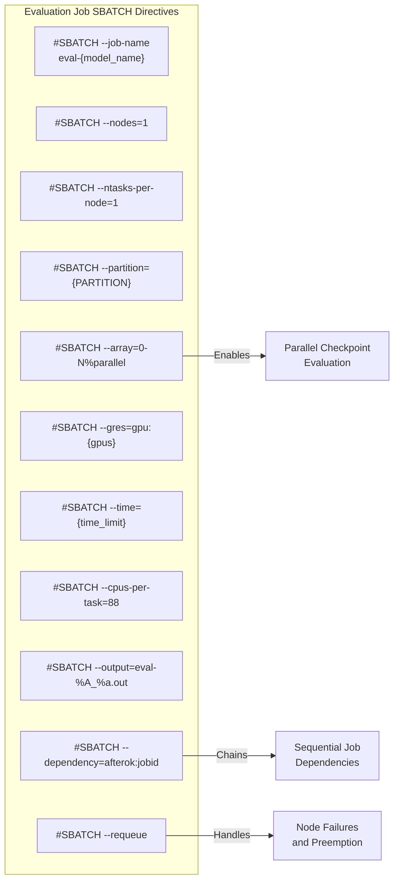

**Evaluation SBATCH Configuration**: Array jobs enable parallel evaluation of multiple checkpoints with throttling (`%parallel`), dependency chains ensure sequential execution, and requeue handles node failures automatically.

Sources: [ablations/evaluation/launch_evals.py:195-208]()

#### Training Job Configuration

Training jobs use multi-node configurations for distributed training:

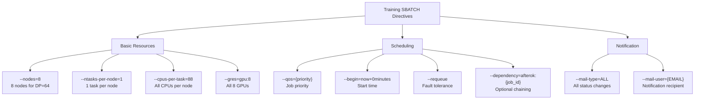

**Training SBATCH Configuration**: Multi-node training uses `--ntasks-per-node=1` (critical for distributed training), requests all resources per node, and includes email notifications for long-running jobs.

Sources: [ablations/training/launch_exp.py:286-300]()

### Array Jobs for Parallel Evaluation

Array jobs enable efficient parallel evaluation of multiple model checkpoints:

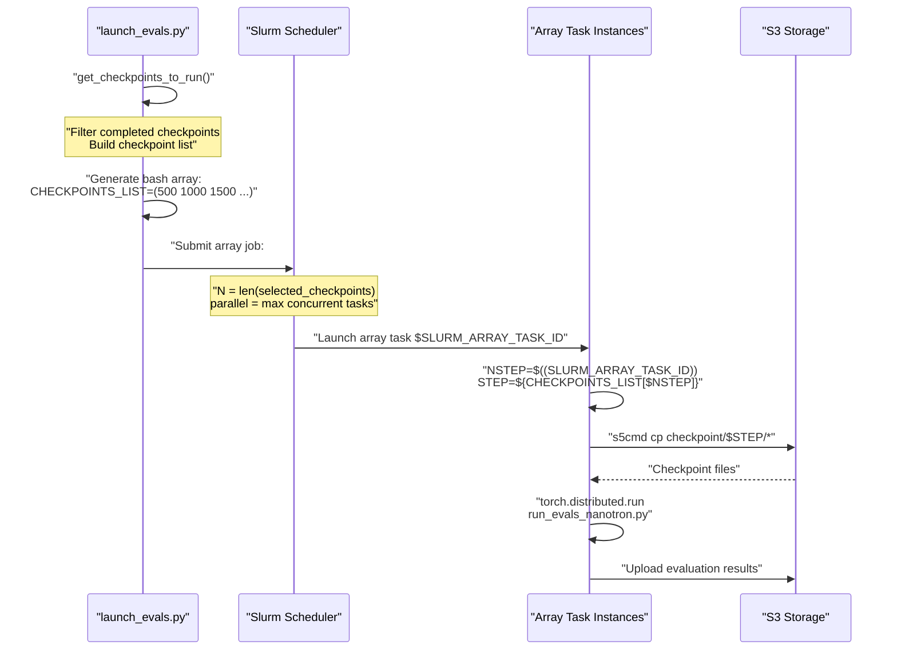

**Array Job Execution Flow**: Each array task indexes into the checkpoint list using `$SLURM_ARRAY_TASK_ID`, downloads its assigned checkpoint, evaluates it, and uploads results independently.

Sources: [ablations/evaluation/launch_evals.py:69-94](), [ablations/evaluation/launch_evals.py:244-246]()

### Distributed Training Launch

Multi-node training coordination uses Slurm environment variables to configure `torch.distributed.run`:

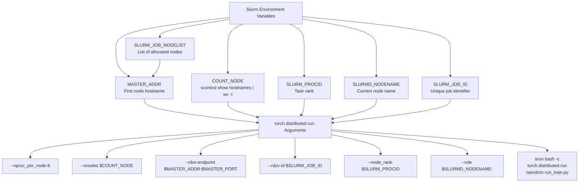

**Distributed Training Launch Configuration**: Slurm environment variables are extracted and mapped to `torch.distributed.run` arguments, enabling automatic multi-node coordination through the rendezvous backend.

Sources: [ablations/training/launch_exp.py:326-330](), [ablations/training/launch_exp.py:347-357](), [ablations/evaluation/launch_evals.py:232-236](), [ablations/evaluation/launch_evals.py:257-262]()

### Job Launch Helper Function

Both training and evaluation scripts use a common pattern for launching Slurm jobs:

```mermaid
graph LR
    CallerCode["Caller Code<br/>(launch_exp.py or launch_evals.py)"]
    
    CallerCode --> GenerateScript["Generate SBATCH script<br/>as multi-line string"]
    
    GenerateScript --> LaunchHelper["launch_slurm_job()<br/>(launch_file_contents, *args)"]
    
    LaunchHelper --> CreateTemp["Create temporary file<br/>tempfile.NamedTemporaryFile('w')"]
    
    CreateTemp --> WriteScript["Write script contents<br/>f.write(launch_file_contents)"]
    
    WriteScript --> SubmitJob["subprocess.check_output()<br/>['sbatch', *args, f.name]"]
    
    SubmitJob --> ParseID["Parse job ID<br/>output.split()[-1]"]
    
    ParseID --> ReturnID["Return job_id<br/>for dependency chaining"]
```

**Slurm Job Launch Pattern**: Scripts are generated as strings, written to temporary files, submitted via `sbatch`, and the returned job ID is parsed for dependency chaining.

Sources: [ablations/training/launch_exp.py:70-83](), [ablations/evaluation/launch_evals.py:49-66]()

---

## S3 Storage System

S3 provides persistent storage for all artifacts in FineWeb 2, including training data, model checkpoints, and evaluation results.

### Storage Hierarchy

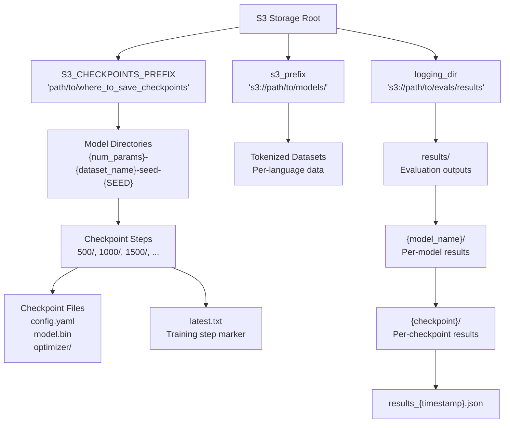

**S3 Storage Organization**: Three primary prefixes organize checkpoints, training data, and evaluation results. Checkpoint directories contain numbered step folders with model weights, config, and optimizer state. Results are organized by model and checkpoint.

Sources: [ablations/training/launch_exp.py:23](), [ablations/evaluation/launch_evals.py:108-109](), [ablations/evaluation/launch_evals.py:133-134]()

### s5cmd Integration

FineWeb 2 uses `s5cmd` for high-performance S3 transfers, significantly faster than standard AWS CLI tools.

#### Download Operations

Checkpoint downloads in evaluation jobs:

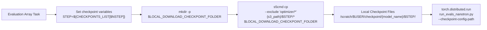

**Checkpoint Download Pattern**: Evaluation jobs download checkpoints from S3 to local scratch storage, excluding optimizer state (not needed for inference), before launching evaluation.

Sources: [ablations/evaluation/launch_evals.py:252-255]()

Dataset downloads in training jobs:

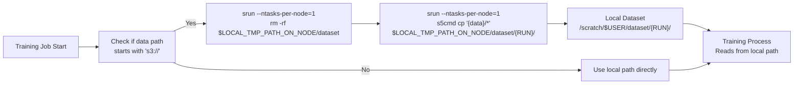

**Dataset Download Pattern**: If data is on S3, training jobs download it once to local scratch across all nodes using `srun --ntasks-per-node=1` to parallelize the download.

Sources: [ablations/training/launch_exp.py:158](), [ablations/training/launch_exp.py:283]()

#### Upload Operations

Training checkpoint uploads are configured through `S3UploadArgs`:

| Parameter | Value | Purpose |
|-----------|-------|---------|
| `upload_s3_path` | `{S3_CHECKPOINTS_PREFIX}/{RUN}` | Target S3 path |
| `remove_after_upload` | `True` | Delete local copy after upload |
| `s5cmd_numworkers` | `16` | Parallel upload workers |
| `s5cmd_concurrency` | `5` | Concurrent operations per worker |
| `s5cmd_path` | Path to s5cmd binary | s5cmd executable location |

The upload process is handled automatically by Nanotron's checkpoint saving mechanism, which:
1. Saves checkpoints to local scratch (`checkpoints_path`)
2. Uploads to S3 using s5cmd with 16 parallel workers
3. Removes local copies to free disk space
4. Updates `latest.txt` to mark completed step

Sources: [ablations/training/launch_exp.py:238-244](), [ablations/training/launch_exp.py:22]()

### Checkpoint Existence Checking

The evaluation system checks for existing results to avoid redundant evaluations:

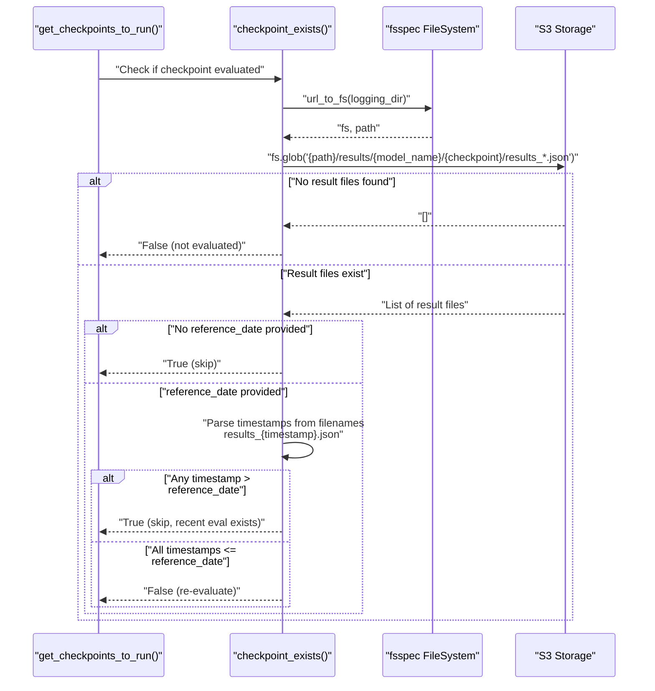

**Checkpoint Existence Logic**: The system queries S3 for result files, parses timestamps from filenames, and determines whether evaluation is needed based on optional date filtering.

Sources: [ablations/evaluation/launch_evals.py:31-46](), [ablations/evaluation/launch_evals.py:84-94]()

---

## HuggingFace Hub Integration

HuggingFace Hub provides tokenizers and datasets that are cached locally for offline execution.

### Environment Configuration

Both training and evaluation scripts configure HuggingFace cache paths:

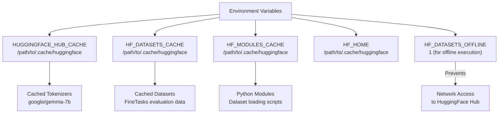

**HuggingFace Cache Configuration**: All cache paths point to a shared location accessible across nodes, with offline mode enabled to prevent runtime downloads that could fail or slow execution.

Sources: [ablations/evaluation/launch_evals.py:217-221]()

### Tokenizer Usage

The training configuration specifies tokenizer loading from HuggingFace:

| Configuration | Value | Purpose |
|---------------|-------|---------|
| `tokenizer_name_or_path` | `"google/gemma-7b"` | Base tokenizer for training |
| Vocab size | `256008` | Extended vocab (gemma + room) |

The tokenizer is loaded by Nanotron during training initialization and cached in `HUGGINGFACE_HUB_CACHE` for subsequent runs.

Sources: [ablations/training/launch_exp.py:234-236](), [ablations/training/launch_exp.py:54]()

### Dataset Hosting

The final FineWeb 2 dataset is hosted on HuggingFace Hub:

- **Repository**: `HuggingFaceFW/fineweb-2`
- **Location**: [https://huggingface.co/datasets/HuggingFaceFW/fineweb-2](https://huggingface.co/datasets/HuggingFaceFW/fineweb-2)
- **Purpose**: Public distribution of processed multilingual data

Sources: [README.md:4]()

---

## File System Organization

Local file systems provide fast scratch storage and organized log directories.

### Path Constants and Organization

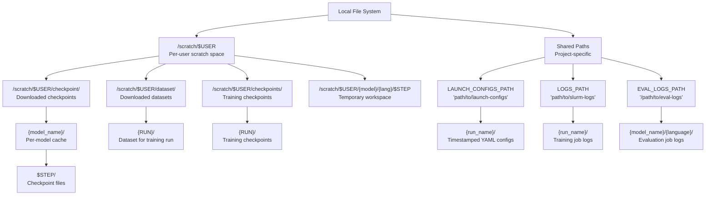

**File System Hierarchy**: User-specific scratch space (`/scratch/$USER`) provides fast staging for checkpoints and datasets with automatic cleanup. Shared paths organize configurations and logs by run name, model, and language.

Sources: [ablations/training/launch_exp.py:16-18](), [ablations/evaluation/launch_evals.py:15](), [ablations/evaluation/launch_evals.py:249](), [ablations/evaluation/launch_evals.py:252]()

### Temporary Storage Management

Evaluation jobs create isolated temporary directories:

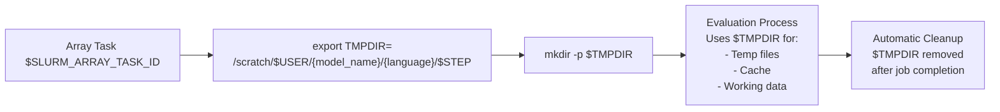

**Temporary Directory Management**: Each evaluation task gets an isolated temporary directory based on model, language, and checkpoint step, preventing conflicts between concurrent evaluations and enabling automatic cleanup.

Sources: [ablations/evaluation/launch_evals.py:249-250]()

### Log File Organization

Log files are organized by job type and include job identifiers:

**Training logs**: `{LOGS_PATH}/{run_name}/train-{timestamp}-{job_name}-{job_id}`

**Evaluation logs**: `{EVAL_LOGS_PATH}/{model_name}/{language}/eval-%A_%a.out`
- `%A`: Job array ID
- `%a`: Task array index

This organization enables:
- Easy log location by run name or model
- Tracking of specific job execution
- Parallel job log isolation
- Chronological ordering via timestamps

Sources: [ablations/training/launch_exp.py:281](), [ablations/training/launch_exp.py:293](), [ablations/training/launch_exp.py:377-379](), [ablations/evaluation/launch_evals.py:157](), [ablations/evaluation/launch_evals.py:205-206]()

---

## Module and Environment Setup

### CUDA Module Loading

Both training and evaluation scripts load CUDA modules:

```bash
module load cuda/12.1
```

This ensures the correct CUDA version is available for PyTorch operations.

Sources: [ablations/evaluation/launch_evals.py:240](), [ablations/training/launch_exp.py:335]()

### Environment Variables for Distributed Training

Critical environment variables for multi-GPU training:

| Variable | Value | Purpose |
|----------|-------|---------|
| `CUBLAS_WORKSPACE_CONFIG` | `:4096:8` | Deterministic CUDA operations |
| `CUDA_DEVICE_MAX_CONNECTIONS` | `1` | Limits concurrent CUDA streams |
| `TMPDIR` | `/scratch/$USER` | Temporary file location |

Sources: [ablations/evaluation/launch_evals.py:237-238](), [ablations/training/launch_exp.py:332-333]()

### Conda Environment Activation

Scripts activate specific conda environments:

```bash
source /path/to/.bashrc
source /path/to/miniconda3/etc/profile.d/conda.sh
conda activate /path/to/miniconda3/envs/exp/
```

This ensures consistent Python dependencies across all jobs.

Sources: [ablations/evaluation/launch_evals.py:211-213]()

---

