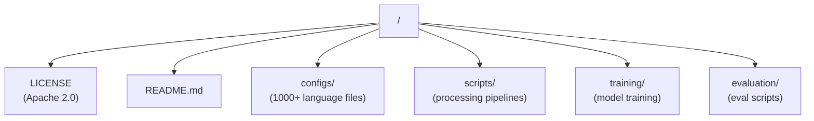
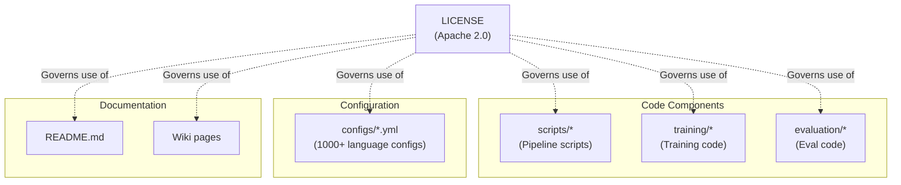
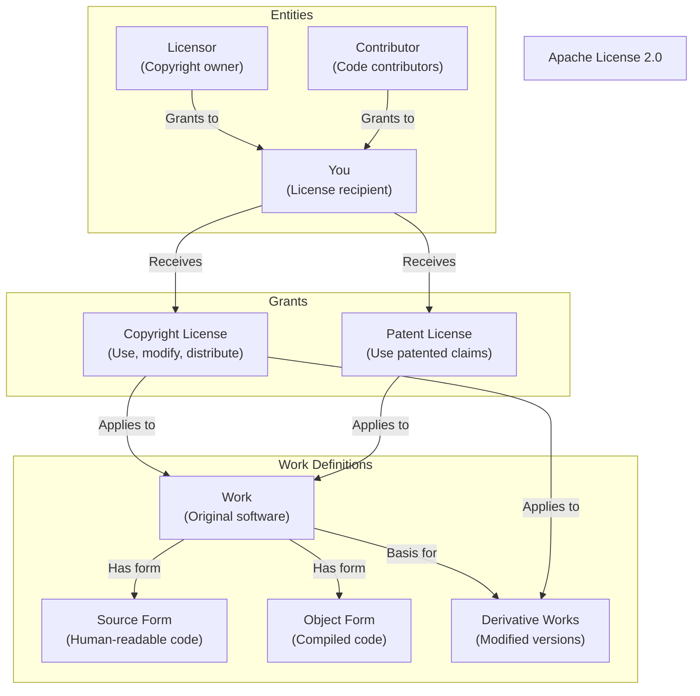
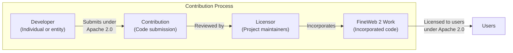
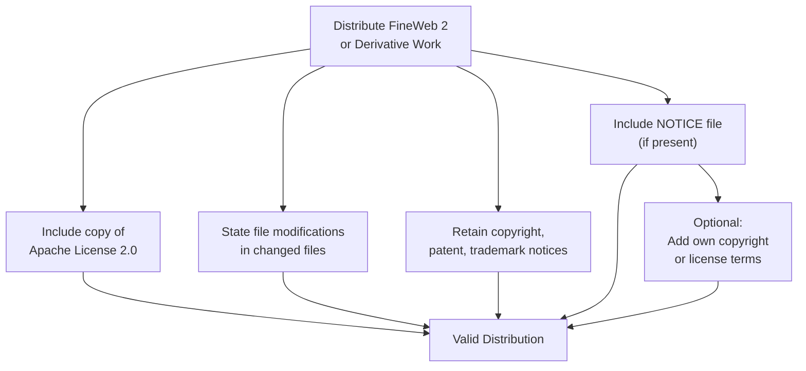
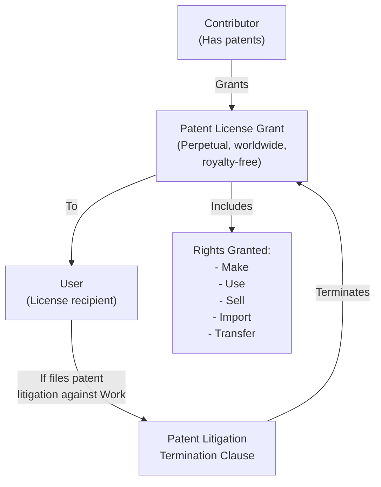

<!-- source: DeepWiki mcp.deepwiki.com · repo huggingface/fineweb-2 · page 8 Reference Information · fetched 2026-10-26 -->

# Reference Information

Relevant source files

The following files were used as context for generating this wiki page:

- [LICENSE](LICENSE)

This page provides access to project metadata, legal information, and branding resources for FineWeb 2. The reference section includes licensing terms that govern the use of FineWeb 2 code and documentation, as well as visual identity assets for project communications.

For technical documentation on data processing, configuration, or evaluation systems, see the main documentation sections ([Data Processing Pipeline](#2), [Configuration System](#3), [Ablation and Evaluation Framework](#4)).

## Overview

FineWeb 2 reference information is organized into the following categories:

### License ([8.1](#8.1))
The complete Apache License 2.0 text governing FineWeb 2's code, configuration files, and documentation. Located at [LICENSE:1-202]().

### Branding Assets ([8.2](#8.2))
Visual identity resources including the FineWeb 2 logo and usage guidelines for project communications.

## Repository Structure

The following diagram shows where reference materials are located within the FineWeb 2 repository:

Sources: [LICENSE:1-202]()

The `LICENSE` file at the repository root contains the full Apache License 2.0 text, which applies to all code, configuration files, and documentation in the repository.

## License Application Scope

The Apache License 2.0 applies to all components of the FineWeb 2 project:

Sources: [LICENSE:1-202]()

## License Summary

The FineWeb 2 project is released under the Apache License 2.0, which provides the following permissions:

| Permission | Description | License Reference |
|------------|-------------|-------------------|
| **Commercial Use** | May be used for commercial purposes | [LICENSE:66-71]() |
| **Modification** | May create derivative works | [LICENSE:66-71]() |
| **Distribution** | May distribute original or modified versions | [LICENSE:89-128]() |
| **Patent Grant** | Explicit patent license from contributors | [LICENSE:73-87]() |
| **Private Use** | May use privately without distribution | [LICENSE:66-71]() |

The license requires:

| Requirement | Description | License Reference |
|-------------|-------------|-------------------|
| **License Inclusion** | Must include copy of license with distributions | [LICENSE:94-95]() |
| **State Changes** | Must document modifications to files | [LICENSE:97-98]() |
| **Copyright Notice** | Must retain copyright notices | [LICENSE:100-104]() |
| **NOTICE File** | Must include NOTICE file contents if present | [LICENSE:106-121]() |

Sources: [LICENSE:1-202]()

## Apache License 2.0 Key Terms

The following diagram maps the key legal concepts defined in the Apache License 2.0:

Sources: [LICENSE:1-202]()

The license defines:
- **Licensor** ([LICENSE:12-13]()): The copyright owner granting the license
- **Contributor** ([LICENSE:62-64]()): Individuals whose contributions are incorporated
- **Work** ([LICENSE:35-38]()): The original FineWeb 2 software
- **Source Form** ([LICENSE:26-28]()): Human-readable code, including Python scripts and YAML configs
- **Object Form** ([LICENSE:30-33]()): Compiled or transformed versions
- **Derivative Works** ([LICENSE:40-46]()): Modified versions of FineWeb 2

## Copyright and Contribution

The Apache License 2.0 establishes clear terms for contributions and copyright:

Sources: [LICENSE:48-64]()

Contributions to FineWeb 2 are governed by [LICENSE:130-136]():
- Submissions are automatically under Apache License 2.0 terms
- No additional terms or conditions apply unless explicitly agreed
- Contributors grant the same copyright and patent licenses to all users

## Warranty and Liability

The Apache License 2.0 includes important disclaimers:

| Disclaimer Type | Terms | License Reference |
|----------------|-------|-------------------|
| **Warranty** | Provided "AS IS" without warranties of any kind | [LICENSE:143-151]() |
| **Liability** | Contributors not liable for damages unless required by law | [LICENSE:153-163]() |
| **Support** | No obligation to provide support, updates, or fixes | [LICENSE:143-151]() |

Users of FineWeb 2 are:
- Responsible for determining appropriateness of use ([LICENSE:149-151]())
- Assume all risks associated with usage ([LICENSE:149-151]())
- Cannot hold contributors liable except in cases of deliberate negligence ([LICENSE:153-163]())

Sources: [LICENSE:143-163]()

## Trademark Notice

The Apache License 2.0 explicitly addresses trademark usage at [LICENSE:138-141]():

> This License does not grant permission to use the trade names, trademarks, service marks, or product names of the Licensor, except as required for reasonable and customary use in describing the origin of the Work and reproducing the content of the NOTICE file.

This means:
- **Permitted**: Stating that software is "based on FineWeb 2" or "uses FineWeb 2"
- **Permitted**: Including required NOTICE file attributions
- **Not Permitted**: Implying endorsement without permission
- **Not Permitted**: Using project names as product branding without authorization

For proper usage of FineWeb 2 branding assets, see [Branding Assets](#8.2).

Sources: [LICENSE:138-141]()

## Redistribution Requirements

When distributing FineWeb 2 or derivative works, the following checklist applies:

Sources: [LICENSE:89-128]()

Detailed requirements:
1. **Include License** ([LICENSE:94-95]()): Provide copy of Apache License 2.0 to all recipients
2. **Document Changes** ([LICENSE:97-98]()): Mark modified files with change notices
3. **Preserve Notices** ([LICENSE:100-104]()): Keep all copyright, patent, trademark, and attribution notices from source
4. **NOTICE File** ([LICENSE:106-121]()): If FineWeb 2 includes a NOTICE file, include it in distributions

Sources: [LICENSE:89-128]()

## Patent License Terms

The Apache License 2.0 includes an explicit patent license grant:

Sources: [LICENSE:73-87]()

Key provisions:
- **Scope** ([LICENSE:73-80]()): Covers patent claims necessarily infringed by contributions
- **Defensive Termination** ([LICENSE:82-87]()): Patent licenses terminate if user files patent litigation alleging the Work infringes
- **Automatic** ([LICENSE:73-80]()): No separate patent agreement required

This ensures users can freely use, modify, and distribute FineWeb 2 without patent concerns, while protecting against patent litigation.

Sources: [LICENSE:73-87]()

## License Version

FineWeb 2 uses:
- **License**: Apache License, Version 2.0
- **Dated**: January 2004
- **URL**: http://www.apache.org/licenses/
- **Location**: [LICENSE:1-202]()

The full canonical text is available at [LICENSE:1-202](). The version at the repository root is authoritative for this project.

Sources: [LICENSE:1-3]()

## Related Documentation

For information about specific aspects of FineWeb 2:
- **Code usage and pipelines**: See [Data Processing Pipeline](#2), [Training System](#5), [Evaluation Framework](#4)
- **Configuration files**: See [Configuration System](#3)
- **External dependencies**: See [External Tools and Dependencies](#7)
- **Branding and logos**: See [Branding Assets](#8.2)
- **License terms**: See [License](#8.1)

Sources: [LICENSE:1-202]()

---

