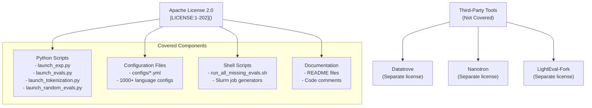
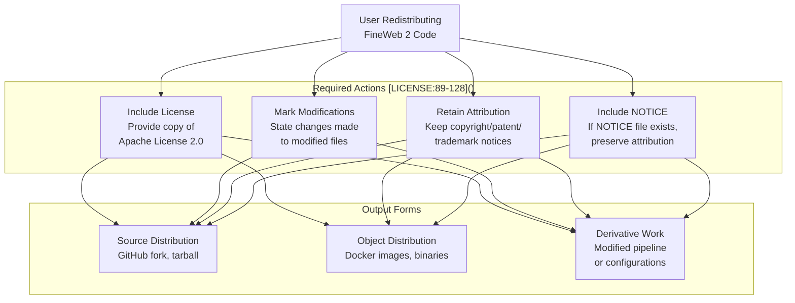
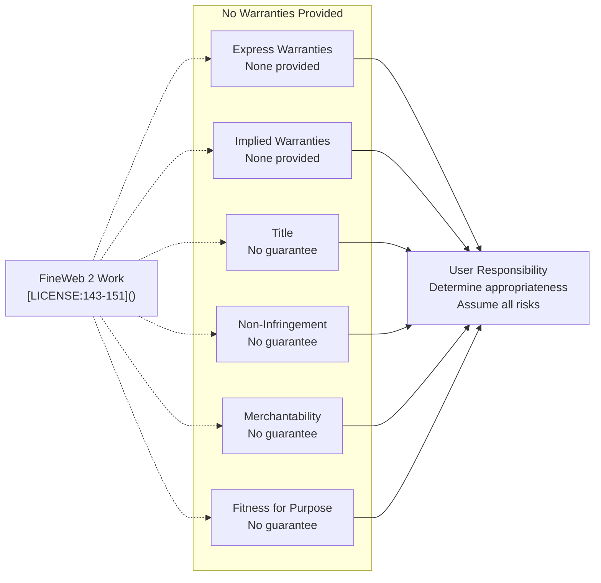

<!-- source: DeepWiki mcp.deepwiki.com · repo huggingface/fineweb-2 · page 8.1 License · fetched 2026-10-26 -->

# License

Relevant source files

The following files were used as context for generating this wiki page:

- [LICENSE](LICENSE)

This page documents the licensing terms governing the FineWeb 2 codebase, configurations, and associated scripts. For information about the FineWeb 2 dataset's licensing, refer to the dataset's HuggingFace page. For information about third-party dependencies and their licenses, see [External Tools and Dependencies](#7).

## Overview

The FineWeb 2 codebase is licensed under the **Apache License, Version 2.0** (January 2004). The complete license text is located at [LICENSE:1-202]().

| License Property | Value |
|-----------------|-------|
| **License Name** | Apache License, Version 2.0 |
| **SPDX Identifier** | Apache-2.0 |
| **Official URL** | http://www.apache.org/licenses/LICENSE-2.0 |
| **OSI Approved** | Yes |
| **Permissive** | Yes |

Sources: [LICENSE:1-3]()

## License Scope

The Apache License 2.0 applies to all components in the FineWeb 2 repository, including:

**Note**: External dependencies (Datatrove, Nanotron, LightEval-Fork, GlotLID, etc.) are governed by their own licenses. See [External Tools and Dependencies](#7) for details.

Sources: [LICENSE:1-202]()

## Permissions Granted

The Apache License 2.0 grants broad permissions to users and contributors. The license defines these permissions in Sections 2 and 3.

### Copyright License (Section 2)

Users receive a **perpetual, worldwide, non-exclusive, no-charge, royalty-free, irrevocable** copyright license to:

| Permission | Description | License Reference |
|-----------|-------------|-------------------|
| **Reproduce** | Make copies of the code and configurations | [LICENSE:66-71]() |
| **Prepare Derivative Works** | Modify code, configs, or create extensions | [LICENSE:66-71]() |
| **Publicly Display** | Share code publicly (e.g., GitHub forks) | [LICENSE:66-71]() |
| **Publicly Perform** | Execute the code and demonstrate functionality | [LICENSE:66-71]() |
| **Sublicense** | Grant licenses to downstream users | [LICENSE:66-71]() |
| **Distribute** | Share original or modified versions | [LICENSE:66-71]() |

These permissions apply to both Source form (code) and Object form (compiled binaries, generated outputs).

Sources: [LICENSE:66-71](), [LICENSE:26-33]()

### Patent License (Section 3)

The license includes a patent grant covering patent claims necessarily infringed by contributions. This protection terminates if the user initiates patent litigation against the Work.

Sources: [LICENSE:73-87]()

## Redistribution Obligations

When redistributing the Work or Derivative Works, users must comply with the following requirements:

### Specific Requirements

**1. License Distribution** [LICENSE:94-95]()
- Every recipient must receive a copy of the Apache License 2.0
- Include the [LICENSE:1-202]() file in all distributions

**2. Modification Notices** [LICENSE:97-98]()
- Modified files must carry prominent notices stating changes were made
- Example: Add comments indicating modifications to `launch_exp.py` or language configs in `configs/*.yml`

**3. Attribution Retention** [LICENSE:100-104]()
- Preserve all copyright, patent, trademark, and attribution notices from the Source form
- Do not remove existing headers or attributions when modifying code

**4. NOTICE File** [LICENSE:106-121]()
- If a NOTICE file exists, include its contents in redistributions
- NOTICE contents are informational and do not modify the license terms

Sources: [LICENSE:89-128]()

## Contributions

### Contribution License Terms

Unless explicitly stated otherwise, all contributions submitted for inclusion in FineWeb 2 are governed by the Apache License 2.0 without additional terms or conditions.

| Contribution Type | Examples | License Terms |
|------------------|----------|---------------|
| **Code Contributions** | New filters, pipeline stages | Apache 2.0 |
| **Configuration Contributions** | New language configs in `configs/` | Apache 2.0 |
| **Documentation** | README updates, wiki pages | Apache 2.0 |
| **Bug Fixes** | Patches to existing scripts | Apache 2.0 |

Sources: [LICENSE:130-136]()

### Contributor Definition

A "Contributor" includes:
- The Licensor (copyright owner)
- Any individual or Legal Entity on behalf of whom a contribution has been received and incorporated

A "Contribution" is any work of authorship intentionally submitted to the Licensor for inclusion, including the original version and modifications.

Sources: [LICENSE:48-64]()

## Disclaimer of Warranty

The Apache License 2.0 provides the Work on an **"AS IS" BASIS** without warranties of any kind.

Users are **solely responsible** for:
- Determining the appropriateness of using or redistributing the Work
- Assuming any risks associated with exercising permissions under the License

Sources: [LICENSE:143-151]()

## Limitation of Liability

Contributors are not liable for damages arising from the use or inability to use the Work, including:

| Damage Type | Covered |
|------------|---------|
| Direct damages | Not liable |
| Indirect damages | Not liable |
| Special damages | Not liable |
| Incidental damages | Not liable |
| Consequential damages | Not liable |
| Loss of goodwill | Not liable |
| Work stoppage | Not liable |
| Computer failure or malfunction | Not liable |
| Commercial damages or losses | Not liable |

This limitation applies under any legal theory (tort, contract, or otherwise), unless required by applicable law.

Sources: [LICENSE:153-163]()

## Trademarks

The Apache License 2.0 **does not grant permission** to use:
- Trade names
- Trademarks
- Service marks
- Product names of the Licensor

Exception: Reasonable and customary use is permitted for describing the origin of the Work and reproducing NOTICE file content.

Sources: [LICENSE:138-141]()

## Practical Application to FineWeb 2

### Using FineWeb 2 Code

Users who want to use FineWeb 2 scripts for their own data processing can:

1. **Clone and use directly**: Run `launch_exp.py`, `launch_tokenization.py`, etc. without modification
2. **Modify for custom needs**: Adapt language configs in `configs/`, modify filtering logic, adjust training parameters
3. **Integrate into larger systems**: Use FineWeb 2 components as part of a larger data processing pipeline

All uses are permitted under Apache 2.0 without requiring permission or payment.

### Creating Derivative Works

Example derivative works include:

| Derivative Work | Apache 2.0 Compliance |
|----------------|----------------------|
| **Fork with new languages** | Add new configs to `configs/`, include [LICENSE]() file |
| **Modified quality filters** | Update filtering logic, mark changes in modified files |
| **Custom evaluation suite** | Extend `launch_evals.py`, retain original attribution |
| **Commercial data processing service** | Use code commercially, include license and attributions |

### Configuration Files

The 1000+ language configuration files in `configs/` are part of the Work and covered by Apache 2.0. Users may:
- Use configurations as-is for supported languages
- Modify thresholds and parameters for specific use cases
- Create new configuration files for additional languages
- Share modified configurations under Apache 2.0 terms

Sources: [LICENSE:1-202]()

## License Text

The complete Apache License 2.0 text is available at [LICENSE:1-202](). For the official license text, see http://www.apache.org/licenses/LICENSE-2.0.

### Key Sections Reference

| Section | Title | Lines |
|---------|-------|-------|
| Section 1 | Definitions | [LICENSE:7-64]() |
| Section 2 | Grant of Copyright License | [LICENSE:66-71]() |
| Section 3 | Grant of Patent License | [LICENSE:73-87]() |
| Section 4 | Redistribution | [LICENSE:89-128]() |
| Section 5 | Submission of Contributions | [LICENSE:130-136]() |
| Section 6 | Trademarks | [LICENSE:138-141]() |
| Section 7 | Disclaimer of Warranty | [LICENSE:143-151]() |
| Section 8 | Limitation of Liability | [LICENSE:153-163]() |
| Section 9 | Accepting Warranty or Additional Liability | [LICENSE:165-174]() |

Sources: [LICENSE:1-202]()

---

