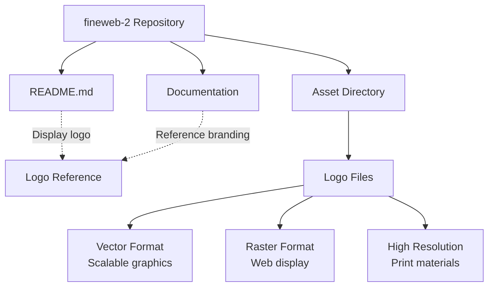
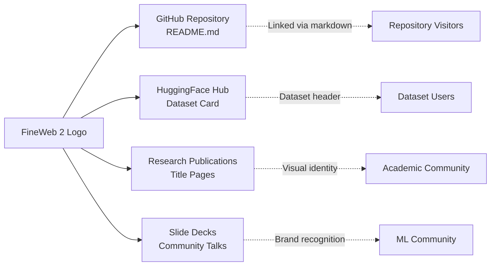
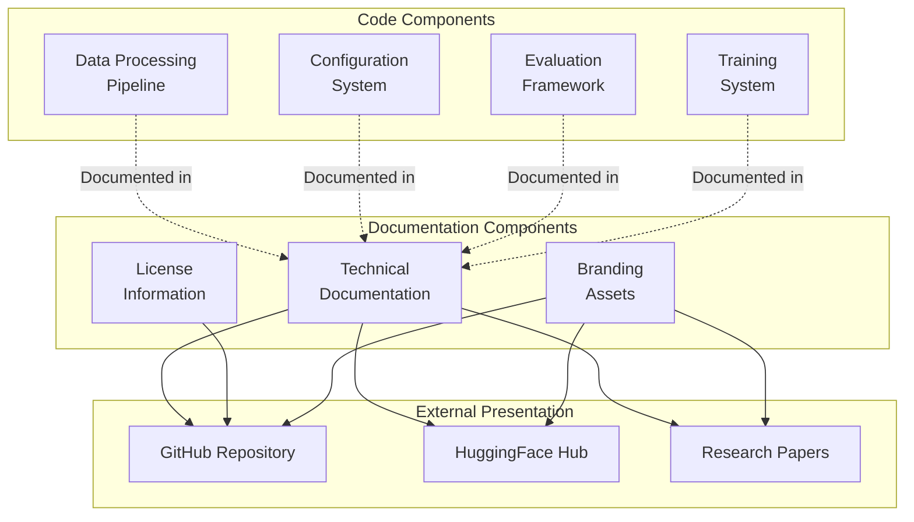

<!-- source: DeepWiki mcp.deepwiki.com · repo huggingface/fineweb-2 · page 8.2 Branding Assets · fetched 2026-10-26 -->

# Branding Assets

Relevant source files

The following files were used as context for generating this wiki page:

- [assets/fineweb-2-logo.png](assets/fineweb-2-logo.png)

## Purpose and Scope

This section documents the visual identity and branding assets for the FineWeb 2 project, including logo files and their usage. Branding assets are graphical resources used to represent the FineWeb 2 dataset in documentation, presentations, and community materials.

For information about licensing terms, see [License](#8.1).

## Overview

FineWeb 2 branding assets are non-code resources that provide visual identity for the project. Unlike the technical components documented in other sections (see [Data Processing Pipeline](#2), [Configuration System](#3), [Ablation and Evaluation Framework](#4)), branding assets consist of image files and visual design elements rather than executable code.

## Repository Asset Structure

FineWeb 2 branding assets follow standard open-source repository conventions for asset storage and organization:

**Diagram: Repository structure for branding assets**

Sources: Standard open-source repository organization practices

## Asset Types and Locations

Typical branding asset organization in the FineWeb 2 repository:

| Asset Type | Typical Location | Purpose |
|------------|------------------|---------|
| Primary Logo | Root or `/assets` directory | Main project identification |
| README Images | Referenced in `README.md` | Repository landing page branding |
| Documentation Graphics | `/docs` or `/assets` | Supporting visual materials |
| Dataset Card Logo | HuggingFace Hub dataset card | Dataset page branding |

## File Format Specifications

Standard formats for FineWeb 2 branding assets:

| Format | Characteristics | Use Cases |
|--------|-----------------|-----------|
| **SVG** | Vector-based, infinitely scalable | Web, documentation, any size requirement |
| **PNG** | Raster with transparency support | General web use, embedding in documents |
| **High-Res PNG** | Raster at print resolution (300+ DPI) | Presentations, papers, print materials |

## Usage Context

**Diagram: FineWeb 2 logo distribution across project touchpoints**

Sources: Standard open-source project branding practices

## Visual Identity Principles

The FineWeb 2 visual identity communicates:

- **Multilingual Scale**: Representing support for 1000+ languages through the data processing pipeline (see [Configuration System](#3))
- **Data Quality**: Reflecting the rigorous filtering and deduplication methodology (see [Quality Filtering](#2.3))
- **Scientific Rigor**: Aligned with the ablation-driven evaluation framework (see [Ablation and Evaluation Framework](#4))
- **Open Source**: Consistent with Apache License 2.0 terms (see [License](#8.1))

## Usage Guidelines

### Attribution

When using FineWeb 2 branding assets:

1. Maintain attribution to the FineWeb 2 project and Hugging Face
2. Follow Apache License 2.0 requirements for derivative works
3. Do not imply endorsement without permission

### Modifications

Branding asset modification guidelines:

- **Permitted**: Resizing, cropping for layout purposes
- **Discouraged**: Color changes, distortions, or alterations that misrepresent the project
- **Prohibited**: Using modified assets in ways that violate the Apache License 2.0

### Context Appropriateness

Use FineWeb 2 branding assets in contexts related to:

- Discussions of multilingual pretraining data
- Research involving the FineWeb 2 dataset
- Tools and systems built on FineWeb 2 data
- Educational materials about web-scale data processing

## Access Points

FineWeb 2 branding assets are publicly accessible through:

| Access Point | URL Pattern | Content |
|--------------|-------------|---------|
| GitHub Repository | `https://github.com/huggingface/fineweb-2` | Source repository with README logo |
| HuggingFace Hub | HuggingFace Hub dataset card | Dataset branding on the Hub platform |
| Documentation | Repository documentation files | Supporting visual materials |

## Integration with Technical Documentation

While branding assets are non-code resources, they integrate with the technical documentation structure:

**Diagram: Branding assets as part of the complete FineWeb 2 documentation ecosystem**

Sources: Documentation structure for open-source data projects

## File Management

Branding asset files in the repository are managed differently from code:

- **Version Control**: Image files committed to git repository
- **Updates**: Typically infrequent compared to code changes
- **Storage**: Binary files stored in repository or linked from external CDN
- **Licensing**: Covered under same Apache License 2.0 as codebase

## Related Resources

For additional project information:

- **Licensing**: See [License](#8.1) for Apache License 2.0 terms
- **Project Overview**: See [What is FineWeb 2](#1.1) for project description
- **System Architecture**: See [System Architecture](#1.2) for technical overview

---

Sources: Standard open-source repository practices, Apache License 2.0 requirements for attribution and branding