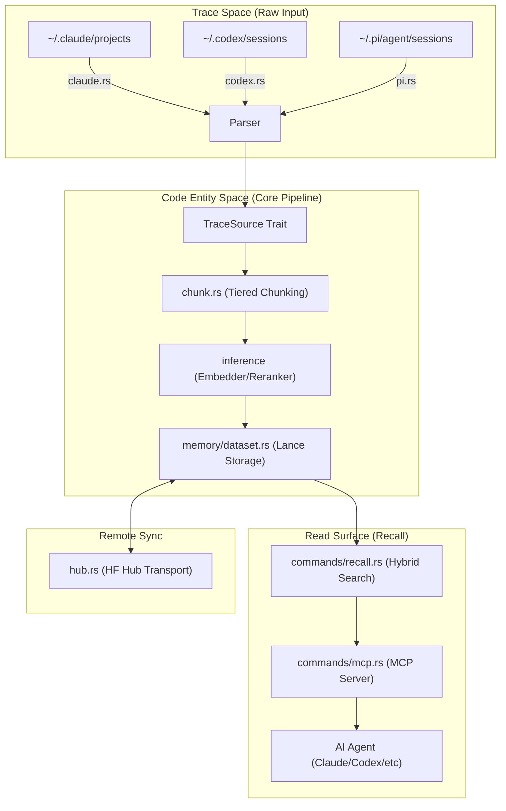
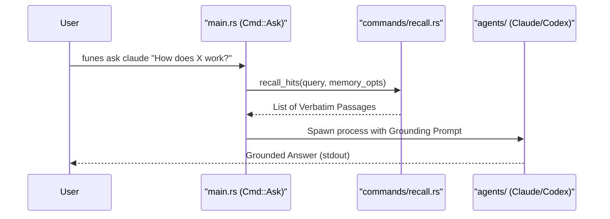

<!-- source: DeepWiki mcp.deepwiki.com · repo huggingface/funes · page 1 Overview · fetched 2026-10-26 -->

# Overview

Relevant source files

The following files were used as context for generating this wiki page:

- [CONTRIBUTING.md](CONTRIBUTING.md)
- [README.md](README.md)
- [SECURITY.md](SECURITY.md)
- [docs/RATIONALE.md](docs/RATIONALE.md)
- [docs/README.md](docs/README.md)
- [docs/ask.md](docs/ask.md)
- [docs/demo/cross-agents.tape](docs/demo/cross-agents.tape)
- [docs/hub-caching.md](docs/hub-caching.md)
- [docs/landscape.md](docs/landscape.md)
- [docs/sessions.md](docs/sessions.md)
- [src/hub.rs](src/hub.rs)
- [src/lib.rs](src/lib.rs)
- [src/main.rs](src/main.rs)

`funes` provides durable, long-term memory for AI coding agents. It indexes past sessions across multiple harnesses—including **Claude Code**, **Codex**, **pi**, and **Hermes**—allowing agents to recall prior decisions, rationale, and findings mid-task [README.md:1-6]().

The system is designed as a local-first, append-only event log. By treating memory as a versioned dataset that can be published to the **Hugging Face Hub**, `funes` enables seamless memory sharing across machines and teams [README.md:17-19]().

## Core Design Philosophy

The architecture of `funes` is guided by four deliberate constraints intended to keep the system faithful, stable, and secure [docs/RATIONALE.md:16-20]().

*   **Append-Only Event Log**: `funes` never overwrites or mutates data. Every chunk is an immutable, timestamped record of "what was said when." Conflicting or updated information is resolved at **read-time** via recency weighting [docs/RATIONALE.md:21-25]().
*   **Deterministic Ingest**: There is no LLM in the indexing pipeline. The system performs `parse → chunk → embed`. This ensures that recalled passages are verbatim and maintain exact provenance (linking back to specific `session_id` and `turn_uuid`) [docs/RATIONALE.md:36-40]().
*   **Local-First & Model-Agnostic**: Embedding and reranking happen on the local machine using pinned models (e.g., `BAAI/bge-small-en-v1.5`). This keeps sensitive data under your control and ensures the memory outlives any specific generative model [docs/RATIONALE.md:57-61]().
*   **Pull-Based Retrieval**: `funes` never proactively injects memory into an agent's context. Recall is a tool that the model (or user) must explicitly call. This keeps the context window clean and ensures memory is only used when relevant [docs/RATIONALE.md:83-87]().

For a deeper dive into these decisions, see [Design Rationale and Landscape](#1.2).

## System Map

The codebase is organized into distinct layers, each responsible for a specific stage of the memory lifecycle [src/lib.rs:8-21]().

### Data Flow: From Transcript to Recall
The following diagram illustrates how raw session data from various agent harnesses is processed into a searchable Lance dataset and subsequently retrieved.

**Diagram: Memory Lifecycle (Ingest to Retrieval)**

Sources: [src/lib.rs:10-21](), [src/main.rs:84-103](), [src/hub.rs:1-3]()

### Code Subsystems
| Layer | Responsibility | Key Files |
| :--- | :--- | :--- |
| **Traces** | Parsing harness-specific transcripts into a unified `Turn`/`Block` model. | `src/traces/` [src/lib.rs:10]() |
| **Inference** | Local embedding and reranking via BLAS or ONNX backends. | `src/inference/` [src/lib.rs:14]() |
| **Memory** | Mechanics of the Lance dataset and local/remote object storage. | `src/memory/` [src/lib.rs:17]() |
| **Hub** | Transport layer for Hugging Face Hub authentication and dataset management. | `src/hub.rs` [src/lib.rs:15]() |
| **Agents** | Integration logic for registering `funes` as an MCP tool or via automation hooks. | `src/agents/` [src/lib.rs:21]() |

## Key Capabilities

### Multi-Agent Integration
`funes` acts as a bridge between different AI tools. You can start a task in **Claude Code**, switch to **Codex**, and the latter can recall the history of the former because they both index into the same local memory [README.md:62-69]().
For setup instructions, see [Getting Started](#1.1).

### Remote Synchronization
By running `funes push <user/org>/<repo>`, your local memory is synchronized to a Hugging Face dataset repository [README.md:88-91](). 
*   **Security**: `funes` redacts credentials at index time and uses an egress gate (via `trufflehog`) to prevent secrets from being pushed [SECURITY.md:28-36]().
*   **Caching**: Remote recall uses a read-through cache, fetching only the immutable Lance files required for a specific query [docs/RATIONALE.md:63-66]().

### Grounded Question Answering
The `funes ask <agent> <question>` command allows you to "borrow" an agent for a single grounded answer without a full installation. `funes` performs the retrieval locally and hands the context to the agent in a single turn [docs/ask.md:1-5]().

**Diagram: `funes ask` Command Execution**

Sources: [src/main.rs:79-82](), [docs/ask.md:18-22](), [src/lib.rs:19-21]()

## Getting Started
To install `funes` and integrate it with your preferred agent, refer to the [Getting Started](#1.1) guide. This covers the installation script, environment variables like `HF_TOKEN`, and the `funes add` onboarding flow [README.md:24-38]().

---

