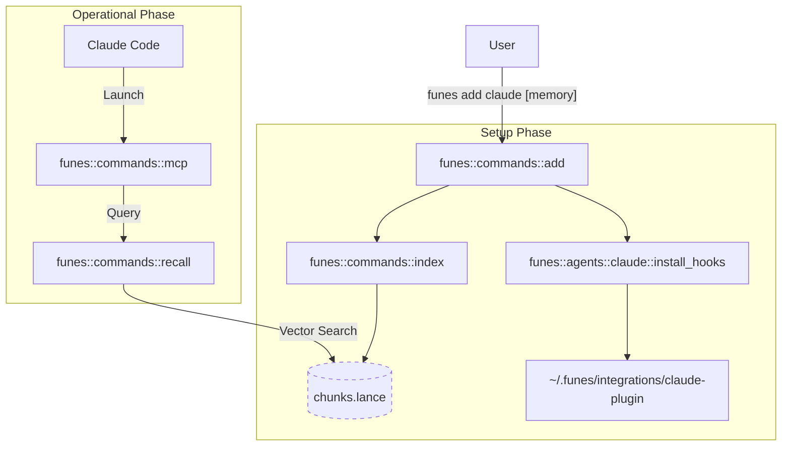
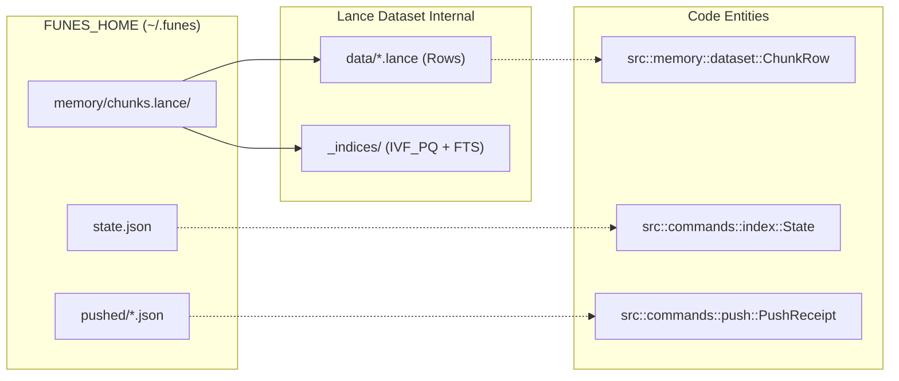

<!-- source: DeepWiki mcp.deepwiki.com · repo huggingface/funes · page 1.1 Getting Started · fetched 2026-10-26 -->

# Getting Started

Relevant source files

The following files were used as context for generating this wiki page:

- [.github/dependabot.yml](.github/dependabot.yml)
- [.gitignore](.gitignore)
- [docs/add.md](docs/add.md)
- [docs/configuration.md](docs/configuration.md)
- [docs/storage.md](docs/storage.md)
- [scripts/bootstrap-protoc.sh](scripts/bootstrap-protoc.sh)
- [scripts/install.sh](scripts/install.sh)
- [scripts/test-install.sh](scripts/test-install.sh)

This page covers the installation, environment configuration, and initial onboarding flow for `funes`. It details how to set up the local environment and wire the memory system into supported AI agents.

## Installation

`funes` provides a streamlined installation script for Linux and macOS. The installer detects the host platform, fetches the matching prebuilt binary from the Hugging Face bucket, and verifies it against a cryptographic manifest.

### install.sh
The `install.sh` script is the primary entry point for users. It supports flags for custom installation directories (`-b`) and specific version tags (`-v`) [scripts/install.sh:8-9]().

**Platform Support:**
The script currently targets three architectures:
- `Linux-x86_64` [scripts/install.sh:34]()
- `Linux-aarch64` / `Linux-arm64` [scripts/install.sh:35]()
- `Darwin-arm64` / `Darwin-aarch64` [scripts/install.sh:36]()

**Verification Logic:**
1. **Manifest Fetch:** Downloads `VERSION` and `SHA256SUMS` from the release bucket [scripts/install.sh:134-135]().
2. **Checksum Validation:** Uses `sha256sum` or `shasum` to ensure the downloaded binary matches the manifest [scripts/install.sh:154-157]().
3. **Self-Reported Version:** Executes the binary with `--version` to confirm it matches the requested tag before moving it to the final destination [scripts/install.sh:160-163]().

### Build-time Dependencies
If building from source, `funes` requires `protoc` (Protocol Buffer compiler) because the underlying `lance` storage engine uses it during the build process [scripts/bootstrap-protoc.sh:3](). The `scripts/bootstrap-protoc.sh` script automates downloading a pinned version (28.3) into a local `.tools/` directory to avoid system-wide conflicts [scripts/bootstrap-protoc.sh:11-12]().

### Test-Install Script
The `scripts/test-install.sh` script serves as a CI validator for the installer itself. It mocks the Hugging Face bucket environment using a temporary directory and a shimmed `curl` command to verify that the installer correctly handles valid binaries and rejects those with checksum mismatches [scripts/test-install.sh:14-29, 54-58]().

**Sources:** `scripts/install.sh`, `scripts/bootstrap-protoc.sh`, `scripts/test-install.sh`

---

## Environment Variables

`funes` behavior is controlled through several environment variables. There is no global configuration file; state is determined by these variables or baked into agent-specific configurations during the `funes add` process [docs/configuration.md:3-5]().

| Variable | Role | Default |
| :--- | :--- | :--- |
| `FUNES_HOME` | Primary state directory (Lance DB, state.json, receipts). | `~/.funes` |
| `HF_TOKEN` | Hugging Face Hub authentication for private memories and pushing. | (None) |
| `FUNES_TRUFFLEHOG` | Path to the `trufflehog` binary for secret scanning. | Found on `PATH` |
| `HF_HUB_CACHE` | Location for cached remote memory files and model weights. | `~/.cache/huggingface/hub` |

### Path Resolution Logic
For authentication, `funes` checks for tokens in the following precedence [docs/configuration.md:49-55]():
1. `HF_TOKEN`
2. `HUGGING_FACE_HUB_TOKEN`
3. `HUGGINGFACE_TOKEN`
4. `~/.cache/huggingface/token` (created by `hf auth login`)

**Sources:** `docs/configuration.md`

---

## The Onboarding Flow (`funes add`)

The `funes add <agent> [memory]` command is the core onboarding mechanism. It performs a "one-click" integration that includes building the initial index and installing automation hooks [docs/add.md:3-6]().

### Implementation Sequence
When a user runs `funes add`, the system executes the following steps:

1. **Memory Binding:** The command associates the agent with a specific memory (a local path, an `<org>/<repo>` shorthand, or a full `hf://` URI) [docs/add.md:85]().
2. **Initial Indexing:** A fast, text-first pass is performed over existing agent transcripts to populate the local Lance dataset [docs/add.md:106-107]().
3. **Hook Installation:** Automation scripts (e.g., `funes-index.sh`) are written to the agent's specific configuration directory (e.g., `~/.codex/hooks/` or `~/.hermes/hooks/`) [docs/configuration.md:37-42]().
4. **MCP Registration:** The agent is configured to launch `funes mcp` as a stdio-based Model Context Protocol server [docs/add.md:38-46]().
5. **Wrong-Memory Guard:** A "first push" is performed to clear the safety gate that prevents automated background scripts from pushing to an uninitialized or incorrect remote repository [docs/add.md:111, 114]().

### Data Flow: Onboarding to Recall

The following diagram illustrates how the `funes add` command sets up the system for future retrieval.

**System Initialization Flow**

**Sources:** `docs/add.md`, `docs/configuration.md`, `docs/storage.md`

---

## Directory Layout (`FUNES_HOME`)

The `$FUNES_HOME` directory (default `~/.funes`) contains the local intelligence of the system.

| Path | Code Entity / Purpose |
| :--- | :--- |
| `memory/chunks.lance/` | The Lance dataset containing `data/` (rows) and `_indices/` (BM25/IVF_PQ) [docs/storage.md:31-36](). |
| `state.json` | `IncrementalState`: Tracks the last-processed timestamp/offset for each `TraceSource` [docs/configuration.md:22](). |
| `index-coverage.json` | `CoverageSnapshot`: A summary of indexed sessions for the `status` command [docs/configuration.md:23](). |
| `pushed/` | `PushReceipt`: JSON files tracking which local versions have been successfully synced to which remotes [docs/configuration.md:24](). |

### Storage Model
A `funes` memory is composed of rows containing text, provenance metadata, and a 384-dimension `Float32` embedding vector [docs/storage.md:59]().
- **Data Cost:** ~2.13 KB per chunk (approx. 75% is the embedding) [docs/storage.md:65]().
- **Index Cost:** ~0.18 KB per chunk (BM25 + IVF_PQ) [docs/storage.md:85]().
- **Total:** Planning budget of ~2.30 KB per chunk [docs/storage.md:90]().

**Local State Organization**

**Sources:** `docs/storage.md`, `docs/configuration.md`

---

